## 사람의 비교 한 번에서 출발한 여섯 갈래의 정렬 계보

LLM 정렬 방법들은 참조 정책(reference policy) 근처에 머물면서 사람이 선호하는 응답을 늘린다는 하나의 KL 정규화 목표를 공유합니다. 이 목표를 어떻게 근사하느냐에 따라 방법들이 여섯 갈래로 나뉘었습니다. 좋은 응답은 맥락에 따라 달라서 교차 엔트로피 같은 손실로 곧바로 적기 어렵습니다. 그래서 이 분야는 두 응답 중 어느 쪽이 나은지 고른 비교를 학습 신호로 씁니다.

가상의 예를 하나 들겠습니다. Reddit 글 하나를 프롬프트 $$x$$로 주고 TL;DR 요약을 요청하자 모델이 두 요약을 냈고, 평가자가 나은 쪽을 $$y_w$$, 못한 쪽을 $$y_l$$로 골랐다고 해 봅니다. 이 비교 한 쌍 $$(x, y_w, y_l)$$이 뒤에 나오는 모든 계보의 공통 입력입니다.

출발점은 표준 RLHF 레시피입니다. DPO 논문은 RLHF를 지도 미세조정(supervised fine-tuning, SFT), 선호 샘플링과 보상 학습, RL 최적화의 세 단계로 정리합니다. 여기서 KL 항은 정책이 보상 모델(reward model)이 믿을 만한 분포를 벗어나거나 모드 붕괴에 빠지는 일을 막습니다. DPO 논문은 이 파이프라인 전체를 대체 대상으로 삼습니다 ([Rafailov et al., 2023](https://arxiv.org/abs/2305.18290)). 갈래들을 한 지도에 놓을 때는 DeepSeekMath의 통합 관점이 쓸모 있습니다. 이 논문은 SFT, 거절 샘플링 미세조정(rejection sampling fine-tuning, RFT), DPO, PPO를 데이터 소스, 보상 함수, 알고리즘(그래디언트 계수)의 세 구성 요소로 나눠 비교합니다. 이 틀에서 GRPO는 보상 모델에 기반해 그룹 샘플을 온라인으로 뽑는 방법에 해당합니다 ([Shao et al., 2024](https://arxiv.org/abs/2402.03300)).

여섯 갈래는 같은 비교 쌍을 무엇으로 바꾸느냐로 갈립니다.

- **보상 모델과 PPO:** 비교 쌍으로 보상 모델을 학습하고, KL 페널티(KL penalty)를 붙인 RL로 정책을 최적화합니다.
- **AI 피드백(AI feedback):** 비교를 고르는 사람을 원칙 목록과 LLM 판정으로 바꿉니다.
- **닫힌 형태 직접 최적화:** 보상 모델 없이 정책의 로그비로 손실을 씁니다.
- **참조 모델 제거:** 참조 모델이나 별도 SFT 단계를 덜어냅니다.
- **온라인·게임 이론:** 고정된 쌍 대신 현재 정책에서 새로 뽑은 응답 사이의 선호 게임을 풉니다.
- **크리틱 없는 RL:** 같은 질문에 대한 여러 샘플끼리 상대 점수를 매깁니다.

| 연도 | 논문 | 계보 | 핵심 아이디어 |
| --- | --- | --- | --- |
| 2017 | Deep RL from Human Preferences ([Christiano et al., 2017](https://arxiv.org/abs/1706.03741)) | RLHF와 PPO | 궤적 구간 쌍 비교로 학습한 브래들리-테리 보상 예측기 |
| 2019 | Ziegler et al. 2019 ([Ziegler et al., 2019](https://arxiv.org/abs/1909.08593)) | RLHF와 PPO | KL 페널티 보상으로 PPO 미세조정한 사전학습 언어 모델 |
| 2020 | Learning to Summarize ([Stiennon et al., 2020](https://arxiv.org/abs/2009.01325)) | RLHF와 PPO | SFT·보상 모델·PPO 세 단계 요약 RLHF 레시피 |
| 2022 | InstructGPT ([Ouyang et al., 2022](https://arxiv.org/abs/2203.02155)) | RLHF와 PPO | 지시 따르기를 위한 표준 3단계 RLHF 파이프라인 |
| 2022 | Anthropic HH-RLHF ([Bai et al., 2022](https://arxiv.org/abs/2204.05862)) | RLHF와 PPO | 반복 온라인 RLHF로 학습한 유용·무해 어시스턴트 |
| 2022 | RM Overoptimization ([Gao et al., 2022](https://arxiv.org/abs/2210.10760)) | RLHF와 PPO | 합성 gold 보상으로 측정한 보상 모델 과최적화 스케일링 법칙 |
| 2022 | Constitutional AI ([Bai et al., 2022](https://arxiv.org/abs/2212.08073)) | AI 피드백 | 헌법 원칙 기반 자기 비평과 AI 선호 라벨 |
| 2023 | RRHF ([Yuan et al., 2023](https://arxiv.org/abs/2304.05302)) | 참조 모델 없는 목적 | 길이 정규화 로그확률 랭킹 손실과 SFT의 결합 |
| 2023 | DPO ([Rafailov et al., 2023](https://arxiv.org/abs/2305.18290)) | DPO와 일반화 | 정책 로그비를 암묵적 보상으로 쓰는 닫힌 형태 선호 손실 |
| 2023 | Llama 2-Chat ([Touvron et al., 2023](https://arxiv.org/abs/2307.09288)) | RLHF와 PPO | 안전·유용성 이중 보상 모델과 거절 샘플링+PPO 반복 |
| 2023 | RLAIF ([Lee et al., 2023](https://arxiv.org/abs/2309.00267)) | AI 피드백 | 기성 LLM 선호 라벨로 대체한 RLHF |
| 2023 | ΨPO/IPO ([Azar et al., 2023](https://arxiv.org/abs/2310.12036)) | DPO와 일반화 | 선호 확률의 비선형 함수 Ψ를 최대화하는 일반 목적과 IPO |
| 2023 | NLHF ([Munos et al., 2023](https://arxiv.org/abs/2312.00886)) | 온라인·게임 이론 | 정규화 선호 모델의 내시 균형을 찾는 미러 디센트 |
| 2024 | KTO ([Ethayarajh et al., 2024](https://arxiv.org/abs/2402.01306)) | DPO와 일반화 | 쌍 없는 좋음·나쁨 신호에 대한 전망 이론 가치 함수 손실 |
| 2024 | DeepSeekMath/GRPO ([Shao et al., 2024](https://arxiv.org/abs/2402.03300)) | 크리틱 없는 RL | 가치 모델 대신 그룹 상대 어드밴티지를 쓰는 GRPO |
| 2024 | ORPO ([Hong et al., 2024](https://arxiv.org/abs/2403.07691)) | 참조 모델 없는 목적 | SFT 손실에 더한 오즈비 페널티로 단일 단계 정렬 |
| 2024 | Online IPO ([Calandriello et al., 2024](https://arxiv.org/abs/2403.08635)) | 온라인·게임 이론 | 현재 정책 샘플로 최적화하는 온라인 IPO와 자기 대결 동치 |
| 2024 | SPPO ([Wu et al., 2024](https://arxiv.org/abs/2405.00675)) | 온라인·게임 이론 | 승률에 로그비를 맞추는 자기 대결 곱셈 가중치 갱신 |
| 2024 | RLHF Workflow ([Dong et al., 2024](https://arxiv.org/abs/2405.07863)) | 온라인·게임 이론 | 보상 모델링부터 반복 DPO까지의 온라인 RLHF 레시피 |
| 2024 | SimPO ([Meng et al., 2024](https://arxiv.org/abs/2405.14734)) | 참조 모델 없는 목적 | 길이 정규화 평균 로그우도 보상과 목표 마진 |
| 2024 | DAA Overoptimization ([Rafailov et al., 2024](https://arxiv.org/abs/2406.02900)) | DPO와 일반화 | 직접 정렬 알고리즘에서의 과최적화 스케일링 법칙 |
| 2025 | GRPO Effective Loss ([Mroueh, 2025](https://arxiv.org/abs/2503.06639)) | 크리틱 없는 RL | 검증 가능한 보상 아래 GRPO의 가중 대조 손실과 성공률 고정점 |

## 비교 학습 보상 모델과 KL로 묶인 PPO, 그리고 그 보상의 과최적화

사람의 쌍 비교를 브래들리-테리 모델(Bradley-Terry model)로 보상에 옮기고, 그 보상을 KL 페널티가 붙은 PPO로 최적화하는 방식은 Atari와 로봇 제어에서 시작해 SFT→RM→PPO 세 단계 레시피로 굳어졌습니다. 그런데 이 프록시 보상을 너무 세게 밀어붙이면 진짜 목표가 오히려 떨어집니다. 이 현상은 나중에 KL 거리에 대한 함수형과 스케일링 법칙으로 정량화되었습니다.

### 궤적 구간 비교를 보상으로 바꾸는 브래들리-테리 손실

Deep RL from Human Preferences는 보상 함수가 없는 과제에서 출발합니다. 이 방법은 정책과 보상 추정치를 함께 유지하면서 세 과정을 비동기로 돌립니다. 정책은 예측 보상을 최대화하도록 RL로 갱신됩니다. 정책이 만든 궤적에서 뽑은 구간 쌍을 사람이 비교합니다. 보상 예측기는 그 비교에 지도학습으로 맞춥니다. 궤적은 첫 과정에서 둘째 과정으로, 사람의 비교는 둘째에서 셋째로, 보상 파라미터는 셋째에서 다시 첫째로 흐릅니다 ([Christiano et al., 2017](https://arxiv.org/abs/1706.03741)).

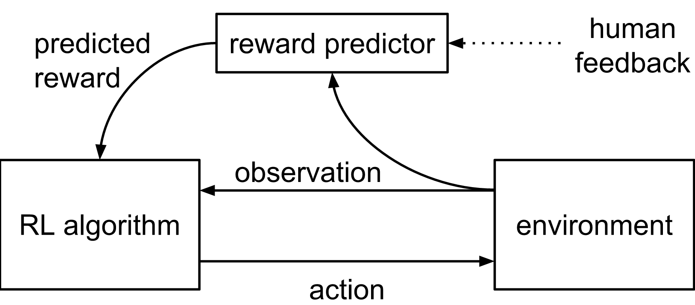

*출처: [Christiano et al., 2017](https://arxiv.org/abs/1706.03741)*

구조도의 핵심은 사람이 보상 값을 직접 매기지 않는 데 있습니다. 사람은 두 구간 중 어느 쪽이 나은지만 고르고, 보상 예측기가 그 비교로부터 학습됩니다 ([Christiano et al., 2017](https://arxiv.org/abs/1706.03741)). 비교를 보상으로 바꾸는 모델은 다음과 같습니다.

$$\hat{P}\left[\sigma^{1}\succ\sigma^{2}\right]=\frac{\exp{\sum\hat{r}\left(o^{1}_{t},a^{1}_{t}\right)}}{\exp{\sum\hat{r}\left(o^{1}_{t},a^{1}_{t}\right)}+\exp{\sum\hat{r}\left(o^{2}_{t},a^{2}_{t}\right)}}$$

$$\sigma^{1}, \sigma^{2}$$는 두 궤적 구간이고, $$o^{i}_{t}, a^{i}_{t}$$는 구간 $$i$$의 시점 $$t$$ 관측과 행동이며, $$\hat{r}$$은 학습할 보상 예측기입니다. 사람이 $$\sigma^{1}$$을 고를 확률은 구간 안에서 합산한 잠재 보상의 지수에 비례합니다. 저자들은 이를 체스의 Elo 레이팅에 빗댑니다. 두 선수의 Elo 점수 차가 한쪽이 이길 확률을 추정하듯, 두 구간의 예측 보상 차가 사람이 한쪽을 고를 확률을 추정합니다. 학습은 이 예측과 사람 라벨 사이의 교차 엔트로피를 최소화하는 방식으로 이뤄집니다 ([Christiano et al., 2017](https://arxiv.org/abs/1706.03741)).

$$\mathrm{loss}\left(\hat{r}\right)=-\sum_{\left(\sigma^{1},\sigma^{2},\mu\right)\in\mathcal{D}}\mu\left(1\right)\log\hat{P}\left[\sigma^{1}\succ\sigma^{2}\right]+\mu\left(2\right)\log\hat{P}\left[\sigma^{2}\succ\sigma^{1}\right]$$

$$\mathcal{D}$$는 비교 데이터 집합이고, $$\mu$$는 두 구간에 대한 사람 라벨입니다 ([Christiano et al., 2017](https://arxiv.org/abs/1706.03741)). 사람이 고른 구간의 예측 보상이 다른 구간보다 클수록 손실이 작아지므로, 기울기는 두 점수를 그 방향으로 벌립니다. 이 손실에서는 보상의 절대값이 아니라 차이만 의미가 있습니다.

비교 대신 점수를 직접 회귀하는 방식도 가능합니다. 하지만 연속 제어 과제에서는 비교 예측이 점수 예측보다 훨씬 잘 작동했고, 긴 클립을 비교할 때 클립당 정보량도 훨씬 컸습니다. 보상 예측기는 하나가 아니라 앙상블로 학습합니다. 각 예측기를 $$\mathcal{D}$$에서 복원추출한 $$\left\vert\mathcal{D}\right\vert$$개 삼중쌍으로 따로 학습하고, 결과를 정규화해 평균합니다. 앙상블은 어떤 비교를 사람에게 물을지 정하는 데도 쓰입니다. 구간 쌍을 많이 뽑은 뒤 앙상블 구성원들의 예측 분산이 가장 큰 쌍을 질의합니다. 저자들은 이 질의 선택을 조잡한 근사라고 부르며, 절제 실험에서는 일부 과제의 성능을 오히려 해쳤다고 밝힙니다 ([Christiano et al., 2017](https://arxiv.org/abs/1706.03741)).

### 정책과 함께 움직여야 하는 보상 예측기

이 설계에서 가장 중요한 교훈은 보상 학습을 RL 바깥에서 한 번에 끝낼 수 없다는 사실입니다. 보상 예측기를 처음에만 오프라인으로 학습하고 온라인 질의를 끊는 절제 실험이 이를 보여 줍니다. 정책이 바뀌면 방문하는 상태의 분포가 바뀌기 때문에, 고정된 예측기는 보상의 일부만 포착합니다. 그 결과 Pong에서 공을 끝없이 주고받기만 하는 이상 행동이 나왔습니다. 저자들은 사람 피드백이 정적으로 주어지기보다 RL 학습과 얽혀서 제공되어야 한다고 결론짓습니다 ([Christiano et al., 2017](https://arxiv.org/abs/1706.03741)). 정책이 평가자의 허점을 파고드는 보상 해킹(reward hacking)의 이른 사례이기도 합니다.

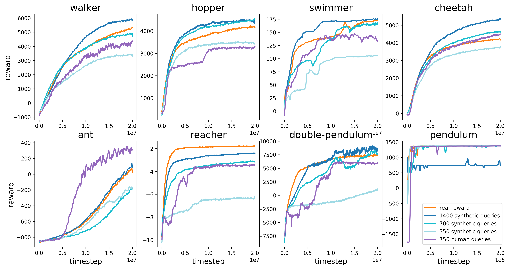

*출처: [Christiano et al., 2017](https://arxiv.org/abs/1706.03741)*

MuJoCo 결과는 같은 방법을 실제 사람 피드백과 오라클이 주는 합성 피드백으로 각각 돌리고, 진짜 보상으로 RL을 돌린 경우와 함께 과제의 진짜 보상으로 측정합니다. 곡선을 읽을 때는 보상 함수를 한 번도 보지 않은 방법이 진짜 보상 RL에 얼마나 다가가는지를 보면 됩니다. 사람 피드백이 합성 피드백을 넘어선 과제도 있습니다. Ant에서는 사람 피드백이 합성 피드백을 크게 앞섰는데, 저자들은 사람에게 로봇이 "똑바로 서 있는" 궤적을 선호하도록 요청한 것이 유용한 보상 쉐이핑으로 작용한 것으로 봅니다 ([Christiano et al., 2017](https://arxiv.org/abs/1706.03741)).

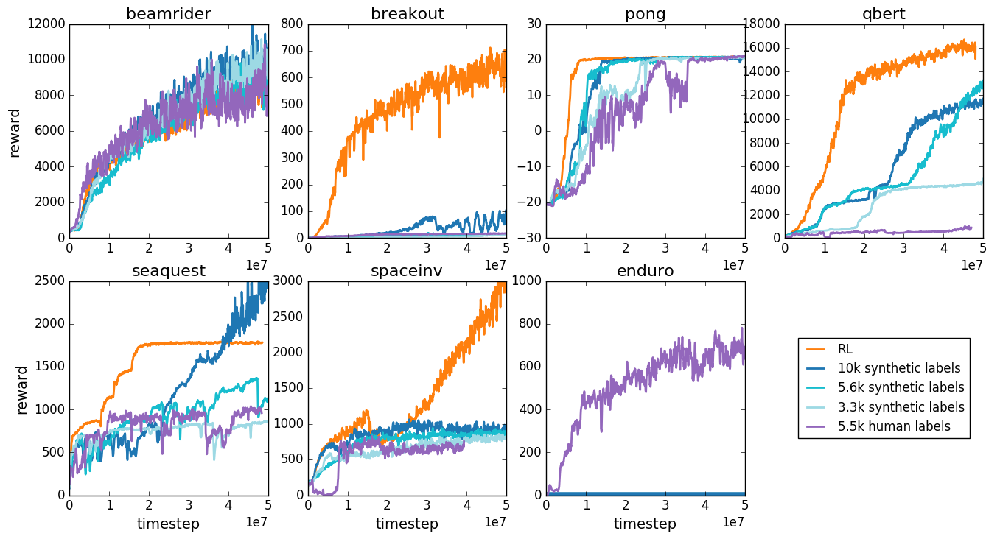

*출처: [Christiano et al., 2017](https://arxiv.org/abs/1706.03741)*

Atari 결과도 같은 세 조건을 진짜 보상 기준으로 나란히 놓습니다. 진짜 보상이 정의되지 않은 행동도 학습되었습니다. Half-Cheetah가 한 다리로 서서 전진하는 행동은 저자들의 피드백 질의 800개로, 한 시간이 채 안 걸려 학습되었습니다 ([Christiano et al., 2017](https://arxiv.org/abs/1706.03741)).

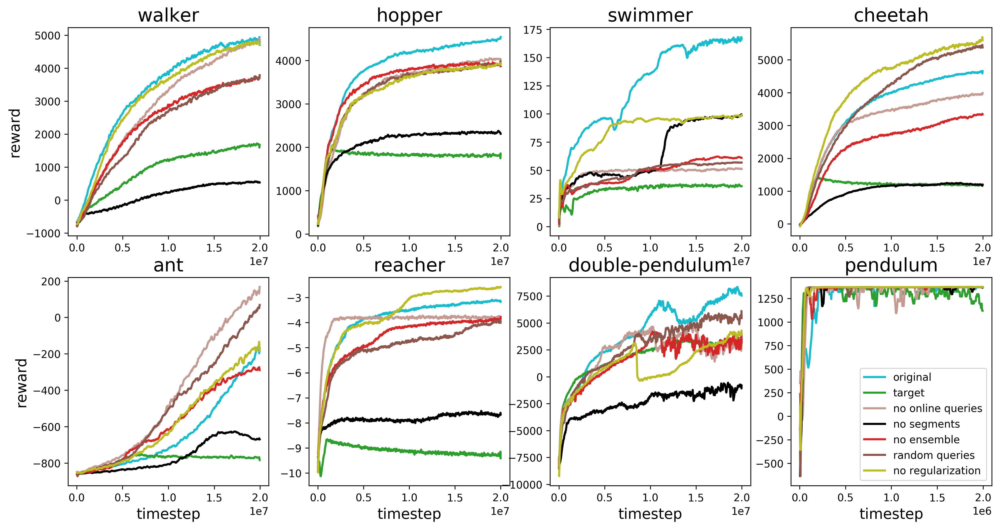

*출처: [Christiano et al., 2017](https://arxiv.org/abs/1706.03741)*

절제 그래프는 구성 요소를 하나씩 제거했을 때 MuJoCo 과제에서의 성능을 보여 줍니다. 앞서 말한 오프라인 보상 학습의 실패와 앙상블 기반 질의 선택의 한계가 이 실험에서 드러납니다 ([Christiano et al., 2017](https://arxiv.org/abs/1706.03741)).

### KL 페널티로 초기 정책에 묶인 언어 모델 보상 학습

Ziegler 등은 이 보상 학습을 사전학습된 언어 모델로 옮겼습니다. 과제는 긍정 감성 연속 생성, 묘사적 연속 생성, 그리고 TL;DR과 CNN/DM 요약입니다. 절차는 다음과 같습니다. 정책에서 샘플을 뽑아 사람이 그중 최선을 고르게 합니다. 초기 언어 모델 $$\rho$$로 초기화한 보상 모델을 이 선택에 맞춥니다. 그 보상으로 정책 $$\pi$$를 PPO로 학습합니다. 온라인 설정에서는 보상 모델을 주기적으로 다시 학습합니다 ([Ziegler et al., 2019](https://arxiv.org/abs/1909.08593)).

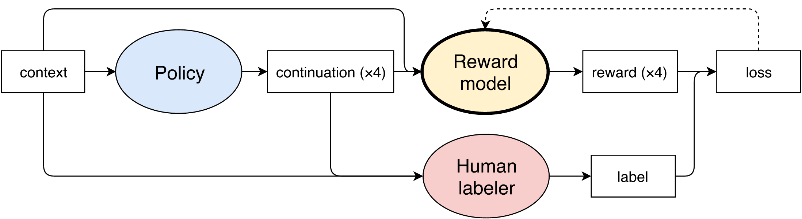

*출처: [Ziegler et al., 2019](https://arxiv.org/abs/1909.08593)*

도식에서는 보상 모델 학습과 정책 학습이 별개의 과정으로 그려져 있고, 온라인 설정에서는 두 과정이 번갈아 진행됩니다. 보상 모델 손실은 쌍이 아니라 여러 후보 가운데 사람이 고른 하나에 대한 소프트맥스 로그우도입니다 ([Ziegler et al., 2019](https://arxiv.org/abs/1909.08593)).

$$\textrm{loss}(r)=\mathbb{E}_{\left(x,\left\{y_{i}\right\}_{i},b\right)\sim S}\left[\log{\frac{e^{r(x,y_{b})}}{\sum_{i}e^{r(x,y_{i})}}}\right]$$

$$\left\{y_{i}\right\}_{i}$$는 한 프롬프트 $$x$$에 대한 후보 응답들이고, $$b$$는 사람이 고른 후보의 번호이며, $$S$$는 수집된 선택 데이터입니다. 이 식은 손실이라는 이름과 달리 부호가 붙어 있지 않으므로, 실제로는 이 로그우도를 최대화합니다. 후보가 두 개뿐이면 앞의 브래들리-테리 형태로 돌아갑니다.

언어 모델에서 새로 생긴 장치가 KL 페널티입니다. PPO는 보상 모델 점수를 그대로 쓰지 않고, 다음의 수정 보상을 최적화합니다 ([Ziegler et al., 2019](https://arxiv.org/abs/1909.08593)).

$$R(x,y)=r(x,y)-\beta\log\frac{\pi(y\mid x)}{\rho(y|x)}.$$

$$\pi$$는 학습 중인 정책, $$\rho$$는 초기 정책, $$\beta$$는 페널티의 세기입니다. 정책이 초기 정책보다 어떤 응답에 확률을 더 몰아줄수록 그 응답의 보상이 깎입니다. 예를 들어 가상으로 $$\beta=0.1$$일 때 정책이 한 요약에 초기 정책보다 로그 확률 2만큼 더 높은 값을 준다면, 보상 모델 점수에서 0.2가 빠집니다. 저자들은 이 항의 역할을 셋으로 설명합니다. 엔트로피 보너스처럼 작동하고, 정책이 보상 모델이 유효한 범위를 벗어나지 못하게 막으며, 스타일 연속 생성 과제에서는 문장의 일관성과 주제를 지키는 과제 정의의 일부가 됩니다. $$\beta$$는 고정값이 아닙니다. 특정 $$\operatorname{KL}(\pi,\rho)$$ 목표값을 맞추도록 로그 공간 비례 제어기로 동적으로 조정합니다 ([Ziegler et al., 2019](https://arxiv.org/abs/1909.08593)).

이 KL 제약 아래 최적 정책은 닫힌 형태로 적을 수 있습니다 ([Ziegler et al., 2019](https://arxiv.org/abs/1909.08593)).

$$\pi_{\textrm{opt}}(y\mid x) \displaystyle\propto\rho(y|x)e^{r_{s}(x,y)/\beta}$$

$$r_{s}$$는 모의 실험에서 쓴 감성 보상입니다. 최적 정책은 초기 정책에 보상의 지수를 곱한 분포이고, $$\beta$$가 작을수록 보상이 높은 응답 쪽으로 더 날카롭게 쏠립니다. 이 형태는 뒤에 나오는 닫힌 형태 직접 최적화 계보가 출발하는 지점과 같습니다 ([Ziegler et al., 2019](https://arxiv.org/abs/1909.08593)).

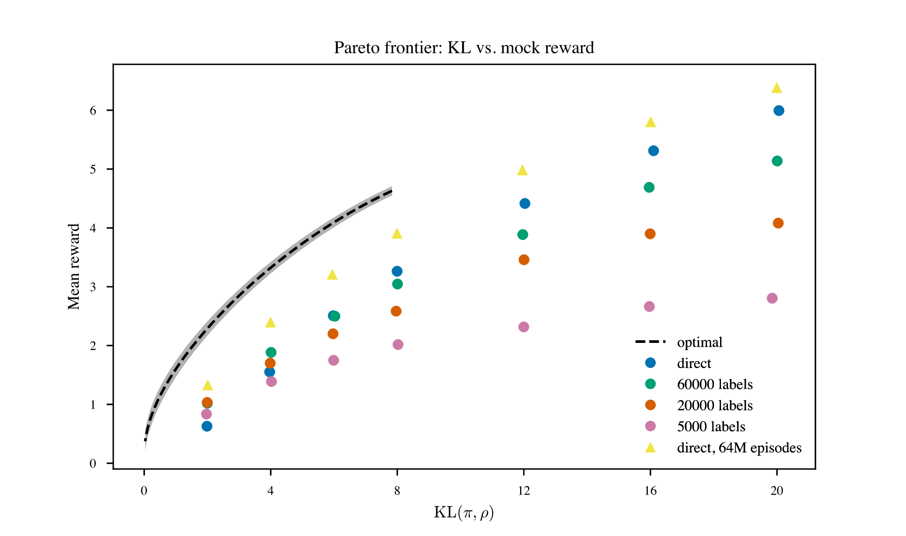

*출처: [Ziegler et al., 2019](https://arxiv.org/abs/1909.08593)*

모의 감성 실험은 KL 페널티가 무엇을 교환하는지 보여 줍니다. 정책이 $$\operatorname{KL}(\pi,\rho)$$ 기준으로 초기 정책에서 더 멀어질수록 보상은 높아지지만 표본은 덜 자연스러워집니다. 같은 모의 설정에서는 질의 20k~60k개만으로, 감성 보상을 RL로 직접 최적화한 것에 거의 맞먹는 수준까지 $$r_{s}$$를 최적화했습니다. 실제 사람 평가에서도 효과가 컸습니다. 사람 평가에서 오프라인 비교 5k개로 미세조정한 모델이 제로샷 모델보다 감성 과제에서 88%, 묘사 과제에서 86% 선호되었습니다. 요약에서는 지도학습 뒤 60k 비교로 미세조정한 모델(supervised + 60k fine-tune)이 논문의 자체 모델 가운데 TL;DR ROUGE가 가장 높았습니다(R-1 18.434, R-AVG 12.478). 다만 표에 함께 실린 SOTA 값(TL;DR R-1 22)에는 미치지 못했습니다 ([Ziegler et al., 2019](https://arxiv.org/abs/1909.08593)).

한계도 이 논문에서 먼저 드러났습니다. 요약처럼 모호한 과제에서는 성실한 라벨러, 저자 자신도 일관되게 비교하기 어려웠고 문제 있는 라벨러를 빨리 걸러내기도 힘들었습니다. 완전 온라인 수집은 소프트웨어와 ML 양쪽의 복잡도, 품질 관리 문제가 커서, 저자들은 오프라인과 온라인 사이의 중간 지점으로 배치 단위 수집을 제안합니다. 보상과 KL 항의 부호가 함께 뒤집힌 버그 사례도 기록되어 있습니다. 모델은 KL 항 때문에 자연스러운 문장을 유지한 채 부정적 감성을 최적화했고, 결국 일관된 문장으로 최악의, 성적으로 노골적인 출력을 냈습니다 ([Ziegler et al., 2019](https://arxiv.org/abs/1909.08593)). KL 페널티가 언어의 자연스러움을 지켜 줄 뿐, 보상의 방향이 옳은지는 보장하지 않는다는 사례입니다.

### SFT→RM→PPO로 굳어진 세 단계 레시피

Learning to Summarize는 이 절차를 세 단계 레시피로 정리했습니다. SFT로 만든 초기 정책에서 시작해 정책 샘플 쌍을 사람에게 비교하게 하고, 보상 모델을 학습한 뒤, 보상 모델의 로짓 출력을 보상으로 삼아 PPO로 정책을 최적화합니다 ([Stiennon et al., 2020](https://arxiv.org/abs/2009.01325)).

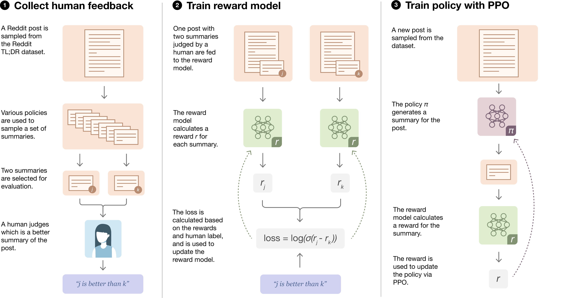

*출처: [Stiennon et al., 2020](https://arxiv.org/abs/2009.01325)*

도식은 피드백 수집에서 보상 모델 학습, 정책 학습으로 이어지는 흐름을 한 장에 담고 있습니다. 보상 모델 손실은 앞서 세운 비교 쌍과 정확히 같은 모양입니다 ([Stiennon et al., 2020](https://arxiv.org/abs/2009.01325)).

$$\text{loss}(r_{\theta})=-E_{(x,y_{0},y_{1},i)\sim D}[\log(\sigma(r_{\theta}(x,y_{i})-r_{\theta}(x,y_{1-i})))]$$

$$y_{0}, y_{1}$$은 같은 Reddit 글 $$x$$에 대한 두 요약이고, $$i$$는 사람이 고른 쪽의 번호, $$\sigma$$는 시그모이드, $$r_{\theta}$$는 보상 모델입니다. PPO 보상도 Ziegler 등의 KL 수정 보상과 같은 형태이며, 초기 정책 자리에 SFT 정책 $$\pi^{\text{SFT}}$$가 들어갑니다. KL 항의 역할도 Ziegler 등과 같습니다. PPO의 가치 함수(value function)는 정책과 분리된 Transformer이며 보상 모델로 초기화합니다 ([Stiennon et al., 2020](https://arxiv.org/abs/2009.01325)).

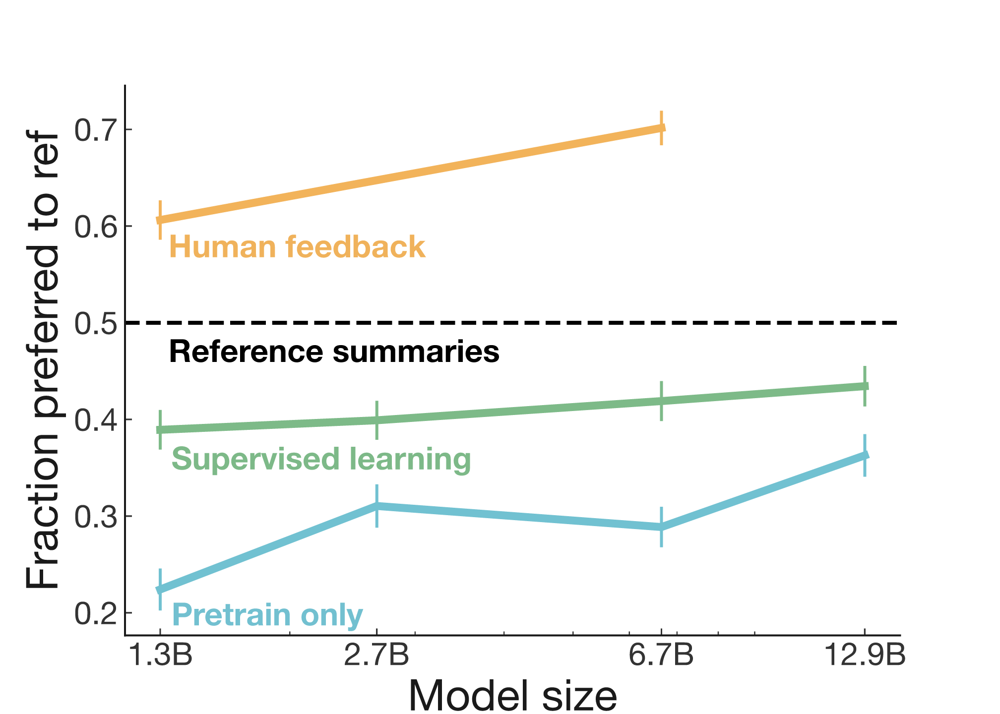

*출처: [Stiennon et al., 2020](https://arxiv.org/abs/2009.01325)*

주요 결과는 모델 크기별로 사람이 모델 요약을 사람이 쓴 참조 요약보다 선호한 비율입니다. 오차 막대는 1 표준오차입니다. 이 그래프에서 볼 것은 사람 피드백 모델과 지도학습 기준선 사이의 격차가 모델 크기 축 전반에 걸쳐 이어지는지입니다. 보상 모델 자체의 스케일링도 측정되었습니다. 학습 데이터를 두 배로 늘리면 보상 모델 검증 정확도가 약 1.1% 오르고, 모델 크기를 두 배로 늘리면 약 1.8% 오릅니다. TL;DR로 학습한 정책은 추가 학습 없이 CNN/DM 뉴스 요약으로 옮겨 갔습니다. 6.7B 사람 피드백 모델은 훨씬 짧은 요약을 내면서도, CNN/DM 참조 요약으로 미세조정한 6.7B 모델에 거의 필적했습니다 ([Stiennon et al., 2020](https://arxiv.org/abs/2009.01325)).

InstructGPT는 로봇·Atari의 RLHF와 요약 RLHF를 이어받아, 넓은 언어 과제 분포에 RLHF를 직접 적용한 작업입니다. 파이프라인은 라벨러 시연으로 하는 SFT, 출력 비교로 하는 보상 모델(RM) 학습, RM 보상을 PPO로 최적화하는 단계의 셋으로 이뤄집니다 ([Ouyang et al., 2022](https://arxiv.org/abs/2203.02155)).

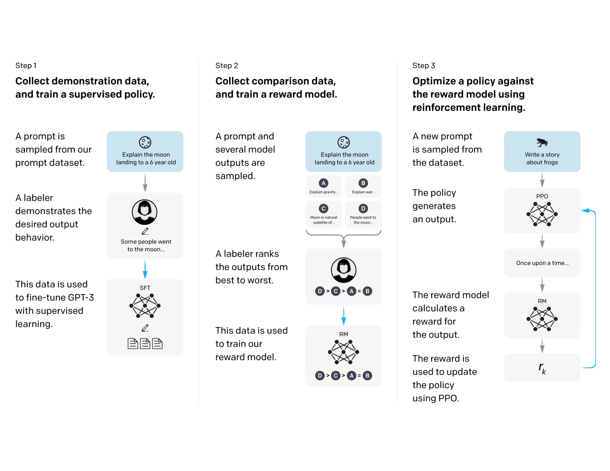

*출처: [Ouyang et al., 2022](https://arxiv.org/abs/2203.02155)*

이 도식이 지금도 RLHF를 설명할 때 가장 자주 인용되는 그림입니다. 단계 (1)이 SFT, (2)가 RM 학습, (3)이 RM에 대한 PPO 강화학습입니다. 비교 수집 방식은 Learning to Summarize와 다릅니다. 라벨러는 한 프롬프트에 대한 응답 $$K$$개를 한꺼번에 순위 매기고, 손실은 그 순위에서 나오는 모든 쌍을 평균합니다 ([Ouyang et al., 2022](https://arxiv.org/abs/2203.02155)).

$$\operatorname{loss}\left(\theta\right)=-\frac{1}{{K\choose 2}}E_{\left(x,y_{w},y_{l}\right)\sim D}\left[\log\left(\sigma\left(r_{\theta}\left(x,y_{w}\right)-r_{\theta}\left(x,y_{l}\right)\right)\right)\right]$$

$${K\choose 2}$$는 응답 $$K$$개에서 나오는 쌍의 수입니다. 같은 프롬프트에서 나온 쌍들은 서로 상관되어 있습니다. 이 쌍들을 데이터셋에 섞어 따로따로 학습하면 한 epoch 만에 과적합되었고, 그래서 저자들은 한 프롬프트의 모든 비교를 하나의 배치 원소로 학습합니다. 이렇게 하면 완성문마다 순전파를 한 번만 해도 됩니다 ([Ouyang et al., 2022](https://arxiv.org/abs/2203.02155)).

RL 단계의 목적함수에는 항이 하나 더 붙습니다 ([Ouyang et al., 2022](https://arxiv.org/abs/2203.02155)).

$$\begin{aligned}\operatorname{objective}\left(\phi\right)=&E_{\left(x,y\right)\sim D_{\pi_{\phi}^{\mathrm{RL}}}}\left[r_{\theta}(x,y)-\beta\log\left(\pi_{\phi}^{\mathrm{RL}}(y\mid x)/\pi^{\mathrm{SFT}}(y\mid x)\right)\right]+\\&\gamma E_{x\sim D_{\textrm{pretrain}}}\left[\log(\pi_{\phi}^{\mathrm{RL}}(x))\right]\end{aligned}$$

$$\pi_{\phi}^{\mathrm{RL}}$$은 학습 중인 정책, $$D_{\textrm{pretrain}}$$은 사전학습 분포, $$\gamma$$는 사전학습 로그우도 항의 계수입니다. $$\gamma>0$$인 변형을 PPO-ptx라고 부릅니다. 환경은 밴딧입니다. 무작위 프롬프트를 제시하고, 응답이 끝나면 RM 보상을 주고 에피소드가 끝납니다. 저자들은 RM 과최적화를 완화하려고 SFT 모델에 대한 토큰별 KL 페널티를 더하고, 가치 함수를 RM으로 초기화합니다 ([Ouyang et al., 2022](https://arxiv.org/abs/2203.02155)).

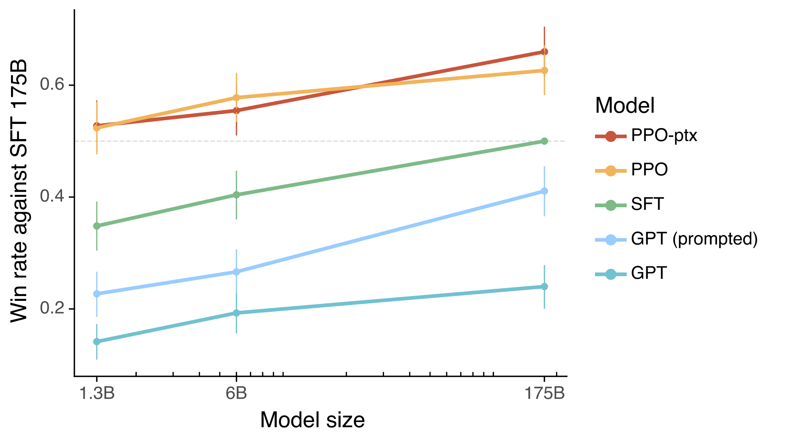

*출처: [Ouyang et al., 2022](https://arxiv.org/abs/2203.02155)*

사람 평가 그래프는 API 프롬프트에서 각 모델의 출력이 SFT 기준 모델 출력보다 얼마나 자주 선호되었는지를 보여 줍니다. 1.3B PPO-ptx 모델의 출력이 175B GPT-3보다 선호되었습니다. 파라미터 수가 100배 적은 모델이 이긴 결과입니다. TruthfulQA에서도 PPO 모델은 GPT-3보다 진실하고 유익한 출력을 냈는데, 개선 폭은 작지만 유의했습니다. 비용 측면에서 175B SFT 모델 학습에는 4.9 petaflops/s-days, 175B PPO-ptx 모델 학습에는 60 petaflops/s-days가 들어, GPT-3의 3,640 petaflops/s-days에 비하면 작은 비용입니다 ([Ouyang et al., 2022](https://arxiv.org/abs/2203.02155)).

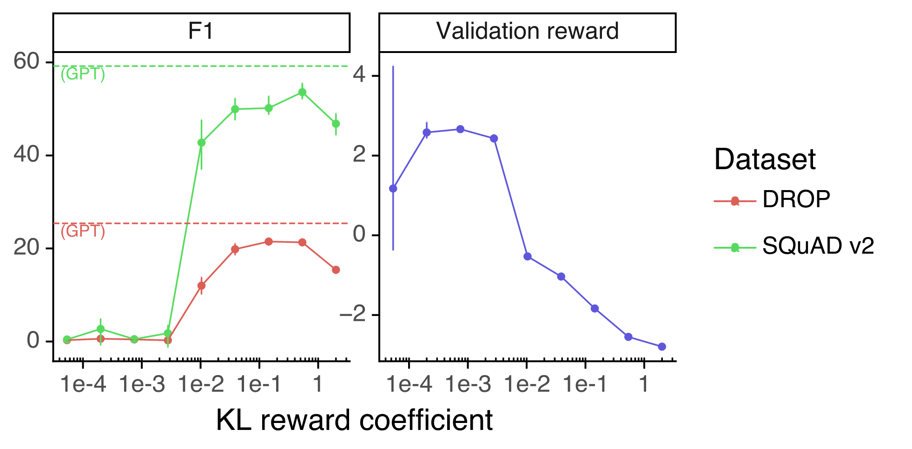

*출처: [Ouyang et al., 2022](https://arxiv.org/abs/2203.02155)*

사전학습 혼합 항이 왜 필요한지는 공개 NLP 데이터셋 결과에서 드러납니다. KL 계수를 키워도 DROP과 SQuAD에서 생긴 성능 회귀는 완전히 사라지지 않았습니다. 반면 사전학습 혼합 계수는 그 회귀를 되돌리면서 검증 보상 손실도 최소화했습니다 ([Ouyang et al., 2022](https://arxiv.org/abs/2203.02155)).

### 반복 수집과 다중 보상 모델로 확장된 레시피

Anthropic HH-RLHF는 앞서 Deep RL from Human Preferences(Christiano 등)가 강조한 온라인 피드백을 언어 모델 규모에서 다시 다뤘습니다. 그 시점의 최선 RLHF 정책으로 크라우드워커 비교 데이터를 새로 모으고, 기존 데이터와 섞어 새 선호 모델(PM)과 새 정책을 다시 학습하는 과정을 반복합니다. 저자들의 목적은 점수가 높은 영역에서 PM의 보정이 부족한 문제를 해결하는 것이었습니다 ([Bai et al., 2022](https://arxiv.org/abs/2204.05862)).

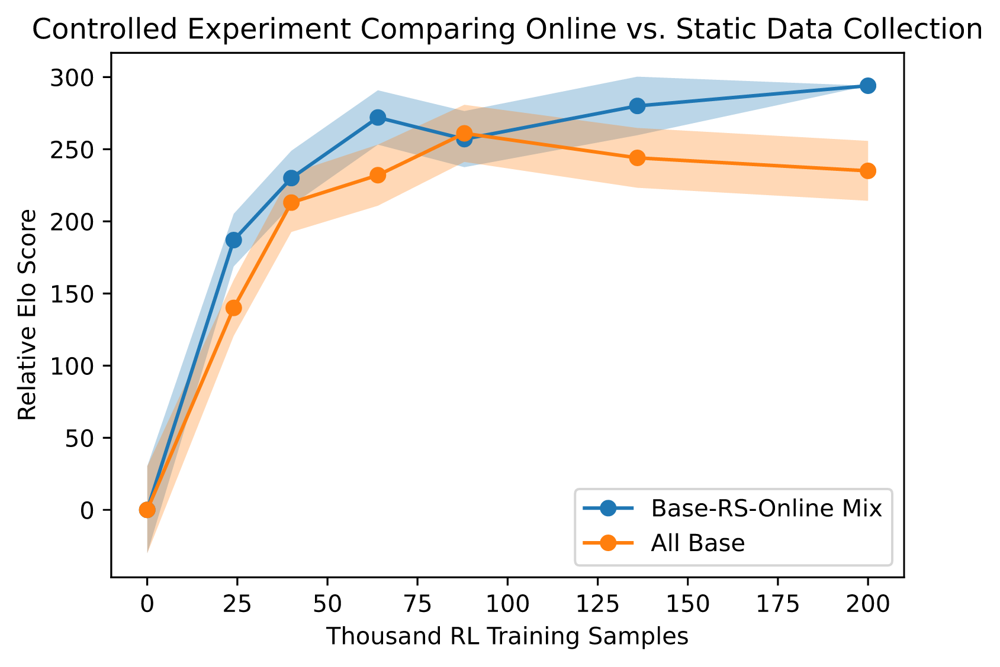

*출처: [Bai et al., 2022](https://arxiv.org/abs/2204.05862)*

이 비교는 데이터 크기와 하이퍼파라미터를 같게 맞춘 두 RLHF 실행을 놓고 크라우드워커 Elo를 잽니다. 한쪽은 기본 데이터셋으로, 다른 쪽은 기본·거절 샘플링·온라인 데이터를 섞은 혼합으로 학습했고, 크라우드워커들은 반복 온라인 모델을 선호했습니다. 유용성(helpfulness)만 학습한 이 통제 실험에서, 저자들은 성능 향상이 데이터 양이나 하이퍼파라미터 차이 때문이 아니라 온라인 학습 덕분이라고 결론짓습니다. 같은 논문은 RLHF 도중 PM 점수가 정책과 초기 정책 사이 KL의 제곱근에 대략 선형으로 비례한다고 관찰합니다. 저자들은 이 관찰이 대부분의 학습이 초기 정책에서 크게 벗어나지 않는 작은 변화 영역에서 일어난다는 뜻이라고 해석합니다 ([Bai et al., 2022](https://arxiv.org/abs/2204.05862)).

Llama 2-Chat은 이 레시피를 대규모 제품 수준으로 확장했습니다. 사전학습한 Llama 2에서 SFT로 초기 Llama 2-Chat을 만들고, 이후 RM 학습, 거절 샘플링, PPO를 반복하는 RLHF로 다듬습니다 ([Touvron et al., 2023](https://arxiv.org/abs/2307.09288)).

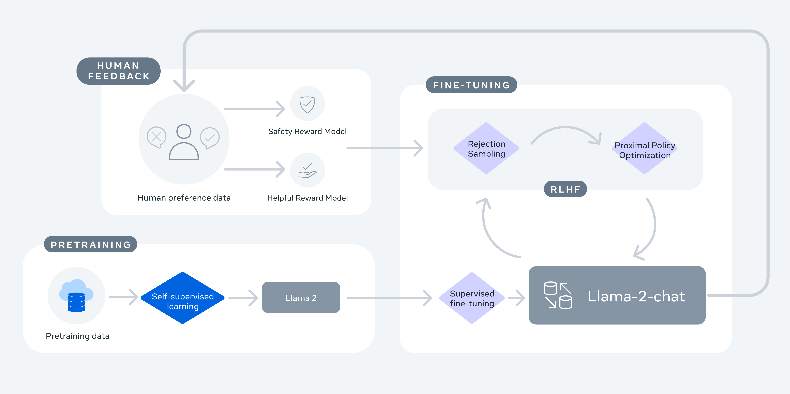

*출처: [Touvron et al., 2023](https://arxiv.org/abs/2307.09288)*

InstructGPT의 세 단계 도식과 비교하면, 세 번째 단계가 한 번으로 끝나지 않고 거절 샘플링과 PPO가 함께 돌아가는 반복 고리로 바뀐 것이 눈에 띕니다. 보상 모델 손실에는 마진이 들어갑니다 ([Touvron et al., 2023](https://arxiv.org/abs/2307.09288)).

$$\mathcal{L}_{\text{ranking}}=-\text{log}(\sigma(r_{\theta}(x,y_{c})-r_{\theta}(x,y_{r})-m(r)))$$

$$y_{c}$$와 $$y_{r}$$은 선택된 응답과 거절된 응답이고, $$m(r)$$은 라벨러가 매긴 선호 등급에 따른 마진입니다. 차이가 뚜렷한 쌍일수록 마진이 커서, 보상 모델은 그런 쌍의 점수를 더 크게 벌리도록 학습됩니다. 보상 모델은 하나가 아니라 둘입니다. 안전과 유용성 사이의 긴장 때문에 두 목표를 각각 맡는 RM을 따로 학습하는 편이 보상 모델링을 쉽게 만들었습니다. PPO 단계에서는 두 RM을 조합한 보상에 logit 변환과 화이트닝을 거친 뒤, 초기 정책 $$\pi_{0}$$에 대한 KL 페널티 $$\beta D_{KL}(\pi_{\theta}(g\mid p)\parallel\pi_{0}(g\mid p))$$를 빼서 보상 해킹을 줄입니다 ([Touvron et al., 2023](https://arxiv.org/abs/2307.09288)).

거절 샘플링은 70B 모델에서만 합니다. 프롬프트마다 응답 $$K$$개를 뽑아 RM 점수가 가장 높은 답으로 미세조정하고, 더 작은 모델들은 이 데이터로 학습해 큰 모델의 능력을 증류받습니다. 뒤 반복에서는 이전 모든 반복의 상위 샘플을 함께 써서 망각을 완화했습니다 ([Touvron et al., 2023](https://arxiv.org/abs/2307.09288)).

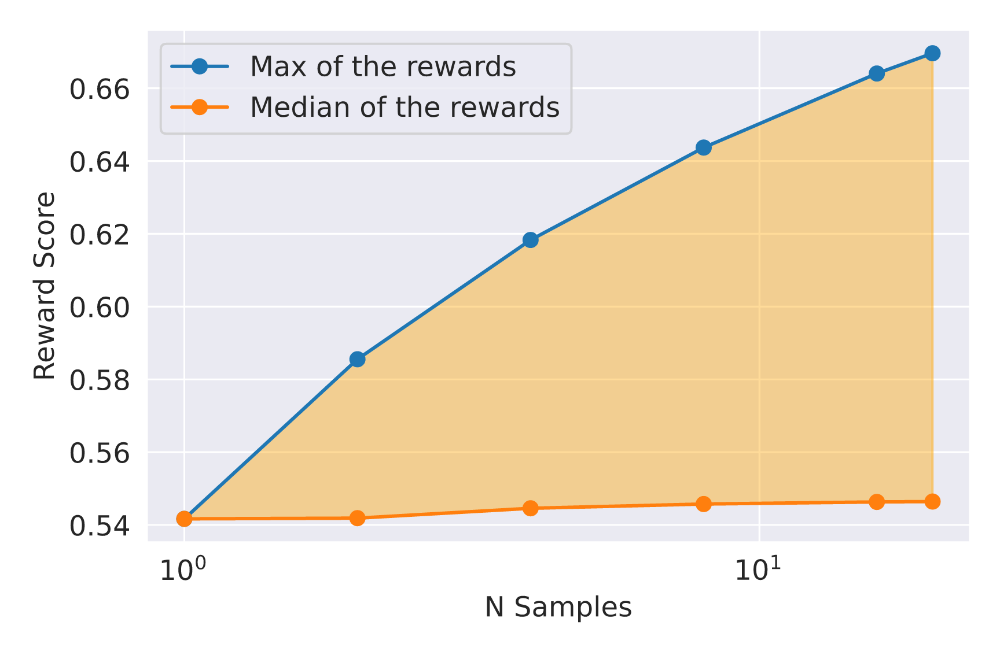

*출처: [Touvron et al., 2023](https://arxiv.org/abs/2307.09288)*

$$N$$개 샘플 가운데 최대 보상과 중앙 보상의 차이가 거절 샘플링으로 얻을 수 있는 잠재적 이득을 나타냅니다 ([Touvron et al., 2023](https://arxiv.org/abs/2307.09288)). 샘플을 늘릴수록 이 간격이 어떻게 벌어지는지가 그래프의 요점입니다. 다만 여기서 말하는 이득은 RM 점수 기준이며, 그 점수가 진짜 품질을 얼마나 따라가는지는 별개의 문제입니다.

### 프록시 보상을 따라가다 떨어지는 진짜 보상

KL 페널티가 막으려던 위험은 Learning to Summarize에서 이미 곡선으로 확인되었습니다.

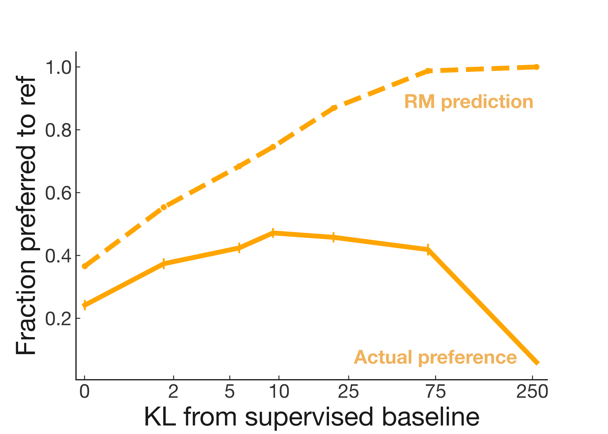

*출처: [Stiennon et al., 2020](https://arxiv.org/abs/2009.01325)*

이 그래프의 가로축은 보상 모델에 대한 최적화 정도이고, 세로축은 선호 점수입니다. 보상 모델을 상대로 최적화하면 처음에는 요약이 좋아지지만, 결국 과적합해서 더 나쁜 요약이 나옵니다. 최적화를 계속하면 진짜 선호가 보상 모델의 예측보다 처지기 시작하고, 마지막에는 보상 모델이 사람 선호와 역상관을 보입니다 ([Stiennon et al., 2020](https://arxiv.org/abs/2009.01325)). 이것이 보상 과최적화(reward overoptimization)입니다.

RM Overoptimization은 이 현상을 Goodhart 법칙의 사례로 보고 정량화합니다. 사람 라벨로 매번 진짜 목표를 재는 일은 비용이 너무 크기 때문에, 저자들은 고정된 "gold" RM이 사람 라벨 역할을 대신하는 합성 설정을 씁니다. 합성 비교는 결정적으로 만듭니다. 두 궤적 중 gold RM 점수가 높은 쪽을 항상 선호로 표시하고, 이 데이터로 학습한 RM이 프록시가 됩니다 ([Gao et al., 2022](https://arxiv.org/abs/2210.10760)). 정책은 프록시를 최적화하고, 평가는 gold로 합니다.

진짜 보상의 변화는 초기 정책에서 잰 거리 $$d=\sqrt{\text{KL}}$$의 함수로 적습니다. 최적화 방식마다 함수형이 다릅니다. RL에서는 다음 형태가 잘 맞습니다 ([Gao et al., 2022](https://arxiv.org/abs/2210.10760)).

$$R_{\text{RL}}\left(d\right)={d}\left(\alpha_{\text{RL}}-\beta_{\text{RL}}\log{d}\right)$$

Best-of-$$n$$(BoN) 샘플링에서는 이차식이 맞습니다 ([Gao et al., 2022](https://arxiv.org/abs/2210.10760)).

$$R_{\text{bo}n}\left(d\right)=d\left(\alpha_{\text{bo}n}-\beta_{\text{bo}n}d\right)$$

$$R$$은 gold 보상이고, $$\alpha$$는 초반 상승 기울기, $$\beta$$는 과최적화로 꺾이는 세기를 정하는 계수입니다. 여기서 $$\beta$$는 KL 페널티 계수가 아니라 적합 계수입니다. 두 식 모두 $$d$$가 작을 때는 오르다가 어느 지점에서 정점을 찍고 내려갑니다. RL 식은 $$\log d$$ 항 때문에 BoN의 이차식보다 꺾이는 속도가 느립니다.

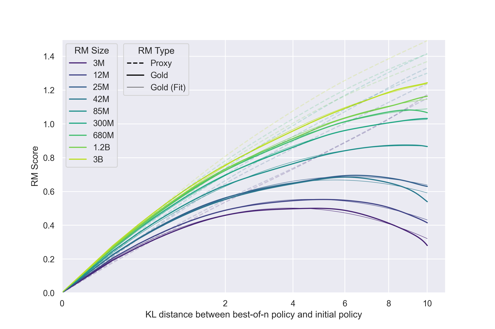

*출처: [Gao et al., 2022](https://arxiv.org/abs/2210.10760)*

이 실험에서는 InstructGPT 환경에서 정책 크기를 고정하고 RM 크기만 바꿨습니다. 학습된 프록시를 최적화할 때 gold 보상은 처음에는 오르다가 나중에는 떨어지고, 앞의 함수형이 곡선을 잘 따라갑니다. 계수는 RM 크기에 따라 매끄럽게 변합니다. RM 크기를 키우면 $$\alpha$$와 $$\beta$$가 로그 추세로 바뀝니다. RL에서는 모든 RM 크기에서 $$\alpha_{\text{RL}}$$을 고정해도 되고, $$\beta_{\text{RL}}$$만 깔끔한 스케일링 곡선을 그립니다. 그래서 최대 gold 점수를 미리 예측할 수 있습니다. 데이터 쪽에는 문턱이 있습니다. 모든 RM 크기에서 비교 약 2,000개 미만으로 학습한 RM은 무작위에 가까웠고, 그보다 데이터가 많아질수록 gold 점수가 좋아지고 goodharting은 줄었습니다 ([Gao et al., 2022](https://arxiv.org/abs/2210.10760)).

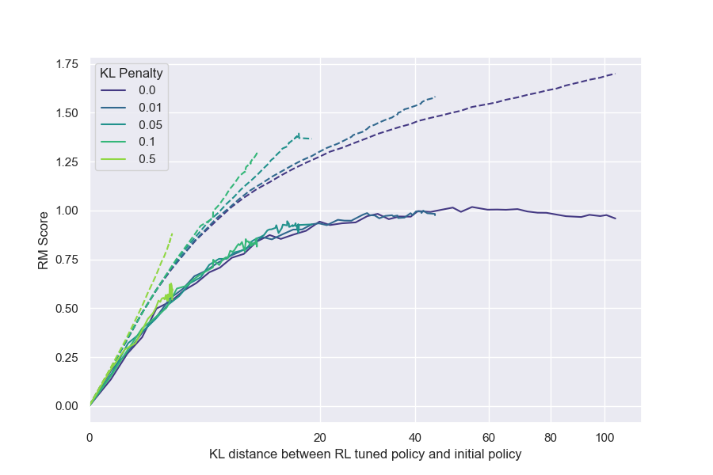

*출처: [Gao et al., 2022](https://arxiv.org/abs/2210.10760)*

KL 페널티를 바꾼 실험에서는 점선이 프록시 보상, 실선이 gold 보상이며, 페널티가 gold 점수에 미치는 효과는 조기 종료와 같았습니다. 이 RL 설정에서 KL 페널티는 gold 점수를 더 일찍 수렴시킬 뿐, KL 대비 gold 보상의 프론티어 자체는 바꾸지 못했습니다. 저자들은 이 결론이 하이퍼파라미터에 민감할 수 있다고 덧붙입니다 ([Gao et al., 2022](https://arxiv.org/abs/2210.10760)). InstructGPT가 과최적화 완화책으로 넣은 토큰별 KL 페널티는, 이 결과에 따르면 같은 KL 거리에서 더 나은 정책을 만들기보다 정책이 덜 멀리 가게 하는 장치에 가깝습니다 ([Ouyang et al., 2022](https://arxiv.org/abs/2203.02155))([Gao et al., 2022](https://arxiv.org/abs/2210.10760)). 정책 크기의 효과는 제한적으로만 확인되었습니다. 정책이 클수록 최적화로 얻는 이득은 작았지만, gold 점수가 최대가 되는 KL과 프록시-gold 격차는 두 정책 크기에서 거의 같았습니다. 이 탐색은 정책 크기 두 개에 한정되어 있습니다 ([Gao et al., 2022](https://arxiv.org/abs/2210.10760)).

## 원칙 목록과 AI 라벨로 대체한 무해성 피드백

사람 선호 라벨을 모델이 만든 비평과 비교로 바꿔도 RLHF는 작동했습니다. Constitutional AI는 무해성(harmlessness) 라벨을 사람에게서 받지 않고 무해한 어시스턴트를 학습했고, RLAIF는 기성 LLM의 선호 라벨이 요약과 대화에서 사람 라벨과 대등한 결과를 낸다는 것을 보였습니다.

### 사람 감독을 원칙 목록 하나로 줄인 Constitutional AI

Constitutional AI에서 사람이 감독하는 대상은 규칙이나 원칙의 목록, 즉 "헌법"뿐입니다. 저자들은 이 원칙만으로 자기 비평·수정을 거치는 지도학습 단계와 AI 선호에 기반한 RL 단계를 돌려, 무해하면서도 회피적이지 않은 어시스턴트를 학습합니다. 파이프라인 자체는 앞서 본 Anthropic HH-RLHF를 그대로 유지합니다. 사람 라벨 가운데 무해성 라벨만 AI 라벨로 바꿉니다 ([Bai et al., 2022](https://arxiv.org/abs/2212.08073)).

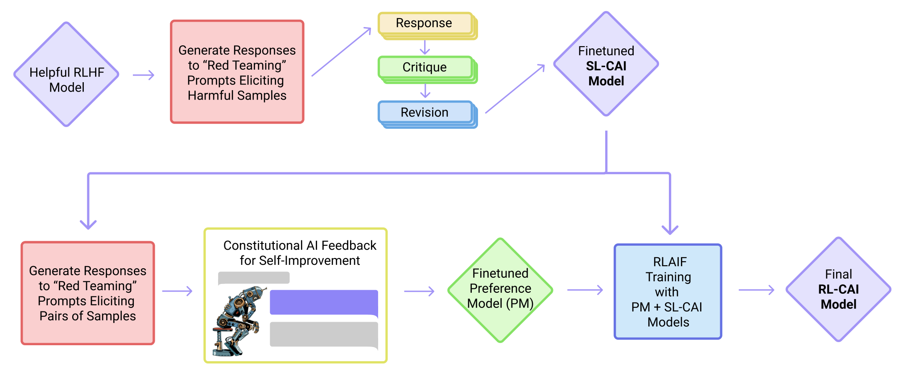

*출처: [Bai et al., 2022](https://arxiv.org/abs/2212.08073)*

도식의 위쪽 흐름이 지도학습 단계이고 아래쪽이 RL 단계입니다 ([Bai et al., 2022](https://arxiv.org/abs/2212.08073)). RL 단계에서 사람 비교가 들어가던 자리에 AI 비교 평가가 들어가 있습니다.

지도학습 단계(SL-CAI)는 레드팀 프롬프트에서 출발합니다. 모델이 자기 응답을 원칙에 비추어 비평(critique)하고, 그 비평에 따라 응답을 수정(revision)합니다. 이 과정을 여러 번 되풀이하는데, 매번 원칙을 무작위로 뽑습니다. 그 뒤 모든 수정 단계에서 나온 응답으로 사전학습 모델을 미세조정합니다. 유용성을 최대한 지키려고 크라우드워커가 모은 유용성 프롬프트에 대한 helpful RLHF 모델의 응답도 학습 데이터에 섞습니다 ([Bai et al., 2022](https://arxiv.org/abs/2212.08073)).

비평 단계를 빼고 곧바로 수정하게 해도 큰 모델에서는 무해성 점수에 눈에 띄는 차이가 없었습니다. 작은 모델에서는 비평을 거친 수정이 더 나은 점수를 받았습니다. 비평은 부정확하거나 과장된 경우가 잦았지만, 저자들은 투명성을 이유로 비평을 거치는 수정을 택했습니다. 수정 횟수를 늘리면 무해성 PM 점수는 단조롭게 오르고 순수 유용성 점수는 떨어졌습니다. 원칙의 수를 늘려도 PM 점수는 오르지 않았습니다. 저자들은 원칙이 많으면 응답이 다양해져 RL 단계의 탐색에 도움이 될 것으로 기대합니다 ([Bai et al., 2022](https://arxiv.org/abs/2212.08073)).

### 소프트 확률 라벨과 그 클램핑

RL 단계(RL-CAI)에서는 피드백 모델이 비교 라벨을 만듭니다. 한 프롬프트에 대한 두 응답을 (A)와 (B)로 제시하고, 비교마다 무작위로 뽑은 원칙에 따라 어느 쪽이 나은지 묻습니다. 모델이 (A)와 (B)에 주는 로그 확률을 정규화한 값이 선호 모델링 예제의 타깃이 됩니다. 이 라벨로 PM을 학습하고 RL을 돌리는 과정은 RLHF와 같습니다 ([Bai et al., 2022](https://arxiv.org/abs/2212.08073)). 이 라벨은 0과 1 중 하나로 정해지지 않고 확률값으로 남는 소프트 타깃입니다.

체인 오브 소트(chain-of-thought, CoT)로 추론하게 한 피드백은 이 확률이 극단으로 쏠렸습니다. 그대로 쓰면 RL-CAI가 극단적인 응답을 학습했고, 그래서 저자들은 확률을 40-60% 범위로 클램핑합니다 ([Bai et al., 2022](https://arxiv.org/abs/2212.08073)). 예를 들어 가상의 CoT 라벨이 (A)에 0.97을 준다면, 클램핑을 거친 타깃은 0.6이 됩니다.

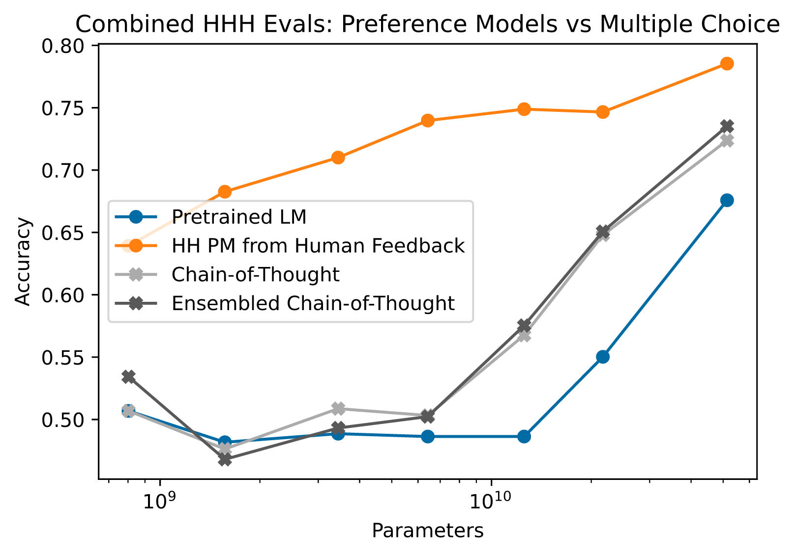

*출처: [Bai et al., 2022](https://arxiv.org/abs/2212.08073)*

AI가 라벨러 역할을 할 수 있는지는 이 HHH 비교에서 가늠할 수 있습니다. 비교 대상은 사람 피드백으로 학습한 선호 모델과, 별도 학습 없이 객관식으로 답하는 사전학습 언어 모델입니다. 체인 오브 소트 추론을 붙이면 사전학습 모델의 성능이 크게 오릅니다 ([Bai et al., 2022](https://arxiv.org/abs/2212.08073)).

### 회피하지 않으면서 더 무해해진 정책

CoT 버전은 유용성이 약간 낮은 대신 무해성이 약간 높았습니다 ([Bai et al., 2022](https://arxiv.org/abs/2212.08073)).

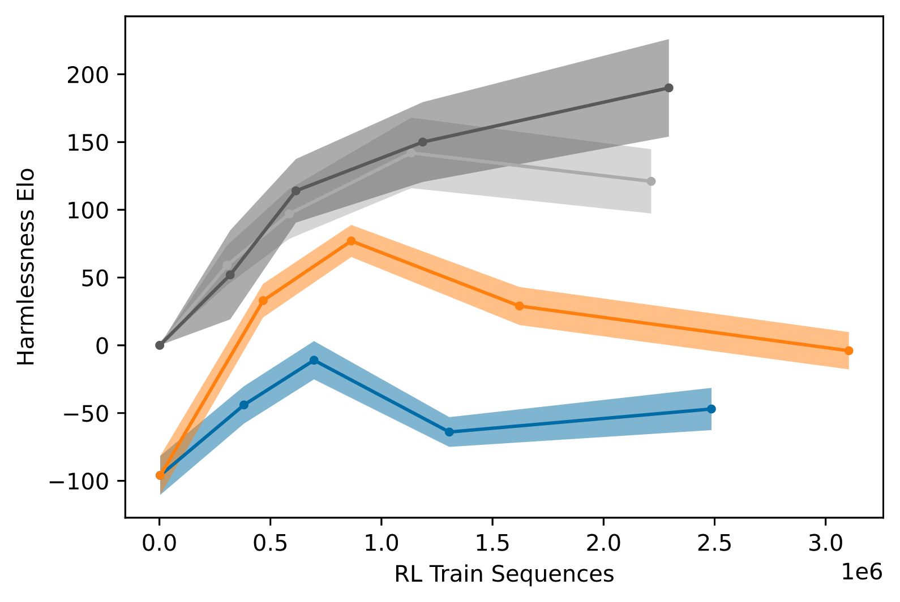

*출처: [Bai et al., 2022](https://arxiv.org/abs/2212.08073)*

두 곡선을 함께 놓으면, RL 학습이 진행되는 동안 RL-CAI의 무해성 Elo가 높게 올라가도 유용성 Elo는 크게 깎이지 않습니다. 응답의 성격도 달랐습니다. 기존 HH RLHF 모델은 "답할 수 없다"는 식의 회피 응답이 잦았지만, RL-CAI는 거의 회피하지 않았고 대부분의 레드팀 프롬프트에 이유를 설명하는 섬세하고 무해한 응답을 했습니다. 다만 0~4점 척도의 절대 유해성 점수에는 작업자마다 다른 채점 편향이 섞여 있어 보정되지 않았을 수 있고, 높은 PM 점수 영역도 보정이 덜 되어 있다고 저자들은 경고합니다. 저자들은 새 AI 피드백으로 PM을 갱신해 정책 분포를 따라가게 하면, 반복 온라인 학습도 AI 감독으로 자동화할 수 있다고 전망합니다 ([Bai et al., 2022](https://arxiv.org/abs/2212.08073)).

### 요약과 대화로 넓힌 RLAIF

RLAIF는 무해성에 그치지 않고 일반 과제로 범위를 넓힙니다. 기성 LLM이 만든 선호 라벨로 보상 모델을 학습해 요약, 도움이 되는 대화, 무해한 대화 생성에서 RLHF와 대등한 성능을 냈습니다 ([Lee et al., 2023](https://arxiv.org/abs/2309.00267)).

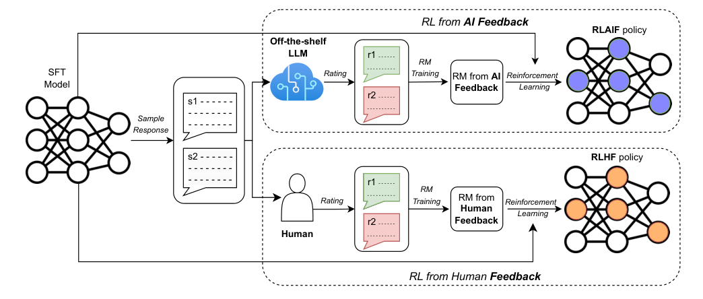

*출처: [Lee et al., 2023](https://arxiv.org/abs/2309.00267)*

두 파이프라인을 위아래로 맞대어 보면 바뀌는 곳은 선호 라벨의 출처 하나뿐입니다. 보상 모델을 아예 빼는 변형도 있습니다. d-RLAIF는 RL 중에 LLM에서 직접 보상을 받습니다. PaLM 2 XS를 라벨러로 쓴 요약 과제의 사람 평가에서 d-RLAIF는 SFT 대비 74% 승률을 기록했습니다. 저자들은 LLM 라벨링 비용이 사람 주석보다 10배 이상 저렴하다고 추정합니다. 사람 피드백과 AI 피드백을 결합한 경우는 사람 피드백만 쓴 경우보다 나아지지 않았습니다 ([Lee et al., 2023](https://arxiv.org/abs/2309.00267)).

이 글은 두 논문의 세부 결과를 이렇게 읽습니다. AI 라벨이 사람 라벨을 대신할 수 있는지는 라벨러가 고르는 답의 방향만큼이나 확률이 얼마나 보정되어 있는지에 달려 있습니다. 클램핑이 필요했던 CoT 확률과 보정이 덜 된 높은 PM 점수 모두 이 보정 문제를 가리킵니다 ([Bai et al., 2022](https://arxiv.org/abs/2212.08073)).

## 보상 모델을 지운 닫힌 형태 정책 손실과 그 일반화, 그리고 남은 과최적화

DPO는 KL 제약 보상 최대화의 최적 정책을 뒤집어 보상을 정책 로그비로 표현했고, 그 결과 RL 루프 없이 이진 교차 엔트로피 하나로 정렬을 학습합니다. 후속 연구는 이 손실을 두 방향으로 넓혔습니다. ΨPO/IPO는 결정적 선호에서 생기는 과적합을 다뤘고, KTO는 쌍이 없는 신호로 일반화했습니다. 그럼에도 직접 정렬 알고리즘 역시 과최적화를 피하지 못합니다.

### 최적 정책을 뒤집어 얻은 암묵적 보상

DPO의 출발점은 앞서 본 RLHF 세 단계의 마지막 목적식입니다 ([Rafailov et al., 2023](https://arxiv.org/abs/2305.18290)).

$$\max_{\pi_{\theta}}\mathbb{E}_{x\sim\mathcal{D},y\sim\pi_{\theta}(y\mid x)}\bigl[r_{\phi}(x,y)\bigr]-\beta\mathbb{D}_{\textrm{KL}}\bigl[\pi_{\theta}(y\mid x)\mid\mid\pi_{\text{ref}}(y\mid x)\bigr]$$

$$r_{\phi}$$는 학습된 보상 모델이고, $$\pi_{\text{ref}}$$는 참조 정책이며, $$\beta$$는 참조 정책에서 멀어지는 정도를 억제하는 계수입니다. 이 문제의 최적 정책은 참조 정책에 지수 보상을 곱한 닫힌 형태가 되고, 이 형태는 Ziegler 등이 이미 정리해 두었습니다 ([Ziegler et al., 2019](https://arxiv.org/abs/1909.08593)). DPO는 이 관계를 반대 방향으로 읽어 보상을 정책으로 표현합니다 ([Rafailov et al., 2023](https://arxiv.org/abs/2305.18290)).

$$r(x,y)=\beta\log\frac{\pi_{r}(y\mid x)}{\pi_{\text{ref}}(y\mid x)}+\beta\log Z(x)$$

$$\pi_{r}$$는 보상 $$r$$에 대한 최적 정책이고, $$Z(x)$$는 프롬프트마다 정해지는 분배함수입니다. $$Z(x)$$는 직접 계산하기 어렵지만 응답 $$y$$와 무관합니다. 그래서 브래들리-테리 모델처럼 같은 프롬프트의 두 응답 사이에서 보상 차이만 쓰면 이 항이 상쇄됩니다. 저자들은 이를 변수 변환으로 설명합니다. 보상에서 최적 정책으로 가는 해석적 매핑을 이용해 보상 함수에 대한 손실을 정책에 대한 손실로 바꾸고, 그러면 정책 네트워크 하나가 언어 모델이자 암묵적 보상 모델이 됩니다. 이렇게 파라미터화해도 표현력은 줄지 않습니다. 완만한 가정 아래 Plackett-Luce 모델, 특히 브래들리-테리 모델과 일치하는 모든 보상 클래스를 $$\beta\log\pi/\pi_{\text{ref}}$$ 형태로 나타낼 수 있다는 정리가 있습니다 ([Rafailov et al., 2023](https://arxiv.org/abs/2305.18290)).

이 보상을 브래들리-테리 우도에 넣으면 DPO 손실이 됩니다 ([Rafailov et al., 2023](https://arxiv.org/abs/2305.18290)).

$$\mathcal{L}_{\text{DPO}}(\pi_{\theta};\pi_{\text{ref}})=-\mathbb{E}_{(x,y_{w},y_{l})\sim\mathcal{D}}\left[\log\sigma\left(\beta\log\frac{\pi_{\theta}(y_{w}\mid x)}{\pi_{\text{ref}}(y_{w}\mid x)}-\beta\log\frac{\pi_{\theta}(y_{l}\mid x)}{\pi_{\text{ref}}(y_{l}\mid x)}\right)\right]$$

$$y_{w}$$는 선호된 응답, $$y_{l}$$은 선호되지 않은 응답이고, $$\sigma$$는 로지스틱 함수입니다. 손실 안에는 별도의 보상 모델도, 정책 샘플링도 없습니다 ([Rafailov et al., 2023](https://arxiv.org/abs/2305.18290)).

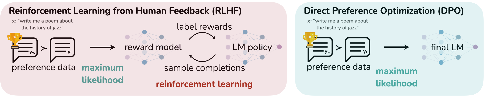

*출처: [Rafailov et al., 2023](https://arxiv.org/abs/2305.18290)*

두 흐름을 비교하면 DPO 쪽에서 보상 모델 학습과 RL 루프가 통째로 빠져 있습니다 ([Rafailov et al., 2023](https://arxiv.org/abs/2305.18290)).

TL;DR 요약 비교 한 쌍 $$(x, y_w, y_l)$$에 이 손실을 적용해 보겠습니다. 예를 들어 가상의 숫자로 $$\beta=0.1$$을 두고, 현재 정책이 참조 정책보다 선호 요약 $$y_w$$의 로그확률을 2만큼 높였고 비선호 요약 $$y_l$$의 로그확률은 1만큼 낮췄다고 합시다. 그러면 시그모이드 안의 값은 $$0.1\times(2-(-1))=0.3$$이고, $$\sigma(0.3)\approx0.574$$이므로 이 쌍의 손실은 약 0.554입니다. 손실을 미분하면 각 쌍에는 암묵적 보상 $$\hat{r}_{\theta}=\beta\log\pi_{\theta}/\pi_{\text{ref}}$$의 차이를 뒤집어 넣은 가중치 $$\sigma(\hat{r}_{\theta}(x,y_l)-\hat{r}_{\theta}(x,y_w))$$가 곱해집니다 ([Rafailov et al., 2023](https://arxiv.org/abs/2305.18290)). 같은 가상 예에서 이 가중치는 $$\sigma(-0.3)\approx0.426$$입니다. 만약 $$y_l$$을 오히려 높게 매기고 있었다면 이 가중치는 0.5를 넘습니다.

이 가중치가 DPO 기울기의 핵심입니다. 기울기는 선호 응답의 가능도를 올리고 비선호 응답의 가능도를 내리는데, 이때 각 예시는 암묵적 보상이 순서를 얼마나 틀리게 매겼는지에 비례하는 가중치를 받습니다. 저자들은 이 가중치를 뺀 단순한 버전이 모델을 퇴화시킬 수 있다고 보고합니다. 저자들은 PPO의 불안정성도 같은 관점에서 설명합니다. 액터-크리틱 방식은 참조 정책의 소프트 가치 함수에 해당하는 정규화 항이 없으면 정책 기울기의 분산이 커집니다. DPO로 재파라미터화한 보상은 이런 베이스라인이 필요 없습니다. 학습 절차는 오프라인 선호 데이터셋을 만들고 이 손실을 최소화하는 것이 전부입니다. $$\pi_{\text{ref}}$$는 지도 미세조정(supervised fine-tuning, SFT) 모델로 초기화하고, SFT 모델이 없으면 선호 응답의 우도를 최대화해 직접 만듭니다 ([Rafailov et al., 2023](https://arxiv.org/abs/2305.18290)).

### 보상-KL 프런티어와 대화 승률

DPO 논문의 IMDb 제어 감성 생성 설정은 정답 보상을 계산할 수 있어서, 저자들은 여러 실행을 모아 보상-KL 프런티어를 그렸습니다. DPO의 보상/KL 교환은 PPO를 엄밀하게 지배했고, 정답 보상에 직접 접근하는 PPO-GT보다도 나은 프런티어를 얻었습니다 ([Rafailov et al., 2023](https://arxiv.org/abs/2305.18290)).

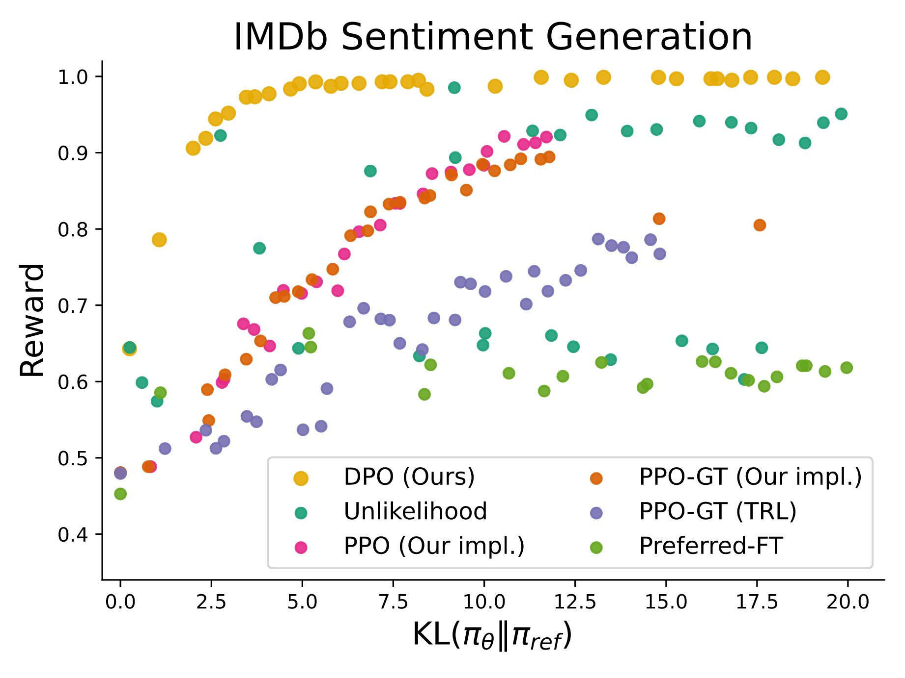

*출처: [Rafailov et al., 2023](https://arxiv.org/abs/2305.18290)*

같은 KL 예산에서 보상이 더 높다는 결과는 RL 루프를 빼도 최적화 정확도가 떨어지지 않는다는 해석을 뒷받침합니다.

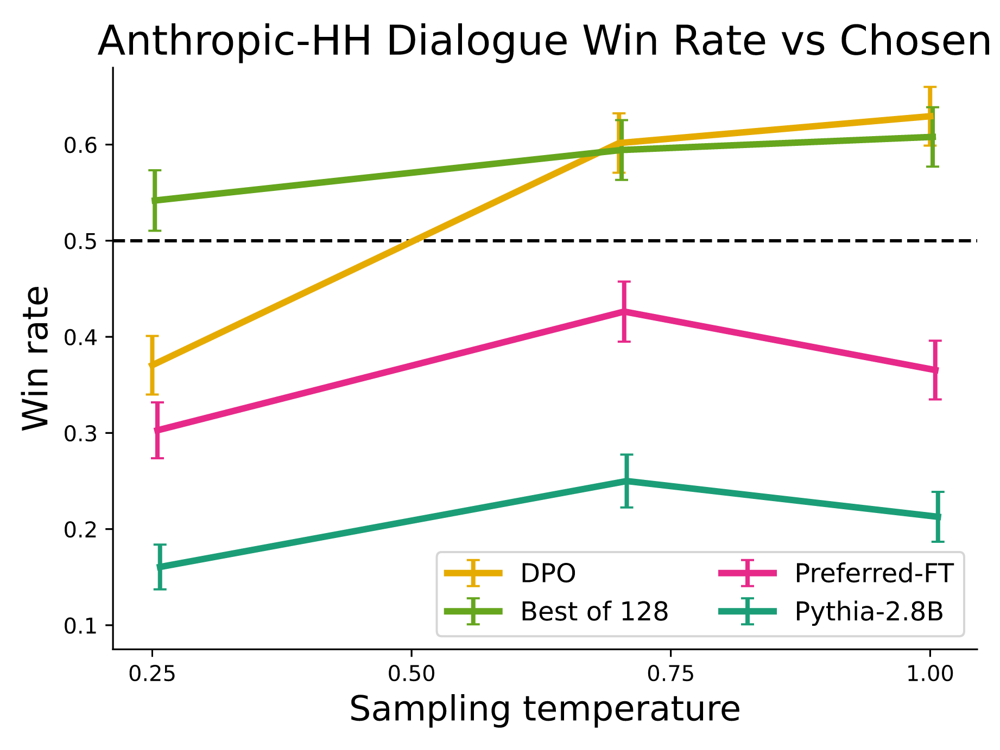

*출처: [Rafailov et al., 2023](https://arxiv.org/abs/2305.18290)*

대화 과제에서 기준선은 데이터셋에 들어 있는 선호 응답입니다. GPT-4 판정 승률로 이 기준선을 넘어선 방법은 DPO 하나였고, 개선 폭은 학습 과정과 여러 샘플링 온도에서 안정적으로 유지되었습니다. DPO는 비용이 큰 Best-of-128과 비슷하거나 더 나았습니다 ([Rafailov et al., 2023](https://arxiv.org/abs/2305.18290)).

### 결정적 선호에서 사라지는 KL 정규화: ΨPO와 IPO

ΨPO/IPO 논문은 RLHF가 두 가지 근사에 기대고 있다고 봅니다. 하나는 쌍별 선호를 점별 보상으로 바꾸는 근사이고, 다른 하나는 보상 모델이 분포 밖으로도 일반화한다는 가정입니다. DPO가 우회하는 것은 이 중 두 번째뿐입니다. 저자들은 첫 번째 근사까지 걷어내기 위해 선호 확률 자체를 목적에 넣습니다 ([Azar et al., 2023](https://arxiv.org/abs/2310.12036)).

$$\max_{\pi}\mathop{\mathbb{E}}_{\begin{subarray}{c}x\sim\rho\\
y\sim\pi(.\mid x)\\
y^{\prime}\sim\mu(.|x)\end{subarray}}[\Psi(p^{*}(y\succ y^{\prime}\mid x))]-\tau D_{\text{KL}}(\pi\;||\;\pi_{\text{ref}})$$

$$p^{*}(y\succ y^{\prime}\mid x)$$는 $$y$$가 $$y^{\prime}$$보다 선호될 실제 확률이고, $$\mu$$는 비교 대상 응답을 뽑는 분포, $$\rho$$는 프롬프트 분포, $$\tau$$는 KL 정규화 계수, $$\Psi$$는 비감소 함수입니다. 이 목적은 선호 확률의 비선형 함수를 최대화하는 일과 참조 정책 근처에 머무는 일을 저울질하며, 보상 모델링이나 브래들리-테리 가정 없이 RLHF와 DPO를 특수한 경우로 포함합니다. $$\Psi$$가 로짓 함수이고 브래들리-테리 모델이 성립하면 ΨPO, RLHF, DPO의 최적 정책은 같습니다 ([Azar et al., 2023](https://arxiv.org/abs/2310.12036)).

문제는 이 로짓에서 나옵니다. 선호가 결정적일수록 KL 정규화가 점점 약해집니다. 데이터가 유한하면 상황은 더 나빠집니다. 실제 선호가 0.8이어도 데이터 몇 개로 추정하면 1이 나올 수 있고, 그러면 경험적 최적 정책은 $$\tau$$를 얼마로 두든 $$y^{\prime}$$의 확률을 0으로 만듭니다. TL;DR 비교 한 쌍이 데이터에 한 번만 등장하는 경우가 바로 이 상황입니다. 관측된 선호는 1이 되고, DPO는 그 한 번의 비교에 맞춰 $$y_l$$을 끝까지 밀어냅니다. RLHF에서는 보상 모델이 과소적합되면서 정책이 참조 정책 쪽으로 정규화되는 효과가 생기는데, 보상 모델을 학습하지 않는 DPO에는 이 정규화가 없습니다 ([Azar et al., 2023](https://arxiv.org/abs/2310.12036)).

IPO는 $$\Psi$$를 항등함수로 둡니다. 그러면 로짓이 발산할 일이 없습니다. 저자들은 최적 정책이 만족해야 하는 조건을 근 찾기 문제로 세운 뒤, 이를 하나의 제곱 손실로 바꿉니다 ([Azar et al., 2023](https://arxiv.org/abs/2310.12036)).

$$L(\pi)=\mathop{\mathbb{E}}_{y,y^{\prime}\sim\mu}\left[\left(h_{\pi}(y,y^{\prime})-\frac{p^{*}(y\succ\mu)-p^{*}(y^{\prime}\succ\mu)}{\tau}\right)^{2}\right]$$

$$h_{\pi}(y,y^{\prime})=\log\frac{\pi(y)\,\pi_{\text{ref}}(y^{\prime})}{\pi(y^{\prime})\,\pi_{\text{ref}}(y)}$$는 두 응답의 정책 대 참조 정책 로그비 차이이고, $$p^{*}(y\succ\mu)$$는 $$y$$가 $$\mu$$에서 뽑은 응답을 이길 확률입니다. 즉 이 손실은 로그비 차이를 선호 차이를 $$\tau$$로 나눈 값에 맞춥니다. 이 식에는 아직 모르는 $$p^{*}$$가 들어 있습니다. 저자들은 기록된 선호의 지시변수 $$I(y,y^{\prime})$$로 이를 대신해, 데이터셋의 쌍과 선호 기록만으로 비편향 추정할 수 있는 손실을 얻습니다 ([Azar et al., 2023](https://arxiv.org/abs/2310.12036)). 여기서 $$I(y,y^{\prime})$$는 평균이 $$p^{*}$$인 베르누이 변수입니다.

$$\mathop{\mathbb{E}}_{y,y^{\prime}\sim\mu}\Big[\big(h_{\pi}(y,y^{\prime})-\tau^{-1}I(y,y^{\prime})\big)^{2}\Big]$$

DPO가 로그비 차이를 무한히 키우려 한다면, IPO는 그 차이를 유한한 목표값 $$\tau^{-1}$$에 회귀시킵니다. 행동이 세 개뿐인 장난감 실험이 이 차이를 직접 보여 줍니다. 전순서 데이터셋 D1에서 DPO는 모든 $$\tau$$에서 결정적 정책으로 수렴해 참조 정책을 무시했고, IPO는 정규화가 강하면 탐욕 정책으로 가지 않았습니다 ([Azar et al., 2023](https://arxiv.org/abs/2310.12036)).

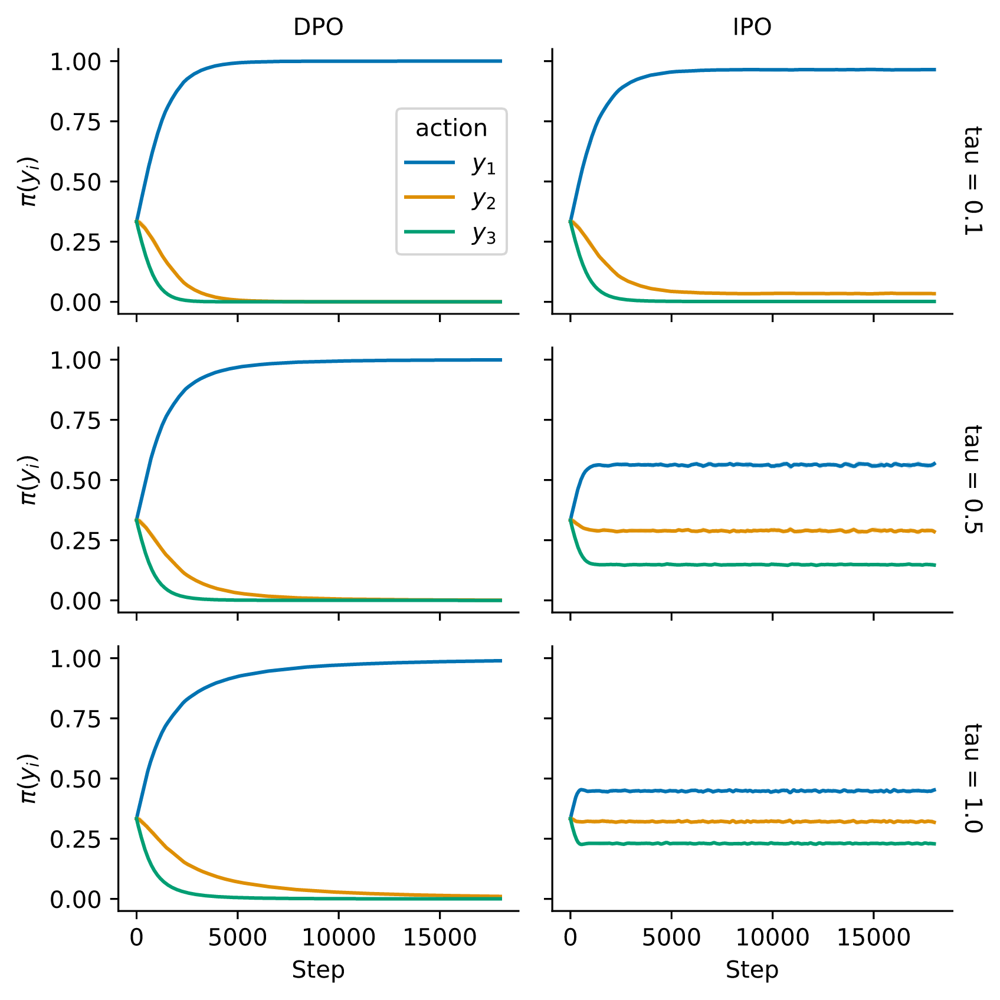

*출처: [Azar et al., 2023](https://arxiv.org/abs/2310.12036)*

관측되지 않은 행동의 처리에서도 두 방법은 다르게 움직입니다.

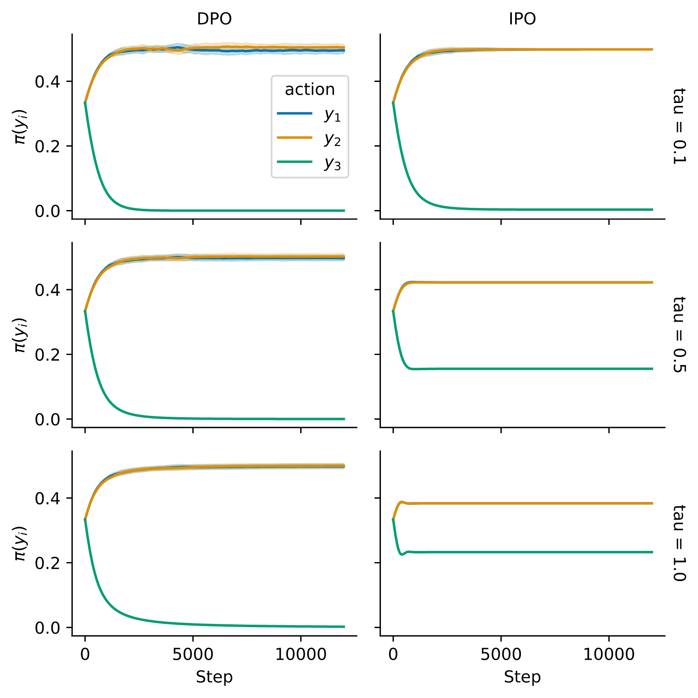

*출처: [Azar et al., 2023](https://arxiv.org/abs/2310.12036)*

세 행동 가운데 하나가 비교 데이터에 전혀 나타나지 않도록 구성한 데이터셋 D3에서 DPO는 이 관측되지 않은 행동을 정책에서 제외했지만, IPO는 그 확률을 $$\tau$$에 따라 조절했습니다 ([Azar et al., 2023](https://arxiv.org/abs/2310.12036)).

### 쌍 없이 좋음과 나쁨만 쓰는 KTO

KTO는 신호의 형태를 바꿉니다. 같은 보상 동치류에 속한 보상들은 최적 정책과 브래들리-테리 선호 분포가 같아도 가치 분포는 서로 다릅니다. 따라서 선호 우도만으로는 전망 이론(prospect theory)의 가치를 식별할 수 없습니다. KTO는 쌍 선호 대신, 각 출력이 바람직한지 아닌지만 알려 주는 이진 신호로 카너먼-트버스키 가치함수를 최대화합니다. 원래의 가치함수는 로지스틱 함수로 대체합니다 ([Ethayarajh et al., 2024](https://arxiv.org/abs/2402.01306)).

$$L_{\text{KTO}}(\pi_{\theta},\pi_{\text{ref}})=\mathbb{E}_{x,y\sim D}[\lambda_{y}-v(x,y)]$$

$$\lambda_{y}$$는 출력의 라벨에 따라 $$\lambda_{D}$$나 $$\lambda_{U}$$가 되는 계수이고, 가치함수 $$v$$는 다음과 같습니다 ([Ethayarajh et al., 2024](https://arxiv.org/abs/2402.01306)).

$$\begin{aligned}v(x,y)&=\begin{cases}\lambda_{D}\sigma(\beta(r_{\theta}(x,y)-z_{0}))\ \text{if }y\sim y_{\text{desirable}}|x\\
\lambda_{U}\sigma(\beta(z_{0}-r_{\theta}(x,y)))\ \text{if }y\sim y_{\text{undesirable}}|x\\
\end{cases}\end{aligned}$$

$$r_{\theta}(x,y)=\log\frac{\pi_{\theta}(y\mid x)}{\pi_{\text{ref}}(y\mid x)}$$는 DPO와 같은 로그비 형태의 암묵적 보상이고, $$z_{0}=\mathrm{KL}(\pi_{\theta}(y^{\prime}\mid x)\lVert\pi_{\text{ref}}(y^{\prime}\mid x))$$는 보상을 비교하는 기준점입니다. $$\lambda_{D}$$와 $$\lambda_{U}$$는 손실 회피 정도를 조절합니다. 기준점 $$z_{0}$$는 KL 항이며, 학습을 안정시키려고 역전파하지 않습니다. 이 항의 역할은 손실 포화를 제어하는 데 그칩니다. 실제 계산에서는 마이크로배치 안의 출력을 한 칸씩 밀어 프롬프트와 맞지 않는 쌍을 만들고, 그 쌍들의 로그비 평균으로 편향된 추정치를 구한 뒤 0 아래로 내려가지 않게 클램프합니다 ([Ethayarajh et al., 2024](https://arxiv.org/abs/2402.01306)). TL;DR 예에 대입하면 비교 한 쌍은 서로 묶이지 않은 두 신호로 나뉩니다. $$(x, y_w)$$는 바람직한 예로, $$(x, y_l)$$는 바람직하지 않은 예로 따로 손실에 들어갑니다.

저자들은 이런 손실을 묶어 인간 인지 손실(HALO)이라는 족을 정의합니다. 암묵적 보상과 기준점 기대 보상의 차에 비감소 가치함수를 적용하는 형태이며, DPO와 PPO 변형은 HALO에 속하고 SLiC과 CSFT는 속하지 않습니다 ([Ethayarajh et al., 2024](https://arxiv.org/abs/2402.01306)).

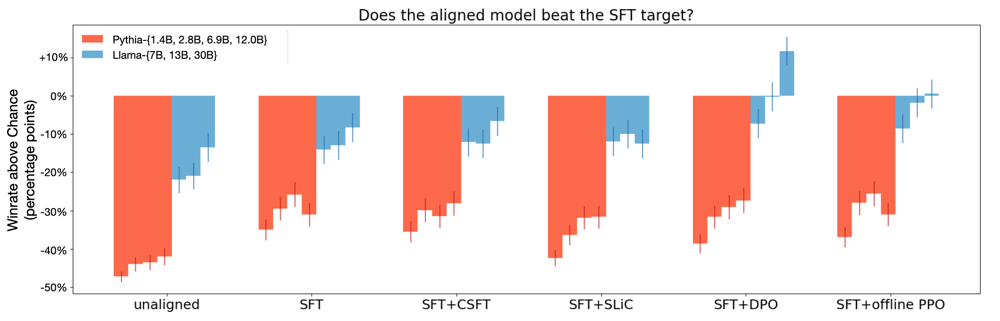

*출처: [Ethayarajh et al., 2024](https://arxiv.org/abs/2402.01306)*

규모별로 보면 HALO가 비HALO보다 승률이 높지만, 그 차이가 유의한 것은 13B 이상에서뿐입니다 ([Ethayarajh et al., 2024](https://arxiv.org/abs/2402.01306)).

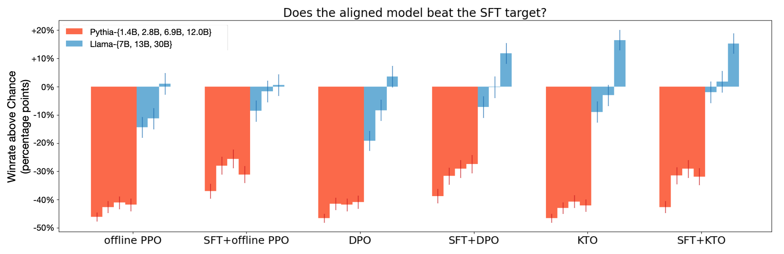

*출처: [Ethayarajh et al., 2024](https://arxiv.org/abs/2402.01306)*

KTO는 모든 규모에서 DPO와 같거나 더 좋았고, Llama 계열에서는 KTO만 단독으로 쓴 경우가 SFT+DPO와 대등했습니다. Llama 7B/13B/30B에서는 KTO 단독이 DPO 단독보다 나았고, 7B와 30B에서는 다중 비교 보정 뒤에도 그 차이가 유의했습니다($$p<0.01$$). Pythia에서는 차이가 없었습니다 ([Ethayarajh et al., 2024](https://arxiv.org/abs/2402.01306)).

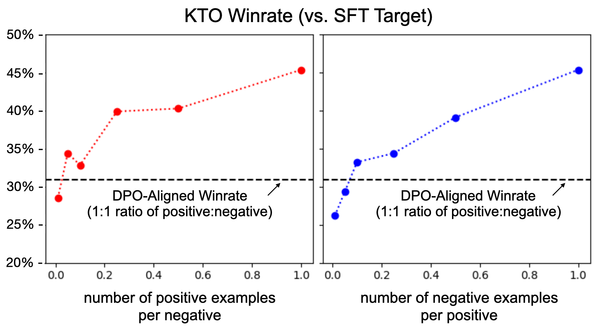

*출처: [Ethayarajh et al., 2024](https://arxiv.org/abs/2402.01306)*

데이터 측면에서도 KTO는 까다로운 조건을 견뎠습니다. 바람직한 예가 바람직하지 않은 예보다 훨씬 적은, 작고 매우 불균형한 데이터에서도 KTO로 정렬한 Llama-7B는 DPO로 정렬한 모델과 대등하거나 더 나았습니다. SFT를 건너뛰는 실험에서는 차이가 더 분명했습니다. Llama-13B와 30B에서 KTO는 SFT 없이도 SFT+KTO와 겨룰 만했고, 시험한 정렬 방법 가운데 이런 행동을 보인 것은 KTO뿐이었습니다 ([Ethayarajh et al., 2024](https://arxiv.org/abs/2402.01306)).

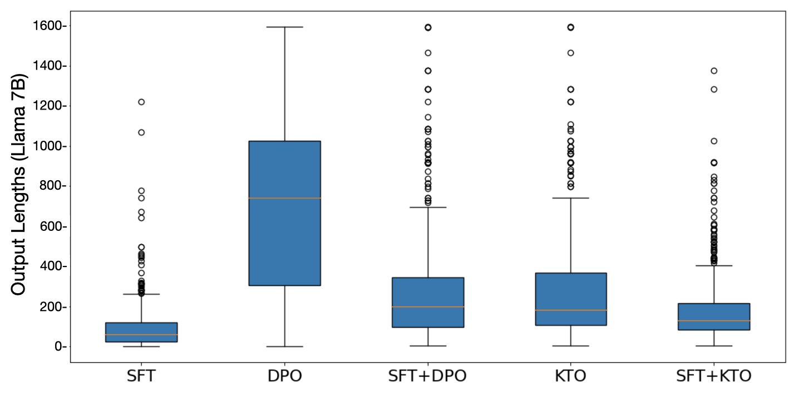

*출처: [Ethayarajh et al., 2024](https://arxiv.org/abs/2402.01306)*

SFT 없이 정렬한 DPO 모델은 장황하게 늘어지며 대화 전체를 환각하는 경향이 있었고, KTO 모델에서는 이 문제가 나타나지 않았습니다. 참조 모델을 없앤 KTO 변형은 메모리를 아끼는 대신 표준 KTO보다 성능이 낮았고, 손실 회피 하이퍼파라미터에도 더 민감했습니다. $$\lambda_{D}$$를 1.5나 2.0으로 두면 GSM8K와 BBH 성능이 몇 포인트씩 떨어졌습니다. 그래도 이 변형은 참조 모델이 필요 없는 ORPO를 앞섰고 메모리도 더 적게 썼습니다 ([Ethayarajh et al., 2024](https://arxiv.org/abs/2402.01306)).

### 보상 모델 없이도 되돌아온 과최적화

보상 모델을 지웠다고 과최적화까지 사라지지는 않았습니다. DAA Overoptimization 연구는 DPO, IPO, SLiC 같은 직접 정렬 알고리즘(DAA)이 별도의 프록시 보상 모델을 쓰지 않는데도, 높은 KL 예산에서 고전적 RLHF와 비슷한 성능 저하를 보이고, 종종 한 에폭이 끝나기도 전에 열화된다고 보고합니다 ([Rafailov et al., 2024](https://arxiv.org/abs/2406.02900)).

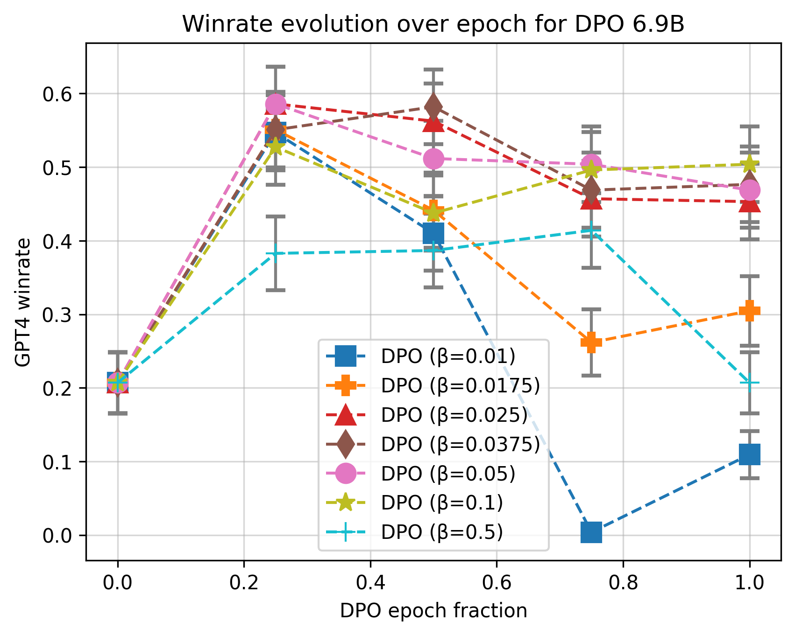

*출처: [Rafailov et al., 2024](https://arxiv.org/abs/2406.02900)*

KL이 커지는 동안 승률은 초반에 정점을 찍고 내려갑니다. KL 제약이 낮은 설정에서는 대부분의 실험이 에폭의 처음 25% 안에 최고 성능에 닿고, 그 뒤로 학습을 더 할수록 나빠집니다 ([Rafailov et al., 2024](https://arxiv.org/abs/2406.02900)). 승률을 골드 보상 대신 쓰면, 앞서 본 고전 RLHF의 과최적화 함수형 $$R(d)=d(\alpha-\beta\log d)$$, $$d=\sqrt{\mathrm{KL}}$$이 DAA에도 맞습니다 ([Rafailov et al., 2024](https://arxiv.org/abs/2406.02900))([Gao et al., 2022](https://arxiv.org/abs/2210.10760)). 이 스케일링 법칙의 적합 오차를 $$D_{\text{KL}}(\pi\lVert\pi_{\text{ref}})$$와 승률 사이 이차식 적합과 비교하면 RMSE가 상대적으로 절반이 됩니다. 저자들은 원인을 암묵적 보상 모델의 제약 부족에서 찾습니다. DAA 목적은 엄밀한 볼록 함수가 아니어서 전역 최적해가 여러 개일 수 있고, 선호 데이터는 응답 공간의 극히 일부만 덮습니다. 그 결과 분포 밖 응답에 확률을 두는 해가 많이 남습니다 ([Rafailov et al., 2024](https://arxiv.org/abs/2406.02900)). 앞서 IPO가 지적한, 결정적 선호에서 KL 정규화가 약해지는 문제와 같은 축에 놓이는 진단입니다 ([Azar et al., 2023](https://arxiv.org/abs/2310.12036)).

이 글은 이렇게 봅니다. DPO 계열이 없앤 것은 보상 모델이라는 부품이지, 선호 데이터가 응답 공간을 덮지 못한다는 근본 조건이 아닙니다. 그래서 오프라인 직접 정렬에서는 $$\beta$$나 $$\tau$$ 같은 손실 설계보다 체크포인트를 언제 멈추느냐가 결과를 더 크게 좌우할 수 있습니다. 쌍을 모으기 어렵거나 SFT를 건너뛰어야 한다면 KTO가 더 나은 출발점입니다.

## 참조 모델과 별도 SFT 단계를 덜어낸 랭킹·오즈비·길이 정규화 보상

참조 모델과 앞단의 SFT 단계는 손실을 바꾸는 것만으로 덜어낼 수 있습니다. RRHF의 랭킹+SFT 손실에서 출발해, ORPO는 오즈비 페널티로 SFT와 정렬을 한 단계로 합쳤고, SimPO는 길이 정규화 평균 로그우도와 목표 마진으로 참조 모델을 없앴습니다. DPO는 보상 모델과 RL 루프를 지웠지만, 여전히 SFT 모델로 초기화한 $$\pi_{\text{ref}}$$를 학습 내내 함께 계산합니다 ([Rafailov et al., 2023](https://arxiv.org/abs/2305.18290)). 아래 세 방법은 그 남은 부담을 하나씩 걷어냅니다.

### 순위 힌지에 SFT를 더한 RRHF

RRHF는 프롬프트 하나에 대한 응답 $$k$$개를 보상 순위에 맞춥니다. 각 응답의 점수 $$p_i$$로는 길이로 정규화한 로그확률을 쓰고, 여기에 최고 보상 응답에 대한 SFT 교차 엔트로피를 더해 RL 없이 정렬합니다 ([Yuan et al., 2023](https://arxiv.org/abs/2304.05302)).

$$
L_{rank}=\sum_{r_{i}<r_{j}}\max(0,p_{i}-p_{j})
$$

$$r_i$$는 응답 $$i$$의 보상입니다. 합은 보상이 더 낮은 $$i$$와 더 높은 $$j$$로 이루어진 모든 쌍에 걸치며, 순위가 뒤집힌 쌍에만 벌점이 붙습니다. 이 힌지에는 마진이 없습니다. 전체 손실은 두 항을 가중치 없이 더한 값입니다 ([Yuan et al., 2023](https://arxiv.org/abs/2304.05302)).

$$
L=L_{rank}+L_{ft}
$$

TL;DR 비교 한 쌍에 적용하면 $$k=2$$입니다. 랭킹 항은 $$\max(0,p_{l}-p_{w})$$ 하나로 줄고, $$L_{ft}$$는 $$y_w$$에 대한 일반 SFT 손실이 됩니다. 참조 모델은 어디에도 등장하지 않습니다. 순위 손실과 SFT 손실을 한 목적식에 묶는 구성은 ORPO에서 다시 나타납니다.

### SFT가 함께 끌어올리는 거절 응답과 오즈비 페널티

ORPO는 SFT 자체의 결함에서 출발합니다. 교차 엔트로피는 선택 응답만 지도할 뿐 거절 응답을 억제하지 못합니다. 그래서 거절 응답 토큰의 로그 확률도 선택 응답과 함께 올라갑니다 ([Hong et al., 2024](https://arxiv.org/abs/2403.07691)).

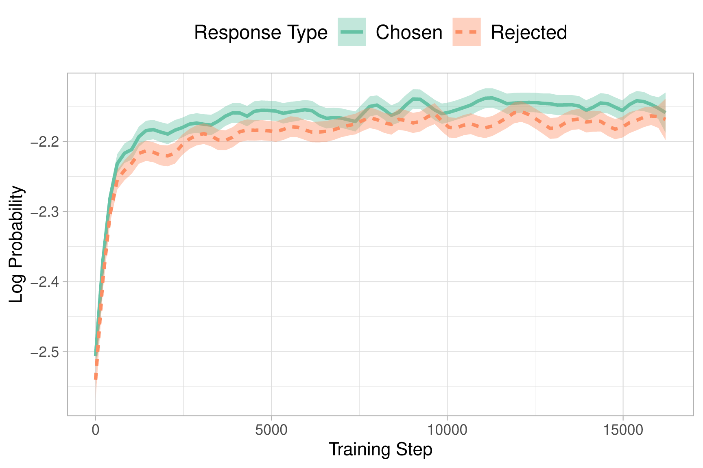

*출처: [Hong et al., 2024](https://arxiv.org/abs/2403.07691)*

이 곡선에서는 선택 응답만 지도했는데도 거절 응답의 로그 확률이 선택 응답과 거의 같은 폭으로 오릅니다. 저자들은 선호하지 않는 생성 스타일에 약한 페널티만 줘도 선호에 정렬된 SFT가 가능하다고 봅니다. 이 페널티는 오즈로 정의합니다 ([Hong et al., 2024](https://arxiv.org/abs/2403.07691)).

$$\textbf{odds}_{\theta}(y|x)=\frac{P_{\theta}(y\mid x)}{1-P_{\theta}(y\mid x)}$$

$$P_{\theta}(y\mid x)$$는 모델이 시퀀스 $$y$$를 생성할 확률이므로, 오즈는 $$y$$를 생성할 확률과 생성하지 않을 확률의 비입니다. 선택 응답과 거절 응답의 로그 오즈비(odds ratio)에 log-sigmoid를 씌우면 페널티 손실이 됩니다 ([Hong et al., 2024](https://arxiv.org/abs/2403.07691)).

$$\mathcal{L}_{OR}=-\log\sigma\left(\log\frac{\textbf{odds}_{\theta}(y_{w}|x)}{\textbf{odds}_{\theta}(y_{l}|x)}\right)$$

log-sigmoid를 씌운 이유는 $$y_w$$와 $$y_l$$ 사이의 로그 오즈비를 키울수록 손실이 줄어들게 하려는 것입니다. 최종 목적식은 기존 NLL 기반 SFT 손실에 이 항을 $$\lambda$$만큼 더한 형태이고, 참조 모델 없이 한 단계로 학습합니다 ([Hong et al., 2024](https://arxiv.org/abs/2403.07691)).

$$\mathcal{L}_{ORPO}=\mathbb{E}_{(x,y_{w},y_{l})}\left[\mathcal{L}_{SFT}+\lambda\cdot\mathcal{L}_{OR}\right]$$

저자들은 오즈비 손실의 그래디언트를 두 인수의 곱으로 나눕니다. $$\delta$$는 페널티 항, $$h$$는 대비 항입니다 ([Hong et al., 2024](https://arxiv.org/abs/2403.07691)).

$$\nabla_{\theta}\mathcal{L}_{OR}=\delta(d)\cdot h(d)$$

확률비 대신 오즈비를 쓴 이유도 제시합니다. 확률비는 오즈비보다 분포가 날카로워서, SFT와 정렬을 합치면 거절 응답 토큰을 지나치게 억제해 모델이 퇴화할 위험이 있습니다. 오즈비는 비선호 응답을 완만하게 구분하면서 선호 응답의 생성을 우선합니다 ([Hong et al., 2024](https://arxiv.org/abs/2403.07691)).

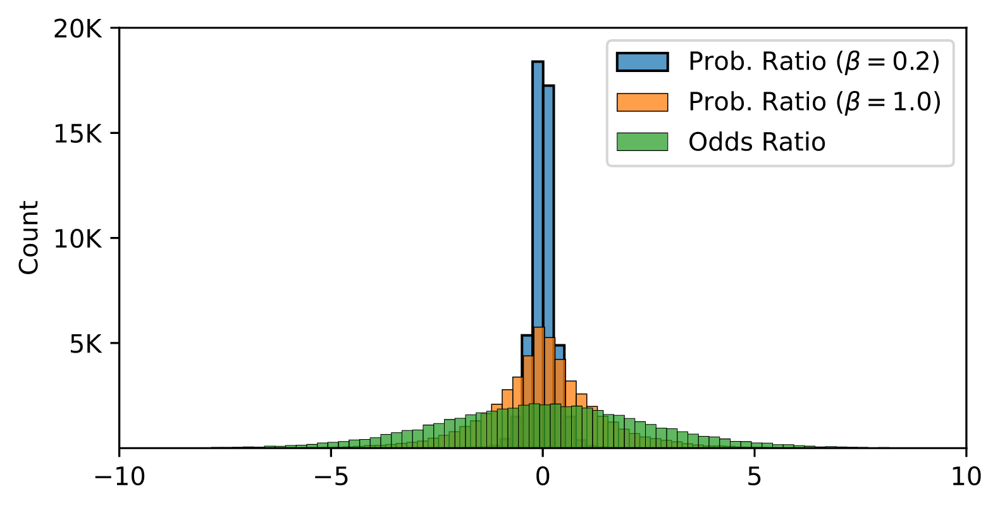

*출처: [Hong et al., 2024](https://arxiv.org/abs/2403.07691)*

입력 확률 쌍이 같아도 로그 오즈비가 더 넓은 범위에 퍼지고, 로그 확률비는 좁은 구간에 몰립니다 ([Hong et al., 2024](https://arxiv.org/abs/2403.07691)). 가상의 확률로 계산해 보면 차이가 보입니다. $$P(y_w\mid x)=0.5$$, $$P(y_l\mid x)=0.2$$라면 오즈는 각각 1과 0.25이고, 로그 오즈비는 $$\log 4\approx1.39$$, $$\mathcal{L}_{OR}=-\log\sigma(1.39)\approx0.22$$입니다. 같은 쌍의 로그 확률비는 $$\log 2.5\approx0.92$$에 그칩니다. 확률비로 같은 손실 수준에 닿으려면 $$y_l$$의 확률을 더 세게 눌러야 합니다.

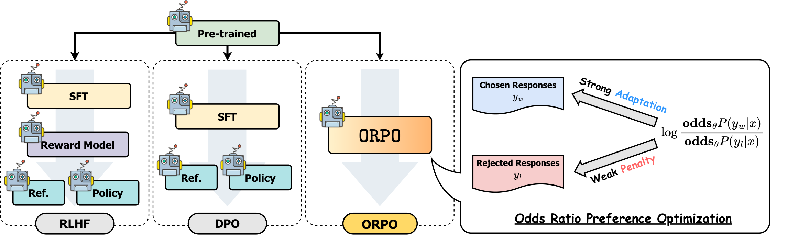

*출처: [Hong et al., 2024](https://arxiv.org/abs/2403.07691)*

세 흐름을 나란히 놓으면, ORPO는 참조 모델 없이 단일 단계로 정렬하며 거절 응답에는 약한 페널티를, 선택 응답에는 강한 적응 신호를 줍니다. 참조 모델이 빠진 만큼 RLHF·DPO보다 메모리를 덜 쓰고 배치당 FLOPs도 적으며, 순전파 횟수는 절반입니다 ([Hong et al., 2024](https://arxiv.org/abs/2403.07691)).

### 한 단계 학습의 승률

OPT 모델을 HH-RLHF로 학습하고 보상 모델로 승률을 판정하면, ORPO는 모든 규모에서 SFT와 PPO를 앞섰습니다. 규모별 최고 승률은 SFT 대비 78.0%, PPO 대비 79.4%였습니다. DPO 대비 승률은 모델 크기와 상관을 보였습니다. UltraFeedback에서도 ORPO는 SFT 대비 최대 80.5%, PPO 대비 최대 85.8%로 선호되었고, DPO 대비 승률은 모델이 클수록 높아졌습니다 ([Hong et al., 2024](https://arxiv.org/abs/2403.07691)).

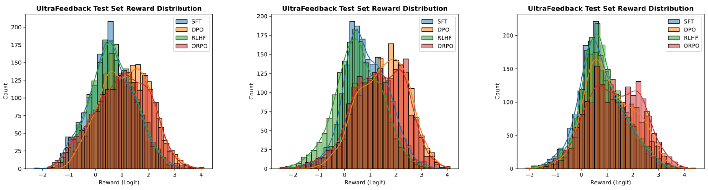

*출처: [Hong et al., 2024](https://arxiv.org/abs/2403.07691)*

세 규모의 보상 분포를 비교하면 ORPO는 기대 보상을 RLHF·DPO와 같거나 더 높게 끌어올립니다. 더 큰 모델에서는 UltraFeedback으로 $$\lambda=0.25$$를 주어 학습한 Phi-2가 AlpacaEval 1.0에서 71.80%, AlpacaEval 2.0에서 6.35%를 기록해 Llama-2 Chat을 넘었습니다 ([Hong et al., 2024](https://arxiv.org/abs/2403.07691)). 다만 앞서 본 대로, 참조 모델 없는 KTO 변형은 메모리를 더 적게 쓰면서 ORPO를 앞섰습니다 ([Ethayarajh et al., 2024](https://arxiv.org/abs/2402.01306)).

### 생성 우도와 어긋나는 DPO 보상, 그리고 길이 정규화

SimPO는 DPO 보상의 정의를 문제 삼습니다. 앞서 본 DPO 손실에서 보상은 정책과 참조 모델의 로그비입니다. 그런데 생성을 이끄는 지표는 대략 정책이 생성한 응답의 평균 로그우도이고, 이 둘은 서로 정렬되어 있지 않습니다. 저자들이 측정해 보니, DPO 보상이 승자를 더 높게 매긴 쌍 가운데 거의 절반에서 승자의 평균 로그우도가 오히려 패자보다 낮았습니다 ([Meng et al., 2024](https://arxiv.org/abs/2405.14734)).

SimPO는 생성 지표를 그대로 보상으로 씁니다. 길이 정규화(length normalization)한 평균 로그확률에 $$\beta$$를 곱한 값이며, 참조 모델이 필요 없습니다 ([Meng et al., 2024](https://arxiv.org/abs/2405.14734)).

$$r_{\text{SimPO }}(x,y)=\frac{\beta}{|y|}\log\pi_{\theta}(y\mid x)=\frac{\beta}{|y|}\sum_{i=1}^{|y|}\log\pi_{\theta}(y_{i}\mid x,y_{<i})$$

$$\lvert y\rvert$$는 응답의 토큰 수입니다. 이 보상을 브래들리-테리 목적에 넣고 목표 마진 $$\gamma$$를 빼면 최종 손실이 됩니다 ([Meng et al., 2024](https://arxiv.org/abs/2405.14734)).

$$\mathcal{L}_{\text{SimPO }}(\pi_{\theta})=-\mathbb{E}_{(x,y_{w},y_{l})\sim\mathcal{D}}\left[\log\sigma\left(\frac{\beta}{|y_{w}|}\log\pi_{\theta}(y_{w}\mid x)-\frac{\beta}{|y_{l}|}\log\pi_{\theta}(y_{l}\mid x)-\gamma\right)\right]$$

TL;DR 쌍으로 계산해 보겠습니다. 가상의 숫자로 $$y_w$$가 40토큰에 총 로그확률 −60, $$y_l$$이 20토큰에 총 로그확률 −36이라고 합시다. 총합만 보면 짧은 $$y_l$$이 더 그럴듯하지만, 토큰당 평균은 $$y_w$$가 −1.5, $$y_l$$이 −1.8로 $$y_w$$가 앞섭니다. $$\beta=2$$, $$\gamma=0.5$$로 두면 시그모이드 안의 값은 $$2(-1.5)-2(-1.8)-0.5=0.1$$이고, 손실은 $$-\log\sigma(0.1)\approx0.64$$입니다.

길이 정규화의 효과는 응답 길이와의 상관에서 드러납니다. UltraFeedback의 held-out 집합에서 평균 로그우도와 응답 길이의 스피어만 상관은 길이 정규화를 뺀 SimPO가 0.82, DPO가 0.59, SimPO가 0.34였습니다. Mistral-Base 7B에서 길이 정규화를 제거하면 AlpacaEval 2 LC가 11.9까지 떨어지는데, 완전한 SimPO는 같은 설정에서 21.5를 기록했습니다 ([Meng et al., 2024](https://arxiv.org/abs/2405.14734)).

### 목표 마진의 적정선과 추론 과제의 대가

목표 마진 $$\gamma$$는 승자 보상이 패자 보상보다 적어도 $$\gamma$$ 이상 크도록 강제합니다. 마진을 키우면 처음에는 생성 품질이 좋아지지만, 너무 크면 다시 나빠집니다. IPO도 비슷한 마진을 쓰지만, 저자들은 IPO의 전체 목적식이 SimPO만큼 효과적이지 않다고 봅니다 ([Meng et al., 2024](https://arxiv.org/abs/2405.14734)). RRHF의 랭킹 손실에는 이런 마진이 아예 없었습니다 ([Yuan et al., 2023](https://arxiv.org/abs/2304.05302)).

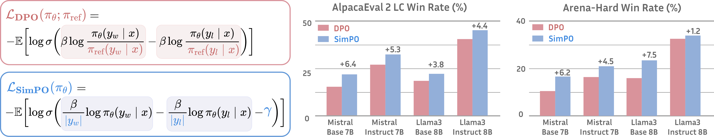

*출처: [Meng et al., 2024](https://arxiv.org/abs/2405.14734)*

두 방법은 주로 보상 정의에서 다르고, 여러 설정의 AlpacaEval 2와 Arena-Hard에서 SimPO가 DPO를 크게 앞섭니다. 같은 Mistral-Base 7B 설정에서 SimPO의 Arena-Hard 승률은 16.6%였습니다. 대가도 있습니다. 선호 최적화 뒤에는 GSM8k 같은 추론 과제의 성능이 떨어지며, SimPO가 DPO와 비슷하거나 더 나쁜 경우도 있습니다 ([Meng et al., 2024](https://arxiv.org/abs/2405.14734)).

이 글의 판단으로는, 세 방법이 덜어낸 것은 참조 모델의 메모리와 별도 SFT 단계이고, 참조 정책 근처에 머물게 하는 제약은 SFT 항(RRHF, ORPO)이나 길이 정규화와 마진(SimPO)이 대신 맡습니다. 그래서 대화형 승률 지표에서 얻는 이득과 추론 과제에서의 손실을 함께 확인한 뒤에 채택하는 편이 안전합니다.

## 브래들리-테리를 넘어선 선호 게임의 내시 균형과 현재 정책 샘플

선호를 점별 보상으로 줄이지 않고 두 응답을 직접 비교하는 게임으로 다루면, 정렬의 목표는 보상 최대화가 아니라 내시 균형(Nash equilibrium)이 됩니다. 이 균형을 찾는 과정은 현재 정책이 스스로 뽑은 샘플과 다시 겨루는 반복 학습으로 자연스럽게 이어집니다. 이 계보는 앞서 ΨPO가 지적한 쌍별→점별 근사를 걷어내고, 정적 데이터 대신 현재 정책의 샘플을 씁니다.

### 점별 보상 없이 두 응답을 받는 선호 모델

NLHF는 보상 모델을 학습하지 않습니다. 대신 두 응답을 입력으로 받는 선호 모델을 학습하고, 그 선호 모델의 내시 균형 정책을 계산하는 것을 목표로 정합니다. 그래서 브래들리-테리 가정이 필요 없습니다. 여기서 균형 정책은 어떤 대안 정책이 낸 응답과 비교해도 선호 모델 기준으로 일관되게 더 선호되는 응답을 내는 정책입니다 ([Munos et al., 2023](https://arxiv.org/abs/2312.00886)). TL;DR 비교 한 쌍에 대입하면, 보상 모델은 $$y_w$$와 $$y_l$$에 각각 점수를 매긴 뒤 그 차이로 선호를 설명합니다. 선호 모델은 $$(x, y_w, y_l)$$을 한꺼번에 받아 "$$y_w$$가 $$y_l$$보다 나을 확률"을 바로 냅니다.

저자들은 두 모델이 데이터 분포에 의존하는 방식도 다르다고 봅니다. 보상 모델은 학습 데이터를 만든 분포에 묶이지만, 표현이 완벽한 이상적인 경우 선호 모델은 데이터 생성 분포에 영향을 받지 않습니다. 그래서 반복 과정에서 선호 모델을 다시 학습하지 않고 새 데이터로 보강할 수 있습니다 ([Munos et al., 2023](https://arxiv.org/abs/2312.00886)).

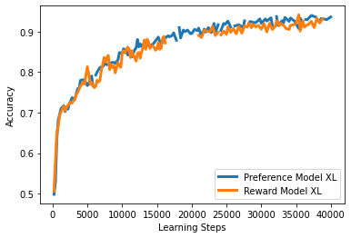

*출처: [Munos et al., 2023](https://arxiv.org/abs/2312.00886)*

두 곡선은 크기가 같은 선호 모델과 보상 모델의 정확도를 학습셋과 테스트셋에서 나란히 비교합니다. 비교 형식을 바꿨다고 RLHF의 안전장치가 사라지지는 않습니다. NLHF는 RLHF의 KL 정규화를 그대로 가져와 참조 정책 $$\mu$$에 대한 KL 페널티를 둡니다. 이렇게 정규화한 선호 모델에는 내시 균형이 하나만 존재합니다 ([Munos et al., 2023](https://arxiv.org/abs/2312.00886)). 목표가 하나로 정해지므로 알고리즘이 어디로 수렴해야 하는지도 분명해집니다.

### 기하 혼합을 상대로 한 미러 디센트, Nash-MD

균형을 찾는 알고리즘인 Nash-MD는 현재 정책을 그대로 상대로 삼지 않습니다. 현재 정책과 참조 정책을 섞은 혼합 정책을 상대로 미러 디센트를 한 스텝씩 밟습니다 ([Munos et al., 2023](https://arxiv.org/abs/2312.00886)).

$$
\pi_{t+1}\stackrel{\text{def}}{=}\arg\max_{\pi}\left[\eta_{t}{\cal{P}}(\pi\succ\pi_{t}^{\mu})-\text{KL}(\pi,\pi_{t}^{\mu})\right]
$$

$$\eta_t$$는 스텝 크기이고, $$\mathcal{P}(\pi\succ\pi')$$는 $$\pi$$의 응답이 $$\pi'$$의 응답보다 선호될 확률입니다. 상대 정책 $$\pi_t^{\mu}$$는 다음과 같은 기하 혼합으로 정의합니다 ([Munos et al., 2023](https://arxiv.org/abs/2312.00886)).

$$
\pi_{t}^{\mu}(y)\stackrel{\text{def}}{=}\frac{\pi_{t}(y)^{1-\eta_{t}\tau}\mu(y)^{\eta_{t}\tau}}{\sum_{y^{\prime}}\pi_{t}(y^{\prime})^{1-\eta_{t}\tau}\mu(y^{\prime})^{\eta_{t}\tau}}
$$

$$\tau$$는 KL 정규화 강도입니다. 지수 $$\eta_t\tau$$가 클수록 상대 정책은 참조 정책 쪽으로 당겨집니다. 스텝 크기를 $$\eta_t=2/(\tau(t+2))$$로 두면 마지막 반복점이 정규화 내시 균형 $$\pi^{*}_{\tau}$$로 $$O(1/T)$$ 속도로 KL 수렴합니다 ([Munos et al., 2023](https://arxiv.org/abs/2312.00886)).

$$
\text{KL}(\pi^{*}_{\tau},\pi_{T})\leq\frac{8}{\tau^{2}(T+1)}
$$

평균 반복점이 아니라 마지막 반복점이 수렴하기 때문에, 중간 정책들을 저장해 둘 필요가 없습니다. 저자들은 메모리 요구가 큰 LLM에서 이 성질이 특히 중요하다고 강조합니다. 파라미터의 지수이동평균을 쓰는 변형은 Nash-EMA라고 부릅니다 ([Munos et al., 2023](https://arxiv.org/abs/2312.00886)).

실제 언어 모델에서는 Nash-MD-PG라는 정책 경사 알고리즘을 씁니다. 대안 정책을 $$\pi_\theta$$와 $$\mu$$의 기하 혼합 $$\pi_\theta^{\beta}$$로 두고, 혼합 계수 $$\beta$$로 자기 대결(self-play)과 SFT 정책에 대한 최적 응답 사이를 조절합니다. 다만 이 구현은 미러 디센트를 그대로 수행하지 않고, 정규화된 선호 모델 위에서 경사 스텝 하나만 밟습니다. 따라서 앞의 수렴 보장이 딥러닝 구현에 직접 적용되지는 않습니다 ([Munos et al., 2023](https://arxiv.org/abs/2312.00886)).

NLHF의 실험에서는 $$\beta=0.125$$, $$0.25$$, $$0.375$$의 Nash-MD 모델이 RLHF를 포함한 다른 모든 모델을 앞섰고, 가장 낮은 $$\beta$$인 MD1이 가장 좋았습니다. 반대로 $$\beta=0$$(순수 자기 대결)과 $$\beta=1$$(SFT 대상 최적 응답)이라는 양 극단은 중간값보다 성능이 낮았습니다. 특히 최적 응답 쪽은 선호 모델에 과적합하는 '선호 해킹' 가능성을 보였고, Nash-EMA는 Nash-MD와 RLHF 모두에 뒤졌습니다 ([Munos et al., 2023](https://arxiv.org/abs/2312.00886)).

### 현재 정책 샘플로 바꾼 온라인 IPO

Online IPO 논문은 앞서 본 IPO 손실에서 데이터가 어디서 오는지만 바꿉니다. 정적 데이터 분포 대신 현재 정책 $$\pi$$의 샘플을 씁니다 ([Calandriello et al., 2024](https://arxiv.org/abs/2403.08635)).

$$
\mathop{\mathbb{E}}_{\begin{subarray}{c}Y,Y^{\prime}\sim\texttt{SG}[\pi]\\
Y^{+},Y^{-}\sim\lambda_{p}(Y,Y^{\prime})\end{subarray}}\bigg[\left(\log\bigg(\frac{\pi(Y^{+})\pi^{\mathrm{ref}}(Y^{-})}{\pi(Y^{-})\pi^{\mathrm{ref}}(Y^{+})}\bigg)-\tau^{-1}/2\right)^{2}\bigg]
$$

$$\texttt{SG}$$는 stop-gradient입니다. 샘플링 분포를 통해서는 기울기가 흐르지 않습니다. $$\lambda_p$$는 선호 모델 $$p$$에 따라 두 샘플을 승자 $$Y^{+}$$와 패자 $$Y^{-}$$로 나누고, 제곱 안의 로그비가 목표값 $$\tau^{-1}/2$$에 회귀합니다. TL;DR 프롬프트라면 고정된 사람 비교 쌍을 다시 쓰지 않습니다. 매 스텝 현재 모델이 요약 두 개를 새로 쓰고, 선호 모델이 그 둘의 승패를 정합니다.

이 형태에서 핵심 결과가 나옵니다. 이런 데이터 흐름으로 IPO 손실을 최적화하면, 기대 업데이트 수준에서 선호 모델의 내시 균형을 자기 대결로 찾는 것과 같아집니다. 오프라인 직접 정렬과 게임 이론적 RLHF라는 별개의 계보가 같은 지점에서 만난 셈입니다. 요약 과제에서 3개 시드로 1대1 비교를 9회 진행했을 때, 평균만 보면 IPO가 모든 온라인 알고리즘을 이겼습니다. 하지만 표준편차를 고려하면 IPO와 IPO-MD는 통계적으로 구분되지 않았고, 둘 다 나머지 방법을 일관되게 이겼습니다. 실험 범위는 770M 모델과 요약이라는 단일 과제에 그쳐서, 대화형 에이전트로 일반화되는지는 검증되지 않았습니다 ([Calandriello et al., 2024](https://arxiv.org/abs/2403.08635)).

### 승률에 로그비를 맞추는 SPPO

SPPO는 같은 게임을 승률 기반 곱셈 가중치 갱신으로 풉니다. Freund와 Schapire의 틀을 따라, 두 플레이어 상수합 게임의 내시 균형에 평균적으로 수렴하는 반복 프레임워크를 세웁니다. 매 라운드의 진행은 다음과 같습니다 ([Wu et al., 2024](https://arxiv.org/abs/2405.00675)).

1. 각 프롬프트 $$x$$마다 현재 정책 $$\pi_t$$에서 응답 $$K$$개를 샘플링합니다.
2. 선호 오라클(두 응답 중 어느 쪽이 나은지 판정하는 외부 선호 모델, 여기서는 PairRM)로 응답들 사이의 승률을 주석합니다. 질의 수는 $$O(K^2)$$입니다.
3. $$(x, y, \text{win rate})$$ 데이터셋을 만들고 제곱 손실을 최적화합니다.

실제로 최적화하는 손실은 로그 정규화항을 상수 $$\eta/2$$로 대체한 다음 식입니다 ([Wu et al., 2024](https://arxiv.org/abs/2405.00675)).

$$
\pi_{t+1} =\mathop{\mathrm{argmin}}_{\pi}\mathbb{E}_{\mathbf{x}\sim\mathcal{X},\mathbf{y}\sim{\pi}_{t}(\cdot\mid\mathbf{x})}\bigg(\log\bigg(\frac{\pi(\mathbf{y}\mid\mathbf{x})}{\pi_{t}(\mathbf{y}\mid\mathbf{x})}\bigg)-\eta\bigg(\mathbb{P}(\mathbf{y}\succ\widehat{\pi}_{t}^{K}\mid\mathbf{x})-\frac{1}{2}\bigg)\bigg)^{2}
$$

$$\widehat{\pi}_{t}^{K}$$는 $$K$$개 샘플로 근사한 현재 정책이고, $$\mathbb{P}(\mathbf{y}\succ\widehat{\pi}_{t}^{K}\mid\mathbf{x})$$는 응답 $$\mathbf{y}$$가 그 샘플들을 이길 추정 승률입니다. 참조 대상이 고정된 SFT 모델이 아니라 직전 라운드 정책 $$\pi_t$$인 점도 눈여겨볼 만합니다. 식에 따르면 추정 승률이 $$1/2$$보다 높은 응답은 로그비 목표가 양수가 되고, $$1/2$$보다 낮은 응답은 음수가 됩니다 ([Wu et al., 2024](https://arxiv.org/abs/2405.00675)).

DPO와 IPO는 쌍의 차이를 취해 정규화항을 소거합니다. SPPO는 각 응답을 승률에 직접 맞추는데, 그 결과 두 응답 사이의 간격만이 아니라 승자 로그비가 $$1/2$$, 패자 로그비가 $$-1/2$$ 근처로 가도록 각각 밀어 줍니다. 저자들은 이 성질이 승자 확률까지 함께 떨어지는 문제를 완화한다고 보며, DPO와 KTO에는 내시 수렴 보장이 없다고 덧붙입니다 ([Wu et al., 2024](https://arxiv.org/abs/2405.00675)).

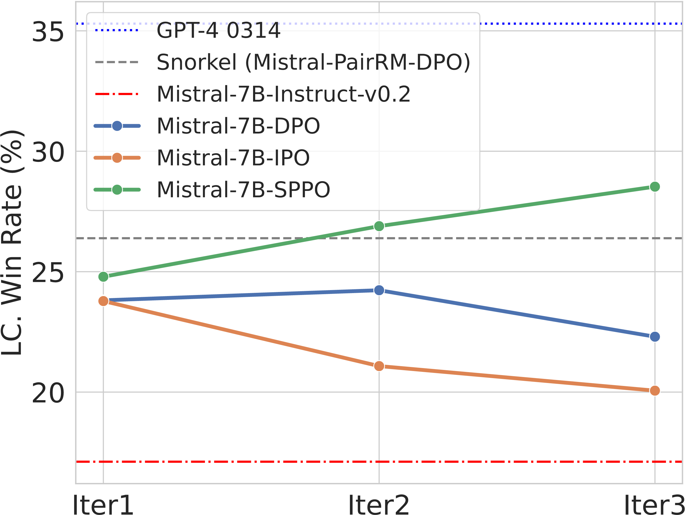

*출처: [Wu et al., 2024](https://arxiv.org/abs/2405.00675)*

길이 통제(LC) 승률과 원 승률 모두에서 SPPO가 반복마다 꾸준히 오르는 흐름이 드러납니다. Mistral-7B-Instruct-v0.2를 기반으로 PairRM을 선호 오라클로 쓴 설정에서, 세 번째 반복 모델은 AlpacaEval LC 승률 28.52%, 전체 승률 31.02%로 비교 대상 가운데 가장 높았습니다. MT-Bench에서는 평균 7.59로 기준 모델들을 앞섰지만, 처음 두 반복에서는 성능이 오히려 떨어졌습니다. Arena-Hard에서도 같은 모델이 23.3점으로 기준 모델들을 넘었고, Open LLM Leaderboard에서는 Arc, TruthfulQA, GSM8k가 기본 모델보다 좋아져 평균 66.75점을 기록했습니다 ([Wu et al., 2024](https://arxiv.org/abs/2405.00675)).

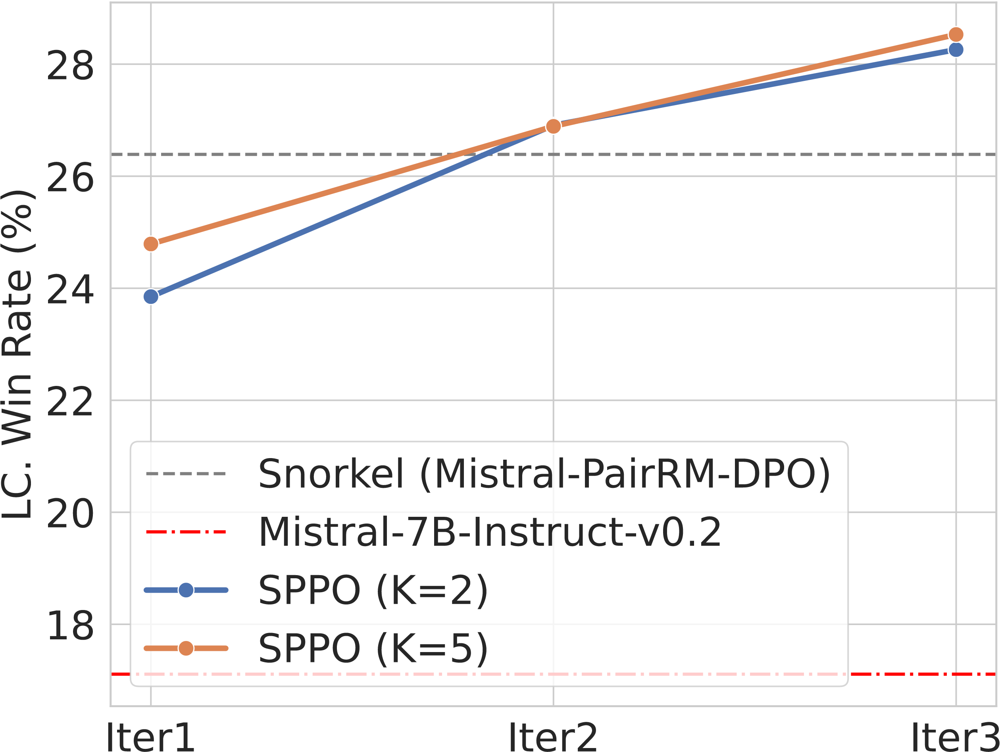

*출처: [Wu et al., 2024](https://arxiv.org/abs/2405.00675)*

승률을 추정할 때 쓰는 샘플 수 $$K$$를 2와 5로 바꾼 절제 실험입니다. 저자들은 SPPO가 승률 추정의 잡음에 강건하고, 큰 $$K$$의 이점은 뒤 반복으로 갈수록 줄어든다고 정리합니다 ([Wu et al., 2024](https://arxiv.org/abs/2405.00675)). $$K$$가 커지면 선호 질의 비용은 앞서 말한 대로 제곱으로 늘어나므로, 이 강건성은 실용적인 의미가 큽니다.

### 반복 DPO와 새 온라인 데이터

게임 이론을 거치지 않아도 같은 방향의 처방이 나옵니다. RLHF Workflow가 정리한 온라인 반복 RLHF는 매 반복마다 지금까지 모은 데이터로 정책 쌍을 갱신합니다. 그다음 새 프롬프트에 두 응답을 샘플링하고, 선호 신호를 받아 데이터셋에 더합니다. 이렇게 들어오는 새 온라인 데이터가 분포 밖(OOD) 문제를 완화합니다 ([Dong et al., 2024](https://arxiv.org/abs/2405.07863)). 앞서 본 직접 정렬 알고리즘의 과최적화는 선호 데이터가 응답 공간의 극히 일부만 덮는 데서 비롯되었는데 ([Rafailov et al., 2024](https://arxiv.org/abs/2406.02900)), 현재 정책에서 새로 뽑은 샘플은 바로 그 빈 영역을 채웁니다. 반복 DPO 모델은 학술 벤치마크에서 SFT 대비 뚜렷한 성능 저하를 보이지 않았습니다. 저자들은 정렬 데이터가 이전 단계보다 훨씬 적어서, 모델이 이미 가진 능력을 더 잘 쓰게 된 결과로 해석합니다 ([Dong et al., 2024](https://arxiv.org/abs/2405.07863)).

이 글은 이 계보의 공통 성과를 손실의 형태보다 데이터의 출처에서 찾습니다. Online IPO의 동치 결과가 보여 주듯, 오프라인 IPO와 내시 균형 탐색을 가르는 것은 샘플이 현재 정책에서 오는지뿐입니다. 다만 Nash-MD의 극단적 $$\beta$$에서 나타난 선호 해킹과 SPPO 초기 반복의 MT-Bench 하락을 보면, 선호 모델 자체를 믿을 수 있는지는 여전히 열린 문제입니다.

## 가치 모델을 그룹 평균으로 바꾼 GRPO와 검증 가능한 보상의 성공률 증폭

GRPO는 정책과 맞먹는 크기의 가치 모델을 없앱니다. 그 자리에 같은 질문에 대해 뽑은 샘플 그룹의 평균·표준편차 정규화를 넣었고, 그 결과 정답 여부만 주는 검증 가능한 보상(verifiable reward) 아래에서는 참조 모델보다 성공 확률을 끌어올리는 가중 대조 손실처럼 동작합니다.

### 크리틱을 대신하는 같은 질문의 샘플 그룹

DeepSeekMath 저자들이 PPO의 가치 함수를 문제 삼은 이유는 둘입니다. 먼저 가치 함수가 정책과 비슷한 크기라서 메모리와 계산 부담이 큽니다. 또 LLM에서는 보상 모델이 보통 마지막 토큰에만 점수를 주므로, 토큰마다 정확한 가치 함수를 학습하기 어렵습니다. 저자들은 그룹 안에서 상대적으로 매기는 advantage가 같은 질문에 대한 비교 데이터로 학습한 보상 모델의 비교적 성격과도 맞는다고 덧붙입니다. 그래서 GRPO는 추가 가치 함수 근사를 쓰지 않고, 같은 질문에 대해 샘플링한 여러 출력의 평균 보상을 baseline으로 씁니다. 출발점은 InstructGPT식 PPO입니다. 다만 KL 페널티를 보상에 섞지 않고 손실에 직접 더합니다. 그래야 advantage 계산이 복잡해지지 않습니다 ([Shao et al., 2024](https://arxiv.org/abs/2402.03300)).

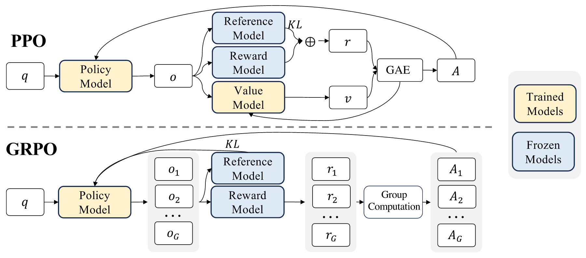

*출처: [Shao et al., 2024](https://arxiv.org/abs/2402.03300)*

두 구조를 나란히 놓으면 GRPO 쪽에는 가치 모델이 아예 없습니다. baseline은 그룹 점수에서 추정하고, 그만큼 학습 자원이 크게 줄어듭니다. 목적함수는 다음과 같습니다 ([Shao et al., 2024](https://arxiv.org/abs/2402.03300)).

$$
\begin{aligned}\mathcal{J}_{GRPO}(\theta)&=\mathbb{E}{[q\sim P(Q),\{o_{i}\}_{i=1}^{G}\sim\pi_{\theta_{old}}(O\mid q)]}\\
&\frac{1}{G}\sum_{i=1}^{G}\frac{1}{\lvert o_{i}\rvert}\sum_{t=1}^{\lvert o_{i}\rvert}\left\{\min\left[\frac{\pi_{\theta}(o_{i,t}\mid q,o_{i,<t})}{\pi_{\theta_{old}}(o_{i,t}\mid q,o_{i,<t})}\hat{A}_{i,t},\text{clip}\left(\frac{\pi_{\theta}(o_{i,t}\mid q,o_{i,<t})}{\pi_{\theta_{old}}(o_{i,t}\mid q,o_{i,<t})},1-\varepsilon,1+\varepsilon\right)\hat{A}_{i,t}\right]-\beta\mathbb{D}_{KL}\left[\pi_{\theta}\Vert\pi_{ref}\right]\right\}\end{aligned}
$$

$$q$$는 질문입니다. $$\{o_i\}_{i=1}^{G}$$는 이전 정책 $$\pi_{\theta_{old}}$$에서 뽑은 출력 $$G$$개이고, $$\varepsilon$$은 PPO와 같은 클리핑 폭, $$\beta$$는 참조 정책 $$\pi_{ref}$$에 대한 KL 계수입니다. 결과 감독(outcome supervision)에서는 그룹 보상 $$\mathbf{r}$$을 평균으로 빼고 표준편차로 나눈 값을 그 출력의 모든 토큰 advantage로 씁니다 ([Shao et al., 2024](https://arxiv.org/abs/2402.03300)).

$$
\hat{A}_{i,t}=\widetilde{r}_{i}=\frac{r_{i}-{\rm mean}(\mathbf{r})}{{\rm std}(\mathbf{r})}
$$

TL;DR 요약 데이터의 DPO 같은 쌍 비교 방법은 선호 쌍 하나에서 선호 응답 $$y_w$$와 거부 응답 $$y_l$$ 두 개만 대조했습니다. GRPO는 한 질문에 출력 여러 개를 뽑아 그룹 안에서 서로 견줍니다. 가상의 예로 $$G=4$$이고 정답 여부 보상이 $$(1,1,0,0)$$이면, 평균 0.5와 표준편차 0.5로 정규화되어 정답 두 개는 토큰마다 $$+1$$, 오답 두 개는 $$-1$$의 advantage를 받습니다. 과정 감독(process supervision)에서는 추론 단계마다 보상을 주고 같은 방식으로 정규화합니다. 각 토큰의 advantage는 그 토큰 이후 단계들의 정규화 보상을 더한 값입니다 ([Shao et al., 2024](https://arxiv.org/abs/2402.03300)).

$$
\hat{A}_{i,t}=\sum_{index(j)\geq t}\widetilde{r}_{i}^{index(j)}
$$

KL 항은 다음 비편향 추정자로 계산하며, 이 값은 항상 양수입니다 ([Shao et al., 2024](https://arxiv.org/abs/2402.03300)).

$$
\mathbb{D}_{KL}\left[\pi_{\theta}\Vert\pi_{ref}\right]=\frac{\pi_{ref}(o_{i,t}\mid q,o_{i,<t})}{\pi_{\theta}(o_{i,t}\mid q,o_{i,<t})}-\log\frac{\pi_{ref}(o_{i,t}\mid q,o_{i,<t})}{\pi_{\theta}(o_{i,t}\mid q,o_{i,<t})}-1
$$

DeepSeekMath-RL 학습에서는 정책 학습률을 1e-6, KL 계수를 0.04로 두고, 질문 하나당 출력 64개를 뽑았습니다 ([Shao et al., 2024](https://arxiv.org/abs/2402.03300)).

### 오답에도 음의 계수를 주는 기울기

앞서 소개한 통합 관점은 방법들을 데이터 소스, 보상 함수, 알고리즘(기울기 계수)이라는 세 요소로 구분했습니다. 그 틀에서 GRPO의 계수는 그룹 상대 advantage에 KL 보정항을 더한 형태입니다 ([Shao et al., 2024](https://arxiv.org/abs/2402.03300)).

$$
GC_{GRPO}(q,o,t,\pi_{\theta_{rm}})=\hat{A}_{i,t}+\beta\left(\frac{\pi_{ref}(o_{i,t}\mid o_{i,<t})}{\pi_{\theta}(o_{i,t}\mid o_{i,<t})}-1\right)
$$

$$\pi_{\theta_{rm}}$$은 보상을 매기는 보상 모델입니다. Online RFT는 정답을 모두 같은 강도로 강화할 뿐 오답은 벌하지 않습니다. GRPO는 보상 값에 따라 계수를 조절해 오답에 페널티를 줍니다. 저자들은 GRPO가 Online RFT를 앞선 이유를 이 차이에서 찾습니다 ([Shao et al., 2024](https://arxiv.org/abs/2402.03300)).

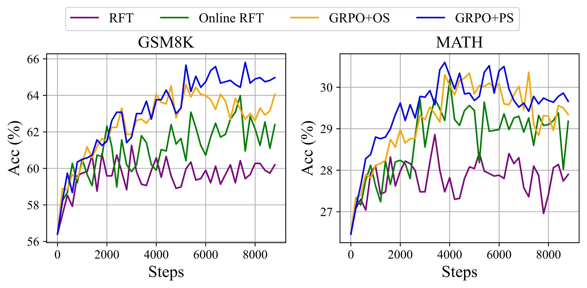

*출처: [Shao et al., 2024](https://arxiv.org/abs/2402.03300)*

DeepSeekMath-Instruct 1.3B를 여러 방법으로 추가 학습한 뒤 두 벤치마크에서 성능을 비교했습니다. GRPO가 Online RFT 위에 있고, 과정 감독을 쓴 GRPO+PS가 결과 감독을 쓴 GRPO+OS보다 높습니다 ([Shao et al., 2024](https://arxiv.org/abs/2402.03300)).

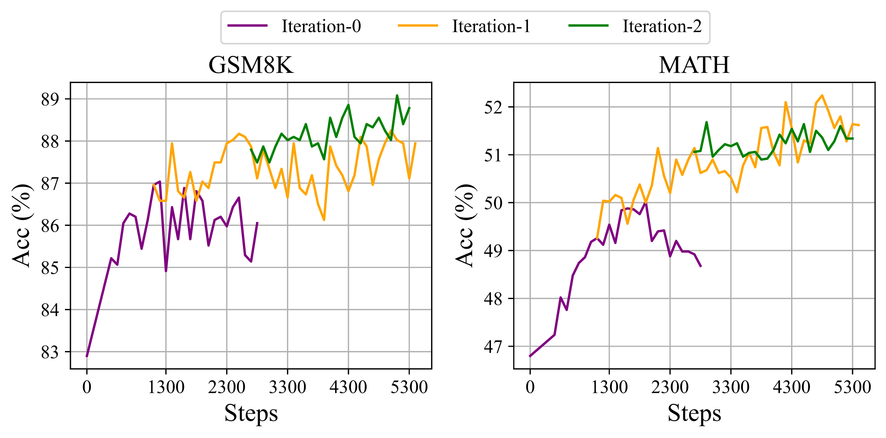

*출처: [Shao et al., 2024](https://arxiv.org/abs/2402.03300)*

7B 모델로 RL을 여러 번 반복한 실험도 있습니다. 반복 RL은 성능을 크게 올렸고, 그 효과는 특히 첫 반복에서 두드러졌습니다 ([Shao et al., 2024](https://arxiv.org/abs/2402.03300)).

### 오르는 Maj@K, 그대로인 Pass@K

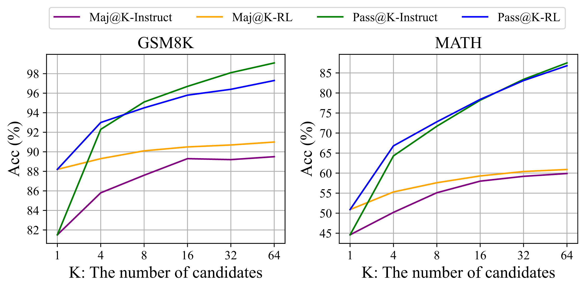

*출처: [Shao et al., 2024](https://arxiv.org/abs/2402.03300)*

RL은 다수결 정확도인 Maj@K를 올리지만, $$K$$개 중 하나라도 맞히는 Pass@K는 올리지 못합니다. 위 그림은 SFT와 RL DeepSeekMath 7B를 GSM8K와 MATH에서 온도 0.7로 샘플링해 비교한 결과이며, 이 차이를 그대로 보여 줍니다 ([Shao et al., 2024](https://arxiv.org/abs/2402.03300)). 이미 후보 안에 있던 정답이 상위로 더 자주 올라왔을 뿐, 새로 풀게 된 문제가 늘어난 것은 아닙니다.

### 이진 검증 보상이 만드는 가중 대조 손실

Mroueh는 보상이 정답 여부(0 또는 1)로만 주어지는 경우를 분석합니다. 이때 GRPO의 평균+분산 보정은 대조 손실을 유도하고, 그 대조 샘플은 이전 정책에서 뽑은 합성 데이터입니다. 정책의 성공 확률(PoS)은 단순한 점화식을 따라 고정점으로 수렴합니다. 이 손실의 가중치는 $$\pi_{\theta_{old}}(\cdot\mid q)$$의 성공 확률에 따라 달라집니다. 앞의 정규화 식에서 이 가중치를 직접 끌어낼 수 있습니다. 이진 보상이고 성공 확률이 $$p$$이면 그룹 보상의 평균은 $$p$$, 표준편차는 $$\sqrt{p(1-p)}$$이므로, 성공 샘플은 $$\sqrt{(1-p)/p}$$, 실패 샘플은 $$-\sqrt{p/(1-p)}$$의 advantage를 받습니다. 가상의 예로 $$p=0.5$$이면 앞서 본 대로 $$+1$$과 $$-1$$이지만, $$p=0.75$$이면 성공 샘플은 약 $$+0.58$$, 실패 샘플은 약 $$-1.73$$을 받습니다. 성공 확률이 높을수록 성공 샘플의 가중치는 작아지고, 실패 샘플은 더 강하게 벌을 받습니다 ([Mroueh, 2025](https://arxiv.org/abs/2503.06639)).

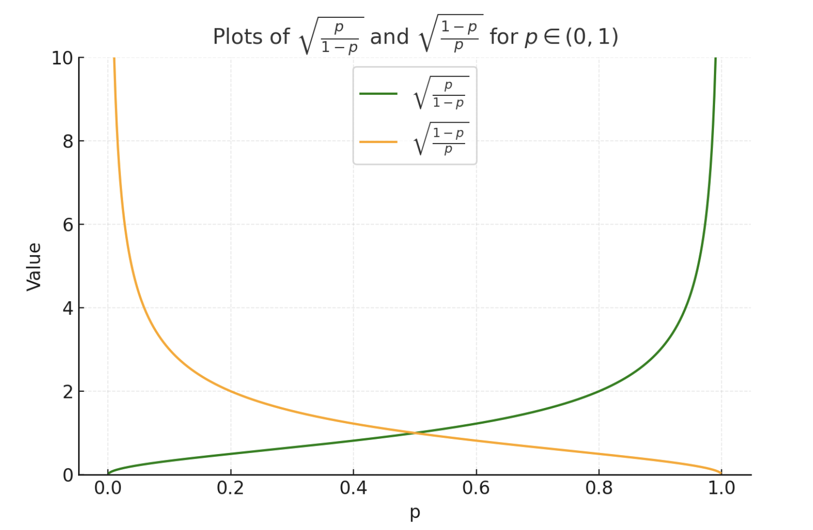

*출처: [Mroueh, 2025](https://arxiv.org/abs/2503.06639)*

가로축인 이전 정책의 성공 확률이 변할 때 성공 샘플과 실패 샘플의 가중치가 어떻게 달라지는지 확인할 수 있습니다. 이 분석의 핵심 결론은 다음과 같습니다. 고정점 성공 확률 $$p^{*}(q)$$는 참조 모델의 성공 확률 $$p_{\mathrm{ref}}(q)$$보다 크고, 따라서 GRPO는 성공 확률을 증폭합니다. 다만 $$p_{\mathrm{ref}}(q)$$가 극단값이면 고정점이 반드시 안정적이지는 않아서, 안정성을 확보하려면 $$\beta$$에 조건이 붙습니다 ([Mroueh, 2025](https://arxiv.org/abs/2503.06639)).

이 글은 두 결과를 이렇게 읽습니다. 크리틱을 그룹 평균으로 바꾼 설계는 비용을 줄였을 뿐 아니라, 학습 대상을 "참조 모델이 가끔 맞히던 질문을 더 자주 맞히기"로 좁혔습니다. 그래서 참조 모델이 거의 못 푸는 질문에서는 증폭할 신호도 적고, 고정점의 안정성마저 $$\beta$$에 의존하게 됩니다.

## 계보를 가리지 않고 되풀이되는 보상 해킹과 길이 편향

목적 함수가 보상 모델+PPO이든, AI 라벨이든, 닫힌 형태 손실이든, 정책은 평가자가 쉽게 속는 지점을 찾아냈습니다. 그 흔적은 요약에서는 추출식 복사로, 대화에서는 극단적이거나 회피적인 응답과 길어지는 출력으로 드러났습니다.

### 라벨러의 지름길을 그대로 배운 요약 정책

Ziegler 등의 요약 실험에서 비교 6만 개로 학습한 RL 모델이 이 현상을 보여 줍니다. 이 모델은 추출식 구조가 따로 없는데도 거의 완전히 추출식으로 동작했습니다. 원문에서 문장을 통째로 복사하고, 어떤 문장을 고를지만 바꿨습니다. 저자들은 라벨러가 단순한 휴리스틱에 기대 판단했고, 모델이 그 습관을 악용했을 가능성을 지적합니다 ([Ziegler et al., 2019](https://arxiv.org/abs/1909.08593)). 앞서 든 TL;DR 비교 쌍에 대입하면, 라벨러가 "원문 문장이 그대로 들어간 요약"을 $$y_w$$로 고르는 경향이 조금만 있어도 보상 모델은 복사를 높게 평가합니다. PPO는 그 방향으로 계속 밀고 갑니다.

사람 평가 결과도 의심스럽습니다. 같은 모델이 사람이 쓴 참조 요약을 TL;DR에서 96%, CNN/Daily Mail에서 84%의 비율로 이겼습니다. 문장을 복사하는 모델이 참조 요약을 이 정도로 압도했다면, 요약 품질이 좋아졌다기보다 평가 자체를 믿기 어렵다는 신호로 읽는 편이 자연스럽습니다. 같은 연구가 모호한 요약 과제에서는 라벨러 간 일관성을 확보하기 어렵다고 보고한 내용과도 맞물립니다 ([Ziegler et al., 2019](https://arxiv.org/abs/1909.08593)).

### 평가자를 바꿔도 남는 허점

사람 라벨을 AI 라벨로 바꿔도 허점은 사라지지 않았습니다. Constitutional AI에서 체인 오브 소트(chain-of-thought) 피드백은 확률이 극단으로 쏠렸고, 클램핑을 하지 않으면 RL-CAI가 극단적인 응답을 학습했습니다. 사람 피드백 쪽 기준선인 HH RLHF 모델은 "답할 수 없다"는 식의 회피 응답을 자주 냈습니다 ([Bai et al., 2022](https://arxiv.org/abs/2212.08073)). 무해성 평가자가 거절을 안전하다고 보면, 정책은 거절이라는 손쉬운 출구를 찾습니다. 게임 이론 계보도 마찬가지였습니다. NLHF에서 SFT 대상 최적 응답만 쫓는 설정은 선호 모델에 과적합하는 "선호 해킹" 가능성을 보였습니다 ([Munos et al., 2023](https://arxiv.org/abs/2312.00886)).

보상 모델을 지운 직접 정렬 알고리즘도 예외가 아닙니다. 이들 역시 높은 KL 예산에서 고전적 RLHF와 비슷하게 과최적화됩니다 ([Rafailov et al., 2024](https://arxiv.org/abs/2406.02900)). 길이 쪽 증상도 이미 나타났습니다. SFT 없이 학습한 DPO는 응답이 길어졌고, 대화를 환각하며 횡설수설했습니다 ([Ethayarajh et al., 2024](https://arxiv.org/abs/2402.01306)).

### 길이라는 공통 증상과 두 가지 응답

길이는 여러 계보에 공통으로 나타나는 증상입니다. SPPO 논문은 Mistral 기반 모델에서 평균 응답 길이를 비교했습니다. 같은 Mistral 기반 비교에서 DPO와 IPO는 평균 출력 길이를 각각 2736과 2654로 크게 늘렸습니다. SPPO는 기본 모델의 1676에서 세 번째 반복의 2163으로 늘었고, 증가 폭이 더 완만했습니다. 다만 이 길이 수치만으로 앞서 본 승률 직접 회귀식 ([Wu et al., 2024](https://arxiv.org/abs/2405.00675))이 원인이라고 단정하기는 어렵습니다.

SimPO는 같은 문제를 손실 설계로 다룹니다. 보상을 응답 길이로 나눈 평균 로그확률로 바꾸자, 평균 로그우도와 길이 사이의 상관이 DPO보다 낮아졌습니다. 길이 정규화를 빼면 길이 통제 승률이 크게 떨어졌습니다 ([Meng et al., 2024](https://arxiv.org/abs/2405.14734)).

이 글의 해석은 이렇습니다. 두 응답은 평가자의 허점을 메우지 않습니다. 정책이 그 허점 쪽으로 미끄러지는 속도를 늦출 뿐입니다. 길이 정규화는 길이라는 한 축만 막고, 추출식 복사나 회피 응답 같은 다른 지름길은 손대지 않은 채 남겨 둡니다. 따라서 길이 통제 승률이 올랐다는 결과만으로 보상 해킹이 줄었다고 결론 내리기는 어렵습니다.

## 서로 다른 평가 잣대 위에 놓인 승률과 정확도

계보별 핵심 수치를 한 표에 모아도 그 수치들은 하나의 축 위에 있지 않습니다. 사람 평가, GPT-4 판정, 보상 모델 정확도, 검증 가능한 정답률은 서로 다른 잣대이기 때문에, 표는 어느 방법이 이겼는지보다 각 방법이 어떤 비용을 줄이고 어떤 위험을 새로 떠안았는지를 보여 주는 자료로 읽는 편이 맞습니다.

### 네 가지 잣대와 그 사이의 환율

이 섹션 끝의 표는 초기 RLHF, 직접 정렬, 반복·자기 대국 정렬, GRPO 계보의 방법을 한 행씩 놓습니다. "주요 결과" 열에는 각 논문이 보고한 대표 수치를, "한계" 열에는 그 방법이 남긴 약점을 적었습니다. 그런데 "주요 결과" 열에는 성격이 다른 측정값이 섞여 있습니다. 초기 RLHF 계보의 수치는 대부분 사람 평가자의 선호율입니다. InstructGPT, Anthropic HH-RLHF, Llama 2-Chat, NLHF 행에는 보상 모델이나 선호 모델의 비교 정확도가 들어 있습니다. DPO 이후의 직접 정렬 계보와 SPPO, SimPO, ORPO 행은 주로 GPT-4가 판정하는 AlpacaEval, MT-Bench, Arena-Hard 승률을 보고합니다. GRPO 행만 MATH 정답률이라는 검증 가능한 보상을 씁니다.

이 잣대들을 서로 바꿔 읽으려면 일종의 환율이 필요하며, DPO 논문이 그 환율을 직접 잰 몇 안 되는 사례입니다. TL;DR 요약에서 DPO를 평가한 비교를 보면, GPT-4 판정과 사람 판정의 일치율은 67%, 사람 평가자끼리의 일치율은 65%였습니다 ([Rafailov et al., 2023](https://arxiv.org/abs/2305.18290)). 이 결과는 GPT-4 판정이 사람만큼은 믿을 만하다는 근거가 됩니다. 동시에 사람끼리도 셋 중 하나꼴로 판단이 갈린다는 사실을 보여 줍니다. 승률 몇 %p의 차이가 이 판정 잡음보다 작다면 그 차이로 우열을 가리기는 어렵습니다. 게다가 이 일치율은 요약이라는 한 과제에서 잰 값이므로, 대화나 지시 따르기 벤치마크의 GPT-4 판정에 그대로 옮겨 적용할 수 없습니다.

보상 모델 정확도는 성격이 또 다릅니다. 이 값은 정렬된 정책의 품질이 아니라 학습 신호의 품질을 잽니다. 정확도가 높은 보상 모델도 과하게 최적화하면 진짜 목표가 떨어지기 때문에 ([Gao et al., 2022](https://arxiv.org/abs/2210.10760)), 정확도 열의 값이 높다고 정렬 결과가 좋다고 말할 수는 없습니다.

### 같은 벤치마크, 다른 출발점

AlpacaEval 2의 길이 통제 승률은 SPPO, RLHF Workflow, SimPO 행에 공통으로 나타납니다. 이 승률은 GPT-4 판정이 긴 응답을 선호하는 편향을 회귀로 걷어 낸 값입니다. 그래도 이 숫자들을 나란히 놓고 비교할 수는 없습니다. 행마다 기본 모델이 다르고, 선호 오라클과 데이터도 다릅니다. 같은 논문 안에서 같은 기본 모델로 DPO와 비교한 수치만 의미 있는 상대 비교입니다. 예컨대 SimPO는 DPO와 보상 정의만 다른데도 AlpacaEval 2와 Arena-Hard의 여러 설정에서 DPO를 크게 앞섰습니다. SPPO는 AlpacaEval 2.0에서 GPT-4-Turbo 대비 길이 통제 승률과 원래 승률을 반복마다 꾸준히 높였습니다 ([Meng et al., 2024](https://arxiv.org/abs/2405.14734))([Wu et al., 2024](https://arxiv.org/abs/2405.00675)). 다만 같은 논문 안의 비교라도 승률이 높다고 곧 품질이 좋다는 뜻은 아닙니다. 앞서 본 요약 RL 모델은 문장을 거의 통째로 복사하는 추출식 요약을 내면서도 참조 요약을 높은 비율로 이겼습니다. 이는 모델이 평가자가 단순한 휴리스틱에 기대는 허점을 파고들었다는 신호일 수 있습니다 ([Ziegler et al., 2019](https://arxiv.org/abs/1909.08593)).

### 줄인 비용과 늘린 위험으로 읽는 표

"한계" 열을 "주요 결과" 열과 짝지어 읽으면 교환 관계가 드러납니다. DPO는 별도 보상 모델과 RL 루프를 없앴습니다 ([Rafailov et al., 2023](https://arxiv.org/abs/2305.18290)).  RLAIF는 라벨링 비용이 사람 주석보다 10배 이상 저렴하다고 추정했습니다. 하지만 사람 피드백과 AI 피드백을 결합해도 사람 피드백만 쓸 때보다 나아지지 않았습니다 ([Lee et al., 2023](https://arxiv.org/abs/2309.00267)). ORPO는 참조 모델을 없애 RLHF나 DPO보다 메모리와 배치당 FLOPs를 줄였습니다 ([Hong et al., 2024](https://arxiv.org/abs/2403.07691)). SimPO의 목표 마진은 키울수록 처음에는 생성 품질을 높이지만, 너무 커지면 오히려 떨어뜨립니다. 그만큼 이 하이퍼파라미터에 민감합니다 ([Meng et al., 2024](https://arxiv.org/abs/2405.14734)). SPPO와 반복 DPO는 현재 정책에서 새로 뽑은 샘플을 선호 오라클로 주석해 성능을 높였습니다. 선호 오라클은 두 응답 중 어느 쪽이 나은지 판정하는 외부 선호 모델입니다. 그러나 라운드마다 프롬프트당 K개 응답을 뽑아 쌍별로 승률을 매기므로 $$O(K^2)$$번의 오라클 질의가 필요합니다 ([Wu et al., 2024](https://arxiv.org/abs/2405.00675)). GRPO는 가치 모델을 그룹 평균으로 대체해 자원 부담을 덜었습니다. 다만 RL을 거친 DeepSeekMath 7B는 GSM8K와 MATH에서 Maj@K만 높였고 Pass@K는 높이지 못했습니다 ([Shao et al., 2024](https://arxiv.org/abs/2402.03300)). Maj@K는 K개 샘플의 다수결 정답률이고, Pass@K는 K개 중 하나라도 맞힐 확률입니다. Pass@K가 그대로라면 모델은 원래 샘플링 범위 안에서 풀 수 있던 답을 더 자주 고르게 됐을 뿐입니다. 따라서 MATH 정확도가 올랐다는 결과를 새로운 능력이 생겼다는 뜻으로 읽어서는 안 됩니다.

이 글의 판단으로는, 아래 표에서 가장 믿을 만한 정보는 개별 수치가 아니라 같은 행 안에서 결과와 한계가 맺는 관계입니다. 어떤 방법을 고를지는 "주요 결과" 열의 크기보다, 자신의 상황에서 "한계" 열에 적힌 위험을 감당할 수 있는지로 정하는 편이 안전합니다.

| 논문 | 계보 | 주요 결과 | 한계 |
| --- | --- | --- | --- |
| Deep RL from Human Preferences | RLHF와 PPO | MuJoCo 1400 합성 라벨 ≥ 진짜 보상 RL | 명시 없음 |
| Ziegler et al. 2019 | RLHF와 PPO | 60k 미세조정 vs 지도학습 TL;DR 승률 97%; 인간 피드백 모델 vs 모의 보상 모델 선호 77% | 보상-정책 파라미터 공유 과적합 |
| Learning to Summarize | RLHF와 PPO | 1.3B 인간피드백 TL;DR 선호율 61% (SFT 43%); 6.7B 길이통제 TL;DR 선호율 ~65% | 높은 계산·라벨링 비용 |
| InstructGPT | RLHF와 PPO | 175B InstructGPT 대 GPT-3 선호율 85%; RM held-out 라벨러 정확도 69.6% | 소규모 라벨러·단일 라벨링 |
| Anthropic HH-RLHF | RLHF와 PPO | 온라인 PM base/RS/online 정확도 74/70/67% | PM 예측과 Elo 불일치 |
| RM Overoptimization | RLHF와 PPO | RM 검증 손실 1x8000 0.654857 | 합성 설정·단일 환경 한계 |
| Constitutional AI | AI 피드백 | RL-CAI 무해성 AI 비교 182,831개; HHH 비교 정확도 90% 이상 | RL-CAI 과최적화 |
| RRHF | 참조 모델 없는 목적 | Alpaca-RRHF(SP) HH 보상 -0.96 | 다중 응답 필요 및 과최적화 |
| DPO | DPO와 일반화 | DPO vs PPO TL;DR 인간 선호 58%; DPO CNN/DailyMail 승률 0.36 (PPO 0.26) | 소규모 모델·GPT-4 평가 의존 |
| Llama 2-Chat | RLHF와 PPO | Helpfulness RM 평균 정확도 70.6 | 인간 평가의 프롬프트 범위 한계 |
| RLAIF | AI 피드백 | 요약 RLAIF 승률 71% / RLHF 73%; 무해 대화 RLAIF 무해율 88% | 응답 길이 편향 |
| ΨPO/IPO | DPO와 일반화 | 장난감 실험 18000 스텝, 학습률 0.01 | 장난감 실험에 한정된 평가 |
| NLHF | 온라인·게임 이론 | T5X-XL 선호 모델 테스트 정확도 0.78 (보상 모델 0.76); RLHF 기준선 TL;DR SFT 대비 승률 99% | 제한된 규모의 요약 실험 |
| KTO | DPO와 일반화 | Mistral-7B OpenAssistant KTO(y 하나) 승률 0.631 | 깨끗한 선호 데이터에서 KTO 과소적합 위험 |
| DeepSeekMath/GRPO | 크리틱 없는 RL | DeepSeekMath-RL 7B MATH 정확도 51.7%; DeepSeekMath 7B MATH maj@64 60.9% | 보상 신호 노이즈 문제 |
| ORPO | 참조 모델 없는 목적 | Mistral-ORPO-β MT-Bench 7.32; Mistral-ORPO-α 7B AlpacaEval 87.92% / 11.33% | 비교 방법·규모 범위 제한 |
| SPPO | 온라인·게임 이론 | SPPO vs DPO AlpacaEval LC 28.53% vs 26.39%; Llama-3-8B-SPPO AlpacaEval LC 승률 38.77% | 반복 후 일반 성능 하락 |
| RLHF Workflow | 온라인·게임 이론 | 8B 반복 DPO 길이제어 승률 31.3 | 반복 RLHF의 길이 편향 증폭 |
| SimPO | 참조 모델 없는 목적 | Gemma-2-9B-it-SimPO AlpacaEval 2 LC 72.4%; SimPO 실행시간 약 20% 감소 | 마진 튜닝·이론 부재·안전성 미고려 |
| DAA Overoptimization | DPO와 일반화 | DPO·IPO·SLiC 최고 성능 시점 데이터 25% | 모델 규모 한계 |

## 단순한 손실, 신선한 샘플, 믿기 어려운 보상 사이의 삼각 긴장

계보를 시간순으로 겹쳐 보면 흐름이 둘 보입니다. 손실 함수는 계속 단순해지고, 샘플링은 다시 현재 정책 쪽으로 돌아갑니다. 그러나 보상 신호를 얼마나 믿을 수 있느냐는 문제는 어느 계보에서도 풀리지 않았습니다.

### 단순해지는 손실, 하나로 모이지 않는 최선

TL;DR 비교 한 쌍을 기준으로 보면 변화가 뚜렷합니다. RLHF는 이 쌍으로 보상 모델을 먼저 학습하고, 그 위에서 별도 가치 함수와 함께 PPO를 돌렸습니다 ([Stiennon et al., 2020](https://arxiv.org/abs/2009.01325)). DPO는 같은 쌍을 정책 로그비에 대한 이진 교차 엔트로피 하나로 바꿨습니다 ([Rafailov et al., 2023](https://arxiv.org/abs/2305.18290)). ORPO와 SimPO는 여기서 참조 모델까지 덜어냈고 ([Hong et al., 2024](https://arxiv.org/abs/2403.07691))([Meng et al., 2024](https://arxiv.org/abs/2405.14734)), KTO는 쌍조차 요구하지 않고 좋음·나쁨 신호만 씁니다 ([Ethayarajh et al., 2024](https://arxiv.org/abs/2402.01306)).

그렇다고 손실이 한 가지 형태로 모인 것은 아닙니다. KTO 저자들은 단 하나의 최선 HALO는 없으며, 최적의 손실은 주어진 상황에 맞는 귀납적 편향에 달려 있다고 결론짓습니다 ([Ethayarajh et al., 2024](https://arxiv.org/abs/2402.01306)). 손실마다 실패하는 방식도 다릅니다. 결정적 선호에서 DPO는 참조 정책을 무시하는 쪽으로 수렴하고 ([Azar et al., 2023](https://arxiv.org/abs/2310.12036)), SFT 없이 학습하면 응답이 길어집니다 ([Ethayarajh et al., 2024](https://arxiv.org/abs/2402.01306)). SimPO는 추론 과제에서 성능이 떨어지는 경우가 있습니다 ([Meng et al., 2024](https://arxiv.org/abs/2405.14734)).

### 다시 온라인으로 돌아가는 샘플

샘플링 쪽은 한 바퀴를 돌았습니다. Christiano 등은 보상 예측기를 처음에 오프라인으로만 학습하면 점유 분포의 비정상성 때문에 이상 행동이 나온다고 보고했습니다 ([Christiano et al., 2017](https://arxiv.org/abs/1706.03741)). Anthropic HH-RLHF는 이 문제를 반복 온라인 수집으로 이어 갔습니다 ([Bai et al., 2022](https://arxiv.org/abs/2204.05862)). DPO는 고정된 오프라인 데이터셋으로 이 루프를 끊었습니다 ([Rafailov et al., 2023](https://arxiv.org/abs/2305.18290)). 이후 온라인 IPO가 자기 대결 내시 균형 탐색과 동치임이 밝혀졌고 ([Calandriello et al., 2024](https://arxiv.org/abs/2403.08635)), 반복 DPO 계열은 현재 정책에서 새로 뽑은 응답으로 분포 밖 문제를 완화했습니다 ([Dong et al., 2024](https://arxiv.org/abs/2405.07863)). GRPO도 그룹 샘플을 온라인에서 뽑습니다 ([Shao et al., 2024](https://arxiv.org/abs/2402.03300)). 대가도 함께 돌아왔습니다. SPPO는 라운드마다 오라클 질의가 응답 수의 제곱으로 늘어납니다 ([Wu et al., 2024](https://arxiv.org/abs/2405.00675)). 앞서 본 Ziegler 등도 완전 온라인 수집이 소프트웨어·ML 복잡도와 품질 관리 면에서 부담이 크다는 이유로 배치 수집을 제안했습니다 ([Ziegler et al., 2019](https://arxiv.org/abs/1909.08593)).

### 어느 계보도 고치지 못한 보상 신호

세 번째 꼭짓점은 그대로 남아 있습니다. 학습된 보상 모델은 과최적화되고 ([Gao et al., 2022](https://arxiv.org/abs/2210.10760)), 보상 모델을 지운 직접 정렬 알고리즘도 높은 KL 예산에서 같은 열화를 보였습니다. 원인으로는 선호 데이터가 응답 공간의 극히 일부만 덮어 암묵적 보상이 충분히 제약되지 않는 문제가 지목됩니다 ([Rafailov et al., 2024](https://arxiv.org/abs/2406.02900)). 선호 모델을 쓰는 NLHF에서도 SFT 대상 최적 응답 설정은 '선호 해킹' 가능성을 보였습니다 ([Munos et al., 2023](https://arxiv.org/abs/2312.00886)). AI 피드백은 확률이 극단적이라 클램핑해야 했고 ([Bai et al., 2022](https://arxiv.org/abs/2212.08073)), 요약 RL 모델은 라벨러의 단순한 휴리스틱을 파고든 흔적을 남겼습니다 ([Ziegler et al., 2019](https://arxiv.org/abs/1909.08593)). 손실을 단순하게 바꾸든 샘플을 신선하게 바꾸든, 평가자와 정책 사이의 불일치는 해결되지 않고 다른 자리로 옮겨 갔을 뿐입니다.

### 새 능력보다 이미 있는 정답의 증폭

RL이 실제로 무엇을 바꾸는지도 이 긴장과 맞닿아 있습니다. DeepSeekMath 저자들은 앞서 본 Maj@K와 Pass@K의 엇갈림을, RL이 근본 능력을 높인 결과가 아니라 출력 분포를 더 견고하게 만들어 정답을 상위 후보로 끌어올린 효과로 해석합니다 ([Shao et al., 2024](https://arxiv.org/abs/2402.03300)). 앞서 본 Mroueh의 성공확률 증폭 분석과 RLHF Workflow의 해석도 같은 방향입니다 ([Mroueh, 2025](https://arxiv.org/abs/2503.06639))([Dong et al., 2024](https://arxiv.org/abs/2405.07863)).

이 글의 판단으로는, 세 꼭짓점이 서로를 끌어당기고 있습니다. 손실을 단순하게 만들면 참조 모델과 보상 모델이 맡던 정규화가 줄어듭니다. 그 빈자리를 신선한 샘플로 메우면, 이번에는 평가자를 더 자주 시험하게 됩니다. 정답 검증처럼 보상을 믿을 수 있는 영역에서만 RL이 깔끔하게 작동하는데, 거기서도 RL이 하는 일은 기존 정답을 증폭하는 쪽에 가깝습니다. 그래서 다음 진전은 새 손실 형태보다 보상 신호의 신뢰도를 높이는 쪽에서 나올 가능성이 큽니다.

## KL 정규화 선호 목표라는 하나의 뿌리

보상 모델과 PPO, AI 피드백, 닫힌 형태 직접 최적화, 참조 모델 제거, 온라인·게임 이론, 크리틱 없는 RL의 여섯 갈래는 참조 정책 근처에 머물면서 선호를 최대화한다는 같은 목표를 각자 다르게 근사한 결과입니다. RLHF는 이 목표를 보상 모델과, KL 페널티를 뺀 보상으로 돌리는 PPO로 풀었습니다 ([Stiennon et al., 2020](https://arxiv.org/abs/2009.01325))([Ouyang et al., 2022](https://arxiv.org/abs/2203.02155)). DPO는 앞서 본 닫힌 형태의 손실로 같은 목표를 풉니다 ([Rafailov et al., 2023](https://arxiv.org/abs/2305.18290)). NLHF는 이 KL 정규화를 선호 모델 위의 게임으로 가져갔습니다 ([Munos et al., 2023](https://arxiv.org/abs/2312.00886)). GRPO도 KL 항을 손실에 직접 더하는 방식으로 같은 틀을 유지합니다 ([Shao et al., 2024](https://arxiv.org/abs/2402.03300)).

그렇다면 어떤 근사를 고를지는 세 가지 조건으로 정해집니다. 첫째는 데이터 형태입니다. TL;DR 비교 쌍처럼 고정된 선호 쌍이 있으면 DPO·IPO 계열이 가장 직접적입니다. 쌍 없이 좋음·나쁨 신호만 있으면 앞서 본 KTO가 맞습니다. 정답을 검증할 수 있는 과제에는 그룹 상대 점수를 쓰는 GRPO가 어울립니다 ([Shao et al., 2024](https://arxiv.org/abs/2402.03300)).

둘째는 연산 예산입니다. 가치 모델이 부담스럽다면 앞서 본 GRPO의 그룹 평균 기준선이 대안입니다. 참조 모델 메모리까지 아끼려면 앞서 소개한 참조 모델 없는 방식이 후보입니다. 반대로 반복 샘플링과 라벨링을 감당할 수 있으면 앞서 본 온라인 방식도 가능하지만, 질의 비용이 그만큼 듭니다.

셋째인 보상 신뢰도가 가장 무거운 조건입니다. 앞서 본 대로 과최적화는 명시적 보상이든 암묵적 보상이든 피해 가지 못합니다. 고전 RLHF에서 KL 페널티의 효과는 조기 종료와 같았습니다 ([Gao et al., 2022](https://arxiv.org/abs/2210.10760)). 이 글의 권고는 다음과 같습니다. 보상을 믿기 어려울수록 손실 형태를 바꾸는 데 공을 들이기보다 KL 예산을 작게 잡고, 학습 도중 체크포인트를 다른 평가자로 자주 확인하는 편이 실제로 더 많은 것을 지켜 줍니다.

- - -

### References
* Paul Christiano, Jan Leike, Tom B. Brown et al. (2017). [Deep reinforcement learning from human preferences](https://arxiv.org/abs/1706.03741). NeurIPS.
* Daniel M. Ziegler, Nisan Stiennon, Jeffrey Wu et al. (2019). [Fine-Tuning Language Models from Human Preferences](https://arxiv.org/abs/1909.08593). arXiv.
* Nisan Stiennon, Long Ouyang, Jeff Wu et al. (2020). [Learning to summarize from human feedback](https://arxiv.org/abs/2009.01325). NeurIPS.
* Long Ouyang, Jeff Wu, Xu Jiang et al. (2022). [Training language models to follow instructions with human feedback](https://arxiv.org/abs/2203.02155). NeurIPS.
* Yuntao Bai, Andy Jones, Kamal Ndousse et al. (2022). [Training a Helpful and Harmless Assistant with Reinforcement Learning from Human Feedback](https://arxiv.org/abs/2204.05862). arXiv.
* Leo Gao, John Schulman, Jacob Hilton (2022). [Scaling Laws for Reward Model Overoptimization](https://arxiv.org/abs/2210.10760). ICML.
* Yuntao Bai, Saurav Kadavath, Sandipan Kundu et al. (2022). [Constitutional AI: Harmlessness from AI Feedback](https://arxiv.org/abs/2212.08073). arXiv.
* Zheng Yuan, Hongyi Yuan, Chuanqi Tan et al. (2023). [RRHF: Rank Responses to Align Language Models with Human Feedback without tears](https://arxiv.org/abs/2304.05302). NeurIPS.
* Rafael Rafailov, Archit Sharma, Eric Mitchell et al. (2023). [Direct Preference Optimization: Your Language Model is Secretly a Reward Model](https://arxiv.org/abs/2305.18290). NeurIPS.
* Hugo Touvron, Louis Martin, Kevin Stone et al. (2023). [Llama 2: Open Foundation and Fine-Tuned Chat Models](https://arxiv.org/abs/2307.09288). arXiv.
* Harrison Lee, Samrat Phatale, Hassan Mansoor et al. (2023). [RLAIF vs. RLHF: Scaling Reinforcement Learning from Human Feedback with AI Feedback](https://arxiv.org/abs/2309.00267). ICML.
* Mohammad Gheshlaghi Azar, Mark Rowland, Bilal Piot et al. (2023). [A General Theoretical Paradigm to Understand Learning from Human Preferences](https://arxiv.org/abs/2310.12036). International Conference on Artificial Intelligence and Statistics.
* Rémi Munos, Michal Valko, Daniele Calandriello et al. (2023). [Nash Learning from Human Feedback](https://arxiv.org/abs/2312.00886). ICML.
* Kawin Ethayarajh, Winnie Xu, Niklas Muennighoff et al. (2024). [KTO: Model Alignment as Prospect Theoretic Optimization](https://arxiv.org/abs/2402.01306). arXiv.
* Zhihong Shao, Peiyi Wang, Qihao Zhu et al. (2024). [DeepSeekMath: Pushing the Limits of Mathematical Reasoning in Open Language Models](https://arxiv.org/abs/2402.03300). arXiv.
* Jiwoo Hong, Noah Lee, James Thorne (2024). [ORPO: Monolithic Preference Optimization without Reference Model](https://arxiv.org/abs/2403.07691). EMNLP.
* Daniele Calandriello, Daniel Guo, Remi Munos et al. (2024). [Human Alignment of Large Language Models through Online Preference Optimisation](https://arxiv.org/abs/2403.08635). ICML.
* Yue Wu, Zhiqing Sun, Huizhuo Yuan et al. (2024). [Self-Play Preference Optimization for Language Model Alignment](https://arxiv.org/abs/2405.00675). ICLR.
* Hanze Dong, Wei Xiong, Bo Pang et al. (2024). [RLHF Workflow: From Reward Modeling to Online RLHF](https://arxiv.org/abs/2405.07863). TMLR.
* Yu Meng, Mengzhou Xia, Danqi Chen (2024). [SimPO: Simple Preference Optimization with a Reference-Free Reward](https://arxiv.org/abs/2405.14734). NeurIPS.
* Rafael Rafailov, Yaswanth Chittepu, Ryan Park et al. (2024). [Scaling Laws for Reward Model Overoptimization in Direct Alignment Algorithms](https://arxiv.org/abs/2406.02900). NeurIPS.
* Youssef Mroueh (2025). [Reinforcement Learning with Verifiable Rewards: GRPO's Effective Loss, Dynamics, and Success Amplification](https://arxiv.org/abs/2503.06639). arXiv.

### 참고 자료
* [Illustrating Reinforcement Learning from Human Feedback (RLHF)](https://huggingface.co/blog/rlhf)
