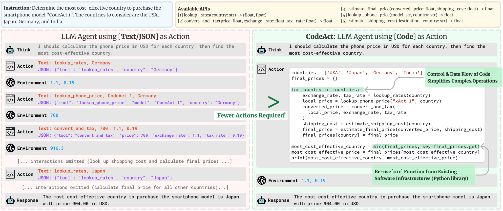
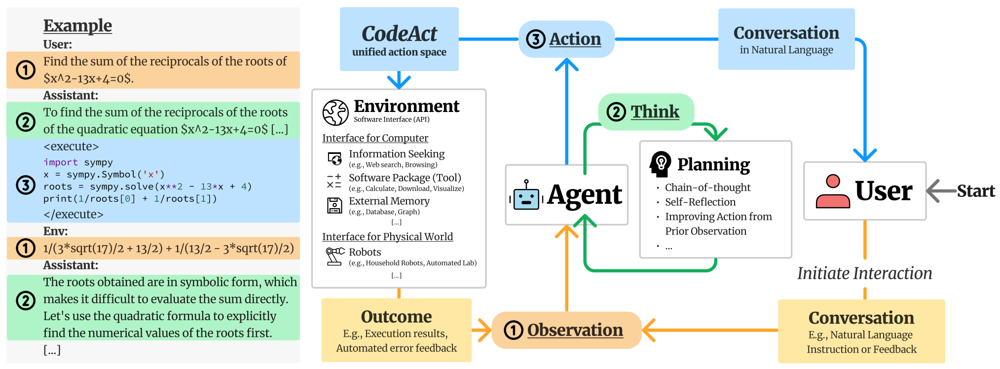
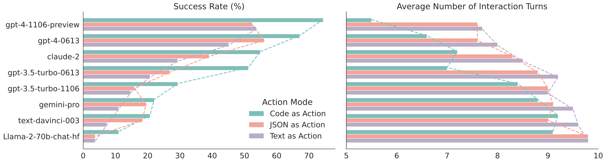
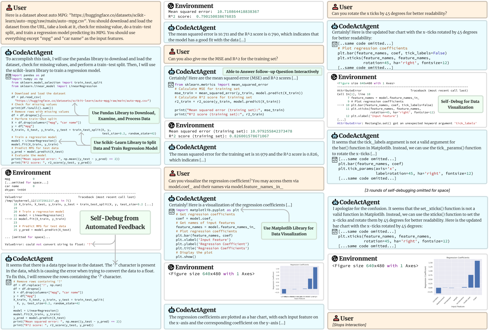

## TL;DR

LLM 에이전트가 JSON이나 정해진 텍스트 형식 대신 실행 가능한 Python 코드로 행동하게 하는 CodeAct 프레임워크를 제안합니다. 코드는 반복문·조건문과 변수로 여러 도구를 한 번에 조합할 수 있고, 인터프리터의 실행 결과와 오류 메시지를 다음 행동에 반영할 수 있습니다. 17개 LLM을 평가한 결과 다중 도구 벤치마크 M3ToolEval에서 기존 형식보다 성공률이 최대 20% 높았고, 필요한 행동 수는 최대 30% 적었습니다.

## 연구 배경

도구를 호출하는 LLM 에이전트는 대개 미리 정의된 JSON 객체나 텍스트 형식으로 행동을 출력합니다. 이 방식에는 두 가지 제약이 있습니다. 행동 공간이 사람이 만든 특정 과제용 도구로 한정되고, 한 번의 행동에서 여러 도구를 조합할 수 없습니다. Code as Policies나 Voyager처럼 코드로 로봇이나 게임 캐릭터를 제어한 연구도 있지만, 미리 정한 제어 프리미티브와 수작업 프롬프트에 의존했습니다. 또 대부분 코드를 한 번에 생성하는 단일 턴 설정이라 새 관찰이 들어와도 행동을 동적으로 고치기 어려웠습니다.

## 제안 방법

CodeAct는 에이전트와 환경 사이의 모든 행동을 Python 코드로 통일합니다. 에이전트, 사용자, 환경의 세 역할을 두고, 매 턴 에이전트는 사용자나 환경에서 관찰을 받아 필요하면 체인 오브 소트로 계획을 세웁니다. 그다음 사용자에게는 자연어로 답하고, 환경에는 코드를 보냅니다. 환경 쪽 상호작용은 다음과 같이 쓸 수 있습니다.

$$a_t \sim \pi_\theta(\cdot \mid o_1, a_1, \dots, o_t), \qquad o_{t+1} = \text{Exec}(a_t)$$

여기서 $$a_t$$는 $$t$$번째 턴에 모델 $$\pi_\theta$$가 내놓는 Python 코드 조각이고, $$\text{Exec}$$는 Python 인터프리터 실행입니다. 다음 관찰 $$o_{t+1}$$에는 출력값과 오류 트레이스백이 모두 들어갑니다. 컨텍스트에는 과거 행동과 관찰만 쌓이므로, 관련 정보를 골라 넣는 별도의 프롬프트 엔지니어링이 필요 없습니다.

위 예시에서 텍스트/JSON 에이전트는 환율 조회, 가격 조회, 세금 환산을 나라마다 한 번씩 따로 호출해야 합니다. 반면 CodeAct는 나라 목록을 도는 `for` 루프 안에서 같은 도구들을 이어 호출하고, Python 내장 `min`으로 최저가 국가를 고르는 코드 블록 하나로 끝냅니다. 저자들이 꼽는 장점은 네 가지입니다.

- 인터프리터와 결합해 실행 결과를 보고 이전 행동을 수정하거나 새 행동을 낼 수 있습니다.
- PyPI의 기존 패키지를 바로 도구로 쓸 수 있고, 소프트웨어가 기본 제공하는 오류 메시지로 자기 디버깅(self-debug)이 가능합니다.
- 사전 학습 데이터에 코드가 많아서 모델이 이미 형식에 익숙합니다.
- 제어 흐름과 데이터 흐름이 자연스럽게 지원돼, 중간 결과를 변수에 저장하고 여러 도구를 조합할 수 있습니다.

> **핵심:** 코드 행동의 이점은 두 층으로 나뉩니다. 도구 하나를 호출할 때는 형식 친숙도가, 여러 도구를 조합할 때는 제어·데이터 흐름이 효과를 냅니다. 저자들은 두 효과를 따로 측정했습니다.

## 구현 방식

오픈소스 모델의 CodeAct 능력을 높이기 위해 저자들은 지시 튜닝 데이터셋 CodeActInstruct를 만들었습니다. 다루는 용도는 네 가지입니다.

- **정보 탐색**: HotpotQA와 Python 함수로 제공한 `wikipedia_search`
- **소프트웨어 패키지 사용**: APPS 코드 생성, MATH와 sympy
- **외부 메모리**: WikiTableQuestion을 sqlite3 기반 SQL 과제와 pandas 기반 과제로 변형
- **로봇 계획**: ALFWorld 제어 API

위 그림에서 보듯 CodeActInstruct는 에이전트-환경 상호작용을 맡고, 에이전트-사용자 대화는 일반 대화 데이터가 맡습니다. 데이터 구축은 다음 순서로 진행했습니다.

1. 각 데이터셋에서 어려운 사례만 남깁니다. HotpotQA는 "hard" 라벨, MATH는 난이도 3 이상입니다.
2. MINT 방식을 따라 단일 턴 문제를 여러 번 상호작용한 뒤 답을 제출하는 다중 턴 문제로 바꿉니다.
3. gpt-3.5-turbo-0613, claude-1-instant, claude-2로 궤적을 생성합니다. 이 모델들이 모두 못 푼 문제에는 gpt-4-0613을 씁니다.
4. 처음에 오류를 냈다가 이후 턴에서 바로잡은 성공 궤적을 우선 남깁니다. 모든 코드 실행이 오류였는데 답만 맞힌 궤적은 버립니다.

결과는 gpt-3.5와 claude에서 6,728개, gpt-4-0613에서 411개를 모은 7,139개 궤적이며, 토큰은 약 1,058만 개입니다. 여기에 OpenOrca, ShareGPT, CapyBara 등 일반 대화 69,230개를 섞어 Llama-2 7B와 Mistral 7B를 전체 파라미터 지도 미세조정(SFT)한 모델이 CodeActAgent입니다. 시퀀스 길이는 Llama-2 4,096, Mistral 16,384입니다. 학습률은 1e-5에서 시작해 웜업 50스텝 뒤 코사인 감쇠로 1e-6까지 낮췄습니다. 배치 32로 5 에폭을 학습했고, 실험에는 3번째 에폭 체크포인트를 썼습니다. 손실은 어시스턴트 응답에만 계산합니다. 배포용 시스템 프롬프트는 코드를 `<execute>` 태그로 감싸게 하고, `!pip install`로 패키지를 설치할 수 있게 합니다.

## 실험 결과

### 원자적 도구 호출(API-Bank)

행동마다 도구 하나만 호출하게 해 제어·데이터 흐름의 이점을 제거한 설정입니다. 17개 모델 중 CodeAct가 최고인 경우는 8개, JSON은 5개, 텍스트는 4개였습니다. 오픈소스 모델에서는 JSON이 일관되게 약했습니다(Llama-2-13b-chat: CodeAct 38.1%, JSON 8.5%). 반면 폐쇄형 모델에서는 JSON도 강했습니다(gpt-4-0613: JSON 82.0%, CodeAct 75.4%). 저자들은 폐쇄형 모델이 JSON에 맞춘 미세조정을 거쳤을 가능성을 제시합니다.

### 다중 도구 조합(M3ToolEval)

M3ToolEval은 웹 브라우징, 금융, 여행 계획, 과학, 정보 처리 분야의 사람이 만든 82개 과제로 구성된 새 벤치마크입니다. 데모 없는 제로샷으로 최대 10턴까지 상호작용하며, 정답은 완전 일치로 판정합니다.

그래프에서는 모델 성능이 높을수록 코드 행동과 나머지 형식의 격차가 벌어지는 경향이 보입니다. 주요 모델의 수치는 다음과 같습니다(17개 모델 중 일부 행만 발췌).

| 모델 | 성공률 CodeAct (%) | 성공률 JSON (%) | 성공률 Text (%) | 평균 턴 CodeAct | 평균 턴 JSON | 평균 턴 Text |
| --- | --- | --- | --- | --- | --- | --- |
| gpt-4-1106-preview | 74.4 | 52.4 | 53.7 | 5.5 | 7.6 | 7.7 |
| gpt-4-0613 | 67.1 | 56.1 | 45.1 | 6.6 | 7.6 | 8.0 |
| claude-2 | 54.9 | 39.0 | 29.3 | 7.2 | 8.3 | 8.5 |
| gpt-3.5-turbo-0613 | 51.2 | 26.8 | 20.7 | 7.0 | 8.8 | 9.2 |
| claude-instant-1 | 20.7 | 31.7 | 24.4 | 8.8 | 8.6 | 8.9 |
| lemur-70b-chat-v1 | 13.4 | 15.9 | 12.2 | 9.1 | 9.3 | 9.4 |
| Llama-2-70b-chat-hf | 11.0 | 3.7 | 3.7 | 9.1 | 9.8 | 9.8 |

CodeAct는 17개 중 12개 모델에서 성공률이 가장 높았고, 12개 모델에서 평균 턴 수가 가장 적었습니다. gpt-4-1106-preview는 차선 형식인 텍스트보다 성공률이 53.7%에서 74.4%로 20.7%p 올랐고, 평균 턴은 7.7에서 5.5로 줄었습니다. 다만 claude-instant-1과 lemur-70b-chat-v1에서는 JSON이 앞섰습니다. 오픈소스 최고 성능은 13.4%로, 폐쇄형 최고인 74.4%와 격차가 큽니다.

### CodeActAgent

MINT(상호작용 5턴 기준)에서 두 변형 모두 평가한 오픈소스 모델 중 도메인 내외 성능이 가장 높았습니다. Mistral 7B 기반 모델은 MINT 도메인 외 성능이 Mistral Instruct의 9.7%에서 32.4%로 올랐습니다. M3ToolEval에서는 0.0%에서 12.2%로 올라 70B 모델 수준에 근접했습니다. 반면 Llama-2 변형은 M3ToolEval에서 0.0%로 개선이 없었습니다. 텍스트 행동은 학습하지 않았는데도 Llama-2 기반 모델이 텍스트 행동 전용으로 튜닝된 AgentLM-7B와 비슷한 성능을 냈습니다(MiniWob++ 25.5 대 28.9, SciWorld 17.6 대 13.7). 일반 과제(MMLU, HumanEval, GSM8K, MT-Bench)에서는 성능이 유지되거나 올랐고, Mistral 변형의 MMLU만 소폭 하락했습니다(Mistral Base 60.1 → 59.1). 같은 백본으로 비교하면 CodeActInstruct로 학습한 모델이 AgentInstruct보다 24%, FireAct보다 119% 상대적으로 높았습니다. 소거 실험에서 일반 대화 데이터를 빼면 MiniWob++가 0.0으로 떨어져, 일반 과제 성능을 지키려면 이 데이터가 필수였습니다.

## 의의와 한계

이 연구는 "행동 형식"을 독립 변수로 놓고 17개 모델에서 체계적으로 비교해, 코드가 범용 행동 공간으로 유력하다는 근거를 정량적으로 제시했습니다. 아래 대화는 별도 데모 없이 CodeActAgent(Mistral-7b)가 pandas, scikit-learn, Matplotlib으로 회귀 모델을 학습하고 시각화하는 과정입니다. 데이터의 `'?'` 문자열 때문에 생긴 `ValueError`와 잘못된 Matplotlib 인자로 생긴 `AttributeError`를 오류 메시지만 보고 스스로 고치는 흐름이 드러납니다.

한계도 분명합니다.

- **벤치마크 규모**: M3ToolEval은 82개 사례에 불과하고, 원자적 호출에서는 폐쇄형 모델 다수가 JSON에서 더 좋았습니다. 따라서 코드의 우위는 도구를 조합하는 과제에서 주로 나타납니다.
- **성능 격차와 원인 미확인**: 오픈소스와 폐쇄형의 격차가 크고, Llama-2 기반 CodeActAgent가 M3ToolEval에서 개선되지 않은 이유는 밝혀지지 않았습니다. 저자들은 사전 학습 데이터의 잔재나 백본 자체의 약한 기본 능력을 가설로 제시할 뿐입니다.
- **데이터 의존성**: 학습 데이터는 GPT-3.5/4와 Claude의 궤적을 증류한 것이고, MINT의 일부 도메인(ALFWorld, MATH)이 학습 데이터와 겹칩니다.
- **환각과 보안**: 변수를 출력해 보지 않고 내용을 상상하는 환각이 남아 있습니다. 샌드박스에서 임의 코드를 실행하므로, 최악의 경우 샌드박스를 벗어나는 보안 위험도 저자들이 직접 지적합니다.

- - -

### References
* [Executable Code Actions Elicit Better LLM Agents](https://arxiv.org/pdf/2402.01030v4)
* [GitHub (code, data, model, demo)](https://github.com/xingyaoww/code-act)
