## TL;DR

### 이 연구를 시작하게 된 배경과 동기는 무엇입니까?
GRPO 같은 검증 가능한 보상 기반 강화학습(RLVR)은 롤아웃 결과를 스칼라 보상 하나로만 받습니다. 그래서 새 과제에 적응하려면 보통 수만 번의 롤아웃이 필요합니다. 그런데 롤아웃은 추론 체인, 도구 호출, 컴파일러 에러 같은 자연어 트레이스로 남습니다. 저자들은 LLM이 이 트레이스를 직접 읽게 하면 비싼 롤아웃 하나에서 훨씬 많은 학습 신호를 얻을 수 있다고 봅니다.

### 이 연구에서 제시하는 새로운 해결 방법은 무엇입니까?
GEPA는 가중치를 고정한 채 복합 AI 시스템의 프롬프트만 진화시키는 옵티마이저입니다.
- 성찰적 프롬프트 변이: 성찰 LM이 실행 트레이스와 평가 트레이스를 읽고, 실패 원인을 특정 모듈에 돌린 뒤 그 모듈의 지시문을 다시 씁니다.
- 파레토 기반 선택: 검증 인스턴스마다 최고 후보를 보존하고, 차지한 인스턴스 수에 비례해 부모를 뽑아 국소 최적해를 피합니다.
- 시스템 인식 병합(Merge): 서로 다른 모듈을 개선한 두 계보를 모듈 단위로 합칩니다.

### 제안된 방법은 어떻게 구현되었습니까?
학습 세트는 피드백용 $$\mathcal{D}_{\text{feedback}}$$과 후보 선택용 $$\mathcal{D}_{\text{pareto}}$$로 나뉩니다. 새 후보는 크기 3의 미니배치에서 먼저 평가하고, 점수가 오른 후보만 $$\mathcal{D}_{\text{pareto}}$$ 전체로 다시 채점합니다. 보상 $$\mu$$는 점수와 `feedback_text`를 함께 돌려주는 피드백 함수 $$\mu_f$$로 확장됩니다. 모듈은 라운드 로빈으로 하나씩 고칩니다.

### 이 연구의 결과가 가지는 의미는 무엇입니까?
- Qwen3 8B 여섯 과제에서 GEPA는 GRPO를 평균 6% 앞섰습니다. 최대 우위는 HotpotQA에서 약 19%이고, 최적 성능까지 쓴 롤아웃은 GRPO보다 4~35배 적었습니다. AIME-2025에서는 GRPO가 더 높았습니다.
- IFBench에서는 678 롤아웃 만에 38.61%를 기록해, 24,000 롤아웃을 쓴 GRPO의 35.88%를 넘었습니다.
- GPT-4.1 Mini에서는 지시문만으로 종합 +12.19를 얻어 MIPROv2의 +5.64를 크게 앞섰습니다. GEPA 계열 프롬프트는 MIPROv2보다 최대 9.2배(Qwen3 8B, PUPA) 짧았고, GPT-4.1 Mini에서는 최대 7.5배(HotpotQA) 짧았습니다. 가중치에 접근할 수 없거나 롤아웃이 비싼 환경에서 쓰기 좋습니다.

- - -

## 스칼라 보상의 한계와 롤아웃 예산 아래의 복합 AI 시스템 최적화

### 스칼라 보상 하나로 배우는 강화학습의 비용

LLM을 특정 과제에 맞추는 대표적인 방법은 검증 가능한 보상 기반 강화학습(RLVR)입니다. 이 방식은 정답 일치나 유닛 테스트 통과처럼 프로그램으로 채점할 수 있는 성공 메트릭을 보상으로 씁니다. GRPO가 이 계열에 속합니다. 시스템을 입력 하나에 실행하고 메트릭으로 채점하기까지의 한 번을 롤아웃(rollout)이라고 부릅니다. GRPO는 롤아웃이 끝날 때마다 결과를 스칼라 보상 하나로 받고, 이 보상으로 정책 경사(policy gradient)를 추정합니다. 정책 경사는 보상이 높았던 출력의 확률은 올리고 낮았던 출력의 확률은 내리도록 가중치를 움직이는 기울기 추정량입니다.

보상은 성공했는지 실패했는지만 알려 줍니다. 출력의 어느 부분이 문제였는지는 수많은 표본의 통계에서 간접적으로만 드러나므로 학습 신호가 성깁니다. 저자들에 따르면 새 과제에 맞추려면 실무에서 보통 수만 번의 롤아웃이 필요하고, 저자들이 인용한 최근 GRPO 연구들은 학습에 최대 수십만 번의 롤아웃을 씁니다.

이런 표본 비효율성은 실무에서 곧 병목이 됩니다. 롤아웃마다 비싼 도구 호출이 들어가는 경우, LLM에서 샘플링할 추론 예산이 제한된 경우, 가장 크거나 성능이 좋은 모델의 가중치를 미세 조정할 수 없는 경우가 대표적입니다.

### 자연어 트레이스로 직렬화되는 롤아웃

저자들의 출발점은 단순한 관찰입니다. 아무리 정교한 LLM 시스템이라도 그 롤아웃은 자연어 트레이스로 직렬화됩니다. 트레이스에는 각 모듈의 지시문(instruction), 그에 따른 LLM의 추론 체인, 도구 호출이 담깁니다. 보상 함수가 스칼라를 내기 전에 만든 내부 정보도 담을 수 있으며, 컴파일러 에러 메시지가 그런 예입니다. RLVR은 이 정보를 모두 숫자 하나로 압축한 뒤에야 학습에 씁니다. 반면 최신 LLM은 이런 트레이스를 그대로 읽고 이해합니다.

> **핵심:** 저자들은 트레이스를 언어로 성찰(reflection)하며 자연어로 학습하는 알고리즘이 표준 강화학습보다 LLM의 강한 언어 사전 지식을 더 효과적으로 활용한다고 주장합니다. 숫자 하나로 압축하기 전의 롤아웃에는 그만큼 더 많은 학습 신호가 남아 있다고 보기 때문입니다.

이 전제 위에서 제안된 GEPA(Genetic-Pareto)는 텍스트 성찰과 다목적 진화 탐색을 결합한, 복합 AI 시스템용 성찰적 프롬프트 옵티마이저입니다. 새 후보는 조상 후보에서 파생되면서 교훈을 누적합니다. 또 GEPA는 전역 최고 프롬프트 하나만 진화시키지 않고 문제 인스턴스별 상위 프롬프트들을 확률적으로 탐색해 국소 최적해를 피합니다.

### 복합 AI 시스템의 정식화

저자들은 하나 이상의 LLM 호출이 외부 도구 호출과 섞이고 임의의 제어 흐름으로 조율되는 모듈식 시스템을 복합 AI 시스템이라고 부르고, 이 시스템 전체를 최적화 대상으로 삼습니다. 이 정의에는 에이전트, 다중 에이전트 시스템, 범용 스캐폴딩 기법이 모두 들어갑니다. 스캐폴딩의 예로 [ReAct](https://arxiv.org/pdf/2210.03629)가 있습니다. ReAct에서는 LLM이 "생각"과 `search[entity]` 같은 행동을 번갈아 생성하고, 도구가 돌려준 관찰을 다음 추론에 반영합니다. 이런 시스템에서는 모델 호출이 여러 번 일어나고, 호출마다 프롬프트가 따로 있습니다.

저자들은 이런 시스템을 다음처럼 표기합니다.

$$
\Phi=(M,C,\mathcal{X},\mathcal{Y}),\qquad M=\langle M_{1},\ldots,M_{|M|}\rangle
$$

$$M$$은 언어 모듈들의 목록, $$C$$는 제어 흐름 논리, $$\mathcal{X}$$와 $$\mathcal{Y}$$는 시스템 전체의 입출력 스키마입니다. 각 모듈은 $$M_{i}=(\pi_{i},\theta_{i},\mathcal{X}_{i},\mathcal{Y}_{i})$$로 구성됩니다. $$\pi_i$$는 지시문과 퓨 샷 데모를 포함한 (시스템) 프롬프트이고, $$\theta_i$$는 그 밑의 모델 가중치이며, $$\mathcal{X}_i, \mathcal{Y}_i$$는 모듈의 입출력 스키마입니다. 실행 중에 $$C$$는 한 모듈의 출력을 다른 모듈에 넘기고, 조건에 따라 모듈을 호출하고, 도구 API를 사용합니다. 따라서 $$C$$는 서로 다른 모듈을 어떤 순서로든, 몇 번이든 호출할 수 있습니다. 예를 들어 "검색 질의 작성" 모듈과 "답 요약" 모듈이 홉 수만큼 번갈아 호출되는 다중 홉 질의응답 시스템을 생각할 수 있습니다.

### 프롬프트와 가중치를 함께 다루는 목적식

모든 모듈의 프롬프트 모음을 $$\Pi_{\Phi}=\langle\pi_{1},\ldots,\pi_{\vert M\vert}\rangle$$, 가중치 모음을 $$\Theta_{\Phi}=\langle\theta_{1},\ldots,\theta_{\vert M\vert}\rangle$$라고 하면, 학습 가능한 파라미터는 $$\langle\Pi,\Theta\rangle_{\Phi}$$입니다. 과제 인스턴스 $$(x,m)$$에서 $$x$$는 입력이고, $$m$$은 정답, 채점 기준표, 코드 유닛 테스트 같은 평가용 메타데이터입니다. 시스템은 출력 $$y=\Phi(x;\langle\Pi,\Theta\rangle_{\Phi})$$를 내고, 메트릭 $$\mu:\mathcal{Y}\times\mathcal{M}\to[0,1]$$은 정확 일치, F1, 통과율 등으로 $$m$$에 비추어 $$y$$의 품질을 매깁니다. 과제 분포를 $$\mathcal{T}$$라 할 때 최적화 문제는 다음과 같습니다.

$$
\langle\Pi^{*},\Theta^{*}\rangle_{\Phi}=\arg\max_{\langle\Pi,\Theta\rangle_{\Phi}}\mathbb{E}_{(x,m)\sim\mathcal{T}}\left[\mu\big(\Phi(x;\langle\Pi,\Theta\rangle_{\Phi}),\,m\big)\right]
$$

GEPA는 $$\Pi$$를, GRPO는 $$\Theta$$를 바꿉니다. 저자들은 서로 다른 파라미터 공간에서 움직이는 두 알고리즘을 같은 목적식 위에서 비교하려고 둘을 함께 담은 일반형을 택했습니다.

### 롤아웃 예산 B라는 제약

현실에서는 앞서 정의한 롤아웃 하나가 계산량, 비용, 시간 면에서 비쌉니다. 그래서 옵티마이저는 학습 세트 $$\mathcal{D}_{\text{train}}=\{(x,m)_{i}\}_{i=1}^{N}$$에서 $$\mu$$에 자유롭게 접근할 수 있지만, 롤아웃은 최대 $$B$$회만 쓸 수 있습니다. 목표는 학습에 쓰지 않은 보류 데이터에서 성능이 가장 좋은 파라미터를 찾는 것입니다.

$$
\langle\Pi^{*},\Theta^{*}\rangle_{\Phi}=\arg\max_{\langle\Pi,\Theta\rangle_{\Phi}}\mathbb{E}_{(x,m)\sim\mathcal{T}}\left[\mu\big(\Phi(x;\langle\Pi,\Theta\rangle_{\Phi}),\,m\big)\right]\quad\text{s.t.}\quad\#\text{rollouts}\leq B
$$

앞의 목적식에서 달라진 것은 제약 하나뿐이지만, 이 제약이 문제의 성격을 바꿉니다. 질문은 이제 "데이터가 적거나 예산이 빠듯한 환경에서 비싼 롤아웃 하나하나로부터 학습 신호를 얼마나 많이 뽑아내 복잡한 모듈식 시스템을 적응시킬 수 있는가"가 됩니다.

## 프롬프트 최적화와 언어 공간 학습의 계보 속 GEPA의 위치

### 가중치 공간의 기준선, GRPO

GRPO(Group Relative Policy Optimization)는 [DeepSeekMath](https://arxiv.org/pdf/2402.03300)에서 도입된 강화학습 알고리즘입니다. PPO와 달리 가치 함수(critic) 네트워크를 따로 학습하지 않습니다. 대신 같은 질문 $$q$$에 대해 이전 정책으로 응답 $$G$$개를 샘플링하고, 그룹 안에서 보상을 비교해 어드밴티지를 정합니다. 응답 $$i$$의 스칼라 보상 $$r_i$$를 그룹 평균과 표준편차로 정규화한 값이 그 응답의 어드밴티지가 됩니다.

$$
\hat{A}_{i,t} = \frac{r_i - \mathrm{mean}(\{r_j\}_{j=1}^{G})}{\mathrm{std}(\{r_j\}_{j=1}^{G})}
$$

예를 들어 $$G=4$$개 응답의 보상이 1, 0, 0, 1이면 평균은 0.5이고, 모집단 기준 표준편차도 0.5입니다. 따라서 맞힌 응답은 +1, 틀린 응답은 −1을 받으며, 응답의 모든 토큰에 같은 값이 적용됩니다. GRPO는 이후 실험에서 가중치를 학습하는 비교 기준선으로 쓰입니다.

### 수작업 프롬프트에서 자동 프롬프트 최적화로

프롬프트를 잘 쓰면 LLM 성능이 오르지만, 체인 오브 소트(chain-of-thought) 프롬프팅처럼 사람의 전문 지식이 필요한 경우가 많습니다. 이 작업을 확장하려고 APE, OPRO, PromptWizard, Promptbreeder 같은 방법들은 LLM이 프롬프트를 직접 제안하고 고치게 합니다. GEPA도 LLM을 옵티마이저로 쓰지만, 환경 피드백·파레토 탐색·모듈별 진화를 더한다는 점이 다릅니다.

같은 흐름에 속하는 APO는 [Pryzant et al.](https://doi.org/10.18653/v1/2023.emnlp-main.494)이 제안한 방법으로, 경사 하강을 텍스트로 옮긴 비유를 씁니다. 미니배치에서 틀린 예시를 모으면 LLM이 "현재 프롬프트가 왜 실패하는가"라는 비평을 쓰는데, 이 비평이 "텍스트 그래디언트"입니다. LLM이 다시 이 비평을 반영해 프롬프트를 고쳐 쓰고, 이렇게 만든 후보들을 빔 서치로 관리하며 미니배치 점수 상위 $$b$$개만 남깁니다. 선택 기준이 평균 점수라서 특정 인스턴스만 잘 푸는 후보는 버려질 수 있습니다. 나중에 나오는 BeamSearch 절제 실험이 이 전략을 모사합니다.

### 진화 기반 접근

EvoPrompt는 프롬프트 개체군 전체를 진화시킵니다. Rainbow Teaming은 품질-다양성 진화로 다양한 적대적 프롬프트를 만듭니다. 저자들은 GEPA가 여기에 도메인 특화 피드백을 더해 겨냥한 변이를 만들어 표본 효율성이 더 높다고 설명합니다. AlphaEvolve와 OpenEvolve는 진화 탐색을 코드 재작성에 직접 적용하며, 해법을 코드로 표현할 수 있는 문제에서 강합니다. 다만 AlphaEvolve는 어려운 문제 하나를 겨냥합니다. GEPA는 여러 도메인의 프롬프트에 진화를 적용하고, 파레토 프런티어 최적화를 결합해 관련 문제들 사이에서 전략을 전이합니다.

### 언어 공간 학습

피드백으로 시스템을 개선하는 흔한 방법은 다수결 신호 같은 강화학습입니다. 하지만 보상 계산이 느리면 강화학습은 표본 효율이 떨어질 수 있습니다. 대안은 가중치 대신 자연어 안에서 배우는 언어 공간 학습입니다. 저자들은 인컨텍스트 밴딧·자기 부트스트래핑 계열로 Reflexion, Self-Refine 등을 인용하고, 워크플로 메모리와 스킬 축적, Dynamic Cheatsheet이나 추론 캐시 같은 테스트 시점 전략 합성 방법도 함께 듭니다. 이 방법들이 실행 중에 경험을 쌓아 전략을 그때그때 합성한다면, GEPA는 학습 예시로부터 과제 특화 규칙을 담은 새 지시문을 제안해 프롬프트 자체를 고칩니다.

Trace는 워크플로의 실행 트레이스와 출력 피드백을 받아 파라미터를 갱신하는 틀이며, 트레이스가 AutoDiff의 역전파 그래디언트 자리를 대신합니다. OptoPrime은 직렬화된 트레이스, 현재 파라미터, 피드백을 LLM에 넣어 새 값을 제안하는 범용 옵티마이저입니다. 개체군 없이 현재 후보 하나만 갱신한다는 점이 GEPA와 다르며, Trace(OptoPrime)는 GPT-4.1 Mini 실험의 기준선입니다.

### 복합 시스템 옵티마이저와 전역 보상

DSPy는 LLM 파이프라인을 모듈 단위 프로그램으로 작성하는 프레임워크로, 프로그램을 실행해 성공한 트레이스를 퓨 샷 예시로 탐색하고 부트스트래핑합니다. 실험에 쓰인 벤치마크 시스템과 MIPROv2도 DSPy로 구현되어 있습니다. TextGrad는 텍스트 피드백을 계산 그래프를 따라 역전파하듯 전달해 각 구성 요소를 고칩니다. 이후의 SelectBestCandidate 절제 실험이 TextGrad의 전략을 모사합니다.

[MIPROv2](https://doi.org/10.18653/v1/2024.emnlp-main.525)는 가장 강한 프롬프트 옵티마이저 기준선입니다. 모듈별 데모 후보를 부트스트래핑하고 제안 LM으로 지시문 후보를 만든 뒤, 지시문과 데모의 조합을 이산 하이퍼파라미터로 보고 TPE(Tree-Structured Parzen Estimator) 기반 베이지안 최적화로 미니배치에서 평가하며 고릅니다. 목적은 데이터 평균의 전역 스칼라 점수 하나이고, 후보가 왜 실패했는지 설명하는 텍스트 피드백은 쓰지 않습니다. 저자들은 DSPy, TextGrad, MIPROv2 같은 복합 시스템 옵티마이저들이 대체로 전역 보상에 의존한다고 봅니다. 반면 Optimas는 전역 목표와 정렬된 지역 보상을 모듈마다 둡니다.

### GEPA가 차지하는 자리

GEPA는 전역 보상에 모듈별 환경 텍스트 피드백을 결합합니다. 또 개별 데이터 인스턴스 단위로 파레토 프런티어를 유지해, 특정 예시에 맞는 프롬프트와 에이전트 설계를 보존합니다. 저자들은 이 파레토 유도 진화 덕분에 GEPA가 여러 프롬프트·코드·에이전트 설계 전략을 탐색한 뒤, 견고하고 일반화되는 집합으로 수렴한다고 설명합니다.

## 미니배치 게이팅으로 예산을 아끼는 GEPA의 유전적 최적화 루프

### 세 원칙과 입력

GEPA는 세 원칙 위에 서 있습니다. 첫째는 유전적 프롬프트 진화, 둘째는 자연어 피드백을 이용한 성찰, 셋째는 파레토 기반 후보 선택입니다. 입력은 다섯 가지입니다. 단순한 프롬프트로 초기화된 시스템 $$\Phi$$, 과제 인스턴스 $$(x,m)$$로 이루어진 학습 세트 $$\mathcal{D}_{\text{train}}$$, 과제의 표준 메트릭 $$\mu$$, 피드백 함수 $$\mu_f$$, 총 롤아웃 예산 $$B$$입니다. 앞서 정의한 목적식은 $$\langle\Pi,\Theta\rangle$$를 모두 다룹니다. GEPA는 그중 프롬프트 모음 $$\Pi_\Phi$$만 진화시키고, LLM 가중치 $$\Theta_\Phi$$는 고정합니다. 그래서 각 후보는 $$\langle\Pi,\Theta_{frozen}\rangle_\Phi$$의 구체적인 한 가지 인스턴스입니다.

유전 알고리즘의 어휘를 짧게 정리하면 다음과 같습니다. 해의 집합을 개체군(population)으로 유지합니다. 기존 해를 조금 바꾸는 변이(mutation), 두 해를 섞는 교차(crossover)로 자식을 만듭니다. 그다음 좋은 해가 살아남도록 선택(selection)합니다. GEPA에서는 개체가 "프롬프트 묶음이 채워진 시스템"이고, 성찰적 프롬프트 변이가 변이를, 시스템 인식 병합(Merge)이 교차를 맡습니다.

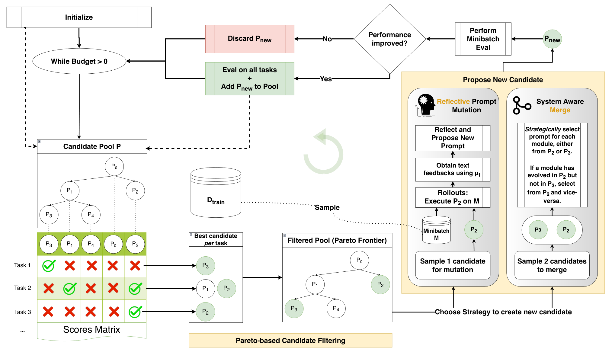

흐름도에서는 새 후보가 두 번 평가된다는 점을 눈여겨보면 됩니다. 먼저 작은 미니배치에서 평가하고, 그 관문을 통과한 후보만 전체 과제에서 다시 평가합니다.

### 두 데이터 분할과 초기화

GEPA는 먼저 $$\mathcal{D}_{\text{train}}$$을 두 부분으로 나눕니다. $$\mathcal{D}_{\text{feedback}}$$은 학습 신호용입니다. 여기서 미니배치를 뽑아 롤아웃하고, 그 트레이스와 피드백으로 프롬프트를 고칩니다. $$\mathcal{D}_{\text{pareto}}$$는 크기가 하이퍼파라미터 $$n_{pareto}$$로 정해진 후보 선택용 검증 세트(validation set)입니다. 후보마다 이 세트의 인스턴스별 점수를 기록해 두고, 이 점수로 부모를 고르고 최종 결과를 정합니다. 두 분할은 맡은 일이 다릅니다. $$\mathcal{D}_{\text{feedback}}$$은 "어떻게 고칠지"를 알려 주고, $$\mathcal{D}_{\text{pareto}}$$는 "무엇을 남길지"를 판정합니다.

초기화에서는 후보 풀을 $$\mathcal{P}\leftarrow[\Phi]$$로, 부모 기록을 $$\mathcal{A}\leftarrow[\text{None}]$$으로 둡니다. 기본 시스템 하나뿐이고 부모는 없습니다. 이어서 기본 시스템을 $$\mathcal{D}_{\text{pareto}}$$의 각 인스턴스 $$i$$에서 채점해 점수 벡터 $$S_\Phi[i]=\mu(\Phi(x_i),m_i)$$를 채웁니다.

### 한 번의 반복

예산 $$B$$가 남아 있는 동안 다음 단계를 되풀이합니다.

1. **후보 선택**: 점수 행렬 $$S$$를 보고 풀에서 부모 $$k$$를 고릅니다. 기본 전략은 파레토 기반 선택입니다.
2. **모듈 선택**: 부모 시스템 $$\Phi_k$$에서 이번에 고칠 모듈 $$j$$를 하나 정합니다.
3. **미니배치 추출**: $$\mathcal{D}_{\text{feedback}}$$에서 크기 $$b$$의 미니배치 $$\mathcal{M}$$을 뽑습니다.
4. **신호 수집**: $$\Phi_k$$를 $$\mathcal{M}$$에서 실행하고, $$\mu_f$$로 모듈 $$j$$의 피드백, 점수, 트레이스를 모읍니다.
5. **프롬프트 갱신**: 기존 프롬프트 $$\pi_j$$와 피드백, 트레이스를 바탕으로 새 프롬프트 $$\pi'_j$$를 만듭니다. 그런 다음 모듈 $$j$$만 바꾼 $$\Phi_k$$의 복사본 $$\Phi'$$을 얻습니다.
6. **비교**: 같은 미니배치에서 갱신 전후의 평균 점수 $$\sigma$$와 $$\sigma'$$을 계산합니다.

### 미니배치 게이팅

$$\sigma'$$이 $$\sigma$$보다 나아졌을 때만 $$\Phi'$$을 풀 $$\mathcal{P}$$에 넣고, 부모 기록 $$\mathcal{A}$$에 $$k$$를 추가합니다. 그 뒤 $$\mathcal{D}_{\text{pareto}}$$ 전체에서 평가해 점수 벡터 $$S_{\Phi'}$$를 채웁니다. 개선되지 않으면 후보를 그대로 버립니다.

비용을 따져 보면 이 관문이 왜 필요한지 보입니다. 예시로 $$b=3$$, $$n_{pareto}=100$$이라고 가정하겠습니다(설명용 값입니다). 후보 하나를 미니배치에서 판정하는 데는 갱신 후 롤아웃 3회가 들고, 전체 평가에는 100회가 듭니다. 모든 제안 후보를 전체 평가하면 예산이 금세 바닥납니다. 게이팅을 두면 실패한 제안은 몇 번의 롤아웃만 쓰고 끝나며, 비싼 전체 평가는 가능성을 보인 후보에게만 돌아갑니다. 미니배치 몇 개로 내린 판정은 잡음이 큽니다. 그래서 최종 선택은 미니배치 점수가 아니라 $$\mathcal{D}_{\text{pareto}}$$ 점수에 맡깁니다.

> **핵심:** 미니배치는 후보를 고치는 재료이자 값싼 1차 관문입니다. $$\mathcal{D}_{\text{pareto}}$$는 살아남은 후보만 채점하는 비싼 2차 심사대입니다. 이렇게 역할을 나눈 덕분에 제한된 $$B$$ 안에서 많은 변이를 시도할 수 있습니다.

### 유전 트리를 따라 쌓이는 지식과 반환값

변이나 교차로 생긴 자식은 부모가 축적한 학습 신호를 물려받습니다. 부모의 프롬프트에는 이전 반복들에서 얻은 교훈이 이미 들어 있기 때문입니다. 자식은 여기에 자기 롤아웃에서 얻은 새 교훈을 더합니다. 부모 기록 $$\mathcal{A}$$가 후보들을 계보로 이으므로, 지식은 이 유전 트리를 따라 누적됩니다. 예산이 소진되면 GEPA는 $$\mathcal{D}_{\text{pareto}}$$ 평균 점수가 가장 높은 후보 $$\Phi^*$$를 반환합니다.

## 트레이스를 읽고 지시문을 다시 쓰는 성찰적 프롬프트 변이

### 스칼라 보상이 가리지 못하는 실패의 원인

강화학습에는 오래된 기여도 할당(credit assignment) 문제가 있습니다. 여러 단계를 거친 결과에 보상이 하나만 주어지면, 어느 결정이 그 결과를 만들었는지 알기 어렵습니다. 복합 AI 시스템에서는 이 문제가 모듈 단위로 나타납니다. 다중 홉 질의응답 파이프라인이 오답을 내서 보상 0을 받았다고 해 봅시다. 첫 번째 검색 질의가 엉뚱했는지, 요약 모듈이 핵심 문장을 버렸는지, 최종 답변 모듈이 근거를 잘못 읽었는지는 이 숫자에 담기지 않습니다. 스칼라 하나만으로는 원인 모듈을 가려내기 어렵습니다.

GEPA는 이 문제를 언어로 풉니다. 복합 AI 시스템이 실행되면서 남기는 자연어 트레이스에는 각 모듈의 중간 추론과 판단 과정이 기록됩니다. 이 트레이스를 최종 결과(성공 또는 실패)와 짝지으면, 엔지니어가 디버깅하듯 오류나 성공을 특정 모듈의 특정 결정까지 거슬러 올라갈 수 있습니다. 저자들은 LLM도 이 일을 할 수 있다고 봅니다. LLM은 트레이스를 성찰(reflection)하면서 최종 결과의 책임을 관련 모듈에 돌리며, 저자들은 이를 **암묵적 기여도 할당**이라고 부릅니다. 기여도를 수치로 계산하지 않습니다. 대신 "두 번째 홉 질의가 첫 번째 홉과 같은 문서를 다시 찾아서 실패했다" 같은 진단을 글로 씁니다.

진단은 곧바로 처방으로 이어집니다. 원인 모듈이 특정되면 그 모듈의 프롬프트만 겨냥해 고칠 수 있습니다. 저자들은 이런 표적 수정이 시스템 전체의 행동을 크고 효과적으로 바꾼다고 설명합니다.

이 발상은 Reflexion 계열의 언어적 자기 피드백과 닿아 있습니다. [Reflexion](https://doi.org/10.52202/075280-0377)에서는 가중치를 고정한 채 에이전트가 실패한 시도를 글로 비평하고, 그 비평을 메모리에 쌓아 다음 시도의 컨텍스트에 넣습니다. GEPA도 언어 피드백이 파라미터 갱신을 대신할 수 있다는 전제를 공유합니다. 다만 Reflexion의 교훈은 한 과제 인스턴스를 재시도하는 동안에만 쓰이는 에피소드 메모리에 머뭅니다. GEPA는 교훈을 최적화되는 지시문 자체에 새겨 넣습니다. 그래서 데이터셋 전체에 재사용할 수 있는 산출물이 남고, 여러 모듈 사이의 기여도 할당도 다룰 수 있습니다.

### 변이 한 번의 절차

앞서 설명한 반복 루프에서 변이를 제안하는 부분을 확대하면 성찰적 프롬프트 변이가 됩니다. 순서는 다음과 같습니다.

1. **실행과 트레이스 수집**: 파레토 프런티어에서 확률적으로 뽑힌 후보를, 학습 세트에서 무작위로 뽑은 미니배치에서 실행하며 실행 과정을 추적합니다.
2. **모듈 정보 추출과 피드백 호출**: 실행 트레이스에서 모듈의 입력, 출력, 추론을 꺼냅니다. 그다음 피드백 함수 $$\mu_f$$를 불러 숫자 점수와 텍스트 피드백을 받습니다. 텍스트 피드백에는 컴파일러 에러 메시지나 통과하지 못한 루브릭 같은 평가 세부 정보가 들어 있습니다.
3. **모듈 선택**: 프로그램의 $$\lvert M\rvert$$개 모듈 중 이번에 고칠 모듈을 정책에 따라 고릅니다. 기본 정책은 라운드 로빈이어서, 모듈들이 차례로 갱신 기회를 얻습니다.
4. **성찰과 제안**: 성찰 LM(reflection LM)에 (현재 프롬프트, 언어 프로그램의 궤적, 점수, 피드백)을 보여 줍니다. 성찰 LM은 성공과 실패를 프롬프트의 요소에 귀속시키고, 수정된 지시문을 제안합니다.
5. **재평가**: 갱신된 모듈을 나머지 프로그램과 합쳐 같은 미니배치에서 다시 평가합니다. 점수가 오르면 새 프로그램을 후보 풀에 넣습니다.

성찰 LM은 시스템 안에서 과제를 푸는 LM과 역할이 다릅니다. 과제 LM이 낸 답과 채점 결과를 읽고 지시문을 고쳐 쓰는 쪽이 성찰 LM입니다.

### 성찰 LM에 주는 메타 프롬프트

성찰 LM이 무엇을 요구받는지는 메타 프롬프트(meta-prompt)에 드러납니다. 메타 프롬프트는 프롬프트를 고치기 위한 프롬프트입니다. 구성은 단순합니다. 먼저 "어시스턴트에게 이런 지시문을 주었다"며 현재 지시문을 보여 줍니다. 이어서 미니배치 예시들의 입력, 어시스턴트의 응답, 응답을 어떻게 개선할 수 있는지 담은 피드백을 붙입니다. 마지막으로 새 지시문을 쓰라고 요청합니다. 요구 사항은 셋입니다.

- **과제 추론**: 입력을 주의 깊게 읽어 입력 형식을 파악하고, 풀려는 과제를 자세히 추론해 기술할 것.
- **틈새 도메인 사실 보존**: 응답과 피드백에 나온 틈새의 도메인 특화 사실 정보를 모두 찾아 지시문에 담을 것. 이런 정보의 상당수는 나중에 어시스턴트가 접할 수 없을 수 있기 때문입니다.
- **일반화 가능한 전략 포함**: 어시스턴트가 일반화 가능한 전략으로 과제를 풀었다면 그 전략도 지시문에 포함할 것.

두 번째 요구가 특히 중요합니다. 어떤 사실이 이번 미니배치의 피드백에만 나왔다면, 그 사실은 반복이 끝나는 순간 사라집니다. 메타 프롬프트는 이런 일회성 정보를 지시문이라는 영구 저장소로 옮기라고 명시합니다. 진화한 프롬프트들이 점점 길어지고 구체적인 사례로 채워지는 것도 이 요구 때문으로 읽을 수 있습니다.

### 실행 트레이스와 평가 트레이스, 그리고 피드백 함수 μ_f

저자들은 성찰의 재료를 두 종류로 구분합니다.

- **실행 트레이스(execution trace)**: AI 시스템 안의 LLM이 만든 텍스트입니다. 각 모듈의 추론, 생성한 검색 질의, 중간 요약, 최종 답이 여기에 속합니다.
- **평가 트레이스(evaluation trace)**: 보상을 계산하는 과정에서 환경이 만든 텍스트입니다. 예를 들어 코드 평가기는 보상 0을 주기 전에 컴파일 에러 메시지를 냅니다.

이 구분이 비자명한 이유가 있습니다. 많은 평가 메트릭은 컴파일, 실행, 프로파일링처럼 풍부한 절차를 거치며 자연어 트레이스를 만들어 놓고도, 마지막에는 이를 스칼라 하나로 압축합니다. 실행 트레이스는 "모델이 무엇을 했는가"를 알려 줍니다. 평가 트레이스는 "평가기가 무엇을 왜 틀렸다고 판정했는가"를 알려 줍니다. 저자들은 이 두 번째 정보원을 성찰적 기여도 할당과 표적 프롬프트 갱신에 쓰자고 제안합니다.

이를 위해 GEPA는 보상 $$\mu$$를 피드백 함수 $$\mu_f$$로 확장합니다. $$\mu_f$$는 평가 중에 추출한 텍스트 트레이스를 최종 점수와 함께 `feedback_text`로 돌려주는 함수입니다. 점수는 미니배치 게이팅과 후보 선택에 쓰이고, `feedback_text`는 성찰 LM의 입력이 됩니다. 같은 0점이어도 "컴파일 에러: 정의되지 않은 변수"나 "루브릭 3번 미충족" 같은 텍스트가 붙으면, 성찰 LM이 고칠 방향이 크게 달라집니다.

이 피드백은 모듈별로 특화할 수도 있습니다. 다중 홉 시스템이라면 평가기가 홉마다 피드백을 줄 수 있습니다. 그러면 라운드 로빈으로 고른 모듈에 맞는 피드백을 성찰 LM에 바로 줄 수 있습니다.

> **핵심:** GEPA의 피드백에는 "점수가 몇인가"뿐 아니라 "평가기가 무엇을 보고 그 점수를 주었는가"까지 담깁니다. 스칼라 보상이 버리던 평가 과정의 텍스트를 되살려 기여도 할당의 재료로 씁니다.

롤아웃에서 나오는 자연어 피드백이 부족하거나 아예 없는 도메인도 있습니다. 이런 도메인에서는 사람 평가자가 점수를 매기면서 함께 쓴 상세한 근거를 활용할 수 있습니다. $$\mathcal{D}_{\text{train}}$$의 각 인스턴스에 이런 설명을 붙여 두면, GEPA는 성찰 단계에서 이를 보조 `feedback_text`로 읽어 갱신 방향을 잡습니다.

### 한 줄 시드 프롬프트가 상세 지시문이 되기까지

성찰의 결과물이 어떤 모습인지는 HotpotQA 다중 홉 질의응답 시스템의 두 번째 홉 질의 작성 모듈에서 잘 드러납니다. 시드 프롬프트는 "question과 summary_1 필드가 주어지면 query 필드를 만들어라"라는 한 줄입니다. GEPA가 GPT-4.1 Mini로 최적화한 결과는 여러 단락짜리 지시문이 되었고, 골격은 다음과 같습니다.

- **입력 이해와 목적**: question은 사용자의 원래 다중 홉 질문이고, summary_1은 첫 홉에서 검색한 문서의 요약이며 질문에 부분적으로만 답한다고 설명합니다. 첫 홉 질의는 원래 질문 그대로이므로, 이번 질의는 첫 홉에서 찾지 못했지만 답에 꼭 필요한 문서를 찾아야 한다고 못 박습니다.
- **핵심 관찰과 교훈**: 첫 홉 문서는 대개 한 개체나 한 측면만 다룹니다. 남은 관련 문서는 summary_1에 언급되었지만 원래 질문에는 명시되지 않은 연결 개념이나 상위 개념에 관한 경우가 많습니다. 그러니 빠졌지만 논리적으로 이어지는 문서를 겨냥하라고 합니다. 원래 질문을 바꿔 말하거나 summary_1의 사실을 되풀이하지 말라는 주의도 붙습니다.
- **구체적 예시**: summary_1이 작은 행정 교구의 인구를 다루는데 질문이 더 넓은 지역의 총인구를 묻는다면 그 지역을 겨냥하라고 합니다("Madeira archipelago population in 2011"). summary_1이 노래를 다루고 질문이 앨범을 묻는다면 앨범 수준 문서를 겨냥하라고 합니다.
- **질의 작성 절차**: "이 요약이 암시하지만 아직 찾지 못한, 원래 질문에 답할 개체나 측면은 무엇인가"를 스스로 묻고, 그 개체를 겨냥한 간결한 사실 질의를 만들라고 합니다.

입력 형식 설명, 데이터셋 특유의 사례, "1차 홉이 놓친 상위·연결 개념을 겨냥하라"는 전략이 메타 프롬프트의 세 요구에 각각 대응합니다.

### PUPA 계보로 보는 교훈의 누적

변이가 계보를 따라 이어질 때 어떤 일이 생기는지는 PUPA 과제에서 볼 수 있습니다. PUPA는 사용자의 개인 질의를 외부의 강력한 LLM에 보낼 요청으로 바꾸되, 개인 정보가 새지 않게 하는 프라이버시 보존 위임 과제입니다. 아래 유전 트리에서 빨간 화살표 경로를 따라가면, 노드마다 그 단계에서 지시문에 새로 들어간 내용이 주석으로 달려 있습니다.

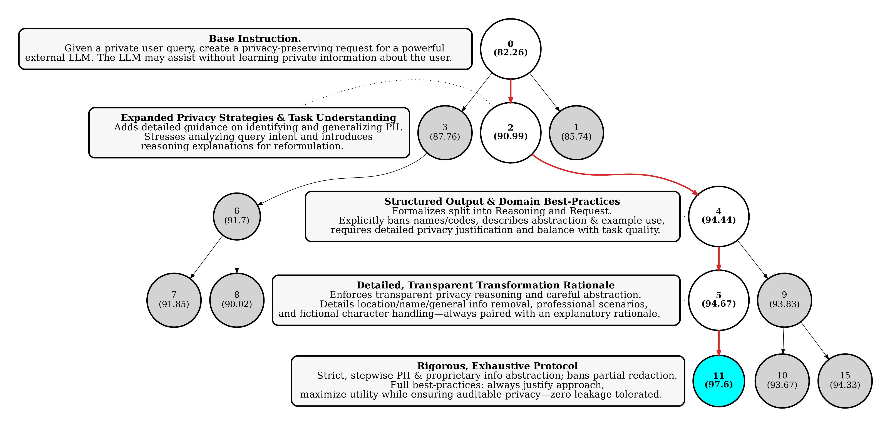

경로는 0→2→4→5→11입니다. 각 단계의 지시문 내용을 정리하면 다음과 같습니다.

| 후보 | 점수 | 지시문에 담긴 주요 내용 |
|---|---|---|
| 0 | 82.26 | 개인 질의로 프라이버시를 보존하는 요청을 만들라는 두 문장짜리 시드입니다. |
| 2 | 90.99 | 프라이버시 보존, 질의 이해와 재구성, 품질 극대화, 공통 전략, 추론 설명의 다섯 항목과 입출력 형식이 생깁니다. |
| 4 | 94.44 | 구조화 출력과 도메인 모범 사례가 강화되고, 예시·피드백 통합(Examples and Feedback Integration) 항목이 추가되어 과정 코드·가상 인물 처리 사례가 들어갑니다. |
| 5 | 94.67 | 민감 정보를 어떻게 식별하고 어떻게 추상화했는지 투명하게 밝히는 변환 근거와 흔한 실수 목록이 추가됩니다. |
| 11 | 97.6 | 부분적으로 가리기를 금지하고 이름·지명·날짜·내부 용어를 모두 완전히 추상화하라는 철저한 PII 처리 규칙이 추가됩니다. |

시드에서 최고 후보까지 점수는 82.26에서 97.6으로 15.34 올랐습니다. 저자들은 각 단계의 수정을 최적화가 진행되며 얻은 정보로 덧붙인 표적 뉘앙스로 설명합니다. 후보 11의 지시문에는 "Jonah Van Beijnen"을 "a notable individual"로, "Yoda"를 "a system name"으로 바꾸는 사례까지 들어 있습니다. 메타 프롬프트가 요구한 틈새 도메인 사실 보존이 이런 형태로 나타납니다. 앞 단계의 교훈은 다음 지시문에 이어지므로, 유전 트리를 따라 지식이 쌓인다는 설명을 실제 프롬프트 텍스트에서 확인할 수 있습니다.

0→2 단계에서 점수는 82.26에서 90.99로 8.73 올랐습니다.

이와 별개로 저자들은 단일 성찰 갱신만으로도 큰 이득이 자주 나온다고 주장합니다.

## 국소 최적해를 피하는 파레토 기반 후보 선택과 시스템 인식 병합

### 항상 최고 후보만 고르면 생기는 문제

앞서 본 반복 루프의 첫 단계는 풀에서 부모 하나를 고르는 일입니다. GEPA는 이 선택 전략을 갈아 끼울 수 있게 설계되어 있고, 어떤 전략을 쓰느냐에 따라 탐색-활용 트레이드오프(exploration-exploitation tradeoff)가 정해집니다. 이미 좋은 후보를 더 다듬을지(활용), 아직 덜 검증된 방향을 시도할지(탐색)를 이 선택이 결정합니다.

가장 단순한 전략은 $$\mathcal{D}_{\text{pareto}}$$ 평균 점수가 가장 높은 후보를 매번 부모로 고르는 것입니다. 저자들은 이 방식이 옵티마이저를 국소 최적해(local optimum)에 가두는 경우가 많다고 지적합니다. 지배적인 전략 하나를 찾으면 그것을 넘어서기 어려워지고, 옵티마이저는 새롭고 더 나을 수도 있는 전략을 배우지 못한 채 예산을 다 씁니다. 저자들이 관찰한 탐색 트리에서도 같은 일이 일어났습니다. 첫 자식 노드에서 새 전략 하나를 찾은 뒤, 탐색이 그 후보만 거듭 다듬으려 하다가 개선에 실패하고 예산을 소진했습니다.

이 현상은 성찰적 변이의 성질 때문에 더 심해질 수 있습니다. 한 후보만 계속 부모가 되면 성찰 LM은 같은 지시문을 같은 방향으로 덧칠합니다. 평균 점수가 조금 낮더라도 특정 유형의 문제를 잘 푸는 다른 후보가 있다면, 그 후보의 전략은 다시 선택되지 못하고 묻혀 버립니다.

### 파레토 지배라는 기준

대안을 이해하려면 다목적 최적화의 파레토 지배 개념이 필요합니다. 목표가 여러 개일 때 후보 A가 모든 목표에서 B 이상이고 적어도 하나에서 B보다 엄격히 낫다면, "A가 B를 지배한다"고 말합니다. 어느 후보에게도 지배되지 않는 후보들의 집합이 파레토 프런티어(Pareto frontier)입니다. 프런티어 위의 후보들은 서로 우열을 가릴 수 없습니다. 어떤 목표에서는 이쪽이, 다른 목표에서는 저쪽이 낫습니다.

GEPA는 $$\mathcal{D}_{\text{pareto}}$$의 **인스턴스 하나하나를 별개의 목표**로 봅니다. 후보 $$\Phi$$의 점수 벡터 $$S_\Phi=(S_\Phi[1],\ldots,S_\Phi[n_{pareto}])$$를 다목적 성능으로 다루는 셈입니다. 평균이라는 스칼라로 줄이면 사라지는 정보, 즉 "이 후보는 어떤 문제에 강한가"가 이렇게 보존됩니다.

### 인스턴스별 파레토 집합과 지배된 후보 제거

후보 선택 절차 SelectCandidate는 세 단계로 이루어집니다.

먼저 인스턴스마다 최고 점수와 그 점수를 낸 후보들을 모읍니다. 풀 $$\mathcal{P}$$의 $$k$$번째 후보를 $$\mathcal{P}[k]$$라 하면, 인스턴스 $$i$$의 최고 점수와 최고 후보 집합은 다음과 같습니다.

$$
s^{*}[i]=\max_{k}S_{\mathcal{P}[k]}[i],\qquad \mathcal{P}^{*}[i]=\{\mathcal{P}[k]:S_{\mathcal{P}[k]}[i]=s^{*}[i]\}
$$

$$\mathcal{P}^{*}[i]$$는 "인스턴스 $$i$$에서 지금까지 나온 최선을 달성한 후보들"입니다. 동점이면 여럿이 들어갈 수 있습니다.

다음으로 이 집합들의 합집합에서 중복을 없애 후보 집합 $$\mathcal{C}=\bigcup_i\mathcal{P}^{*}[i]$$를 만듭니다. 적어도 한 인스턴스에서 최고였던 후보만 남고, 어디에서도 최고가 아닌 후보는 이 단계에서 빠집니다. 이어서 제거 집합 $$D=\emptyset$$에서 시작해, $$\mathcal{C}\setminus D$$ 안에 다른 후보에게 지배되는 후보가 있는 한 그 후보를 $$D$$에 넣는 일을 반복합니다. 마지막으로 각 $$\mathcal{P}^{*}[i]$$에서 $$D$$를 빼 $$\hat{\mathcal{P}}^{*}[i]$$를 얻습니다.

어떤 인스턴스에서 최고인데도 지배될 수 있는 이유는 동점 때문입니다. A와 B가 인스턴스 1에서 함께 최고점을 냈고, 다른 인스턴스에서는 B가 A 이상이며 한 곳에서는 엄격히 높다면 A는 지배됩니다. A가 차지하던 최고 자리는 B가 그대로 차지하므로, A를 빼도 어떤 인스턴스의 최고 성능도 사라지지 않습니다.

### 빈도 비례 샘플링

남은 비지배 후보 $$\hat{\mathcal{C}}$$(절차에 정의 없이 쓰였지만 $$\mathcal{C}\setminus D$$를 뜻하는 것으로 읽힙니다)에서 부모 하나를 확률적으로 뽑습니다. 가중치는 각 후보가 최고 자리를 차지한 인스턴스 수입니다.

$$
f[\Phi]=\sum_{i}\mathbb{1}\big[\Phi\in\hat{\mathcal{P}}^{*}[i]\big],\qquad \Pr(\Phi_k)\propto f[\Phi_k]
$$

여기서 $$\mathbb{1}[\cdot]$$은 조건이 참이면 1, 거짓이면 0인 지시 함수입니다.

작은 예로 흐름을 보겠습니다(설명용 값입니다). $$\mathcal{D}_{\text{pareto}}$$에 인스턴스가 4개, 풀에 후보가 4개 있고 점수가 0 또는 1이라고 하겠습니다.

| 후보 | 인스턴스 1 | 인스턴스 2 | 인스턴스 3 | 인스턴스 4 | 평균 |
|---|---|---|---|---|---|
| A | 1 | 1 | 1 | 0 | 0.75 |
| B | 0 | 0 | 0 | 1 | 0.25 |
| C | 1 | 0 | 1 | 0 | 0.50 |
| D | 0 | 0 | 0 | 0 | 0.00 |

최고 후보 집합은 인스턴스 1이 {A, C}, 2가 {A}, 3이 {A, C}, 4가 {B}입니다. 합집합 $$\mathcal{C}$$는 {A, B, C}이고, D는 어디에서도 최고가 아니어서 이미 빠졌습니다. 그런데 C는 모든 인스턴스에서 A 이하이고 인스턴스 2에서 엄격히 낮으므로 A에게 지배되어 제거됩니다. B는 인스턴스 4에서 유일한 최고라 남습니다. 결과적으로 $$f[A]=3$$, $$f[B]=1$$이고, A는 확률 3/4, B는 1/4로 뽑힙니다.

평균만 보는 전략이었다면 B는 절대 부모가 되지 못합니다. 평균 0.25로 꼴찌에 가깝기 때문입니다. 하지만 B는 다른 누구도 풀지 못한 인스턴스 4를 푸는 전략을 담고 있고, 파레토 선택은 그 전략에 계속 기회를 줍니다. 동시에 A가 여전히 가장 자주 뽑히므로 활용도 유지됩니다.

평균 점수는 "누가 전체적으로 나은가"만 알려 주지만, 인스턴스별 파레토 프런티어는 "누가 어떤 문제에서 이기는가"를 보존합니다. GEPA는 한 문제라도 독점적으로 이기는 후보를 살려 두고, 많이 이기는 후보일수록 더 자주 다듬습니다.

### MAP-Elites의 일루미네이션 전략과의 연결

저자들은 이 방식을 [Mouret and Clune](https://arxiv.org/pdf/1504.04909)의 일루미네이션(illumination) 전략에서 가져왔다고 밝힙니다. 그들이 제안한 MAP-Elites는 품질-다양성(quality-diversity) 탐색 알고리즘입니다. 사용자가 정한 행동 특성 공간을 격자 셀로 나누고, 셀마다 가장 성능이 좋은 해(엘리트) 하나를 보관합니다. 결과물은 최적해 하나가 아니라 "공간의 각 영역에서 가능한 최선"을 비추는 지도이고, 이 지도에서 엘리트를 뽑아 변이시키며 탐색을 이어 갑니다. 이렇게 공간을 넓게 탐색하면 단일 최고 해도 더 좋게 찾는 경우가 많다고 그 논문은 보고합니다.

GEPA에서는 셀의 자리를 학습 인스턴스가 차지합니다. 사람이 행동 기술자를 설계할 필요 없이, 데이터 자체가 틈새(niche)를 정의하는 셈입니다. 차이도 있습니다. MAP-Elites는 셀마다 엘리트 하나만 두고 균등하게 뽑지만, GEPA는 동점인 최고 후보를 모두 남긴 뒤 지배된 후보를 명시적으로 지우고, 차지한 틈새 수에 비례해 뽑습니다. 또 GEPA의 다양성은 행동의 질적 차이가 아니라 인스턴스별 승리로만 측정되므로, 쉬운 인스턴스를 많이 이기는 후보가 유리해질 수 있습니다.

저자들은 이 전략이 탐색을 부풀리지 않으면서 국소 최적해를 벗어나게 돕고, 최적화 예산 안에서 "이기는" 전략을 담은 후보에 자원을 집중해 탐색과 활용의 균형을 맞춘다고 주장합니다.

### 두 계보를 합치는 시스템 인식 병합

성찰적 변이는 한 번에 모듈 하나만 고칩니다. 그러다 보면 풀 안에 서로 다른 모듈을 개선한 계보가 생길 수 있습니다. 예를 들어 다중 홉 시스템에서 한 계보는 질의 작성 모듈을, 다른 계보는 답변 모듈을 개선했다고 해 봅시다. 두 개선을 한 시스템에 모으면 둘 다보다 나을 수 있습니다. 시스템 인식 병합(Merge)은 이런 상호 보완적 전략을 합치는 교차 연산이며, 이를 켠 변형이 GEPA+Merge입니다. GEPA는 풀에 조건을 만족하는 두 후보가 있는지 정기적으로 확인하고, 찾으면 Merge를 호출합니다.

#### 발동 조건

Merge는 시드가 고정된 확률적 샘플러로 서로 다른 두 후보 $$i$$, $$j$$를 뽑은 뒤, 부모 기록 $$\mathcal{A}$$를 거슬러 올라가 각자의 조상 집합 $$A_i$$, $$A_j$$를 구합니다. 그다음 다음 조건을 차례로 검사합니다.

1. **직계 관계가 아닐 것**: $$i\in A_j$$이거나 $$j\in A_i$$이면 건너뜁니다. 한쪽이 다른 쪽의 조상이면 자손이 이미 조상의 개선을 물려받았으므로 합칠 것이 없습니다.
2. **공통 조상이 있을 것**: 공통 조상 $$a\in A_i\cap A_j$$마다 검사를 이어 가며, 같은 $$(i,j,a)$$ 조합을 이미 시도했다면 건너뜁니다.
3. **두 후보 모두 조상보다 나을 것**: $$S[a]>\min(S[i],S[j])$$이면 건너뜁니다. 즉 조상의 점수가 두 후보 점수의 최솟값 이하여야 합니다. 두 계보가 모두 조상 대비 실제로 개선되었을 때만 그 개선을 합칠 가치가 있다고 보는 조건입니다.
4. **서로 다른 모듈을 진화시켰을 것(Desirable 검사)**: 모듈을 하나씩 보며, 어떤 모듈에서 한쪽 후보는 조상과 같고 다른 쪽은 달라졌다면 참을 돌려줍니다. 그런 모듈이 하나도 없으면 병합하지 않습니다. 한쪽만 바꾼 모듈이 있어야 "다른 쪽이 갖지 못한 개선"을 가져올 수 있기 때문입니다.

부록의 설명에 따르면 저자들은 이를 "공통 조상을 공유하되 서로 겹치지 않는 프롬프트 집합을 최적화했고, 파레토 최적이며, 둘 다 조상의 종합 성능을 넘어선 후보들"로 요약합니다.

#### 모듈별 결합 규칙

조건을 통과하면 조상 $$a$$의 복사본에서 출발해 모듈 $$m$$마다 조상 프롬프트 $$\pi_a$$, 두 후보의 프롬프트 $$\pi_i$$, $$\pi_j$$를 비교합니다.

- $$\pi_a=\pi_i$$이고 $$\pi_j\neq\pi_i$$이면 $$j$$만 이 모듈을 바꿨으므로 $$\pi_j$$를 택합니다.
- $$\pi_a=\pi_j$$이고 $$\pi_i\neq\pi_j$$이면 반대로 $$\pi_i$$를 택합니다.
- 세 프롬프트가 모두 다르면 둘 다 이 모듈을 바꾼 것이므로, 점수가 높은 후보의 프롬프트를 택합니다(동점이면 무작위).
- 그 밖의 경우, 즉 셋이 모두 같거나 두 후보가 같은 방향으로 바꾼 경우에는 기본값으로 $$\pi_i$$를 씁니다.

세 모듈 시스템으로 예를 들면(설명용 구성), 조상이 $$\langle q_0, r_0, a_0\rangle$$이고 후보 $$i$$가 $$\langle q_1, r_0, a_0\rangle$$, 후보 $$j$$가 $$\langle q_0, r_0, a_2\rangle$$이라면 병합 결과는 $$\langle q_1, r_0, a_2\rangle$$입니다. 각 계보가 고친 모듈만 골라 담고, 아무도 손대지 않은 모듈은 그대로 둡니다. 모듈 구조를 알고 그 경계에서 섞는다는 뜻에서 "시스템 인식" 교차입니다. 텍스트를 임의로 잘라 붙이는 일반적인 프롬프트 교차와 달리, 각 모듈의 지시문은 일관된 한 덩어리로 유지됩니다.

저자들은 실험에서 Merge 호출을 최대 5회로 두었습니다. 그래서 Merge는 탐색의 주된 동력이 아니라, 파레토 선택이 따로 살려 둔 상호 보완적 계보들을 가끔 하나로 묶어 주는 장치에 가깝습니다. 파레토 선택이 다양한 전략을 보존하고, Merge가 그중 서로 겹치지 않는 개선을 결합하는 식으로 두 설계가 맞물립니다.

## 여섯 벤치마크와 예산을 맞춘 비교 조건

### 데이터 분할과 접근 규칙

저자들은 표준적인 학습/검증/테스트 분할을 씁니다. 옵티마이저는 학습 세트의 텍스트와 레이블에 모두 접근할 수 있습니다. 검증 세트(validation set)에서는 조기 종료 같은 용도로 후보의 점수를 추적하는 것만 허용되고, 인스턴스 내용은 직접 볼 수 없습니다. GEPA에서는 학습 세트가 $$\mathcal{D}_{\text{feedback}}$$, 검증 세트가 $$\mathcal{D}_{\text{pareto}}$$가 됩니다. 학습 세트는 대부분 150개(PUPA는 111개, AIME는 45개) 정도로 작습니다.

### 벤치마크별 시스템과 피드백 함수

벤치마크마다 기존 복합 AI 시스템과 피드백 함수를 짝지었습니다. 피드백 함수는 대체로 "무엇이 맞았고 무엇이 아직 빠졌는가"를 텍스트로 알려 줍니다.

| 벤치마크 | 과제 | 최적화 대상 시스템 | 텍스트 피드백 | 학습/검증/테스트 |
|---|---|---|---|---|
| HotpotQA | 다중 홉 질의응답 | HoVer 다중 홉 프로그램의 마지막 홉을 답변 생성으로 바꾼 시스템 | 각 단계에서 아직 검색해야 할 관련 문서 | 150/300/300 |
| IFBench | 정밀한 지시 따르기(출력 제약) | 답변 후 제약에 맞춰 재작성하는 2단계 시스템 | 충족한 제약과 충족하지 못한 제약의 설명 | 150/300/294 |
| AIME-2025 | 경시 수학 | 단일 단계 체인 오브 소트 | 원문에 명시 없음 | 2022–24 문제 90개를 학습·검증에 반씩, 2025 문제 30개를 5회씩 테스트 |
| LiveBench-Math | 수학 | 단일 단계 체인 오브 소트 | 원문에 명시 없음 | 368문항을 3등분 |
| HoVer | 주장 검증용 다중 홉 문서 검색 | 질의 작성 모듈 2개와 문서 요약 모듈 2개로 최대 3홉 검색 | 찾아낸 정답 문서와 아직 남은 문서 | 150/300/300 |
| PUPA | 프라이버시 보존 위임 | PAPILLON(2모듈) | 응답 품질 점수와 PII 유출 점수로 나눈 총점 분해 | 111/111/221 |

IFBench는 학습·검증을 IF-RLVR 학습 데이터에서 만들고, 테스트는 분포 밖의 새 제약 58종이 담긴 IFBench로 합니다. 따라서 옵티마이저는 테스트에서 처음 보는 제약으로 평가됩니다.

PUPA의 시스템인 [PAPILLON](https://doi.org/10.18653/v1/2025.naacl-long.173)은 신뢰할 수 있는 모델과 신뢰할 수 없는 모델을 함께 쓰는 위임 파이프라인입니다. 신뢰 모델 위에서 도는 질의 재작성 모듈이 사용자 질의에서 개인 식별 정보(PII)를 걷어 냅니다. 재작성된 질의만 외부의 비신뢰 모델에 보내고, 다시 신뢰 모델의 응답 재작성 모듈이 최종 답을 만듭니다. 점수는 답의 품질을 높이면서 PII 유출을 줄이는 두 목표를 합친 값입니다.

### 모델

오픈 모델로 Qwen3 8B를, 상용 모델로 GPT-4.1 Mini를 씁니다. 시스템은 모델마다 한 번씩 구성하며, 한 시스템 안의 모든 모듈이 같은 모델을 씁니다.

### GRPO 비교 조건

GRPO는 Qwen3 8B로만 학습합니다. 복합 시스템 실험에서는 [LoRA](https://doi.org/10.48550/arXiv.2106.09685)를 적용합니다. LoRA는 사전 학습 가중치 $$W_0$$를 고정하고 저랭크 행렬 곱 $$BA$$만 학습해 $$W_0 + \frac{\alpha}{r}BA$$ 형태로 갱신하는 방법입니다. 학습 파라미터와 메모리가 크게 줄고, 저자들은 비용이 낮고 GRPO와 함께 널리 쓰인다는 이유로 택했습니다. 한 스텝에 4개 인스턴스마다 12개 응답 그룹, 즉 48개 롤아웃을 만들고 500스텝을 돌리므로 롤아웃은 $$48 \times 500 = 24{,}000$$개로 고정됩니다. 20스텝마다 검증 점수를 재서 조기 종료에 씁니다. 단일 모듈 실험에서는 LoRA 대신 전체 파라미터 미세 조정으로도 GRPO를 돌렸습니다. GRPO의 롤아웃 수는 GEPA 예산에 맞춘 값이 아니라 고정값이어서, GRPO와의 비교는 같은 예산의 대결이 아니라 GEPA가 훨씬 적은 롤아웃으로 어디까지 가는지를 보는 비교입니다.

### 프롬프트 옵티마이저 간 예산 매칭

프롬프트 옵티마이저끼리는 예산을 맞춥니다. MIPROv2의 총 롤아웃 수는 검증 세트 크기와 모듈 수 등에 따라 달라지며, PUPA의 2270회부터 HoVer의 6926회까지 분포했습니다. 저자들은 벤치마크마다 MIPROv2가 쓴 롤아웃 수를 먼저 기록하고, GEPA의 최적화를 그 수에서 멈추게 했습니다. 제안·검증 절차가 달라 실제 사용량은 조금씩 어긋나지만, 차이는 언제나 10.15% 이내입니다. Trace(OptoPrime)와 TextGrad도 Trace 프레임워크에서 같은 구조, 초기 프롬프트, 데이터 분할로 구현해 같은 예산, 메트릭, 피드백 함수를 받았습니다. 다만 두 옵티마이저는 모듈별 피드백을 지원하지 않아, Trace 저자들의 BigBench-Hard 튜토리얼 형식으로 피드백을 넣었습니다. GEPA의 미니배치 크기는 3이며, Merge를 켜면 최대 5회까지 호출됩니다.

GEPA가 집계한 롤아웃 수에는 미니배치 평가뿐 아니라 $$\mathcal{D}_{\text{pareto}}$$ 검증 평가에 쓴 롤아웃도 포함됩니다. 비용도 크지 않습니다. GPT-4.1 Mini로 주요 실험 전체를 돌리는 데 500달러 미만이 들었고, 그중 GEPA는 86달러, GEPA+Merge는 67달러, MIPROv2는 76달러, Trace와 TextGrad는 합쳐 172달러였습니다. 최적화 중 성찰 LM 호출은 벤치마크당 17회(Qwen3 8B, IFBench)에서 92회(GPT-4.1 Mini, HoVer) 사이였습니다.

## 24,000 롤아웃의 GRPO를 훨씬 적은 롤아웃으로 넘어서는 GEPA

### Qwen3 8B 여섯 과제의 최종 성적

Qwen3 8B에서 저자들이 보고한 테스트 점수와 최적화 예산은 다음과 같습니다. 종합(Aggregate)은 여섯 과제 점수의 평균이고, 개선폭은 기준선(최적화 전 시드 프롬프트) 대비 차이입니다.

| 옵티마이저 | HotpotQA | IFBench | HoVer | PUPA | AIME-2025 | LiveBench-Math | 종합 | 개선폭 |
|---|---|---|---|---|---|---|---|---|
| 기준선 | 42.33 | 36.90 | 35.33 | 80.82 | 27.33 | 48.70 | 45.23 | — |
| GRPO | 43.33 | 35.88 | 38.67 | 86.66 | 38.00 | 51.26 | 48.91 | +3.68 |
| MIPROv2 | 55.33 | 36.22 | 47.33 | 81.55 | 20.00 | 46.60 | 47.84 | +2.61 |
| GEPA | 62.33 | 38.61 | 52.33 | 91.85 | 32.00 | 51.95 | 54.85 | +9.62 |
| GEPA+Merge | 64.33 | 28.23 | 51.67 | 86.26 | 32.00 | 51.95 | 52.40 | +7.17 |
| GEPA (+Merge) 롤아웃 | 6871 | 3593 | 7051 | 2426 | 1839 | 1839 | 3936 | — |
| GRPO 롤아웃 | 24000 | 24000 | 24000 | 24000 | 24000 | 24000 | 24000 | — |

GEPA는 AIME-2025를 뺀 다섯 과제에서 GRPO를 이깁니다. AIME-2025에서는 GRPO가 38.00, GEPA가 32.00입니다. 저자들은 다섯 과제에서의 우위를 19.0%, 2.73%, 13.66%, 5.19%, 0.7%로 나열할 뿐 과제 이름은 밝히지 않습니다. 이 값은 위 표의 GEPA와 GRPO 점수 차를 HotpotQA, IFBench, HoVer, PUPA, LiveBench-Math 순으로 적은 것과 일치하며, 단위는 퍼센트포인트입니다. 저자들은 여섯 과제 평균 우위를 +6%로 밝힙니다. 최대 우위는 HotpotQA에서 나왔으며, 저자들은 이를 결과 관찰에서는 약 19%, 논문 요약에서는 최대 20%로 표현합니다.

저자들에 따르면 GEPA는 최적 테스트 성능에 도달하기까지 GRPO보다 4~35배 적은 롤아웃을 씁니다. IFBench가 대표적입니다. GEPA는 678 롤아웃 만에 최적 프롬프트를 찾아 38.61%를 기록했고, 24,000 롤아웃을 쓴 GRPO의 35.88%를 넘었습니다.

GEPA+Merge는 HotpotQA에서 64.33으로 가장 높지만, IFBench에서는 28.23으로 기준선보다 낮습니다. 저자들은 GEPA+Merge가 GEPA와 비슷한 롤아웃 예산에서 GRPO를 21% 앞선다고 보고합니다.

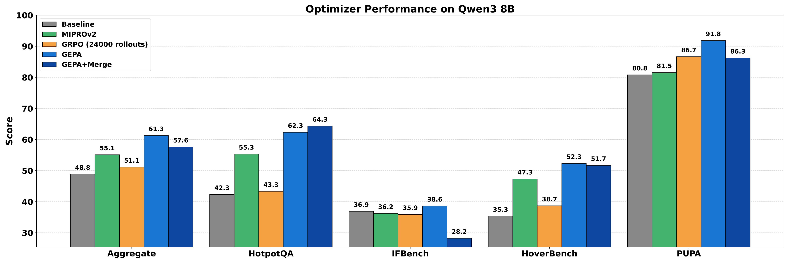

이 막대그래프는 Qwen3 8B에서 다섯 옵티마이저의 최종 테스트 성능을 종합 점수와 과제별 점수로 나누어 보여 줍니다.

### 학습 곡선이 보여 주는 속도 차이

최종 점수만으로는 학습 속도를 알 수 없습니다. 그래서 저자들은 롤아웃 수에 따른 점수 곡선을 함께 제시합니다. 원은 검증 성능, 별은 보류된 테스트 세트 성능입니다.

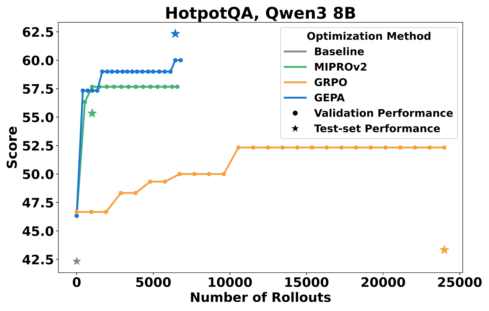

HotpotQA 곡선에서는 출발 직후의 기울기를 비교하면 됩니다. 저자들에 따르면 롤아웃이 쌓일수록 프롬프트 옵티마이저인 GEPA와 MIPROv2는 GRPO보다 훨씬 빠르게 배우고, GEPA는 최종 점수에서 두 방법을 모두 크게 앞섭니다. 저자들은 테스트 세트 표시로 보아 이 격차가 보류된 질문에서도 유지된다고 봅니다.

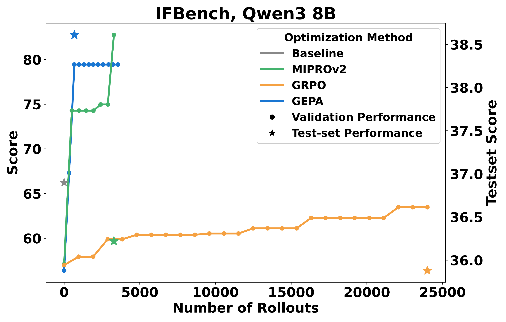

IFBench 곡선은 HotpotQA 곡선과 같은 그림에 실려 있으며, 앞의 저자 설명도 두 과제에 함께 붙어 있습니다.

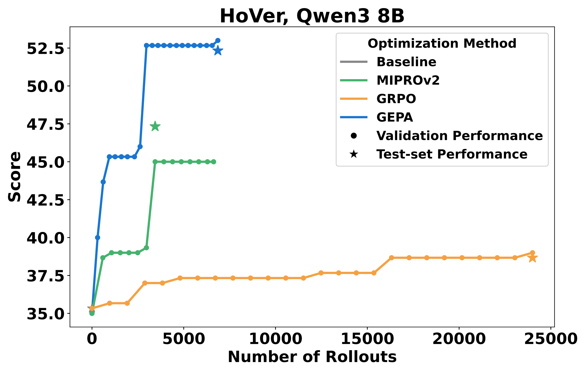

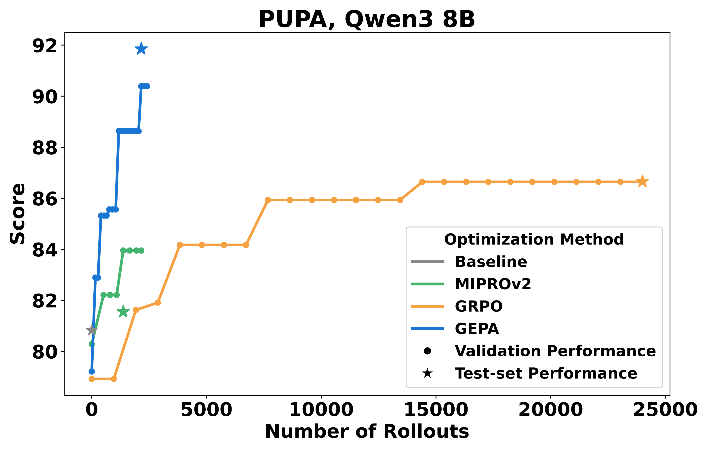

HoVer와 PUPA 곡선에서도 초반 롤아웃 구간의 기울기를 옵티마이저별로 비교하고, 별 표시로 테스트 점수를 확인하면 됩니다.

### 최고 검증 점수 도달 롤아웃

저자들은 곡선에서 "GRPO가 기록한 최고 검증 점수에 GEPA가 도달하기까지 쓴 롤아웃 수"라는 지표를 추렸습니다. 최종 성능 대신 "GRPO가 24,000 롤아웃으로 도달한 수준을 GEPA는 얼마 만에 따라잡는가"를 묻는 지표입니다. 여섯 과제에서 이 값은 243, 402, 330, 1143, 1179, 306 롤아웃이었습니다. 저자들은 이를 바탕으로 표본 효율성 차이가 최대 78배라고 보고합니다.

### 학습 롤아웃과 검증 롤아웃의 구분

지금까지의 롤아웃 수는 모두 GEPA가 쓴 전체 롤아웃입니다. 앞서 설명했듯 이 집계에는 미니배치 평가와 $$\mathcal{D}_{\text{pareto}}$$ 검증 평가가 함께 들어갑니다. 그런데 두 종류의 롤아웃은 역할이 다릅니다.

- **학습 롤아웃**: $$\mathcal{D}_{\text{feedback}}$$ 미니배치에서 돌리는 롤아웃입니다. 성찰 LM이 이 실행 트레이스와 피드백을 읽고 지시문을 고치므로, 실제 학습 신호를 만듭니다.
- **검증 롤아웃**: 미니배치 관문을 통과한 후보를 $$\mathcal{D}_{\text{pareto}}$$에서 채점하는 롤아웃입니다. 저자들은 이 점수가 후보 선택에만 쓰이고 학습 신호를 만들지 않는다고 밝힙니다.

저자들에 따르면 GEPA 예산의 대부분은 검증 평가에 쓰입니다. 구조상 그럴 수밖에 없는 이유를 가상의 숫자로 보면 이렇습니다. 예컨대 검증 세트가 N개라면, 관문을 통과한 후보 하나를 채점할 때마다 N 롤아웃이 듭니다. 반면 변이 시도 한 번에는 작은 미니배치 몇 개만 돌리면 됩니다. N이 미니배치보다 훨씬 크면 전체 예산은 자연히 채점 쪽으로 쏠립니다.

학습 롤아웃만 세면 숫자가 크게 줄어듭니다. GEPA가 최적 성능에 이르기까지 쓴 학습 롤아웃은 79~737회입니다. GRPO의 최고 검증 점수에 도달하는 데는 네 과제에서 각각 102, 32, 6, 179회의 학습 롤아웃이면 충분했습니다. 저자들은 이 결과가 성찰적 프롬프트 진화에 기반한 학습의 높은 표본 효율성을 보여 준다고 해석합니다.

GEPA 롤아웃의 대부분은 어느 후보를 남길지 고르는 채점에 쓰입니다. 지시문을 실제로 고치는 데 쓰인 학습 롤아웃은 수 회에서 수백 회 수준입니다.

이 구분은 예산을 더 줄일 수 있는 지점도 보여 줍니다. 저자들은 더 작은 검증 세트로 평가하거나, 전체 세트 대신 동적으로 고른 검증 부분집합으로 점수를 추적하면 표본 효율성을 더 높일 수 있다고 보고, 이를 향후 과제로 제안합니다.

### 전체 파라미터 미세 조정 GRPO와 비교

여기서 의문이 생깁니다. GRPO가 진 이유가 LoRA로 표현력이 제한되었기 때문은 아닐까요? 이를 확인하려고 저자들은 2홉 HoVer 과제에서 전체 파라미터 미세 조정으로 학습한 GRPO와 GEPA를 비교했습니다.

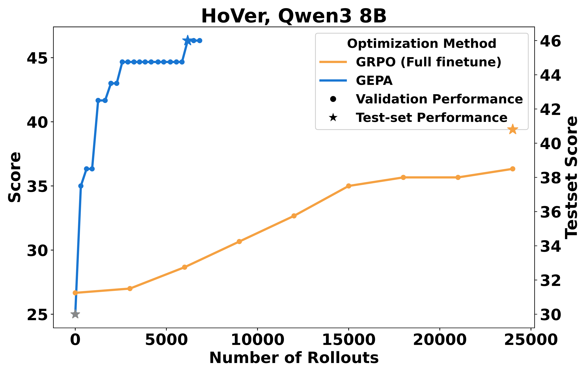

저자들은 이 비교에서 나타난 상대적 격차가 LoRA GRPO와 비교했을 때와 비슷하다고 봅니다. 따라서 GEPA가 전체 파라미터 GRPO와 파라미터 효율적 GRPO 모두에 대해 비슷한 우위를 보인다고 해석합니다. 다만 이는 단일 과제에서 한 비교입니다.

## 지시문만으로 퓨 샷 최적화를 넘어서는 GEPA의 프롬프트 옵티마이저 비교

### GPT-4.1 Mini 종합 성적

GEPA는 프롬프트만 바꾸므로 가중치에 접근할 수 없는 상용 모델에도 그대로 적용됩니다. 저자들은 GPT-4.1 Mini에서 GEPA를 MIPROv2의 두 설정과 비교했습니다. 하나는 지시문만 최적화하는 MIPROv2-No-Demos이고, 다른 하나는 지시문과 퓨 샷(few-shot) 데모를 함께 최적화하는 MIPROv2입니다. Trace(OptoPrime)와 TextGrad도 비교 대상입니다. 마지막 행인 GEPA-Qwen-Opt는 모델 간 전이 실험입니다.

| 옵티마이저 | HotpotQA | IFBench | HoVer | PUPA | AIME-2025 | LiveBench-Math | 종합 | 개선폭 |
|---|---|---|---|---|---|---|---|---|
| 기준선 | 38.00 | 47.79 | 46.33 | 78.57 | 49.33 | 58.20 | 53.03 | — |
| Trace(OptoPrime) | 60.33 | 51.19 | 46.00 | 74.18 | 45.33 | 60.74 | 56.30 | +3.27 |
| MIPROv2-No-Demos | 38.00 | 52.04 | 51.33 | 91.85 | 48.67 | 60.97 | 57.14 | +4.11 |
| MIPROv2 | 58.00 | 49.15 | 48.33 | 83.37 | 51.33 | 61.84 | 58.67 | +5.64 |
| TextGrad | 62.33 | 48.64 | 47.67 | 85.68 | 46.67 | 63.84 | 59.14 | +6.11 |
| GEPA | 69.00 | 52.72 | 51.67 | 94.47 | 59.33 | 64.13 | 65.22 | +12.19 |
| GEPA+Merge | 65.67 | 55.95 | 56.67 | 96.46 | 59.33 | 64.13 | 66.36 | +13.33 |
| GEPA-Qwen-Opt (Qwen3 8B로 최적화) | 65.67 | 49.83 | 54.67 | 90.05 | 52.67 | 59.31 | 62.03 | +9.00 |

GEPA(+12.19)와 GEPA+Merge(+13.33)의 향상폭은 MIPROv2(+5.64)의 두 배를 넘습니다. 저자들은 GEPA가 두 모델과 여섯 과제의 모든 설정에서 MIPROv2를 이겼고, 격차가 GPT-4.1 Mini에서 최대 11.1%, Qwen3 8B에서 최대 10.3%라고 보고합니다. 저자들은 초록에서 MIPROv2 대비 우위의 예로 AIME-2025의 +12%를 듭니다. 이 값은 Qwen3 8B 표의 차이(GEPA 32.00, MIPROv2 20.00)와 일치하며, 위의 GPT-4.1 Mini 표에서는 8포인트(59.33 대 51.33)입니다.

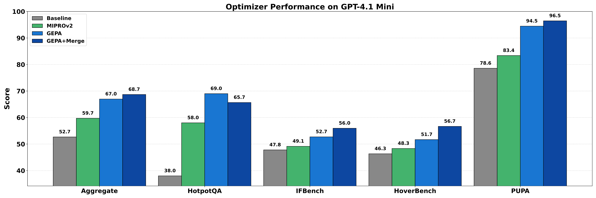

이 그래프에서는 기준선, MIPROv2, GEPA, GEPA+Merge의 종합 및 벤치마크별 최종 테스트 점수를 나란히 볼 수 있습니다.

### 퓨 샷 우위라는 통념과 그 반전

프롬프트 최적화가 바꿀 수 있는 대상은 크게 둘입니다. 과제를 설명하는 지시문(instruction)과, 입력과 정답 쌍을 보여 주는 퓨 샷 데모입니다. [Wan et al.](https://doi.org/10.48550/arXiv.2406.15708)은 두 계열을 통제된 조건에서 비교했고, 예시 선택이 지시문 최적화보다 더 중요할 수 있다는 결과를 얻었습니다. 최적화하지 않은 시드 지시문에 무작위 탐색으로 고른 예시만 붙여도 최신 지시문 옵티마이저를 이겼습니다. MIPROv2 논문도 퓨 샷 최적화가 효과적이라는 증거를 내놓았습니다. 그래서 "보여 주는 편이 가르치는 편보다 낫다"는 쪽이 지배적인 결론이었습니다.

GEPA 결과는 반대 방향을 가리킵니다. GEPA는 지시문만 바꾸는데도 지시문과 데모를 함께 최적화하는 MIPROv2를 모든 설정에서 앞섭니다. 저자들은 추세가 바뀌고 있다고 보고, 그 원인을 주로 두 가지로 봅니다. 최근 LLM의 지시 따르기 능력과 자기 성찰 능력이 좋아졌고, GEPA의 설계가 이 향상된 능력을 활용한다는 것입니다. 다만 이 원인 설명은 직접 검증한 결과가 아니라 저자들의 해석입니다. 또한 GEPA가 비교한 상대는 순수 예시 옵티마이저가 아니라 결합 옵티마이저인 MIPROv2입니다.

### 일반화 격차 재분석

저자들은 Wan et al.의 일반화 격차(generalization gap) 분석을 다시 수행했습니다. 일반화 격차는 최종 테스트 점수에서 최고 검증 점수를 뺀 값입니다.

$$
g = S_{\text{test}} - \max_{t} S_{\text{val}}(p_t)
$$

$$S_{\text{val}}$$과 $$S_{\text{test}}$$는 각각 검증 세트 점수와 테스트 세트 점수입니다. $$p_t$$는 최고 점수를 찾는 범위가 되는 후보 프롬프트들로 읽을 수 있습니다. 옵티마이저는 검증 점수가 높은 후보를 고르므로, 검증 세트에 과적합하면 테스트 점수가 그보다 낮아져 $$g$$가 음수가 됩니다. 예를 들어 최고 검증 점수가 70인 프롬프트가 테스트에서 65를 받으면 격차는 −5이고, 68을 받으면 −2입니다. 0에 가까울수록 검증 성능이 새 데이터에서도 유지된다는 뜻입니다. Wan et al.은 이 지표에서 예시 쪽이 더 잘 일반화한다고 보았습니다.

저자들은 다시 분석한 결과, 성찰로 진화한 지시문이 이제 더 작은 일반화 격차를 보인다고 주장합니다. 그리고 이것이 모델 능력의 발전과 GEPA 설계의 이점을 함께 보여 준다고 해석합니다. 근거가 되는 그림은 세 장입니다.

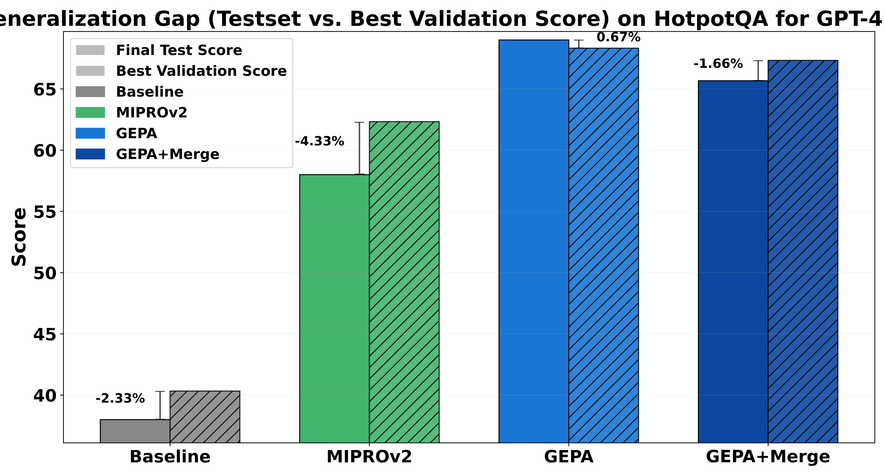

옵티마이저마다 최종 테스트 점수와 최고 검증 점수를 막대 쌍으로 나란히 비교하면 됩니다. 두 막대의 차이가 그 옵티마이저의 일반화 격차입니다.

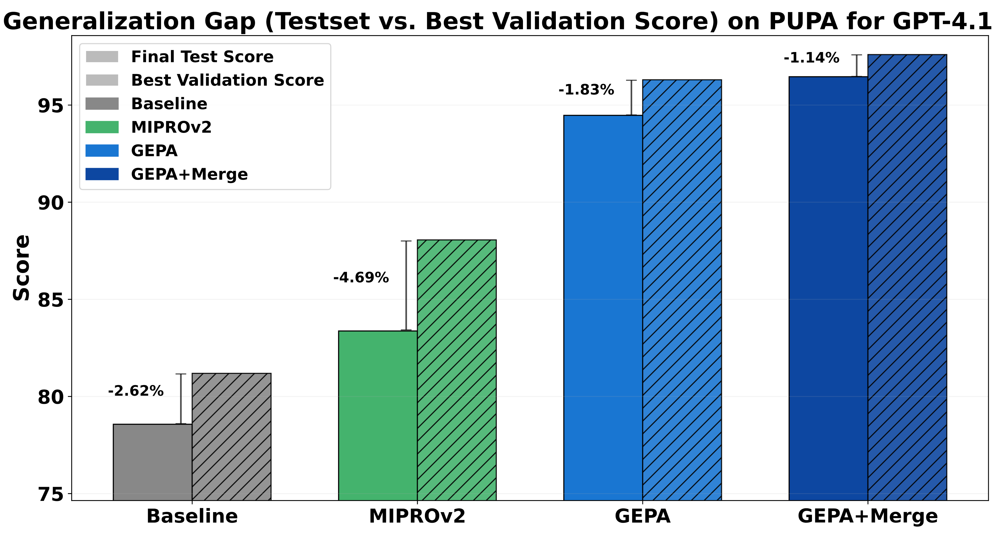

PUPA에서도 같은 방식으로 옵티마이저별 막대 쌍과 그 위에 적힌 격차를 볼 수 있습니다.

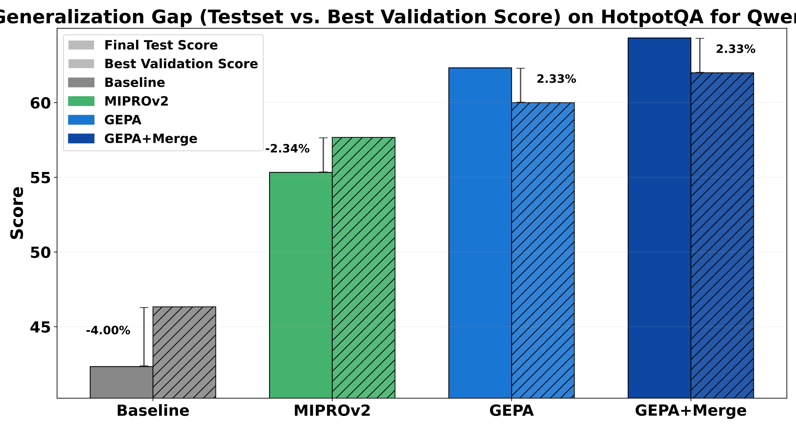

같은 HotpotQA를 Qwen3 8B로 최적화했을 때의 옵티마이저별 최종 테스트 점수와 최고 검증 점수입니다.

질적 차이도 있습니다. Wan et al.은 지시문 최적화가 주로 "유사 예시(quasi-exemplar)"를 지시문에 넣는 방식으로 효과를 낸다고 관찰했습니다. 반면 저자들에 따르면 GEPA의 프롬프트에는 과제를 어떻게 수행할지 적은 상세하고 선언적인 지시가 자주 들어갑니다.

### 프롬프트 길이와 서빙 비용

성찰로 진화한 지시문은 대체로 훨씬 짧아서 실무에서도 이점이 있습니다. 복잡한 과제에서는 퓨 샷 데모 하나만으로도 길이가 부담스러울 수 있습니다. MIPROv2처럼 여러 데모를 동시에 쓰도록 함께 최적화하면 프롬프트는 더 길어집니다.

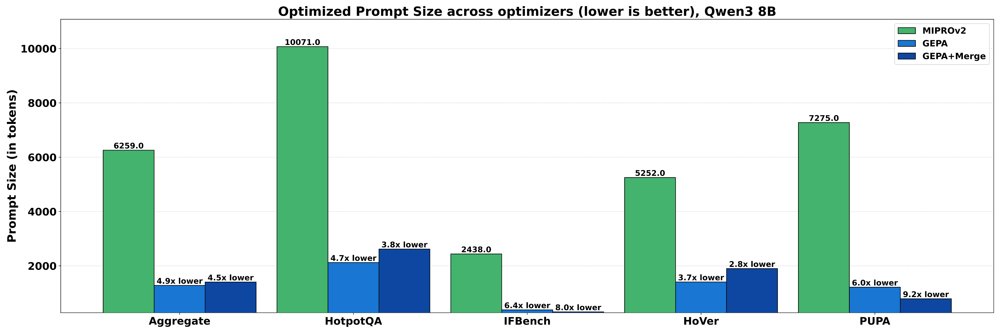

이 그래프는 벤치마크별로 MIPROv2, GEPA, GEPA+Merge가 만든 최적화 프로그램의 프롬프트 토큰 수를 비교합니다. 저자들은 GEPA와 GEPA+Merge 프롬프트가 MIPROv2보다 최대 9.2배 짧다고 보고합니다.

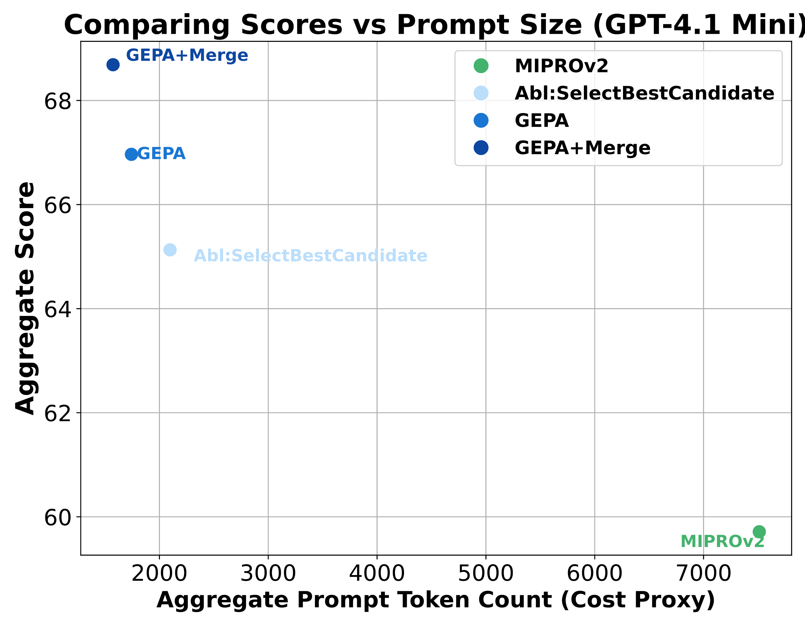

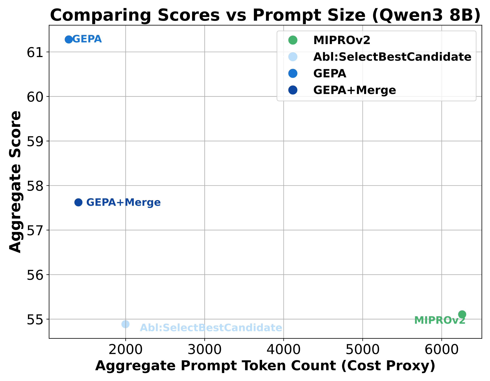

두 산점도는 옵티마이저별 종합 프롬프트 토큰 수(가로축)와 종합 점수(세로축)를 함께 보여 줍니다. 저자들은 종합적으로 성능이 높은 옵티마이저일수록 프롬프트가 짧은 경향이 있다고 관찰합니다. API 제공자는 모두 입력 토큰에 과금하므로, 프롬프트가 짧으면 하위 과제의 실행 비용이 줄어듭니다. 지연 시간도 줄고 LLM 서빙 시스템의 전반적인 효율도 좋아집니다.

### 약한 모델에서 강한 모델로의 프롬프트 전이

GEPA-Qwen-Opt는 Qwen3 8B만 써서 Qwen3 8B를 대상으로 최적화한 프롬프트입니다. 저자들은 이 프롬프트를 전혀 수정하지 않고 GPT-4.1 Mini에서 평가했습니다.

더 작고 계열도 다른 모델에서 최적화한 프롬프트가 여섯 벤치마크 종합 +9.00을 얻었습니다. 이는 GPT-4.1 Mini에서 직접 최적화한 MIPROv2(+5.64), TextGrad(+6.11), Trace(+3.27)보다 높습니다.

HotpotQA에서는 +27.67(38.00에서 65.67)을 기록했습니다. 다만 GPT-4.1 Mini에서 직접 최적화한 GEPA(+12.19)에는 못 미칩니다.

### 최종 프롬프트의 모습 비교

부록은 모든 시스템, 벤치마크, 모델에 대해 GEPA와 MIPROv2의 최종 프롬프트를 함께 싣습니다. MIPROv2 프롬프트는 몇 문장짜리 짧은 지시문 뒤에 모듈마다 최대 4개의 퓨 샷 데모를 붙이는 구성입니다. 데모에 검색 문단 전체가 그대로 담기는 경우도 많습니다. GEPA 프롬프트는 데모 없이 지시문만으로 이루어지며, 입력 형식 설명, 도메인 특화 규칙, 주의 사항을 담습니다. 저자들에 따르면 GEPA 프롬프트의 토큰은 대부분 지시문에 쓰이고, MIPROv2 프롬프트의 토큰은 대부분 퓨 샷 예시에 쓰입니다. 예를 들어 HotpotQA 최종 답변 모듈의 지시문에는 "별명을 물으면 별명만 답하라", "English와 British를 구분하라" 같은 규칙이 들어 있습니다. 일부 모듈에는 시드 지시문이 그대로 남아 있습니다.

## 파레토 선택과 Merge의 기여를 가르는 절제 실험

### 선택 전략만 바꾼 비교

후보 선택 전략의 효과만 따로 보려고, 저자들은 성찰적 변이와 미니배치 게이팅 같은 진화 하니스를 그대로 두고 반복 루프 첫 단계의 부모 선택 방식만 바꿨습니다. 모델은 Qwen3 8B이고 과제는 넷입니다. 비교한 전략은 세 가지입니다.

- **SelectBestCandidate**: 매 반복마다 점수가 가장 높은 후보 하나에서만 자식을 만듭니다. TextGrad가 쓰는 전략과 비슷한 탐욕적 선택입니다.
- **BeamSearch(N=4)**: 상위 4개 후보를 풀로 유지하며, APO가 쓰는 전략입니다. 후보를 여럿 남기지만 여전히 국소 최적해에 빠지기 쉽습니다.
- **GEPA 파레토 선택**: 앞서 설명한 인스턴스별 파레토 프런티어에서 빈도 비례로 부모를 뽑습니다.

| 전략 | HotpotQA | IFBench | HoVer | PUPA | 종합 | 개선폭 |
|---|---|---|---|---|---|---|
| 기준선 | 42.33 | 36.90 | 35.33 | 80.82 | 48.84 | — |
| SelectBestCandidate | 58.33 | 30.44 | 45.33 | 85.45 | 54.89 | +6.05 |
| BeamSearch | 57.33 | 36.39 | 41.00 | 81.08 | 53.95 | +5.11 |
| GEPA | 62.33 | 38.61 | 52.33 | 91.85 | 61.28 | +12.44 |

파레토 선택의 향상폭 +12.44는 탐욕적 선택(+6.05)과 빔 서치(+5.11)의 두 배를 넘습니다. 종합 점수 차는 SelectBestCandidate 대비 약 6.4(61.28 − 54.89), BeamSearch 대비 7.33(61.28 − 53.95)입니다. 과제별 격차는 BeamSearch 대비 최대 11.33(HoVer, 52.33 − 41.00), SelectBestCandidate 대비 최대 8.17입니다. 탐욕적 선택은 IFBench에서 30.44로, 기준선 36.90보다도 낮습니다. BeamSearch는 후보를 넷이나 유지하는데도 종합 점수가 SelectBestCandidate보다 낮습니다. 후보 수만 늘려서는 탐색이 충분히 다양해지지 않는다고 읽을 수 있습니다.

### 정체하는 트리와 균형 잡힌 트리

두 전략의 차이는 PUPA(GPT-4.1 Mini) 최적화에서 생긴 탐색 트리의 모양에서 드러납니다.

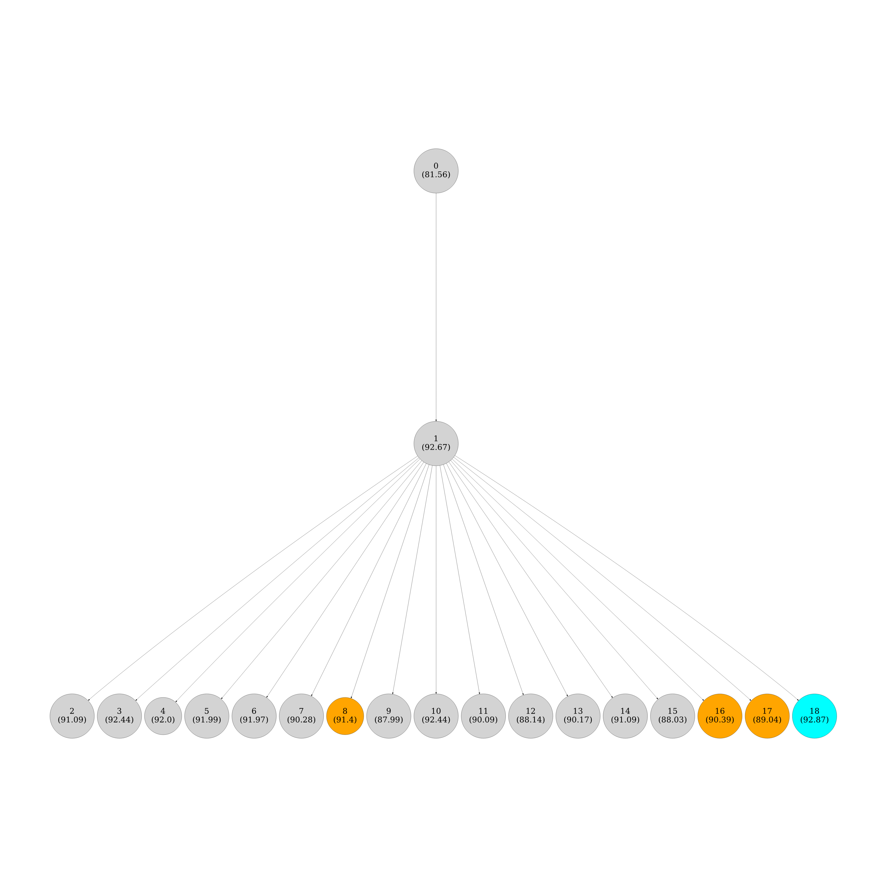

탐욕적 선택 트리는 앞서 설명한 국소 최적해 사례 그대로, 첫 자식 이후 한 후보에서만 가지를 치다가 정체합니다.

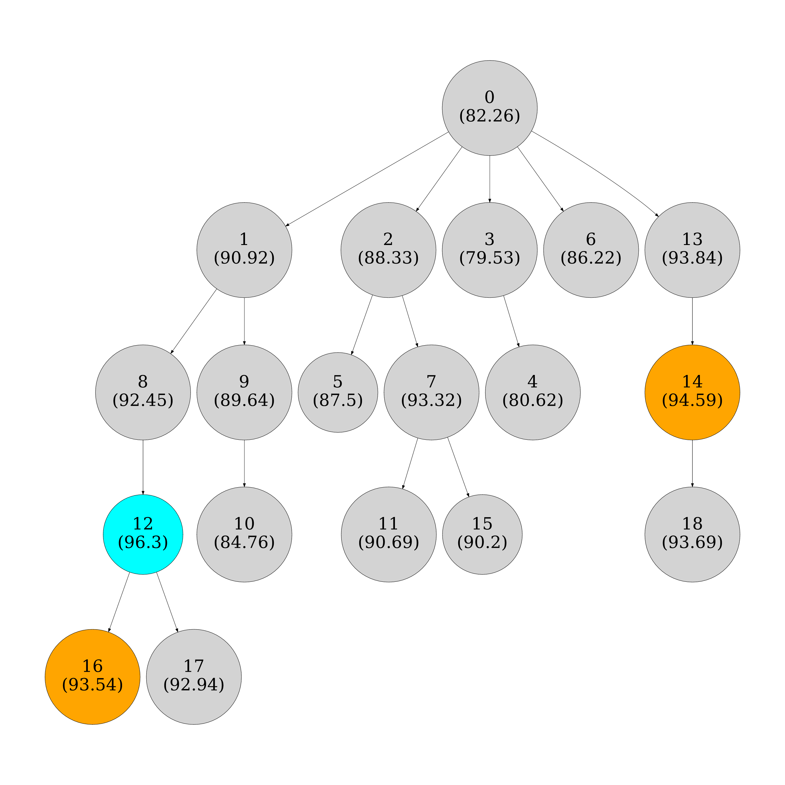

파레토 선택 트리는 여러 계보로 고르게 퍼진 균형 잡힌 모양입니다. 지금까지 찾은 "이기는" 전략을 모두 부모 후보로 남겨 두므로 탐색과 활용의 균형이 잡히고, 같은 롤아웃 예산 안에서 더 좋은 프로그램에 도달합니다.

### Merge의 추가 이득

저자들은 GEPA+Merge가 GEPA보다 최대 5% 높고, 이미 강한 GEPA 위에 종합 약 2%를 더 얹는다고 보고합니다. 저자들은 이 이득이 상호 보완적인 전략을 익힌 별개의 계보를 찾아내 결합한 덕분이라고 설명합니다.

### 모델에 따라 뒤집히는 Merge의 효과

Merge가 늘 도움이 되지는 않습니다. GPT-4.1 Mini에서는 특히 잘 작동했지만, Qwen3 8B에서는 성능을 떨어뜨렸습니다. 다만 Qwen3 8B도 네 과제 중 한 과제에서는 Merge로 이득을 봤습니다.

저자들은 이 차이의 원인을 두 가지에서 찾습니다. 롤아웃 예산을 성찰적 변이와 교차 사이에 어떻게 나누는가, 그리고 교차를 언제 호출하는가입니다. 실험에서는 두 모델에 같은 하이퍼파라미터를 고정해 썼고, 그 설정이 Qwen3 8B에는 적절하지 않았다는 해석입니다.

시점이 왜 중요한지는 Merge의 동작을 떠올리면 이해됩니다. Merge는 공통 조상에서 갈라져 각자 다른 모듈을 개선한 두 계보가 있어야 의미 있는 결합을 만듭니다. 계보가 충분히 갈라지기 전에 호출하면 합칠 만한 보완적 개선이 거의 없고, Merge에 쓴 롤아웃은 변이에 쓸 예산을 줄이기만 합니다. 추측하자면, 모델마다 변이가 개선을 만드는 속도와 계보가 분화하는 속도가 다르다면 같은 호출 일정도 한 모델에는 적절하고 다른 모델에는 너무 이를 수 있습니다.

교차는 잘 작동하는 독립 계보가 이미 있을 때 가장 큰 이득을 냅니다. 따라서 Merge는 고정된 일정이 아니라 최적화 트리가 충분히 다른 계보를 만든 뒤에 호출해야 한다는 것이 저자들의 직관입니다.

저자들은 이 원인 설명을 별도 실험으로 검증하지 않았고, Merge 호출 시점과 예산 배분을 상황에 맞게 정하는 적응형 기법을 향후 연구 과제로 제시합니다.

## 학습 도구에서 탐색 도구로: 커널 생성과 적대적 프롬프트 탐색

### 과제 집합에 일부러 과적합하는 추론 시점 탐색

GEPA의 본래 목적은 새 과제에 AI 시스템을 적은 표본으로 적응시키는 것입니다. 저자들은 예비 결과를 근거로, 같은 알고리즘을 추론 시점 탐색(inference-time search) 기법으로도 쓸 수 있다고 봅니다. 방법은 간단합니다. 풀어야 할 과제 목록 자체(예: CUDA로 바꿀 PyTorch 모듈 목록)를 학습 세트로 넘기고, $$\mathcal{D}_{\text{train}}$$과 $$\mathcal{D}_{\text{pareto}}$$ 모두에 과제 전체를 넣습니다. 평소라면 피해야 할 과적합이 여기서는 목표가 됩니다. GEPA는 바로 이 과제들을 반복해서 더 잘 풀도록 프롬프트를 고치고, 한 과제의 롤아웃에서 얻은 교훈을 다른 과제에도 적용합니다. 따라서 이어지는 숫자는 보지 못한 과제에 대한 일반화 성능이 아니라, 주어진 과제 집합 안에서 얻은 탐색 결과입니다.

이 실험에서는 피드백 함수 $$\mu_f$$로 도메인 지식을 주입합니다. 커널 개발 지식은 대개 기술 매뉴얼에 정리되어 있습니다. GEPA는 컴파일러 에러 메시지 같은 롤아웃 실패 정보를 검색 질의로 삼아 매뉴얼의 관련 절을 찾고, 그 내용을 성찰의 재료로 넣습니다. 저자들은 이렇게 오류 기반으로 검색하면 아키텍처별 모범 사례가 프롬프트 진화에 반영된다고 설명합니다. 또한 응답을 캐시해 온도 기반 샘플링의 확률성을 없앴습니다. 그래서 개선이 샘플링 운이 아니라 프롬프트 갱신과 다양한 프롬프트 탐색에서 나왔다고 판단할 수 있습니다.

### NPUEval: AMD XDNA2 NPU 커널

[NPUEval](https://arxiv.org/pdf/2507.14403)은 ML 워크로드에 흔한 연산자를 AMD NPU용 C++ 커널로 작성하게 하고, 실제 하드웨어에서 컴파일하고 실행해 채점하는 벤치마크입니다. 지표인 벡터 활용률(vector utilization)은 커널이 NPU의 벡터 연산 유닛을 얼마나 잘 쓰는지 나타냅니다. 저자들은 이 벤치마크의 초기 버전을 썼습니다.

기준 에이전트 Sequential10은 컴파일러 에러와 프로파일링 결과를 보고 커널을 최대 10번 다시 생성하며, Best-of-N 방식으로 평가합니다. 모델은 모두 GPT-4o입니다. Sequential10 단독은 평균 벡터 활용률 4.25%에 그칩니다. 기술 매뉴얼 기반 RAG를 더하면 16.33%, 여기에 MIPROv2까지 붙이면 19.03%입니다. RAG 없이 Sequential10에 GEPA를 적용하면 평균 30.52%가 되고, 일부 커널은 최대 70%에 이릅니다. GEPA가 만든 단일 프롬프트 하나만 써도 같은 에이전트가 RAG 없이 26.85%를 냅니다.

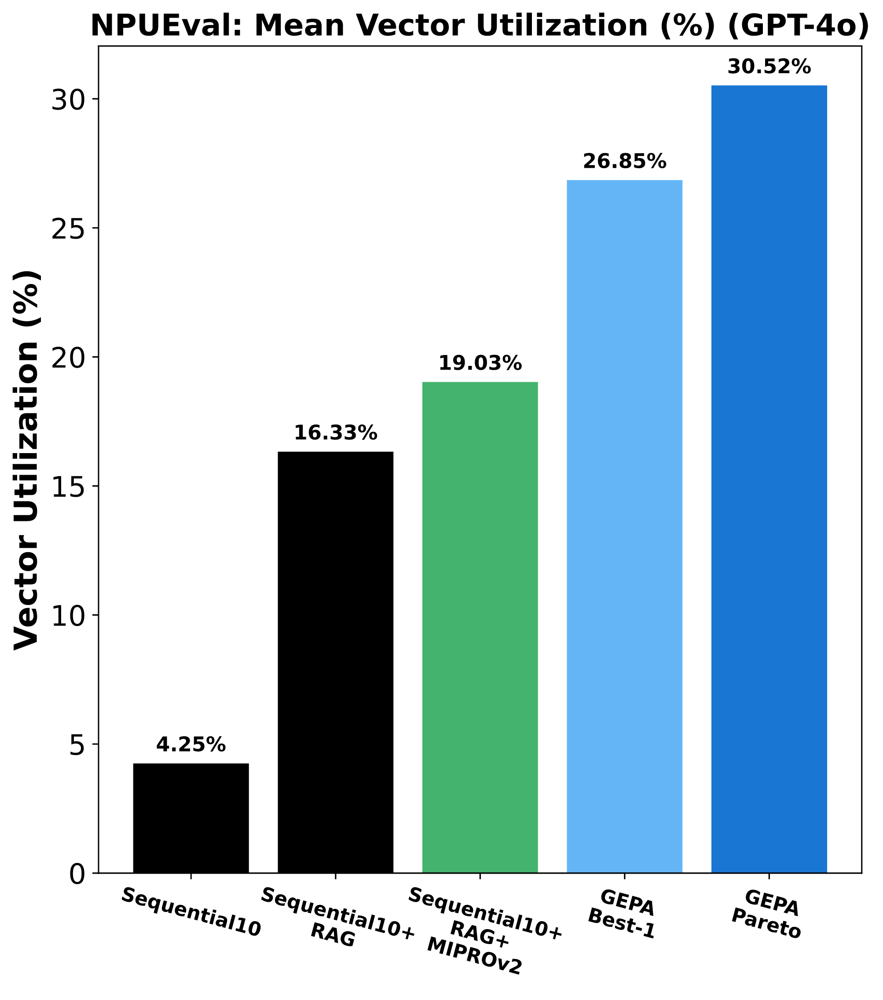

이 막대그래프에서는 실행 중에 검색을 쓰는 RAG + MIPROv2 구성(19.03%)과 검색 없이 GEPA 프롬프트 하나만 쓴 구성(26.85%)을 나란히 비교하면 됩니다.

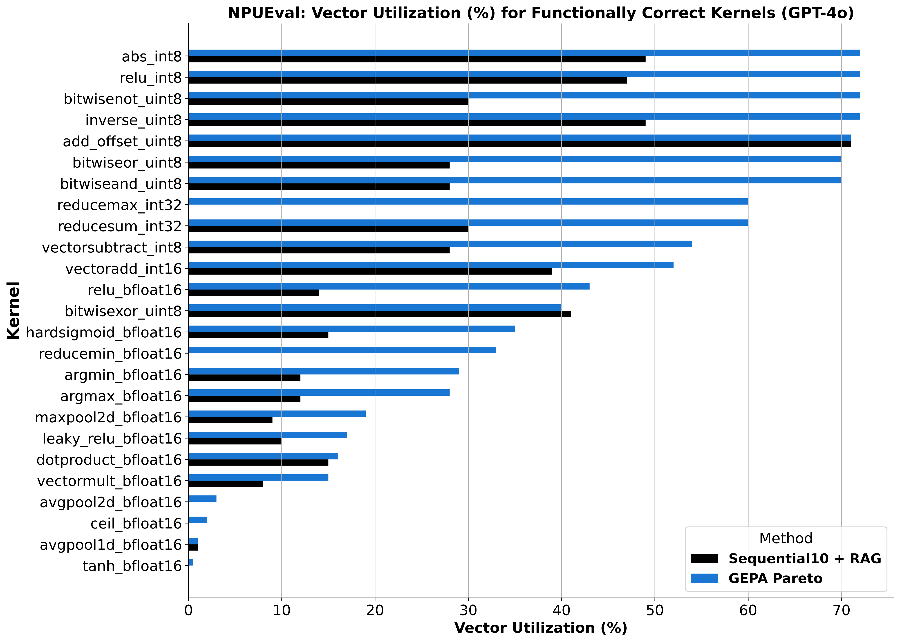

두 번째 그래프는 커널별 벡터 활용률을 보여 줍니다. 아래는 26.85%를 낸 프롬프트로, 오류 기반 검색이 아키텍처 모범 사례를 프롬프트 진화에 녹인 예입니다.

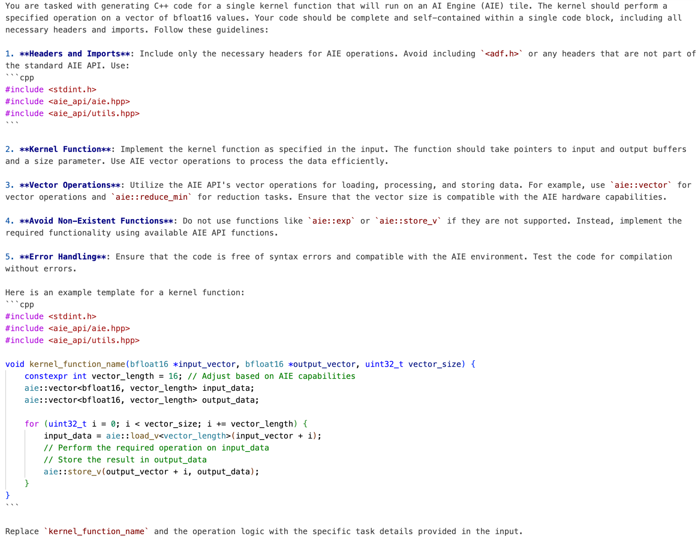

### KernelBench: V100 CUDA 커널과 fast_p

[KernelBench](https://arxiv.org/pdf/2502.10517)는 PyTorch 워크로드를 더 빠른 CUDA 커널로 다시 작성하게 하는 벤치마크입니다. 지표 $$\text{fast}_p$$는 정확하면서도 기준(PyTorch eager)보다 $$p$$배 넘게 빠른 커널을 만든 과제의 비율입니다.

$$
\text{fast}_p = \frac{1}{\lvert\mathcal{T}\rvert}\sum_{i\in\mathcal{T}} \mathbb{1}\!\left[\text{correct}_i \wedge \frac{T^{\text{base}}_i}{T^{\text{gen}}_i} > p\right]
$$

$$\mathcal{T}$$는 과제 집합, $$T^{\text{base}}_i$$와 $$T^{\text{gen}}_i$$는 과제 $$i$$에서 기준 구현과 생성 커널의 실행 시간입니다. 예를 들어 과제가 10개이고 그중 3개에서 정확하면서 기준보다 빠른 커널을 만들었다면 $$\text{fast}_1=0.3$$입니다. $$\text{fast}_{0.5}$$는 기준 속도의 절반보다 빠르기만 하면 인정하므로 조건이 더 느슨합니다.

저자들은 세 난이도에 걸친 대표 부분집합 35개 과제를 NVIDIA V100에서 다뤘습니다. 에이전트는 환경 피드백을 보고 최대 5번 다시 생성하는 Sequential5이고, 모델은 GPT-4o입니다.

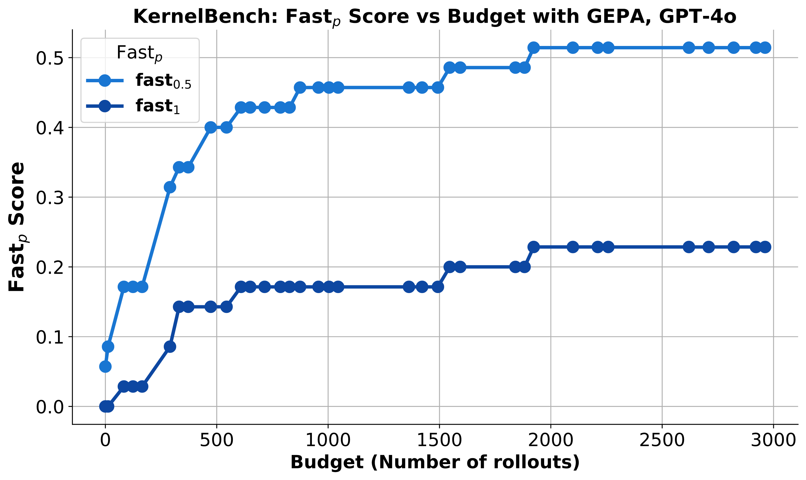

이 곡선에서는 롤아웃 예산이 늘어날 때 두 지표가 어떻게 변하는지 보면 됩니다. 저자들에 따르면 GPT-4o의 거의 0%였던 $$\text{fast}_1$$이 탐색 예산이 늘수록 올라 20%를 넘었습니다. 저자들은 이 결과가 초기 결과이며 더 체계적인 연구가 필요하다고 밝힙니다.

### 보상을 뒤집은 적대적 프롬프트 탐색

같은 루프에서 보상의 부호만 뒤집으면 적대적 프롬프트 탐색(adversarial prompt search)이 됩니다. 옵티마이저는 pass@1(첫 시도 정답률)을 최소화하도록 잡다한 상식 같은 추가 정보를 프롬프트에 넣는 수정을 제안합니다. 이때 제약이 붙습니다. 프롬프트는 과제와 모순되면 안 되고, 문제를 푸는 데 필요한 정보는 모두 남아 있어야 합니다. 과제는 그대로 두고 모델만 흔드는 교란을 찾습니다.

저자들은 AIME 2022–2024 문제를 진화용 풀로 삼아, 깨끗한 지시문에서 출발해 모든 질의 앞에 붙이는 범용 적대적 지시문 하나를 진화시켰습니다. 평가는 GPT-5 Mini로 AIME-2025 30문제를 문제당 5번씩, 모두 150회 생성해 진행했습니다. 그 결과 과제 설명과 답 형식 지시가 그대로 남아 있었는데도 pass@1이 깨끗한 프롬프트의 76%에서 10%로 떨어졌습니다.

깨끗한 프롬프트는 "질문에 답하고, 응답 끝에 정확히 '`### <final answer>`' 형식으로 답을 적으라"는 한 문단입니다. GEPA가 만든 프롬프트는 여기에 꿀은 상하지 않는다, 나일강은 6,650km가 넘는다, 돌고래는 한쪽 눈을 뜨고 잔다 같은 상식 문장을 끼워 넣고, 형식 규칙을 다시 한 번 말합니다.

저자들이 직접 살펴보니 GPT-5 Mini는 대부분의 응답을 실제 답 대신 리터럴 플레이스홀더 `### <final answer>`로 끝냈습니다. 저자들은 이 큰 하락이 형식 요구 자체가 아니라, 잡다한 정보와 엄격한 문자 그대로의 형식 규칙이 상호작용해서 생긴 것으로 해석합니다.

저자들은 이런 탐색이 평균 지표로는 보이지 않는 최악의 경우 강건성을 자동으로 점검하는 방법이 되고, 찾은 프롬프트를 스트레스 테스트나 안전 학습용 데이터로 쓸 수 있다고 제안합니다.

### 논문의 결론

저자들은 언어 기반 성찰과 파레토 후보 풀의 결합을, 자원이 제한된 환경에서 복잡한 AI 워크플로를 최적화하는 확장 가능한 전략으로 제시합니다. 또한 커널 작성처럼 어려운 도메인의 코드 생성에서 추론 시점 탐색 도구로서의 가능성도 보였다고 정리합니다. 저자들은 도메인 특화 텍스트 피드백과 결합한 추론 시점 탐색이 다른 코드 생성과 도메인 적응 과제로도 일반화될 수 있다고 보며, 이를 향후 연구 방향으로 남깁니다.

## 한계와 시사점

실무에서 가장 큰 장점은 가중치 접근 없이 상용 모델에 그대로 적용되고, 결과물이 사람이 읽고 고칠 수 있는 지시문이라는 점입니다. GPT-4.1 Mini 주요 실험에서 GEPA 최적화에 든 비용은 86달러였습니다. Qwen3 8B로 최적화한 프롬프트를 수정 없이 옮겨 써도 종합 +9.00을 얻었습니다. 따라서 작은 모델로 싸게 탐색하고 큰 모델에 배포하는 운용도 가능합니다.

한계도 분명합니다. GEPA 예산의 대부분은 학습 신호가 아니라 $$\mathcal{D}_{\text{pareto}}$$ 채점에 쓰입니다. 더 작거나 동적으로 고른 검증 부분집합은 향후 과제로 남았습니다. AIME-2025에서는 GRPO가 38.00, GEPA가 32.00으로 앞섰습니다. 경시 수학처럼 모델 자체의 추론 능력이 병목인 과제에서는 지시문만 바꾸는 접근에 상한이 있을 수 있습니다. 또한 GEPA는 가중치를 고정하므로, 정식화가 허용하는 프롬프트와 가중치의 공동 최적화는 실험하지 않았습니다.

Merge는 GPT-4.1 Mini에서 이득이었지만 Qwen3 8B에서는 성능을 떨어뜨렸고, IFBench에서는 기준선보다도 낮았습니다. 변이와 교차의 예산 배분, 호출 시점을 적응적으로 정하는 방법은 향후 연구로 남았습니다. 지시문이 퓨 샷 데모보다 잘 일반화하는 이유로 든 최신 LLM의 지시 따르기·성찰 능력 향상은 검증되지 않은 가설입니다. 비교 상대도 순수 예시 옵티마이저가 아닌 MIPROv2였습니다.

명시되지 않은 가정도 있습니다. 성능은 벤치마크마다 손으로 설계한 $$\mu_f$$의 텍스트 품질에 크게 기대는데, 피드백 설계의 기여를 분리한 절제 실험은 없습니다. GRPO는 24,000 롤아웃으로 고정되어 예산을 맞춘 대결이 아닙니다. 학습 세트도 대부분 150개 안팎으로 작아서, 데이터가 많을 때도 우위가 유지되는지는 알 수 없습니다.

커널 생성 결과는 과제 집합에 일부러 과적합한 추론 시점 탐색이며 초기 결과입니다. 다른 코드 생성과 도메인 적응으로의 확장은 후속 과제입니다. 적대적 프롬프트 탐색으로 찾은 프롬프트는 스트레스·회귀 테스트, 미세 조정이나 안전성 학습 데이터, 대규모 레드팀에 쓸 수 있다고 저자들은 제안합니다.

정리하면, 롤아웃이 비싸고 평가 과정에서 컴파일 에러나 루브릭 같은 풍부한 텍스트가 나오는 다중 모듈 시스템이라면 GRPO보다 먼저 시도할 만합니다. 반대로 피드백이 점수 하나뿐이거나 모델 능력 자체를 끌어올려야 하는 과제라면 가중치 학습이 여전히 필요할 수 있습니다.

- - -

### References
* [GEPA: Reflective Prompt Evolution Can Outperform Reinforcement Learning](https://arxiv.org/pdf/2507.19457v2)
