## TL;DR

### 이 연구를 시작하게 된 배경과 동기는 무엇입니까?
LM 프로그램은 여러 LM 호출을 엮은 파이프라인이고, 지금은 대부분 사람이 프롬프트를 고쳐 가며 만듭니다. APE나 OPRO 같은 기존 프롬프트 옵티마이저는 최적화하는 호출의 출력을 바로 채점할 수 있어야 동작합니다. 다단계 프로그램에서는 점수가 파이프라인 끝에서 하나만 나오고 중간 모듈에는 레이블이 없습니다. DSPy도 시연 예시는 최적화했지만 여러 모듈의 지시문은 다루지 못했습니다.

### 이 연구에서 제시하는 새로운 해결 방법은 무엇입니까?
저자들은 문제를 두 난제로 나눕니다. 소수의 좋은 후보를 만드는 제안 문제와, 과제 점수 하나를 모듈별 선택에 나눠 주는 크레딧 할당 문제입니다.
- 제안: 지표를 통과한 실행 트레이스로 시연 예시를 부트스트랩하고, 데이터셋 요약·프로그램 요약·팁으로 제안 LM을 그라운딩합니다.
- 크레딧 할당: MIPRO는 모듈별 지시문 번호와 시연 예시 집합 번호를 범주형 잠재 변수로 두고, 다변량 TPE 대리 모델이 좋은 조합을 학습합니다.
- 메타 최적화: MIPRO++는 같은 대리 모델로 제안 방식 자체(요약 사용 여부, 온도, 팁 등)를 학습합니다.

### 제안된 방법은 어떻게 구현되었습니까?
MIPRO는 시연 예시 집합과 지시문 후보를 미리 만든 뒤, Optuna의 TPE로 조합을 고르고 미니배치 점수로 대리 모델을 갱신합니다. 일정 스텝마다 평균 점수 1위 조합을 전체 학습 집합에서 다시 평가하고, 그중 최고를 반환해 미니배치 노이즈를 보정합니다. 과제 LM은 Llama-3-8B, 제안 LM은 GPT-3.5이며, 예산은 과제에 따라 전체 평가 20~50회입니다.

### 이 연구의 결과가 가지는 의미는 무엇입니까?
- Llama-3-8B를 쓴 일곱 과제 중 다섯에서 MIPRO가 가장 좋았고, 정확도 향상은 최대 13%였습니다.
- 시연 예시 최적화가 대체로 성능을 좌우합니다. Iris 테스트에서 Bootstrap Random Search는 94.1로, 최적화하지 않은 기준선 40.9를 크게 앞섰습니다.
- 예시로 전달하기 어려운 조건부 규칙이 있으면 지시문 최적화가 중요합니다. HotPotQA Conditional에서는 0-Shot MIPRO(14.6)가 Bootstrap Random Search(10.4)를 넘었고, MIPRO가 23.3으로 가장 높았습니다. 작은 오픈소스 모델로 다단계 파이프라인을 운영하면서 레이블이 최종 출력에만 있는 개발자에게 가장 쓸모가 큽니다.

- - -

## 다단계 LM 프로그램과 프롬프트 최적화가 비어 있던 자리

### LM 프로그램과 수작업 프롬프트 엔지니어링

복잡한 과제를 언어 모델로 풀 때는 LM을 한 번만 호출하는 일이 드뭅니다. 질문에서 검색 쿼리를 만들고, 검색 결과를 맥락에 붙이고, 다시 쿼리를 만든 뒤 마지막으로 답을 생성하는 식으로 여러 LM 호출을 엮습니다. 이렇게 모듈식 LM 호출을 엮은 파이프라인을 LM 프로그램이라고 부르며, 멀티홉 검색이 대표적인 예입니다. 각 모듈은 흔히 체인 오브 소트 프롬프팅을 씁니다. 최종 답 앞에 중간 추론을 먼저 쓰게 하는 방식입니다([Wei et al.](https://arxiv.org/pdf/2201.11903)).

오늘날 LM 프로그램은 대부분 사람이 프롬프트 엔지니어링으로 만듭니다. 특정 LM이 특정 파이프라인의 각 단계를 제대로 수행할 때까지 시행착오를 거치며 프롬프트를 고칩니다.

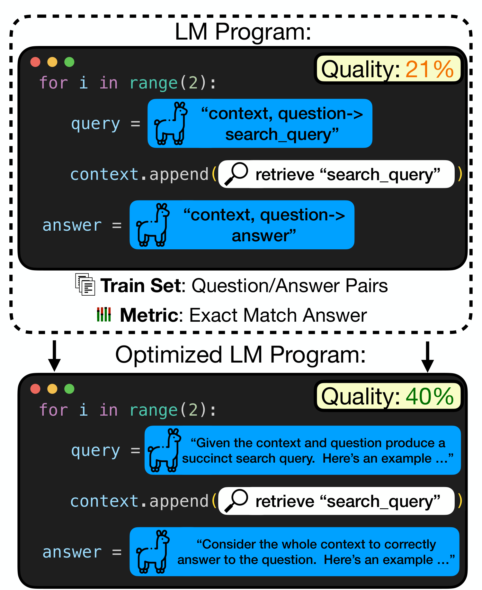

도식에서 옵티마이저가 받는 입력은 질문-답 쌍으로 된 학습 집합과, 예측 답이 정답 문자열과 같은지를 보는 정확 일치 지표뿐입니다. 위아래 프로그램은 구조가 같고 쿼리 생성 단계와 답 생성 단계의 지시문만 바뀌었다는 점에 주목하십시오. 그림에는 없지만 옵티마이저는 각 단계의 시연 예시도 부트스트랩합니다.

### 기존 프롬프트 옵티마이저가 다단계에서 막히는 이유

수작업 대신 알고리즘으로 프롬프트를 찾는 프롬프트 옵티마이저도 이미 있습니다. 이들은 문자열 공간을 탐색해 성능이 높은 프롬프트를 찾습니다.

- **APE**([Zhou et al.](https://arxiv.org/pdf/2211.01910)): 제안용 LM에 입력-출력 예시를 보여 주고 "이런 출력을 낳았을 지시문"을 역으로 추론해 후보를 여럿 만듭니다. 그런 다음 각 후보를 붙인 과제 LM을 레이블 데이터에서 채점해 최고점 지시문을 고릅니다.
- **OPRO**([Yang et al.](https://arxiv.org/pdf/2309.03409)): LM 자체를 블랙박스 옵티마이저로 씁니다. 지금까지 시도한 지시문과 점수를 점수 순으로 메타 프롬프트에 넣으면 LM이 이 궤적을 보고 더 나은 지시문을 제안하고, 새 후보를 채점해 궤적에 추가하는 과정을 반복합니다.
- **EvoPrompt**: 진화 알고리즘 기반으로 프롬프트를 탐색합니다.

이 방법들은 최적화 대상인 LM 호출의 출력을 곧바로 정답과 비교해 점수를 매길 수 있다고 전제합니다. 단일 호출 과제에서는 자연스러운 가정이지만, 다단계 프로그램에서는 개별 LM 호출에 정답 레이블이나 평가 지표가 없습니다. 멀티홉 예시의 데이터셋에는 질문과 최종 답만 있고 "첫 번째 검색 쿼리의 정답"은 어디에도 없습니다. 좋은 쿼리란 뒤 단계가 정답을 내도록 돕는 쿼리여서, 그 품질은 파이프라인 전체를 돌려 최종 지표를 봐야만 간접적으로 드러납니다. 그래서 중간 모듈 하나만 떼어 내 APE나 OPRO를 직접 적용하기 어렵습니다.

> **핵심:** 다단계 프로그램에서 막히는 지점은 탐색 알고리즘 자체가 아닙니다. 탐색이 기댈 모듈 단위 평가 신호가 아예 없어서 문제입니다. 점수는 파이프라인 끝에서 하나만 나옵니다.

### DSPy가 이미 해결한 것과 남긴 것

DSPy 프로그래밍 모델은 이 문제를 프로그래밍 추상화로 정리했습니다. 각 LM 호출은 `context, question -> search_query`처럼 입력과 출력 필드를 적은 **시그니처**로 선언하고, 체인 오브 소트 같은 프롬프팅 전략을 구현한 **모듈**이 이를 실행합니다. 개발자는 모듈을 일반 파이썬 코드로 조합해 프로그램을 짜고, 옵티마이저가 프로그램을 **컴파일**하면서 각 LM 호출의 지시문, 시연 예시(입력/출력 예), LM 가중치를 임의 지표에 맞춰 최적화할 파라미터로 다룹니다.

기존 DSPy 옵티마이저는 다단계 파이프라인을 실행해 시연 예시를 만들고, 이를 프롬프트나 가중치, 또는 둘 다를 최적화하는 데 썼습니다. 그러나 다중 프롬프트 파이프라인의 **지시문**은 조정하지 못했고, 이 논문은 바로 이 공백을 겨냥합니다.

### 약한 가정 아래의 두 난제

이 연구는 DSPy 추상화와 맞물리는 약한 가정만 둡니다. LM 가중치, 로그 확률, LM 호출 체인의 중간 단계에 대한 수작업 지표나 레이블에는 접근하지 않습니다. 필요한 것은 LM 프로그램, 최적화할 지표, 입력(지표에 따라 최종 출력 포함)으로 된 학습 집합뿐입니다. 이 설정에서 저자들은 두 가지 핵심 난제를 꼽습니다.

**제안 문제.** 가능한 프롬프트 공간은 감당할 수 없을 만큼 크고, 모듈이 늘수록 조합이 곱으로 불어납니다. 모듈마다 지시문 후보 10개만 있어도 모듈 3개면 조합이 1,000개입니다(예시용 수치). 평가 한 번이 파이프라인 전체 실행이라 비용이 크므로, 처음부터 소수의 고품질 지시문을 제안하는 능력이 중요해집니다.

**크레딧 할당 문제.** 모든 모듈의 프롬프트를 이루는 여러 변수를 함께 최적화하는데, 관측되는 것은 과제 수준 점수 하나뿐입니다. 쿼리 지시문과 답 지시문을 동시에 바꿨더니 점수가 올랐다면 어느 쪽 덕분인지 알 수 없습니다. 탐색 노력을 어디에 쏟을지 정하려면 각 변수 설정이 성능에 미친 영향을 추론해야 합니다.

### 기여와 관련 연구 대비 위치

저자들의 기여는 셋입니다. 첫째, LM 프로그램 최적화 문제를 형식화하고 제안 문제에 대한 전략 세 가지와 크레딧 할당에 대한 전략 세 가지로 알고리즘 설계 공간을 제시합니다. 둘째, 일곱 과제로 된 LM 프로그램 옵티마이저 벤치마크를 공개합니다. 셋째, 이 설계 공간에서 여러 옵티마이저를 구성해 평가합니다. 대표 결과인 MIPRO(Multi-prompt Instruction PRoposal Optimizer)는 동급 최고 수준의 오픈소스 모델인 Llama-3-8B를 사용한 실험에서 일곱 과제 중 다섯 과제에서 기준 옵티마이저를 앞섰고, 정확도는 최대 13% 향상되었습니다.

문자열 프롬프트 최적화 연구에는 그래디언트 유도 탐색, 재순위화 기반 전수 탐색, 진화 알고리즘, 다른 LM에 프롬프팅하는 방식, 강화학습이 있습니다. 강화학습 계열은 몇 단어 수준이나 구 수준의 편집, 또는 텍스트-이미지 생성에 집중했습니다. 다단계에 가장 가까운 시도는 쌓아 올린 LLM 호출의 프롬프트 공동 최적화를 변분 추론으로 모델링하고 단순한 두 층 구조에서 실험한 연구입니다. 이 접근은 LM에 넘긴 토큰의 로그 확률에 접근할 수 있어야 성립하는데, 텍스트 입력·텍스트 출력만 허용하는 상용 LM API가 늘면서 이 가정은 실제로 점점 제약이 커지고 있습니다. 반면 이 논문의 옵티마이저는 모듈 수가 몇 개든 어떤 LM 프로그램에도 바로 적용됩니다.

## 변수 할당 탐색으로 본 LM 프로그램 최적화와 네 단계 공통 루프

### 프롬프트 템플릿, 변수, 전체 할당

LM 프로그램 $$\Phi$$가 모듈 $$m$$개로 이루어져 있고, 모듈마다 어떤 LM을 쓴다고 하겠습니다. 모듈 $$i$$는 프롬프트 템플릿 $$p_i$$로 정의되고, 이 템플릿에는 빈 슬롯인 변수 $$\mathbf{v}$$가 들어 있습니다. 퓨 샷 QA용 템플릿이라면 지시문 자리, 시연 예시 자리, 대상 질문 자리가 각각 변수입니다.

프로그램 전체의 템플릿이 쓰는 변수를 모두 모은 집합을 $$\mathbf{V}$$라 하고, 이 변수 각각에 문자열을 하나씩 채워 넣는 전체 할당을 $$\mathbf{V}\mapsto S$$로 씁니다. 할당이 정해지면 모든 빈칸이 채워지므로 실행 가능한 프로그램 $$\Phi_{\mathbf{V}\mapsto S}$$ 하나가 확정됩니다. 이렇게 보면 프롬프트 최적화는 "좋은 문장을 쓰는 일"이 아니라 "어느 할당을 고를지"를 찾는 탐색 문제가 되고, 모든 옵티마이저가 이 할당 공간 위에서 움직입니다.

### 목적 함수와 잠재 변수 관점

학습 집합 $$\mathcal{D}$$는 입력 $$x$$와 선택적 메타데이터 $$x'$$(예: 레이블)의 쌍으로 이루어집니다. 지표 $$\mu$$는 프로그램 출력 $$\Phi_{\mathbf{V}\mapsto S}(x)$$와 $$x'$$를 받아 점수를 냅니다. 목표는 학습 집합에서 평균 점수가 가장 높은 할당을 찾는 것입니다.

$$
\Phi^{*}=\arg\max_{\mathbf{V}\mapsto S}\,\frac{1}{\lvert\mathcal{D}\rvert}\sum_{(x,x')\in\mathcal{D}}\mu(\Phi_{\mathbf{V}\mapsto S}(x),x')
$$

식 자체는 평균을 최대화하는 단순한 형태입니다. 까다로운 부분은 $$\mu$$가 과제 전체 출력에만 점수를 매겨서 생깁니다. 첫 모듈의 지시문 변수가 무엇이어야 하는지 직접 알려 주는 신호는 어디에도 없고, 그 값의 좋고 나쁨은 최종 점수를 거쳐서만 드러납니다. 그래서 $$\mathbf{V}$$의 모든 변수가 잠재 변수입니다. 앞서 말한 크레딧 할당 문제가 수식에서는 이렇게 나타납니다.

저자들은 이 문제가 다루기 어려운 이유로 다섯 가지를 듭니다.

1. 각 문자열 $$s\in S$$는 어떤 값이든 될 수 있습니다.
2. 앞서 본 대로 감독이 과제 수준뿐이라 모든 변수가 잠재 변수입니다.
3. LM의 그래디언트나 임베딩에 접근하지 않으므로 많은 강화학습 기법과 프롬프트 튜닝 기법을 쓸 수 없습니다.
4. 시스템 설계자가 가진 데이터셋 $$\mathcal{D}$$는 대개 작습니다.
5. $$\Phi$$를 평가하는 데 쓸 LM 호출 예산도 작습니다.

세 번째 이유 때문에 이 문제는 블랙박스 최적화가 됩니다. 블랙박스 최적화는 목적 함수의 내부나 기울기를 보지 않고, 입력을 넣어 나온 값만 보고 최적점을 찾는 방식입니다. 하이퍼파라미터 탐색에서 설정 하나를 골라 학습을 돌리고 검증 점수만 보는 과정과 같은 틀입니다. 여기서는 할당 하나를 정해 프로그램을 실행하고 지표 값을 받는 일이 함수 평가 한 번이며, 평가 한 번에 LM 호출이 여러 번 들어 비용이 큽니다.

실제로는 변수 일부만 최적화하는 경우가 많습니다. 이 연구는 각 프롬프트 $$p$$에 자유형 지시문 변수 1개와 시연 예시 변수 $$K$$개 $$\{d_{i1},\ldots,d_{ik}\}$$를 두고, 대상 질문 같은 나머지 변수는 상수로 고정합니다.

### 모든 옵티마이저가 공유하는 루프

정확한 해를 구할 수 없으므로 저자들은 근사 해를 찾는 일반 틀을 정의합니다. 이 틀은 OPRO와 APE를 LM 프로그램으로 일반화한 것입니다. 입력은 옵티마이저 $$M$$, 최적화 전 프로그램 $$\Phi$$, 지표 $$\mu$$, 최대 반복 횟수 $$I$$, 학습 데이터 $$\mathcal{D}$$, 미니배치 크기 $$B$$, 제안 하이퍼파라미터 $$\theta$$입니다. 옵티마이저에는 제안을 좌우하는 내부 상태가 있고, 네 메서드로 이 상태를 다룹니다.

1. **Initialize**: 시작할 때 $$M$$.Initialize($$\mathcal{D}$$, $$\theta$$)로 데이터를 이용해 옵티마이저를 초기화합니다.
2. **Propose**: 반복 $$k=1,\ldots,I$$마다 새 할당 $$\mathbf{V}\mapsto S_k$$를 제안합니다.
3. **검증**: $$\mathcal{D}$$에서 크기 $$B$$의 배치 $$\mathcal{D}_k$$를 샘플링하고, 제안된 할당으로 프로그램을 실행해 평균 점수를 계산합니다.

   $$
   \sigma=\frac{1}{B}\sum_{(x,x')\in\mathcal{D}_k}\mu(\Phi_{\mathbf{V}\mapsto S_k}(x),x')
   $$

4. **Update**: $$M$$.Update($$\mathbf{V}\mapsto S_k$$, $$\sigma$$)로 관찰한 점수를 내부 상태에 반영합니다.

반복이 끝나면 **ExtractOptimizedSets**로 최종 할당을 꺼내 $$\Phi_{\mathbf{V}\mapsto S}$$를 반환합니다. 검증 단계의 $$\sigma$$는 목적 함수의 평균을 전체 $$\mathcal{D}$$ 대신 크기 $$B$$인 배치로 근사합니다. 직관적으로 보면 Propose는 무엇을 시도할지, Update는 관찰한 점수를 어떻게 반영할지를 정하는 자리입니다.

설계 목표는 효율입니다. 저자들은 이 틀의 인스턴스 가운데 프로그램 $$\Phi$$를 호출하는 횟수, 곧 검증 단계를 최소화하고, 그 결과 제안을 샘플링해야 하는 횟수도 줄이는 것을 찾습니다.

## 과제에 맞춘 후보 생성: 시연 예시 부트스트래핑, 그라운딩, 제안 학습

앞서 본 공통 루프에서 Propose 단계가 내놓는 후보가 엉뚱하면 평가 예산이 낭비됩니다. 그래서 저자들은 과제·프로그램·데이터·지표의 성격에 맞는 후보를 효율적으로 샘플링하는 데 집중합니다. 후보는 과제를 실제로 푸는 과제 LM이 아니라 별도의 LM인 **제안 LM**이 만듭니다. 제안 LM을 쓰는 방식은 세 가지입니다. 과제 수행 방법을 보여 주는 퓨 샷 예시를 부트스트랩하는 방식, 좋은 지시문을 짓는 데 도움이 될 정보를 모아 요약하는 방식, 그리고 제안 LM의 사용법 자체를 메타 최적화하는 방식입니다.

### 시연 예시 부트스트래핑: 중간 레이블 없이 모듈별 예시 얻기

다단계 프로그램에는 중간 모듈의 정답 레이블이 없습니다. 그런데 쿼리 생성 모듈의 시연 예시를 만들려면 "이 질문에는 이런 쿼리가 좋다"는 입력/출력 쌍이 필요합니다. 부트스트래핑은 프로그램을 직접 돌려 보고 최종 결과가 좋았던 실행만 남겨 이 문제를 피합니다. 이는 Khattab et al.(2022, 2024)이 연구한 단순하지만 효과적인 기각 샘플링 전략입니다. 배경으로 덧붙이면, 2022년 연구인 [Demonstrate-Search-Predict](https://arxiv.org/pdf/2212.14024)는 학습 입력에 파이프라인 자체를 실행해 각 중간 모듈의 입출력 형식에 맞는 시연 예시를 얻는 방식을 제시했고, 2024년 연구는 DSPy입니다.

절차는 다음과 같습니다. 학습 집합에서 입력 $$x$$를 뽑아 $$\Phi(x)$$를 실행하면, 모듈마다 실제로 받은 입력과 낸 출력의 기록이 남습니다. 이 기록을 **실행 트레이스** $$\tau$$라고 부릅니다. 그런 다음 최종 출력을 지표 $$\mu$$로 채점해 다음 조건을 만족하는지 봅니다.

$$
\mu(\Phi(x),x')\geq\lambda,\quad (x,x')\in\mathcal{D}
$$

여기서 $$\lambda$$는 성공으로 간주할 임계값입니다. 정확 일치처럼 0/1인 지표라면 사실상 "정답을 맞혔는가"를 묻는 조건입니다. 조건을 통과하면 트레이스의 **모든** 값을 각 모듈의 유효한 시연 예시 후보로 삼고, 통과하지 못한 트레이스는 버립니다. 이것이 **기각 샘플링**입니다. 프로그램이 생성한 트레이스 가운데 기준을 통과한 것만 받아들이는 방식이며, 여기서는 그 기준이 최종 지표입니다.

가상의 예로 두 홉 질문을 실행했다고 하겠습니다. 첫 쿼리가 "어떤 영화의 감독", 둘째 쿼리가 "그 감독의 출생지"였고 최종 답이 정답과 일치했습니다. 그러면 (질문 → 첫 쿼리), (질문+검색 맥락 → 둘째 쿼리), (전체 맥락 → 답) 세 쌍이 각 모듈의 시연 예시 후보 풀에 들어갑니다. 중간 쿼리가 정말 최선이었는지는 알 수 없습니다. 다만 끝까지 정답에 이르는 데 기여한 쿼리임은 확인됐으므로, 이를 그럴듯한 레이블로 씁니다.

이렇게 후보 풀이 생기면 문제는 "어떤 시연 예시 조합을 쓸까"로 줄어듭니다. 한 모듈 안에서 $$K$$개를 고르는 선택과, 모듈 사이에서 조합을 맞추는 선택이 모두 들어갑니다. Khattab et al.(2024)은 다단계 프로그램에서 이 방식이 수작업 시연 예시보다 나은 경우가 많다고 보고합니다.

### 그라운딩: 제안 LM에 과제 맥락 쥐여 주기

지시문은 시연 예시처럼 실행 기록에서 바로 뽑을 수 없으므로 제안 LM이 새로 써야 합니다. 저자들의 가설은 이렇습니다. 데이터의 성질, 프로그램 구조, 성공적인 수행 예시 같은 관련 맥락을 제안 LM에 주면 과제에 더 잘 맞는 지시문이 나올 것입니다. 이를 **그라운딩**이라 부릅니다. 저자들은 이 맥락을 모으는 제로 샷 LM 프로그램을 만들었고, 맥락 요소는 넷입니다.

1. 원시 데이터셋 $$\mathcal{D}$$의 패턴을 기술한 **데이터셋 요약**
2. 프로그램 제어 흐름을 요약한 **프로그램 요약**
3. 앞서 설명한 방식으로 얻은 부트스트랩 시연 예시
4. 이전에 평가한 단계별 프롬프트와 그 학습 집합 점수

저자들은 각 요소를 맥락으로 넣는 방안을 검토하며, 데이터셋 요약·프로그램 요약 사용 여부 같은 일부 선택은 제안 학습의 대상이 됩니다.

#### 지시문 제안 프로그램의 입력 구성

새 지시문은 DSPy 시그니처 `GenerateSingleModuleInstruction`이 생성합니다. 시그니처의 지시문은 "아래 정보로 LM 호출로 풀려는 과제를 파악한 뒤, 과제를 더 잘 풀도록 LM을 프롬프팅할 새 지시문을 생성하라"는 내용입니다. 입력 필드는 네 맥락 요소를 그대로 반영합니다.

| 필드 | 내용 |
| --- | --- |
| `dataset_description` | 사용하는 데이터셋 설명(데이터셋 요약) |
| `program_code` | 과제를 풀도록 설계된 LM 프로그램 코드 |
| `program_description` | 프로그램이 푸는 과제와 푸는 방식 요약(프로그램 요약) |
| `module` | 지시문을 만들 대상 모듈 |
| `task_demos` | 해당 모듈의 입력/출력 예시 |
| `previous_instructions` | 이전에 시도한 지시문과 점수 |
| `basic_instruction` | 기본 지시문 |
| `tip` | 새 지시문 작성 방향에 대한 제안 |
| `proposed_instruction`(출력) | 제안된 새 지시문 |

데이터셋 설명과 프로그램 설명은 이 시그니처가 아니라 별도 모듈이 미리 생성합니다.

#### 데이터셋 요약과 프로그램 요약 만들기

데이터셋 요약은 두 단계로 만듭니다. 먼저 제안 LM이 학습 집합을 배치 단위로 돌면서, 이전 관찰 목록을 보고 대부분 샘플에 성립하는 경향(주제, 내용, 구문, 간결성 등)에 대한 관찰을 덧붙입니다. 더할 내용이 없으면 'COMPLETE'를 출력하게 하고, 'COMPLETE'가 5번 나오면 순회를 멈춥니다. 그다음 모인 관찰을 가장 중요한 내용만 담은 2~3문장으로 요약하게 합니다. 예를 들어 ScoNe 요약은 부정과 이중 부정이 얽힌 논리 추론 과제임을 짚고, HotPotQA 요약은 다양한 주제의 퀴즈형 질문이라는 특징을 짚습니다.

프로그램 요약은 DSPy 코드를 그대로 요약기에 넣어 만듭니다. 이때 두 가지를 기술하게 합니다. 하나는 이 프로그램이 풀려는 과제가 무엇인지이고, 다른 하나는 그 과제를 어떻게 푸는 것처럼 보이는지입니다.

#### 다양성을 위한 팁

같은 맥락으로 여러 번 생성하면 비슷한 지시문만 나오기 쉽습니다. 그래서 `tip` 필드에 다음 여섯 가지 중 하나를 넣어 생성 지시문의 성격을 다양하게 만듭니다.

- `none`: 빈 문자열
- `creative`: 창의적으로 쓰라는 제안
- `simple`: 명확하고 간결하게
- `description`: 정보가 풍부하고 서술적으로
- `high_stakes`: LM이 반드시 과제를 풀어야 하는 중대한 상황을 포함
- `persona`: "You are a ..." 형태로 과제에 맞는 페르소나 부여

### 제안 학습: 제안 방식 자체를 최적화하기

지금까지의 전략에는 저마다 설정값이 붙습니다. 지시문 생성 온도는 얼마로 할지, 데이터셋 요약이나 프로그램 요약으로 그라운딩할지 말지 같은 값입니다. 이 값의 정답이 하나로 정해져 있다면 고정하면 됩니다. 하지만 저자들은 최적 설정이 과제, 프로그램, 제안 LM에 따라 달라질 수 있다고 봅니다. 데이터셋 요약을 예로 들면, 논리 추론 과제에서는 필수일 수 있습니다. 반면 사실형 QA처럼 LM에 매우 친숙한 과제에서는 작은 제안 LM의 주의를 흩뜨릴 수 있습니다.

**제안 학습**은 이 문제를 최적화 문제 안으로 끌어들입니다. 제안 하이퍼파라미터를 파라미터화하고, 여러 시행에 걸쳐 베이지안 모델을 학습해 주어진 과제·프로그램·LM 구성에 통하는 제안 전략을 찾습니다. 이 방식은 한 단계 위의 문제를 다룹니다. 일반 최적화는 "어떤 지시문이 좋은가"를 찾지만, 제안 학습은 "어떤 방식으로 지시문을 만들어야 좋은 지시문이 나오는가"를 찾습니다. 그래서 메타 최적화라고 부릅니다.

> **핵심:** 그라운딩 맥락은 무조건 많을수록 좋은 입력이 아닙니다. 과제마다 득이 되기도 하고 해가 되기도 하는 선택지입니다. 그래서 저자들은 어떤 맥락을 줄지를 데이터로 학습할 변수로 다룹니다.

## 과제 점수 하나로 모듈별 공을 가리는 세 가지 크레딧 할당

제안 단계가 모듈마다 지시문 후보와 시연 예시 후보를 여러 개 내놓으면, 이를 조합하는 방법은 모듈 수에 따라 곱으로 늘어납니다. 이 공간을 탐색하려면 특정 선택이 프로그램 성능에 얼마나 기여했는지 알아야 합니다. 그런데 관측되는 것은 파이프라인 끝의 점수 하나뿐입니다. 저자들은 이 크레딧 할당 문제의 해법으로 탐욕적 방식, 대리 모델 방식, 이력 기반 방식 세 가지를 제안하고 실험합니다.

### 탐욕적 크레딧 할당: 정확하지만 느린 한 단계씩 바꾸기

가장 직관적인 방법은 프로그램의 한 단계만 바꾼 후보를 제안하고, 각각 따로 평가하는 것입니다. 나머지 모듈은 그대로 두고 한 모듈의 지시문만 바꿨는데 점수가 올랐다면, 그 공은 그 모듈에 돌릴 수 있습니다. 그래서 오류를 엉뚱한 단계 탓으로 돌리는 일이 줄어듭니다.

비효율은 두 가지입니다. 첫째, 변경을 한 번에 하나씩만 적용해야 하므로 평가 횟수가 많아집니다. 둘째, 단계 사이의 의존성 때문에 어떤 단계의 변화는 다른 단계가 먼저 개선되기 전까지 점수에 드러나지 않을 수 있습니다. 예를 들어 첫 검색 쿼리가 형편없으면, 둘째 쿼리 모듈의 지시문을 아무리 개선해도 최종 답은 여전히 틀립니다. 그러면 둘째 모듈의 개선은 "효과 없음"으로 기록됩니다. 저자들의 예비 실험에서도 탐욕적 방식은 다른 방식보다 성능이 낫지 않았고, 시간 복잡도만 상당히 나빴습니다.

### 대리 모델 방식: 베이지안 최적화로 조합의 품질 예측하기

#### 베이지안 최적화와 대리 모델

평가가 비싼 블랙박스 함수를 최적화할 때 널리 쓰는 방법이 베이지안 최적화입니다. 실제 함수를 매번 호출하는 대신, 지금까지의 평가 결과로 "이 설정이면 점수가 얼마쯤 나올지"를 예측하는 값싼 **대리 모델**을 학습합니다. 다음 평가 지점은 대리 모델을 보고 고릅니다. 이때 대리 모델이 불확실성까지 표현하므로 두 방향 사이에서 균형을 잡을 수 있습니다. 하나는 좋다고 확인된 영역을 더 파는 활용이고, 다른 하나는 아직 잘 모르는 영역을 시험하는 탐색입니다. 또 점수 하나하나를 그대로 믿지 않고 여러 관측을 모아 경향을 학습하므로, 평가에 섞인 노이즈에도 비교적 강합니다. 대표적인 예로 [Snoek et al.](https://arxiv.org/pdf/1206.2944)은 가우시안 프로세스를 대리 모델로 써서 머신러닝 하이퍼파라미터를 튜닝했습니다.

저자들이 베이지안 학습을 택한 이유는 이 방법이 여러 잠재 변수가 얽힌 함수를 효율적으로 최적화한다고 알려져 있어서입니다. LM 프로그램 최적화에서는 모듈마다 "몇 번째 지시문 후보를 쓸지", "몇 번째 시연 예시 묶음을 쓸지"가 각각 하나의 이산 파라미터입니다. 이 파라미터들을 정하면 프로그램이 하나 정해지고, 평가하면 점수가 나옵니다. 대리 모델은 과거 평가로부터 파라미터 조합의 품질을 예측하고, 이후 탐색을 유망한 영역에 집중시킵니다.

#### TPE: 좋은 시행과 나쁜 시행의 밀도를 따로 모델링하기

실제로 쓴 대리 모델은 [Bergstra et al.](https://openalex.org/W2106411961)이 제안한 TPE(Tree-structured Parzen Estimator)입니다. 구현은 하이퍼파라미터 최적화 프레임워크 [Optuna](https://doi.org/10.1145/3292500.3330701)의 것을 썼습니다. 가우시안 프로세스가 "설정 → 점수"를 직접 모델링하는 데 비해, TPE는 방향을 뒤집어 "점수가 좋았던 시행에서는 어떤 설정이 자주 나왔는가"를 모델링합니다.

$$x$$를 파라미터 설정, $$y$$를 손실(점수를 뒤집은 값)이라고 하겠습니다. 지금까지의 시행을 손실의 분위수 임계값 $$y^*$$로 나눈 뒤, 좋은 시행 집합과 나쁜 시행 집합 각각에서 설정의 밀도를 추정합니다.

$$
\ell(x)=p(x\mid y<y^*),\qquad g(x)=p(x\mid y\geq y^*)
$$

여기서 $$\gamma=p(y<y^*)$$는 "좋은" 시행으로 분류되는 비율입니다. Bergstra et al.은 기대 개선량(현재 최고 기록을 얼마나 넘을지의 기댓값)이 다음과 같은 꼴임을 보였습니다.

$$
\mathrm{EI}_{y^*}(x)\propto\left(\gamma+\frac{g(x)}{\ell(x)}(1-\gamma)\right)^{-1}
$$

따라서 다음 후보로는 비율 $$\ell(x)/g(x)$$가 큰 설정, 곧 좋은 시행에서는 흔하고 나쁜 시행에서는 드문 설정을 고르면 됩니다.

장난감 예로 설명하겠습니다. 수치는 설명용입니다. 한 모듈에 지시문 후보 A, B, C가 있고, 시행 20번 가운데 상위 4번이 "좋은" 시행이라고 하겠습니다. 상위 4번 중 3번이 A를 썼다면 $$\ell(A)$$는 높습니다. 나머지 16번에서 A가 2번만 나왔다면 $$g(A)$$는 낮습니다. 그러면 A의 비율이 커져 다음 시행에서 A가 뽑힐 확률이 높아집니다. 다만 밀도 추정에는 평활화가 들어가므로 B와 C의 확률이 0이 되지는 않고, 이 덕분에 탐색이 이어집니다.

#### 다변량 TPE가 필요한 이유

원래의 TPE는 단변량입니다. 파라미터마다 밀도를 독립적으로 모델링합니다. 하지만 LM 프로그램에서는 조합이 중요합니다. 첫 모듈의 지시문 A는 둘째 모듈의 시연 예시 묶음 X와 함께일 때만 좋을 수 있습니다. 단변량 모델은 "A가 좋다", "X가 좋다"를 따로 배우므로 이런 상호작용을 놓칩니다. 저자들은 파라미터 선택 사이의 결합 기여를 모델링하는 다변량 TPE를 써서 프로그램의 변수들을 함께 최적화합니다. 이 근거로 [BOHB(Falkner et al.)](https://doi.org/10.48550/arXiv.1807.01774)를 인용합니다. 배경으로 덧붙이면, BOHB는 다변량 커널 밀도 추정으로 파라미터 사이의 상호작용을 포착하는 접근입니다.

> **핵심:** 대리 모델 방식은 모듈별 점수가 없다는 문제를 우회합니다. 모듈마다 점수를 매기려 하지 않고, 과제 수준 점수만으로 "어떤 선택들의 조합이 좋은 시행에 자주 등장하는가"를 통계적으로 학습합니다. 결합 밀도를 쓰므로 모듈 사이의 궁합까지 크레딧에 반영됩니다.

#### 한계: 고정된 후보 집합

대리 모델 방식은 이미 제안된 이산 파라미터 집합 위에서는 효율적으로 최적화합니다. 하지만 그 집합 밖으로는 나가지 못합니다. TPE가 "지시문 B는 대체로 나빴다"는 사실을 배워도, 그 교훈으로 B를 고친 새 지시문을 만들 수는 없습니다. 과거 평가에서 얻은 교훈이 후보 자체를 개선하는 데 쓰이지 못합니다.

### 이력 기반 크레딧 할당: 강한 LM에 판단을 맡기기

이력 기반 방식은 이 한계를 정반대 방향에서 접근합니다. 충분히 강한 LM이라면 과거 평가 이력만 보고도 크레딧 할당을 할 수 있다고 가정합니다. 이 가정이 맞으면 명시적 대리 모델이 필요 없습니다. 게다가 제안 LM이 원리상 크레딧 할당과 개선된 지시문 제안을 한 번에 할 수 있습니다. 구체적으로는 OPRO의 전략을 따릅니다. 평가된 지시문과 그 점수의 이력을 제안 LM의 맥락에 넣고, 제안 LM이 이를 바탕으로 새 지시문을 출력하게 합니다.

세 방식의 트레이드오프는 다음과 같습니다. 탐욕적 방식은 귀속이 깨끗하지만 비쌉니다. 대리 모델 방식은 효율적이고 조합 효과까지 잡지만 후보 집합이 고정됩니다. 이력 기반 방식은 후보를 계속 새로 만들 수 있지만, 크레딧을 제대로 가려내는 일을 전적으로 LM의 능력에 기댑니다. LM이 이 과정을 얼마나 명시적으로 수행하도록 지시하는지에 따라 여러 변형이 나옵니다.

## 기준 옵티마이저: Bootstrap Random Search와 OPRO 계열이 품은 크레딧 할당 가정

기준 옵티마이저들은 앞서 본 공통 루프 구조를 똑같이 따릅니다. 차이는 과제 수준 점수 하나를 모듈별 선택에 어떻게 나눠 주는지에 있습니다.

### Bootstrap Random Search: 시연 예시만 무작위로 탐색하는 강한 기준선

이 옵티마이저는 DSPy의 `BootstrapFewshotWithRandomSearch`를 일반화한 것입니다. Khattab et al.(2024)은 모듈마다 시연 예시를 생성하고 무작위 탐색으로 고르는 이 방식으로 좋은 결과를 얻었고, 이 연구에서도 강한 기준선으로 씁니다. 하이퍼파라미터는 모듈당 시연 예시 수 $$K$$와, 부트스트랩해서 평가할 집합의 수 $$N$$입니다. Initialize에서는 앞서 설명한 시연 예시 부트스트래핑으로 모듈마다 $$K$$개씩 든 집합을 $$N$$개 모읍니다. Propose는 집합 하나를 샘플링해 각 모듈에 넣습니다. Update는 그 프로그램을 학습 집합(또는 전용 검증 분할) 점수와 함께 전역 저장소에 넣고, ExtractOptimizedSets는 최고 점수 할당을 반환합니다.

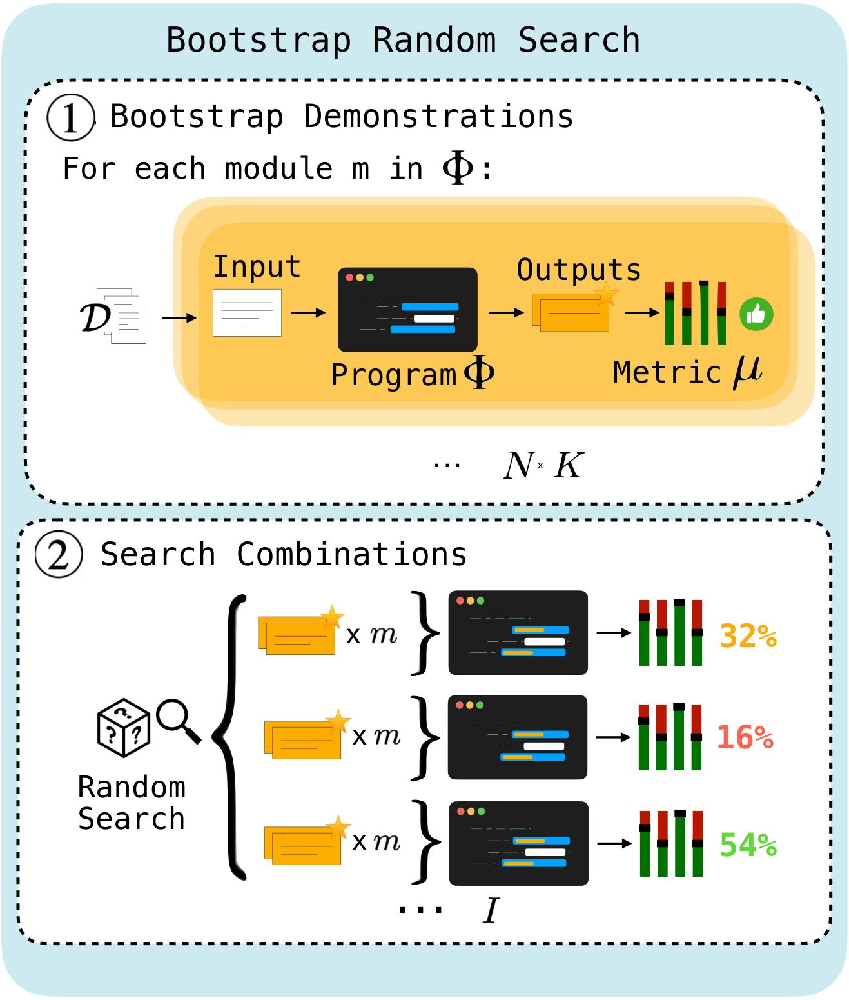

흐름도의 둘째 단계는 모듈 전체의 시연 예시 조합을 통째로 채점합니다. 크레딧을 모듈별로 나누지 않고 가장 좋은 조합 하나를 고를 뿐이며, 지시문은 건드리지 않습니다.

### 단일 모듈 OPRO와 메타 프롬프트

OPRO의 출발점은 매 반복에서 옵티마이저의 상태를 담는 **메타 프롬프트**입니다. 메타 프롬프트에는 제안 LM에 할 일을 알려 주는 메타 지시문, 학습 데이터로 평가한 과거 지시문과 점수, 과제 예시가 들어갑니다. 제안 LM은 메타 프롬프트에 이미 있는 것과 다른 새 지시문을 만듭니다. 그 지시문을 채점한 뒤에는 점수 상위 지시문으로 메타 프롬프트를 갱신합니다. 시드 지시문 $$s$$에서 시작해 이 과정을 반복하고, 끝나면 최고 점수 지시문을 꺼냅니다. 원래 OPRO는 단계마다 후보를 여러 개 생성하지만, 저자들은 단순화를 위해 단계당 하나만 만듭니다.

### Module-Level OPRO: 모든 모듈이 같은 몫을 받는다는 가정

모듈이 $$m>1$$개가 되면 레이블이 과제 수준에만 있어서 각 지시문의 기여를 알 수 없습니다. Module-Level OPRO는 이 문제를 가장 단순하게 처리합니다. 모듈마다 메타 프롬프트를 따로 두고, 프로그램 전체 점수 $$r$$을 각 모듈 지시문 품질의 대리 지표로 그대로 씁니다. 아래 루프에서는 이력이 모듈마다 따로 쌓입니다.

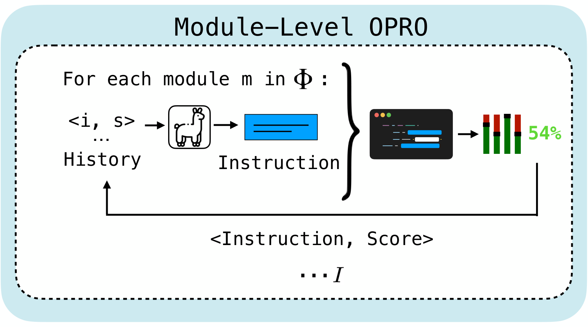

제안 LM은 모듈 $$i$$의 이력, 곧 $$i$$번째 지시문과 그때의 프로그램 점수 쌍만 보고 새 지시문을 만듭니다. 새 지시문 $$m$$개를 한꺼번에 끼운 프로그램을 평가하면, 그 점수가 각 모듈의 이력에 똑같이 추가됩니다. 최대 반복 횟수 $$I$$에 이르면 최고 점수 파라미터화를 반환합니다.

이 설계에는 강한 가정이 두 개 깔려 있습니다. 모든 지시문이 점수에 똑같이 기여하며, 할당 사이에 의존성이 없다고 봅니다. 저자들이 지적하듯 실제로는 성능이 나쁜 모듈 하나가 프로그램 전체를 망칠 수 있습니다. 그러면 동등 기여 가정 때문에 멀쩡한 다른 모듈의 지시문도 낮은 점수로 이력에 기록될 수 있습니다.

### Program-Level OPRO: 크레딧 할당을 LM에 맡기기

Program-Level OPRO는 단일 메타 프롬프트로 돌아갑니다. 메타 프롬프트에는 프로그램 전체의 다단계 이력, 곧 $$[s_1,\ldots,s_m]$$과 점수 $$r$$의 쌍을 넣습니다. 제안 LM은 한 번의 호출로 지시문 $$m$$개를 모두 만듭니다. 충분히 강한 LM이라면 어느 지시문을 가장 크게 고쳐야 할지 스스로 가려낼 것이라는 가설에 기댑니다.

저자들은 이 가정도 매우 강하다고 봅니다. 이력이 길어질수록 정보가 손실되기 쉬워서입니다. 근거로는 긴 맥락의 중간에 놓인 정보를 LM이 잘 활용하지 못하는 현상을 보고한 연구 [Lost in the Middle](https://arxiv.org/pdf/2307.03172)을 듭니다. 참고로 Lost in the Middle의 실험 과제는 검색형 QA와 키-값 검색이어서, 그 결과가 지시문 이력에도 들어맞는지는 이 논문에서 따로 확인하지 않았습니다. Program-Level OPRO는 더 복잡한데도 추가 성능 이득이 보이지 않았습니다. 그래서 저자들은 실험에 Module-Level OPRO를 썼습니다.

### CA-OPRO: 좌표 상승으로 구현한 탐욕적 할당

CA-OPRO("Coordinate-Ascent" OPRO)는 앞서 본 탐욕적 크레딧 할당을 OPRO에 적용합니다. 모듈을 하나씩 돌면서 Module-Level OPRO의 제안 함수로 지시문 $$N$$개를 만듭니다. 나머지 파라미터를 고정한 채 이들을 평가하고, 가장 좋은 지시문으로 갱신한 뒤 다음 모듈로 넘어갑니다. 이 과정 전체를 $$D$$번 반복하므로 대략 모듈 수, 후보 수, 반복 횟수를 곱한 만큼 평가가 필요합니다. 초기 실험에서 이 비효율을 정당화할 만한 성능이 나오지 않아, 저자들은 본 실험에서 제외했습니다.

## MIPRO: 제안은 LM에, 크레딧 할당은 베이지안 대리 모델에

### 설계 동기: OPRO의 강한 가정 풀기

앞서 본 OPRO 계열은 공통된 약점을 안고 있습니다. Module-Level OPRO는 모든 모듈이 점수에 똑같이 기여한다고 가정합니다. Program-Level OPRO는 긴 이력을 읽은 LM이 크레딧을 알아서 가려낸다고 가정합니다. 어느 쪽이든 제안 LM 혼자서 두 가지 일을 떠맡습니다. 하나는 좋은 새 지시문을 쓰는 일이고, 다른 하나는 과거 점수를 보고 어느 모듈의 어떤 선택이 좋았는지 판단하는 일입니다.

MIPRO는 이 두 일을 떼어 놓습니다. 제안 LM은 점수 이력을 읽지 않고 과제에 맞는 후보를 만드는 일만 맡습니다. 과제 수준 점수가 모듈별 파라미터(지시문과 시연 예시)에 얼마나 민감한지는 베이지안 대리 모델이 최적화 내내 명시적으로 학습합니다. 크레딧 할당과 최종 선택도 이 대리 모델이 사후에 처리합니다. 후보는 최적화 전에 모두 미리 만들어 두며, 그 일은 앞서 설명한 부트스트래핑과 그라운딩이 맡습니다.

### 세 단계 구조

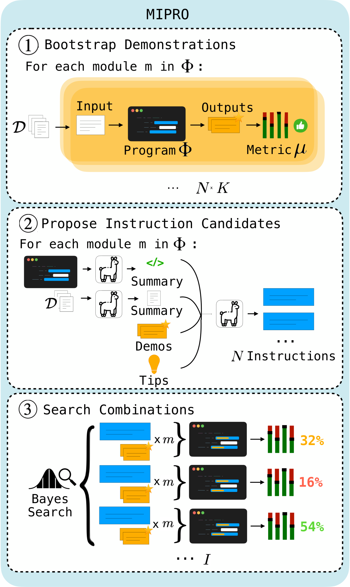

흐름도를 위에서 아래로 따라가면 세 단계가 차례로 나옵니다. 앞의 두 단계에서 후보를 모두 미리 만들어 두고, 마지막 단계만 반복 루프로 돕니다.

1. **시연 예시 부트스트랩.** Bootstrap Random Search의 첫 단계와 같은 절차를 씁니다. 프로그램을 학습 데이터에 실행하고, 지표를 통과한 실행 트레이스에서 모듈별 시연 예시 집합 $$N$$개를 만듭니다.
2. **지시문 후보 제안.** 그라운딩 전략으로 모듈마다 지시문 후보 $$N$$개를 미리 제안합니다. 제안 LM은 데이터셋 요약, 프로그램 요약, 부트스트랩한 시연 예시, 팁을 맥락으로 받습니다.
3. **조합 탐색.** 각 모듈에서 "몇 번째 지시문을 쓸지"와 "몇 번째 시연 예시 집합을 쓸지"를 범주형 잠재 변수로 둡니다. 베이지안 최적화로 이 변수들의 최적 값 조합을 찾습니다.

세 번째 단계를 수식으로 적어 보겠습니다. 모듈이 $$m$$개이면 잠재 변수는 모듈마다 두 개씩, 모두 $$2m$$개입니다.

$$
z=\left(i_1, d_1, \ldots, i_m, d_m\right),\qquad i_j\in\{1,\ldots,N\},\; d_j\in\{1,\ldots,N\}
$$

$$i_j$$는 모듈 $$j$$의 지시문 후보 번호이고, $$d_j$$는 시연 예시 집합 번호입니다. $$z$$를 하나 정하면 각 변수에 문자열이 채워지고, 그러면 프로그램 $$\Phi$$가 하나 정해집니다. 본문 기호를 따르면 탐색 공간의 크기는 $$N^{2m}$$입니다(부록은 두 후보 수를 각각 $$T$$와 $$K$$로 다르게 적습니다). 예를 들어 설명용 값으로 $$N=10$$이고 모듈이 둘이면 조합은 $$10^{4}$$, 곧 1만 개입니다. 이를 전부 평가할 수는 없으므로 대리 모델이 탐색을 이끕니다.

Initialize 시점에는 아무 정보가 없습니다. 그래서 MIPRO는 각 범주형 변수의 모든 후보에 같은 효용을 주는 균등 사전분포에서 시작합니다. 해석하자면, 초기 시행들은 특정 후보에 치우치지 않은 무작위 탐색에 가깝습니다. 시행 기록이 쌓여 좋은 시행과 나쁜 시행을 나눌 수 있게 되어야 TPE가 분포를 기울이기 시작합니다. 일반적으로 TPE 구현은 처음 몇 시행을 무작위 샘플링으로 채운 뒤 밀도 모델로 넘어갑니다. 균등 사전분포는 이 출발점에 해당합니다.

### Propose와 Update: TPE로 고르고 미니배치로 채점하기

Propose 단계는 [Bergstra et al.](https://openalex.org/W2106411961)의 TPE 샘플링 규칙을 그대로 씁니다. 앞서 본 좋은 시행과 나쁜 시행의 밀도 비율 규칙을 MIPRO는 지시문 번호와 시연 예시 집합 번호라는 범주형 변수 $$z$$에 적용합니다. 좋은 시행에 흔하고 나쁜 시행에 드문 번호 조합이 다음 후보로 뽑히기 쉽습니다. 앞서 다룬 다변량 TPE를 쓰면 이 판단이 개별 번호가 아니라 조합 단위로 이루어집니다.

Update 단계에서는 고른 조합으로 만든 프로그램을, 학습 집합에서 무작위로 뽑은 미니배치 $$B$$개 샘플에서 채점합니다. 이 값이 앞서 정의한 미니배치 점수 $$\sigma$$입니다. 저자들은 이 점수로 추정기의 "파라미터 품질 사전분포"를 갱신한다고 표현합니다. 좋은 후보의 가중치는 높이고 나쁜 후보의 가중치는 낮추는 방향입니다.

과정을 짧게 따라가 보겠습니다. 수치는 모두 설명용입니다. 두 모듈 프로그램에서 처음 몇 시행은 사전분포가 균등하므로 사실상 무작위로 조합을 고릅니다. 그러다 모듈 1의 지시문 3번이 든 조합이 미니배치에서 계속 높은 점수를 내면, 좋은 쪽 밀도에서 $$i_1=3$$의 비중이 커집니다. 그 뒤로는 $$i_1=3$$이 자주 샘플링되고, 탐색은 나머지 변수 쪽으로 옮겨 갑니다. 이 과정에서 각 모듈이 따로 채점된 적은 한 번도 없습니다. 크레딧은 "어떤 선택이 좋은 시행에 반복해 등장하는가"라는 통계에서만 나옵니다.

### 미니배치 평가가 성립하는 이유

전체 학습 집합 대신 미니배치로 채점하면 한 시행의 비용이 크게 줄어듭니다. 대신 점수에 노이즈가 섞입니다. 운 좋게 쉬운 샘플만 뽑힌 미니배치는 평범한 조합도 좋아 보이게 만듭니다. 저자들은 Snoek 등의 연구를 인용하며, 베이지안 최적화가 최적화 과정에 불확실성을 반영하므로 노이즈에 강건하다는 점을 근거로 듭니다. 이를 바탕으로 매 반복 전체 집합 대신 미니배치로 평가하면, 같은 비용으로 더 많은 파라미터 설정을 탐색하고 활용할 수 있다고 봅니다. 앞서 설명했듯 대리 모델은 여러 시행의 경향에서 배우므로 개별 미니배치의 오차를 어느 정도 견딥니다. 예를 들어 학습 집합이 500개이고 $$B$$가 25개라면(설명용 값), 전체 평가 한 번 비용으로 미니배치 시행 20번을 돌릴 수 있습니다.

### ExtractOptimizedSets: 주기적 전체 평가로 노이즈 보정하기

노이즈에 강건하다고 해도 최종 선택까지 미니배치 점수에 맡길 수는 없습니다. 그래서 MIPRO는 $$S$$ 스텝마다, 지금까지의 시행에서 평균 점수가 가장 높은 후보 조합을 전체 학습 집합에서 평가합니다. 최적화가 끝나면 전체 평가를 받은 조합 가운데 점수가 가장 높은 것을 최적 할당으로 반환합니다.

두 평가가 번갈아 도는 흐름을 시행 번호로 따라가 보겠습니다. 설명용 예이며, $$S=10$$이라고 하겠습니다.

| 시점 | 일어나는 일 |
| --- | --- |
| 시행 1~10 | TPE가 조합을 고르고, 미니배치 점수로 시행 기록을 쌓습니다. |
| 10번째 스텝 직후 | 평균 미니배치 점수 1위인 조합 A를 전체 학습 집합에서 평가합니다. 전체 점수는 미니배치 평균보다 낮게 나옵니다. |
| 시행 11~20 | 탐색이 이어지고, 새 조합 B가 미니배치 평균 1위로 올라섭니다. |
| 20번째 스텝 직후 | 평균 1위인 조합 B를 전체 평가합니다. 전체 점수가 A보다 높게 나옵니다. |
| 종료 | 전체 평가를 받은 A와 B 가운데 전체 점수가 더 높은 B를 반환합니다. |

이 예에서 A는 한때 미니배치 평균 1위였지만 전체 평가에서 B에 뒤졌습니다. 미니배치 점수가 실제보다 부풀었던 경우입니다. 해석하자면, 미니배치 점수는 "어디를 더 볼지" 정하는 탐색 신호이고, 전체 평가 점수는 "무엇을 내놓을지" 정하는 선택 신호입니다. 이렇게 두 신호를 나눈 구조는 미니배치에 과적합한 조합이 최종 결과로 나오는 일을 막기 위한 장치로 볼 수 있습니다.

### 시연 예시만, 또는 지시문만 최적화하는 변형

**0-Shot MIPRO**는 둘을 함께 최적화하지 않고 지시문만 최적화합니다. 비용이나 맥락 길이 제약이 있을 때 적합합니다.

**Bayesian Bootstrap**은 반대로 부트스트랩한 시연 예시만 최적화합니다. 퓨 샷 예시가 과제의 핵심이거나, 이미 좋은 지시문을 찾아서 예산을 시연 예시에만 쓰고 싶을 때 알맞습니다. MIPRO를 시연 예시 최적화로 제한한 변형입니다.

### MIPRO++: 프로그램이 아니라 제안 방식을 최적화하기

MIPRO++는 같은 베이지안 대리 모델을 한 단계 위로 옮깁니다. 앞서 설명한 제안 학습을 그대로 구현한 것입니다. 두 수준을 나란히 놓으면 차이가 잘 보입니다. 아래는 설명용 예입니다.

| 구분 | MIPRO | MIPRO++ |
| --- | --- | --- |
| 대리 모델이 고르는 값 | 모듈 1은 지시문 3번과 시연 예시 집합 7번을 씁니다. | 프로그램 요약을 켜고, 온도 0.7과 `persona` 팁을 씁니다. |
| 한 시행의 결과물 | 미리 만든 후보로 조립한 프로그램입니다. | 그 설정으로 새로 생성한 지시문을 넣은 프로그램입니다. |
| 대리 모델이 배우는 것 | 어느 후보가 좋은지 배웁니다. | 어떤 제안 방식이 좋은 지시문을 낳는지 배웁니다. |

저자들에 따르면 완전한 형태에서는 대리 모델이 지시문 제안과 시연 예시 부트스트래핑 모두의 파라미터를 학습합니다. 이 논문에서는 지시문 제안 전략 최적화에 한정해 평가했고, 그 형태가 **0-Shot MIPRO++**입니다. 탐색 공간은 그라운딩 제안기의 설정 다섯 가지입니다.

| 제안 하이퍼파라미터 | 유형 | 의미 |
| --- | --- | --- |
| 데이터셋 요약 사용 여부 | 불리언 | 제안 LM 맥락에 데이터셋 요약을 넣을지 정합니다. |
| 프로그램 요약 사용 여부 | 불리언 | 제안 LM 맥락에 프로그램 요약을 넣을지 정합니다. |
| 제안 온도 | 실수 | 제안 LM의 샘플링 온도를 조절합니다. |
| 팁 | 범주형 | 프롬프트 엔지니어링 팁 가운데 어느 것을 줄지 고릅니다. |
| 부트스트랩 시연 집합 | 범주형 | 제안 LM에 보여 줄 부트스트랩 시연 예시 집합을 고릅니다. |

이 하이퍼파라미터들은 MIPRO와 같은 미니배치 전략을 쓰는 베이지안 모델이 최적화합니다. MIPRO와 가장 크게 다른 부분은 후보 목록을 미리 고정하지 않는 것입니다. 시행마다 순서는 다음과 같습니다.

1. 대리 모델이 다섯 하이퍼파라미터의 값 조합을 제안합니다.
2. 제안 LM이 그 설정으로 새 지시문을 생성합니다.
3. 새 지시문을 넣은 프로그램을 앞서 설명한 미니배치 방식으로 평가하고, 그 점수로 대리 모델을 갱신합니다.

최종적으로는 전체 평가를 받은 프로그램 가운데 가장 좋은 것을 반환합니다. 해석하자면, 좋은 설정에서 새 지시문을 계속 뽑을 수 있어 후보가 처음 만든 목록에 갇히지 않습니다. 대신 같은 설정에서도 시행마다 다른 지시문이 나오므로, 한 시행의 점수에는 미니배치의 변동에 더해 생성 결과의 변동도 섞인다고 볼 수 있습니다.

## 일곱 과제와 공정한 비교를 위한 실험 설정

### 데이터셋, 지표, 프로그램으로 묶은 일곱 과제

저자들은 데이터셋, 지표, LM 프로그램을 한 묶음으로 보고 과제 일곱 개를 만들었습니다. 다단계 프로그램과 단일 모듈 프로그램이 함께 들어 있습니다.

| 벤치마크 | 과제 유형 | 프로그램 | 모듈 수 | LM 호출 수 | 지표 |
| --- | --- | --- | --- | --- | --- |
| HotPotQA | 멀티홉 QA | 멀티홉 검색 | 2 | 3 | 정확 일치 |
| HotPotQA Conditional | 멀티홉 QA | 멀티홉 검색 | 2 | 3 | 맞춤 지표 |
| Iris | 분류 | 체인 오브 소트 | 1 | 1 | 정확도 |
| Iris-Typo | 분류 | 체인 오브 소트 | 1 | 1 | 정확도 |
| Heart Disease | 분류 | 답변 앙상블 | 2 | 4 | 정확도 |
| ScoNe | 자연어 추론 | 체인 오브 소트 | 1 | 1 | 정확 일치 |
| HoVer | 멀티홉 주장 검증 | 멀티홉 검색 | 4 | 4 | Recall@21 |

**HotPotQA**([Yang et al.](https://doi.org/10.48550/arXiv.1809.09600))는 여러 위키백과 문서를 엮어야 답할 수 있는 질문 데이터셋입니다. 저자들은 "fullwiki" 설정을 씁니다. 이 설정에는 정답 문서가 주어지지 않으므로, 시스템이 위키백과 문서 요약 약 500만 개 전체에서 관련 문서를 직접 찾아야 합니다. 프로그램에서는 검색 질의 생성 모듈이 두 번 호출되어 홉마다 문서를 모으고, 답 생성 모듈이 모은 문서를 읽어 답을 냅니다. 다단계 옵티마이저를 시험할 때 표준처럼 쓰는 과제입니다.

**ScoNe**([She et al.](https://doi.org/10.18653/v1/2023.acl-short.154))는 부정 추론 벤치마크입니다. 부정이 중첩된 논리 퍼즐에서 전제가 가설을 함의하는지 판단해야 합니다. 원 연구는 이 함의 형식에서 InstructGPT가 대부분의 프롬프팅 전략으로 실패했다고 보고했습니다. 저자들은 체인 오브 소트 모듈 하나가 Yes/No로 답하게 하고 정확 일치로 채점합니다. 프로그램 코드만 봐서는 드러나지 않는 데이터 특유의 뉘앙스를 옵티마이저가 지시문이나 시연 예시로 표현할 수 있는지 보려는 과제입니다.

**HoVer**([Jiang et al.](https://doi.org/10.18653/v1/2020.findings-emnlp.309))는 여러 위키백과 문서를 넘나들어야 사실 여부를 가릴 수 있는 주장 검증 데이터셋입니다. 저자들은 검증 단계는 빼고, 필요한 근거 문서를 모두 찾는 하위 과제만 씁니다. 프로그램은 일곱 과제 가운데 가장 깁니다.

1. 주장 자체로 검색합니다.
2. 결과를 요약합니다(LM 호출 1).
3. 요약을 맥락에 넣어 다음 질의를 만듭니다(LM 호출 2).
4. 검색하고 결과를 요약합니다(LM 호출 3).
5. 두 요약을 바탕으로 질의를 만듭니다(LM 호출 4).
6. 마지막으로 한 번 더 검색합니다.

세 홉에서 가져온 상위 문서를 모두 모은 뒤, 정답 문서를 얼마나 찾았는지(재현율)를 Recall@21로 봅니다. 더 어려운 설정을 만들려고 지지 사실이 3개인 예시만 남겼습니다. 그래도 일부 예시는 2홉으로도 풀립니다.

**Iris**는 꽃받침과 꽃잎의 길이·너비로 붓꽃 세 종을 가리는 고전 분류 과제입니다. 간단한 규칙 몇 개로 거의 풀리지만, 그 규칙은 LM에 주지 않습니다. 옵티마이저가 LM에 체인 오브 소트 방식의 추론을 스스로 가르칠 수 있는지 봅니다. **Iris-Typo**는 출력 설명에 'versicolor'를 'versicolour'로 잘못 적은 버전입니다. 원래는 실수였지만, 잘못 명세된 프롬프트에서 출발하는 최적화를 현실적으로 시험할 수 있어 두 설정을 모두 보고합니다.

**Heart Disease**는 나이, 성별, 콜레스테롤 등 특성 13개로 심장병 여부를 맞히는 이진 분류 과제입니다. 결정적인 패턴 몇 개를 찾기 어려운 과제로 보고, 체인 오브 소트 호출 세 번으로 임상 의견 세 개를 만든 뒤 최종 모듈이 이를 종합해 판정하게 했습니다.

### HotPotQA Conditional의 조건부 형식 규칙

저자들은 과제 LM이 바로 알아채기 어렵고 예시 몇 개로는 완전히 정의되지 않는 규칙에서 지시문 최적화가 가장 큰 효과를 내리라고 봅니다. 이를 검증하려고 HotPotQA에 답 유형별 형식 규칙을 덧붙였습니다.

- 답이 인물이면 전부 소문자로 답합니다.
- 장소면 구두점을 넣지 않습니다.
- 날짜면 응답을 "Peace!"로 끝내고, 다른 경우에는 이렇게 끝내지 않습니다.
- 그 밖의 유형이면 전부 대문자로 답합니다.

답 유형은 GPT-4로 주석하고 저자들이 감독했습니다. 프로그램은 HotPotQA와 같고, 규칙을 적은 시드 지시문으로 시작합니다. 맞춤 지표는 정확 일치에 정규식 파싱을 더해 나머지 조건을 지켰는지까지 확인합니다.

### 데이터 분할

기본 분할은 학습 500, 개발 500, 테스트 2,000이며, 테스트 집합이 그보다 작으면 전체를 씁니다. 학습 집합은 옵티마이저가 쓰고, 개발 집합은 저자들이 방법을 다듬는 데 쓰며, 테스트 집합은 최종 보고에만 씁니다. HotPotQA Conditional은 학습 500은 같지만, 레이블을 손으로 만들어 개발과 테스트는 200씩입니다. Iris(학습 75, 테스트 75)와 Heart Disease(학습 120, 테스트 183)는 데이터가 작고 방법 개선에 쓰지 않아 개발 집합이 없습니다.

### 세 비교군 묶음과 기준선

옵티마이저는 무엇을 최적화하는지에 따라 세 묶음으로 나눠 비교합니다.

| 최적화 대상 | 옵티마이저 |
| --- | --- |
| 지시문만(제로 샷 프롬프트) | Module-Level OPRO, 0-Shot MIPRO, 0-Shot MIPRO++ |
| 시연 예시만(퓨 샷) | Bootstrap Random Search, Bayesian Bootstrap |
| 둘 다 | MIPRO |

기준선은 최적화하지 않은 프로그램입니다. 그라운딩의 효과를 따로 보려고 그라운딩을 뺀 **Module-Level OPRO -G**도 돌립니다. 이 변형의 제안 프롬프트에는 원래 OPRO 논문의 구성 요소인 퓨 샷 예시, 그리고 이전에 제안한 지시문과 그 점수의 이력만 들어갑니다.

### 전체 평가 시행 기준의 예산

예산은 과제에 따라 20~50회의 **전체 평가 시행**, 곧 학습 집합 전체를 채점하는 횟수로 정합니다. 그래서 미니배치를 쓰는 옵티마이저는 실제로 훨씬 많은 시행을 합니다. HotPotQA와 ScoNe의 예산은 전체 평가 50회이고, 미니배치 시행 약 300회에 해당합니다. HoVer는 실행 비용이 가장 큰 프로그램이라 20회로 줄였습니다. Iris, Heart Disease, HotPotQA Conditional은 30회입니다. 이 세 실험은 개별 방법을 겨루기보다 지시문 최적화와 시연 예시 최적화의 가치를 비교하는 데 초점을 두었기 때문입니다. 저자들은 방법 간 차이를 가리려면 더 많은 시행이 필요할 수 있다고 덧붙입니다.

0-Shot MIPRO, Bayesian Bootstrap, MIPRO는 모듈당 후보 수 $$N$$을 정해야 합니다. 다른 옵티마이저는 탐색한 후보 수가 시행 수와 같아서 이 값이 따로 없습니다. 저자들은 광범위한 탐색 없이 이전 실험의 경험에 따라 값을 골랐습니다. 경험칙은 $$N<T/v$$이며, $$T$$는 시행 예산이고 $$v$$는 최적화하는 변수의 총수입니다. 예를 들어 ScoNe에서는 세 옵티마이저 모두 70을 썼고, HoVer에서 MIPRO는 10을 썼습니다.

### 과제 LM, 제안 LM, 교사 모델 배치

대부분의 실험에서 과제 LM, 곧 LM 프로그램 안에서 쓰는 모델은 Llama-3-8B입니다. 채팅 템플릿 없이 돌렸는데, 그 편이 DSPy의 자동 완성형 프롬프트와 더 잘 맞았기 때문입니다. 지시문을 쓰는 제안 LM은 기본 온도 0.7의 GPT-3.5입니다. MIPRO++ 실험에서는 제안 온도 자체도 최적화 대상입니다. 시연 예시 부트스트래핑의 교사 모델은 기본적으로 Llama-3-8B이고, 더 어려운 ScoNe와 HoVer에서는 GPT-4o로 바꿨습니다. 다만 본문은 GPT-3.5를 "대부분의 실험"에 썼다고 적고, 부록은 ScoNe, HoVer, Iris에서 제안 LM으로 GPT-4를 썼다고 적습니다.

### 다섯 번 실행과 윌콕슨 부호 순위 검정

방법마다 과제당 5회씩 실행하고, 그 평균을 보고합니다. 두 방법의 차이가 유의한지는 윌콕슨 부호 순위 검정으로 판단합니다. 이 검정은 짝지은 관측치의 차이를 구하고, 그 절댓값에 순위를 매긴 뒤 양수 쪽과 음수 쪽 순위 합이 한쪽으로 치우쳤는지 봅니다. 정규분포를 가정하지 않는 비모수 검정입니다. 저자들은 테스트 예시마다 5회 실행의 평균 점수를 구하고, 이 예시별 평균을 두 방법 사이에서 짝지어 검정합니다.

## 시연 예시 최적화의 우위와 조건부 규칙에서 드러나는 지시문 최적화의 가치

### 결과 표 읽는 법

아래 표의 값은 과제마다 5회 실행한 평균이며, 최적화 대상에 따라 세 비교군 묶음으로 나눴습니다. 원 표에서 굵은 글씨는 각 열의 최고값입니다. 2위와 비교해 윌콕슨 부호 순위 검정(p < .05)으로 차이가 유의할 때만 한 값에 단독으로 표시합니다. 유의하지 않으면 비슷한 성능으로 보고 여러 값을 함께 표시합니다. Module-Level OPRO, Module-Level OPRO -G, 0-Shot MIPRO++, Bayesian Bootstrap은 ScoNe, HotPotQA, HoVer에서만 실행했으므로 나머지 과제에서는 값이 없습니다. 공간을 아끼려고 표를 둘로 나눴고, 학습 열과 개발 열은 생략한 채 테스트 점수만 옮겼습니다.

| 옵티마이저 | 최적화 대상 | ScoNe Test | HotPotQA Test | HoVer Test |
| --- | --- | --- | --- | --- |
| 최적화 없음(N/A) | 지시문만 | 69.1 | 36.1 | 25.3 |
| Module-Level OPRO -G | 지시문만 | 76.1 | 36.0 | 25.7 |
| Module-Level OPRO | 지시문만 | 73.5 | 39.0 | 32.5 |
| 0-Shot MIPRO | 지시문만 | 71.5 | 36.8 | 33.1 |
| 0-Shot MIPRO++ | 지시문만 | 75.7 | 39.3 | 32.6 |
| Bootstrap Random Search | 시연 예시만 | 75.4 | 45.8 | 37.2 |
| Bayesian Bootstrap | 시연 예시만 | 77.4 | 46.2 | 37.6 |
| MIPRO | 둘 다 | 79.4 | 46.4 | 39.0 |

| 옵티마이저 | 최적화 대상 | HotPotQA Cond. Test | Iris Test | Iris-Typo Test | Heart Disease Test |
| --- | --- | --- | --- | --- | --- |
| 최적화 없음(N/A) | 지시문만 | 6 | 40.9 | 32 | 26.8 |
| 0-Shot MIPRO | 지시문만 | 14.6 | 36.4 | 56.7 | 25.8 |
| Bootstrap Random Search | 시연 예시만 | 10.4 | 94.1 | 58.7 | 79.2 |
| MIPRO | 둘 다 | 23.3 | 88.6 | 68.7 | 74.2 |

저자들은 이 결과에서 다섯 가지 교훈을 끌어냅니다.

### 교훈 1: 부트스트랩한 시연 예시 최적화가 성능의 핵심

대부분의 과제에서 부트스트랩한 시연 예시만 최적화하면 지시문만 최적화할 때보다 성능이 유의하게 높습니다. 저자들은 윌콕슨 검정으로 이를 확인했습니다. 가장 단순한 Bootstrap Random Search도 과제별로 가장 좋은 지시문 전용 옵티마이저를 한 경우만 빼고 모두 이깁니다. 그 예외인 HotPotQA Conditional은 교훈 3의 가설을 뒷받침하는 사례입니다.

차이는 분류 과제에서 특히 큽니다. Iris 테스트에서 Bootstrap Random Search는 94.1을 기록해, 최적화하지 않은 제로 샷 기준선(40.9)과 0-Shot MIPRO(36.4)를 크게 앞섭니다. Heart Disease에서도 79.2로 기준선 26.8, 0-Shot MIPRO 25.8을 훨씬 넘습니다. 다단계 과제도 방향이 같습니다. HotPotQA 테스트에서 지시문 전용 옵티마이저의 최고 점수는 0-Shot MIPRO++의 39.3이지만, Bootstrap Random Search는 45.8입니다.

이 결과를 어떻게 해석할지가 중요합니다. 퓨 샷 예시의 효과를 흔히 "출력 형식을 보여 준다"는 정도로 이해합니다. 그런데 역할이 형식 전달뿐이라면, 형식을 갖춘 예시라면 어느 집합을 써도 점수가 비슷해야 합니다. 형식은 지시문 한 줄로도 상당 부분 전달할 수 있으므로 지시문 최적화와의 격차도 이렇게 크지 않아야 합니다. 저자들의 관찰은 이와 다릅니다. 최적화를 실행해 보면 **어떤 시연 예시 집합을 쓰느냐에 따라 성능 편차가 큽니다**. 형식은 같아도 담긴 내용이 다른 예시들이 서로 다른 점수를 낸다는 뜻입니다.

저자들은 시연 예시 집합만 바꿔도 점수가 크게 흔들린다는 관찰에서, 좋은 부트스트랩 예시가 과제 형식을 가르치는 데 그치지 않고 **성공적인 추론 행동**에 관한 정보를 담고 있다고 추론합니다. 부트스트랩 예시는 지표를 통과한 실제 실행 트레이스이므로, 정답에 이른 중간 사고 과정이 함께 들어 있습니다.

이 결론은 저자들이 관찰을 바탕으로 내린 추론이며, 이를 직접 분리해 검증한 실험은 아닙니다. 편차가 크다는 관찰은 부록의 최적화 궤적 그래프에 근거합니다. 이 그래프는 과제와 방법 조합마다 한 번의 실행에서 시행에 따른 학습 점수를 보여 줍니다. 아래 Heart Disease 그래프는 0-Shot MIPRO, Bootstrap Random Search, MIPRO의 궤적이며, 시연 예시 집합에 따라 점수 편차가 크다는 관찰의 예입니다.

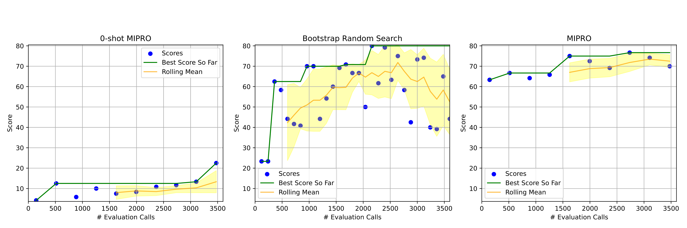

### 교훈 2: 지시문과 시연 예시를 함께 최적화한 MIPRO가 대체로 최고

둘을 함께 최적화한 MIPRO는 저자들이 서두와 결론에서 밝힌 대로 일곱 과제 중 다섯에서 최선입니다. 저자들은 서두에서 최대 13% 정확도 향상을 보고했지만, 어떤 비교에서 계산한 값인지, 상대 향상인지 %p인지는 밝히지 않았습니다. 저자들은 과제마다 MIPRO와 실행 평균 기준 2위 옵티마이저를 비교한 통계 검정으로 이 결론을 뒷받침합니다. 결과 표에서 MIPRO의 테스트 점수가 가장 높은 과제는 ScoNe, HotPotQA, HoVer, HotPotQA Conditional, Iris-Typo 다섯입니다. 테스트 열에서 다음으로 높은 값과 나란히 놓으면 ScoNe는 79.4 대 77.4(Bayesian Bootstrap), HoVer는 39.0 대 37.6(Bayesian Bootstrap), HotPotQA Conditional은 23.3 대 14.6(0-Shot MIPRO), Iris-Typo는 68.7 대 58.7(Bootstrap Random Search)입니다. HotPotQA는 46.4 대 46.2(Bayesian Bootstrap)로 차이가 작고, 저자들은 이 과제를 아래와 같이 예외로 꼽습니다.

예외는 HotPotQA, Heart Disease, 오타 없는 Iris 셋입니다. 저자들은 예외마다 다른 가설을 내놓거나 아예 내놓지 않습니다.

**HotPotQA.** 저자들은 이 과제에서 지시문의 가치가 낮다고 가정합니다. 최종 모듈이 비교적 단순한 질의응답이어서 많은 모델에 분포 내(in-distribution) 과제일 가능성이 크기 때문입니다.

**Heart Disease.** 이 과제에서는 MIPRO가 시연 예시 전용 방법보다 낮습니다. 테스트 점수는 MIPRO 74.2, Bootstrap Random Search 79.2입니다. 저자들은 원인을 시드 지시문에서 찾습니다. 옵티마이저를 단순한 시드 지시문으로 초기화했는데, 이 지시문에는 분류 기준이 전혀 들어 있지 않았습니다. 저자들에 따르면 현재 지시문 옵티마이저는 그런 기준을 스스로 추론하는 능력이 제한적입니다.

**오타 없는 Iris.** 테스트 점수는 MIPRO 88.6, Bootstrap Random Search 94.1입니다. 이 예외에 대해서는 저자들이 별도 가설을 내놓지 않습니다.

### 교훈 3: 조건부 규칙이 있는 과제에서 결정적인 지시문 최적화

교훈 1의 유일한 예외였던 HotPotQA Conditional이 교훈 3의 주된 근거입니다. 저자들의 가설은 다음 두 조건을 모두 갖춘 조건부 규칙이 있을 때 지시문 최적화가 가장 중요하다는 것입니다.

1. 규칙이 LM에 즉시 자명하지 않습니다.
2. 소수의 퓨 샷 예시로는 규칙을 표현할 수 없습니다.

두 조건은 각각 다른 경로를 막습니다. 첫째 조건은 모델의 사전 지식으로 규칙을 맞히는 경로를 막습니다. 앞서 HotPotQA에서 지시문 가치가 낮았던 이유로 든 "분포 내 과제"와 정반대 상황입니다. 둘째 조건은 교훈 1에서 강력했던 시연 예시 경로를 막습니다. 두 경로가 모두 막히면 규칙을 모델에 전달할 통로는 지시문만 남습니다.

앞서 소개한 HotPotQA Conditional의 답 유형별 형식 규칙이 바로 이런 경우입니다. 시연 예시 몇 개로 이 규칙이 왜 잘 전달되지 않는지는 설명용 예로 보면 알 수 있습니다. 부트스트랩한 예시 셋이 모두 인물 질문이었다면 모델은 "답은 소문자로 쓴다"만 배웁니다. 날짜일 때 "Peace!"를 붙이는 규칙은 예시에 한 번도 나오지 않습니다. 다양한 유형이 섞여 있어도 예시에는 "이 답은 인물이라 소문자"라는 이유가 적혀 있지 않습니다. 모델은 출력만 보고 답 유형과 형식 사이의 조건 관계를 역으로 추론해야 합니다. 규칙 네 개를 예시 몇 개로 모두 덮기도 어렵습니다. 지시문에는 네 규칙을 한 줄씩 그대로 적을 수 있습니다.

실제로 이 과제에서는 시연 예시를 쓰지 않는 제로 샷 지시문 최적화조차 시연 예시 전용 최적화를 넘어섭니다. 테스트 점수는 0-Shot MIPRO 14.6, Bootstrap Random Search 10.4입니다. 둘을 함께 최적화한 MIPRO는 23.3으로 가장 높고, 최적화하지 않은 기준선은 6입니다. 아래 그래프는 이 과제에서 세 방법이 한 번의 실행 동안 기록한 시행별 학습 점수를 보여 줍니다.

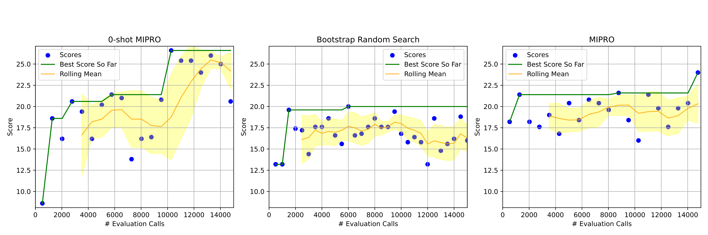

이 실험에서 옵티마이저는 과제 규칙을 적은 시드 지시문에서 출발합니다. 저자들은 이런 경우, 특히 과제가 복잡할수록 **시드 프롬프트에서 출발해 최적화하는 것이 중요하다**고 강조합니다. 저자들의 표현으로는 현재 옵티마이저가 아직 과제 규칙을 모두 추론하지는 못하기 때문입니다. 저자들은 앞서 본 Heart Disease 결과에도 같은 교훈이 드러난다고 봅니다. 분류 기준이 없는 시드에서 출발했을 때 MIPRO는 시연 예시 전용 방법보다 낮았습니다.

지시문 최적화가 크게 이기는 조건은 과제의 난도가 아니라 규칙의 성격입니다. 모델이 모르고 예시로도 전달할 수 없는 규칙이 시드 지시문에 적혀 있을 때 지시문 최적화가 가장 중요합니다. 시드에 규칙이 없으면 현재 옵티마이저가 그 규칙을 추론하는 능력은 제한적입니다.

### Iris-Typo: 시드 프롬프트의 오류를 바로잡은 지시문 최적화

Iris-Typo는 교훈 3의 가설을 뒷받침하는 또 하나의 사례입니다. 시드 프롬프트에 'versicolor'가 'versicolour'로 잘못 적혀 있고, 최적화하지 않은 기준선은 32입니다. 0-Shot MIPRO는 시연 예시 없이 지시문만 바꿔 점수를 32에서 56.7로 올렸습니다. 저자들은 이 결과를 두고 지시문 옵티마이저가 시드 프롬프트의 실수를 바로잡는 데까지 기여한다고 봅니다. 시연 예시 전용 Bootstrap Random Search는 58.7이고, 둘을 함께 최적화한 MIPRO는 68.7로 가장 높습니다. 아래 그래프는 기본 프롬프트에 이 철자 오류가 있던 실행 하나에서 세 방법이 기록한 시행별 학습 점수를 보여 줍니다.

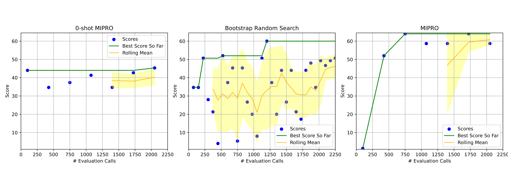

## 제안 전략 분석: 과제마다 다른 그라운딩 효과, 학습된 중요도, 결론이 엇갈린 비교

### 교훈 4: 그라운딩은 대체로 돕지만 최적 전략은 과제마다 다름

그라운딩을 뺀 Module-Level OPRO -G와 원래 Module-Level OPRO를 비교하면 과제에 따라 방향이 갈립니다. HotPotQA 테스트에서는 그라운딩이 있을 때 39.0, 없을 때 36.0입니다. HoVer에서는 32.5와 25.7입니다. 두 멀티홉 과제에서는 저자들의 표현대로 그라운딩이 성능 향상에 필수적이었습니다. ScoNe에서는 반대로 그라운딩을 넣은 쪽이 73.5, 뺀 쪽이 76.1이었습니다. 그라운딩이 오히려 성능을 떨어뜨린 것으로 보입니다.

어떤 맥락이 도움이 될지는 과제를 돌려 보기 전에는 알 수 없습니다. 저자들은 이 점을 제안 학습의 근거로 듭니다. 실제로 제안 하이퍼파라미터를 함께 학습하는 0-Shot MIPRO++는 ScoNe에서 75.7을 기록해, 그라운딩 때문에 잃었던 성능을 거의 되찾았습니다. 이 결과는 고정 전략 하나를 미리 정해서 얻은 것이 아닙니다. 과제에 맞는 제안 전략을 데이터에서 골라서 얻었습니다.

### 학습된 중요도 점수: 어떤 제안 구성 요소가 효과를 냈는가

0-Shot MIPRO++에는 부수 효과가 하나 더 있습니다. 제안 하이퍼파라미터를 최적화한 베이지안 모델에서 각 구성 요소의 **중요도 점수**를 읽어 낼 수 있습니다. 하이퍼파라미터 중요도 분석은 쌓인 시행 기록을 보고, 목적 함수 값의 변동 가운데 각 하이퍼파라미터가 설명하는 몫을 추정합니다. 그림 형식은 Optuna의 중요도 분석 출력과 같아 보입니다. Optuna의 기본 방식(fANOVA)으로 계산했다면 막대 값은 상대적 몫으로 읽을 수 있습니다. 이 값은 통제 실험으로 효과를 분리한 것이 아닙니다. 대리 모델이 시행 이력에서 학습한 상관관계입니다.

막대 이름은 다음과 같이 읽습니다.

- `k_parent_predictor_demos`: $$k$$번째 모듈의 메타 프롬프트에 넣을 부트스트랩 시연 예시 집합의 선택
- `tip`: 팁
- `use_dataset_summary`: 데이터셋 요약 사용 여부
- `program_aware`: 프로그램 요약 사용 여부
- `temperature`: 제안 온도
- `prompt_model`: 제안 LM 선택
- `use_prompt_history`: 이전 지시문 이력 사용 여부

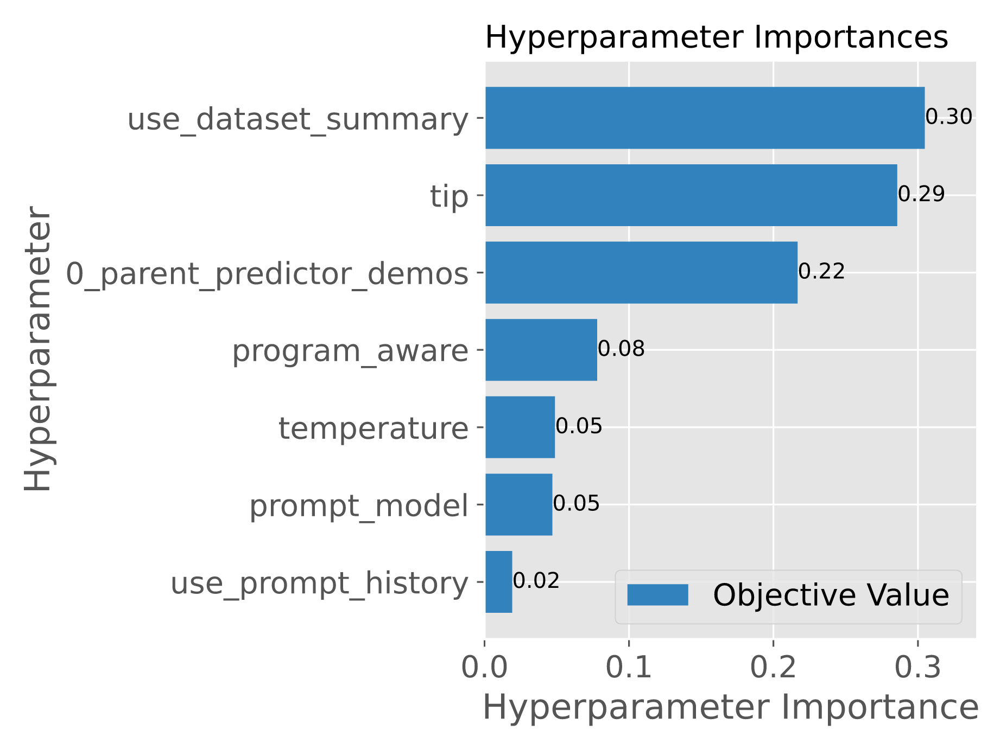

ScoNe에서는 데이터셋 요약, 팁, 메타 프롬프트의 시연 예시가 제안 품질에 중요하다고 학습되었습니다. 앞서 ScoNe에서 그라운딩이 성능을 떨어뜨린 결과와 함께 보면, 데이터셋 요약을 넣을지 말지가 이 과제에서 큰 차이를 만든 것으로 해석할 수 있습니다. 다만 넣는 쪽과 빼는 쪽 가운데 어느 쪽이 좋았는지는 중요도만으로는 알 수 없습니다.

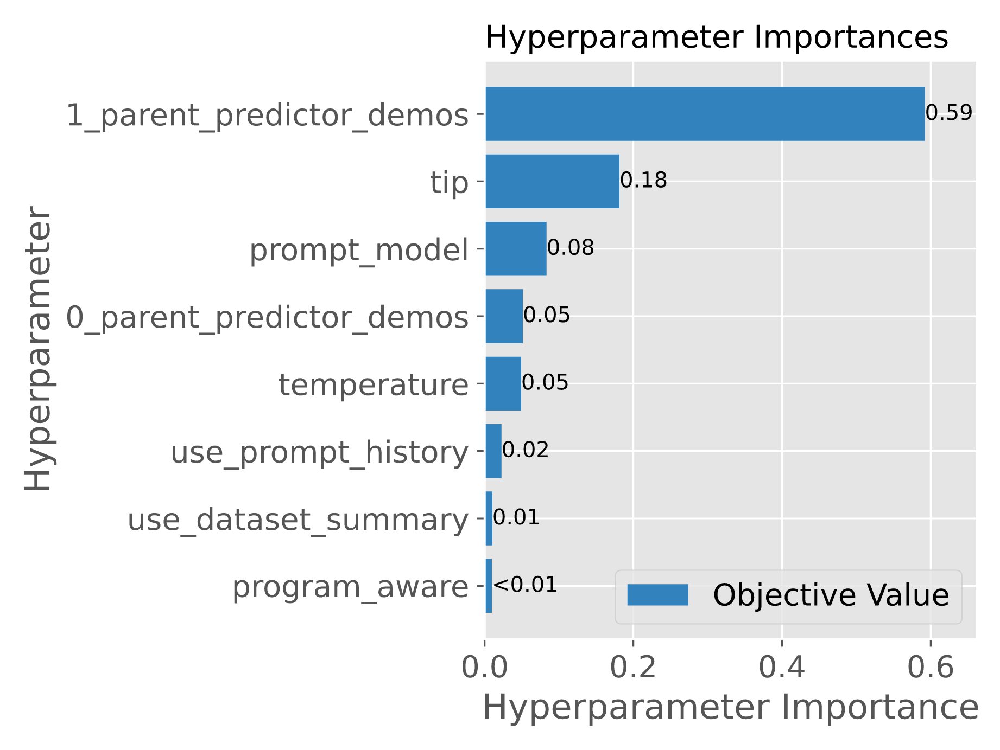

HotPotQA에서는 메타 프롬프트에 넣을 시연 예시 집합이 가장 중요하게 학습되었습니다. 데이터셋 요약은 가장 덜 중요한 축에 속합니다.

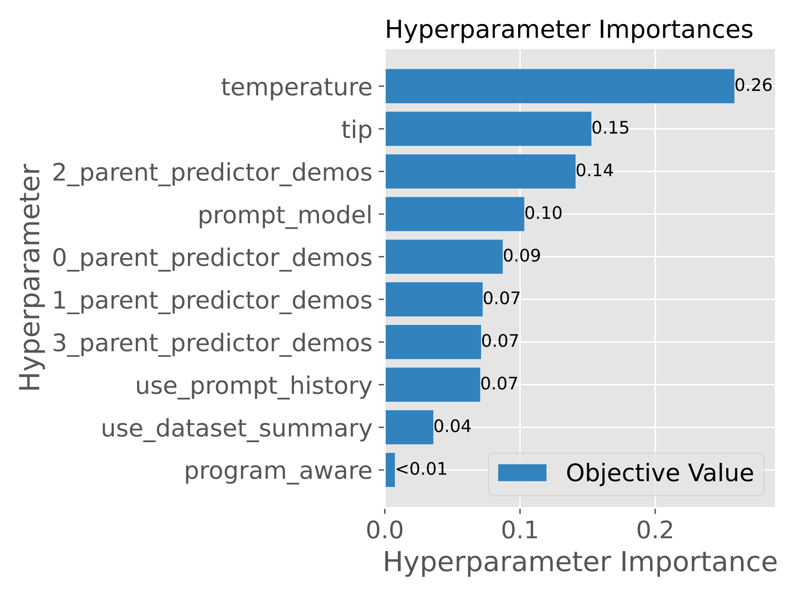

HoVer에서도 모듈별 시연 예시 선택과 팁이 중요하게 학습되었습니다. 이 과제에서는 제안 온도도 중요하게 학습되었습니다.

세 과제를 종합하면, 저자들의 요약대로 여러 과제에서 가장 높은 중요도를 받은 것은 **메타 프롬프트에 넣을 부트스트랩 시연 예시의 선택과 팁**입니다. 반면 많은 파라미터는 과제마다 중요도가 다릅니다. 데이터셋 요약이 대표적입니다. ScoNe에서는 중요도가 높지만, HotPotQA와 HoVer에서는 가장 덜 중요한 축에 속합니다.

### 교훈 5: 결과가 엇갈린 비교와 예산 의존성 가설

모든 비교에서 결론이 나지는 않았습니다. 저자들은 이를 "LM 프로그램 옵티마이저에 대해 더 배울 것이 남았다"는 교훈으로 정리합니다. 앞서 본 결과 표의 테스트 점수를 기준으로 하면 세 비교가 엇갈립니다. 첫째, Module-Level OPRO, 0-Shot MIPRO, 0-Shot MIPRO++ 사이에는 일관된 우열이 없습니다. 둘째, Bayesian Bootstrap은 ScoNe에서 Bootstrap Random Search를 앞서지만, HotPotQA와 HoVer에서는 차이가 통계적으로 유의하지 않습니다. 셋째, 0-Shot MIPRO++는 ScoNe와 HotPotQA에서 0-Shot MIPRO를 앞서지만, HoVer에서는 둘이 비슷합니다.

저자들은 다른 예산에서 비교하면 차이가 더 뚜렷해질 수 있다고 봅니다. 아직 검증하지 않은 가설입니다. 0-Shot MIPRO는 미니배치로 채점하므로 같은 예산에서 훨씬 많은 파라미터 조합을 탐색합니다. 그래서 예산이 아주 적을 때 가장 유리할 수 있습니다. 반대로 0-Shot MIPRO++는 많은 시행을 제안 동역학 학습에 씁니다. 그래서 예산 제약이 없는 상황에서 차이를 낼 수 있습니다. 저자들은 이 탐구를 후속 연구로 남겼습니다.

부록에는 과제와 방법 조합마다 한 번의 실행에서 기록한 학습 점수 궤적이 실려 있습니다. 평가 호출 횟수에 따라 각 방법의 최고 점수가 어떻게 오르는지 보여 주므로, 이 가설을 생각할 때 참고가 됩니다. 아래 세 그래프는 차례로 ScoNe, HotPotQA, HoVer의 궤적입니다.

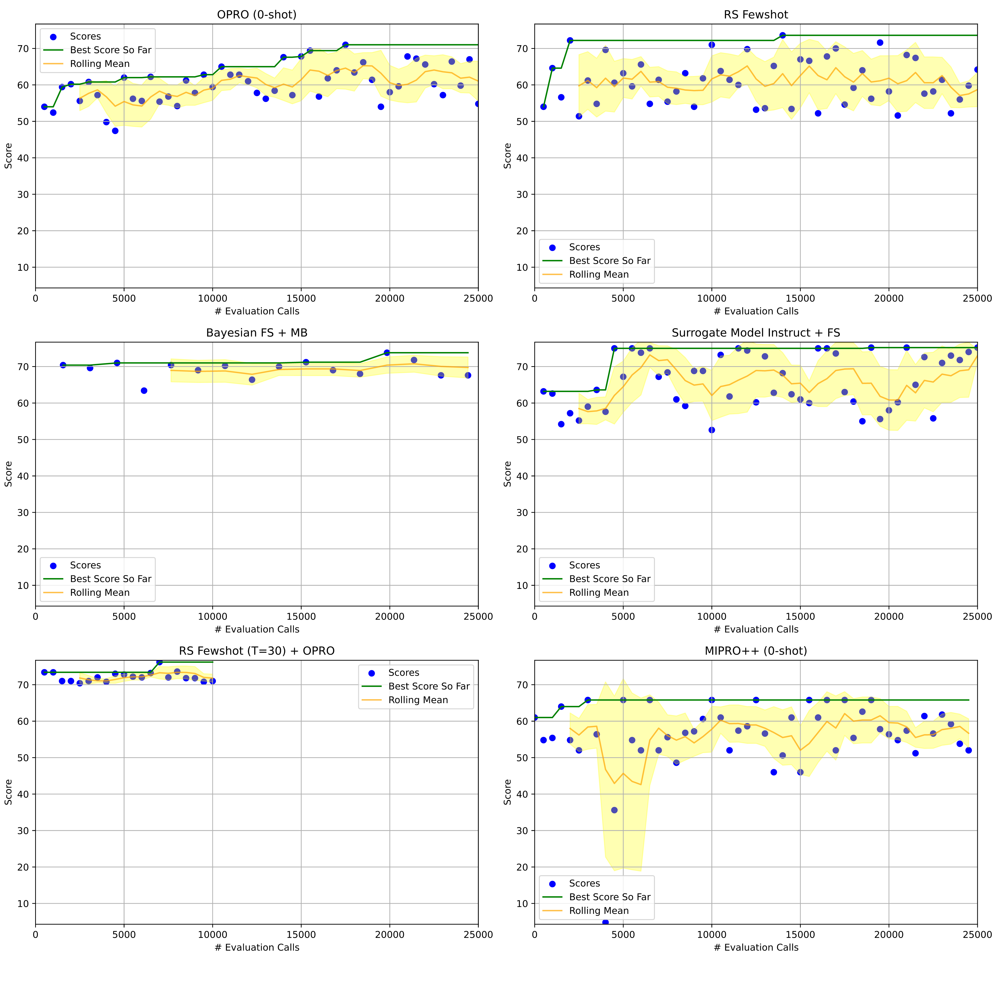

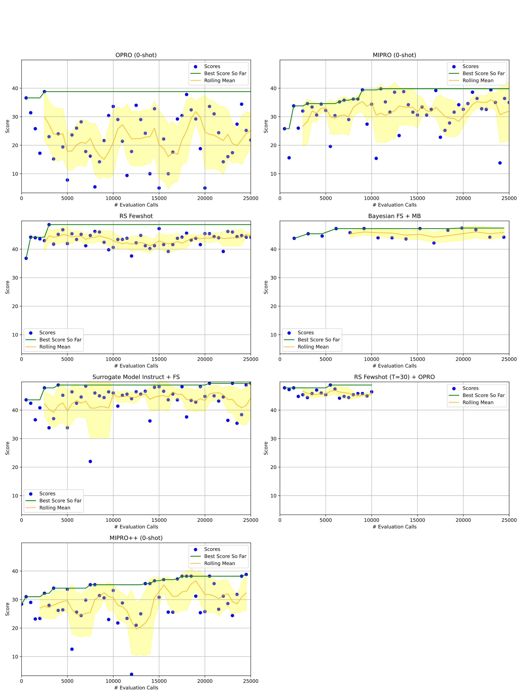

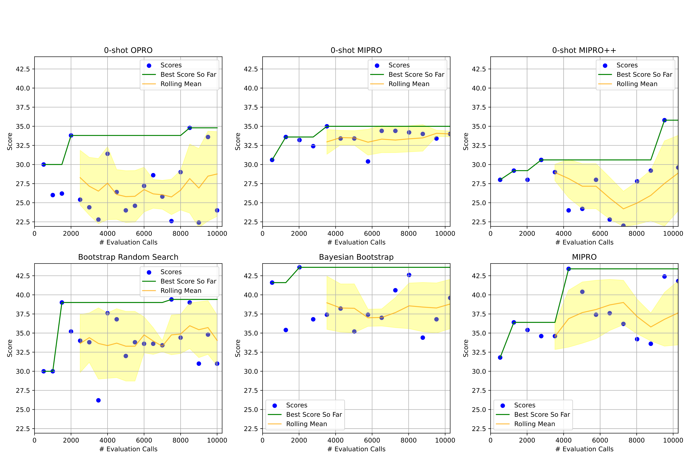

### 프롬프트 변천에서 드러난 실패 양상: 퓨 샷 예시에 과적합된 지시문

저자들은 각 과제에서 0-Shot MIPRO를 한 번씩 실행하며, 시행마다 어떤 지시문이 제안되고 몇 점을 받았는지 기록했습니다. 이 기록에서 현재 제안기의 실패 양상이 드러납니다. 제안 LM이 메타 프롬프트에 들어간 퓨 샷 예시에 **과적합된** 지시문을 씁니다. 과제 전반에 대한 지시를 쓰는 대신, 예시 하나의 내용을 지시문에 그대로 옮겨 적습니다.

이런 사례는 여러 과제에서 나옵니다. HotPotQA 시행 330의 검색 모듈 지시문은 "Steven Spielberg가 자기 애니메이션 스튜디오를 세우게 만든 영화의 감독을 찾는 검색 질의를 만들라"였습니다. 같은 시행의 답 모듈 지시문은 "우간다 정치인과 별명이 같은 핀란드 전직 권투 선수를 찾아 답하라"였습니다. 둘 다 특정 질문을 통째로 담고 있고, 점수는 34.6으로 시드 지시문(35.4)보다 낮았습니다. HotPotQA Conditional의 시행 190에도 특정 질문을 그대로 담은 검색 지시문이 나옵니다.

**과적합 지시문이 최고 프로그램에 남는 경우**도 있습니다. ScoNe에서 가장 좋은 지시문(시행 80, 65.4점)은 부정 추론 일반을 다루지 않고 구체적인 상황 하나를 담고 있습니다. 탐정이 범죄 현장에서 장갑을 낀 용의자를 관찰했고 흉기에 지문이 없을 때, 용의자가 범행했다고 논리적으로 추론할 수 있는지 판단하라는 내용입니다. 시드 지시문 "context, question -> answer"는 57.0점이었습니다. HoVer의 최고 프로그램(35.0점)에도 Leo Dan의 곡을 틀던 라디오 방송국이라는 특정 주장을 담은 요약 지시문이 들어 있습니다. HotPotQA Conditional의 최고 프로그램(26.6점)에서도 답 모듈 지시문이 "최초의 여성 노벨 물리학상 수상자가 태어난 나라의 GDP"라는 특정 질문에 맞춘 규칙으로 바뀌어 있습니다.

이런 지시문이 왜 살아남는지에 대해 저자들은 두 가설을 제시하고, 결론은 후속 연구로 미룹니다.

1. **크레딧 할당의 한계.** 이런 지시문을 걸러 내려면 더 명시적인 크레딧 할당이 필요할 수 있습니다. 다중 모듈 과제에 한정한 해석을 하나 덧붙이면, 다른 모듈의 선택 덕분에 점수가 높았던 조합에 과적합 지시문이 함께 실려 들어왔을 수 있습니다.
2. **지시문이 시연 예시처럼 작동할 가능성.** 구체적인 사례를 담은 지시문이 사실상 퓨 샷 예시 역할을 할 수 있습니다. 그렇다면 이 지시문은 과제 LM이 과제를 잘 수행하는 쪽으로 편향을 주고 있습니다.

두 가설의 처방은 정반대입니다. 첫째가 맞으면 과적합 지시문은 제거해야 할 잡음입니다. 둘째가 맞으면 유용한 신호일 수 있습니다. 교훈 1에서 시연 예시가 추론 행동에 관한 정보를 담는다고 본 해석과 함께 보면, 둘째 가설도 가볍게 버리기 어렵습니다.

### Heart Disease: 'high stakes' 류 지시문이 점수를 깎은 사례

Heart Disease의 변천은 다른 방향의 실패를 보여 줍니다. 시드 지시문으로 만든 프로그램은 23.3점이었습니다. 시행 10에서는 네 모듈 모두에 "중대한 의료 결정", "생명을 구하는 예측"처럼 위급함을 강조하는 'high stakes' 류의 지시문이 제안되었고, 점수는 12.5로 떨어졌습니다. 시행 30에서도 "응급실에서 시간이 촉박한 상황" 같은 지시문이 나왔고, 점수는 10.0으로 더 낮아졌습니다. 최종 최고 프로그램(시행 90, 22.5점)에서는 네 모듈 가운데 둘의 지시문이 시드와 똑같았고, 점수도 시드와 거의 같았습니다.

이 사례는 교훈 2·3과 맞물립니다. 시드 지시문에 분류 기준이 없을 때, 제안 LM은 기준을 추론하지 못하고 주로 문체만 바꾸는 모습을 보입니다. 그 결과 지시문 최적화는 이득을 내지 못했고, 가장 좋은 결과도 시드 수준으로 돌아가는 데 그쳤습니다.

## 한계와 시사점

실무에서 가장 쓸모 있는 강점은 요구 조건이 적다는 데 있습니다. 로그 확률, 그래디언트, 중간 레이블 없이 프로그램·지표·작은 학습 집합만 있으면 되므로 텍스트 입출력만 허용하는 API에도 그대로 적용됩니다. 지시문 생성과 크레딧 할당을 분리했고, 미니배치 점수를 탐색에, 전체 평가 점수를 최종 선택에 쓰도록 나눴습니다. 같은 예산으로 더 많은 조합을 볼 수 있어 비용 측면에서 합리적입니다. 다만 구현에는 숨은 비용이 있습니다. Llama-3-8B 결과는 GPT-3.5 제안 LM과, ScoNe·HoVer에서는 GPT-4o 교사 모델에 기대어 얻었습니다. 그래서 강한 외부 모델 없이 같은 이득이 나오는지는 따로 따져야 합니다. 통계 검정도 테스트 예시별로 5회 평균을 짝지어 계산했습니다. 실행 사이의 변동, 곧 같은 옵티마이저를 다시 돌렸을 때 어느 정도 흔들리는지는 이 검정에 직접 반영되지 않습니다. 모듈당 후보 수 $$N$$도 경험칙으로 정해서, 결과가 이 값에 얼마나 민감한지 알 수 없습니다.

저자들이 밝힌 한계는 다음과 같습니다. 예산을 고정한 채 비교해서, 극단적으로 적거나 많은 예산에서 옵티마이저 간 우열이 바뀌는지 확인하지 않았습니다. 제안 LM과 과제 LM도 고정해서 다른 모델 조합으로 일반화되는지는 후속 검증이 필요합니다. 손으로 쓴 시드 지시문이 없으면 복잡한 과제의 규칙을 추론하는 능력이 제한적이며, 그라운딩만으로는 부족할 수 있습니다. 벤치마크를 더 복잡한 과제와 프로그램으로 넓히는 일도 과제로 남았습니다. 제안 LM이 메타 프롬프트의 퓨 샷 예시에 과적합된 지시문을 쓰는 원인 규명도 미뤄졌습니다. 저자들은 Iris-Typo의 철자 오류 같은 잘못된 명세를 프로그래밍 추상화 차원에서 감지하는 기능이 필요하다고 제안합니다. HoVer는 3홉이 필요한 예시만 남긴 더 균일한 설정에서 다시 연구할 것을 권합니다.

적용 순서는 비교적 분명합니다. 먼저 저렴하고 강한 Bootstrap Random Search로 시연 예시를 최적화해 기준점을 잡습니다. 형식이나 판정 규칙이 조건에 따라 갈리는 과제라면 그 규칙을 시드 지시문에 직접 적은 뒤 MIPRO로 지시문과 예시를 함께 최적화합니다. 반대로 분류 기준을 모르는 채 옵티마이저가 기준을 찾아 주리라 기대하는 상황이라면 지시문 최적화에 예산을 쓰기보다 시드를 먼저 다듬는 편이 낫습니다. 최종 프로그램에 특정 사례를 담은 지시문이 섞였는지도 배포 전에 사람이 확인해야 합니다.

- - -

### References
* [Optimizing Instructions and Demonstrations for Multi-Stage Language Model Programs](https://arxiv.org/pdf/2406.11695v2)
