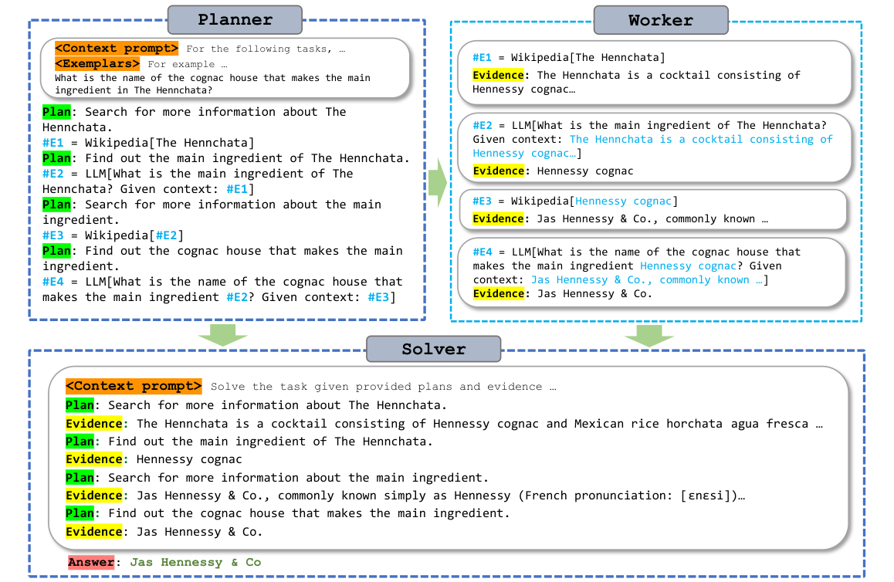
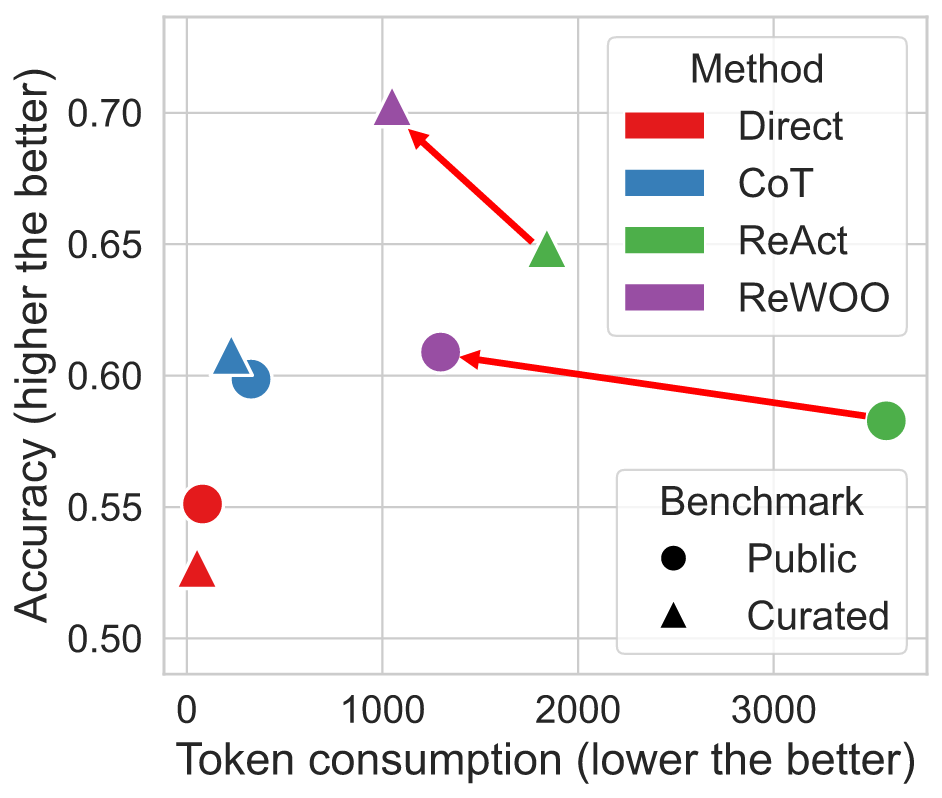
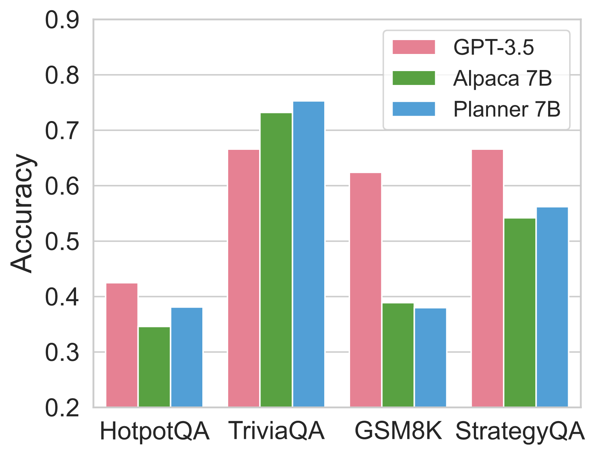

## TL;DR

ReWOO는 도구를 쓰는 언어 모델의 추론 과정을 도구 응답(관찰)과 분리합니다. 계획을 먼저 한 번에 작성하고, 도구를 실행해 증거를 모은 뒤, 마지막에 답을 합성하는 방식입니다. 이렇게 하면 같은 프롬프트를 반복해서 입력하지 않아도 됩니다. 저자들은 멀티홉 추론 벤치마크인 HotpotQA에서 토큰 효율 5배와 정확도 4% 향상을 보고했고, GPT-3.5 175B의 추론 능력을 LLaMA 7B로 옮기는 가능성도 제시했습니다.

## 연구 배경

검색, 계산기 같은 외부 도구를 LLM에 붙인 증강 언어 모델(ALM)은 대부분 ReAct 방식을 따릅니다. 모델이 생각(Thought)과 행동(Action)을 생성하면 도구가 관찰(Observation)을 돌려주고, 모델은 그 관찰을 보고 다음 단계를 정합니다. 구현은 단순하지만 비용 문제가 큽니다. ChatGPT 같은 블랙박스 API는 상태를 저장하지 않으므로, 도구 응답을 받은 뒤 생성을 재개하려면 컨텍스트 프롬프트, 예시, 지금까지의 추론 흔적과 관찰을 매번 처음부터 다시 넣어야 합니다. 상용 API는 토큰 단위로 과금하므로 이 중복이 곧 비용입니다. 저자들은 Auto-GPT로 다단계 작업 하나를 처리하면 요청 한 번에 1달러를 쉽게 넘긴다고 지적합니다. 그리고 ALM의 토큰 소비를 줄이는 연구는 자신들이 알기로 이것이 처음이라고 주장합니다.

## 제안 방법

핵심 가정은 사람처럼 LLM도 행동의 결과를 미리 예상하고 계획을 세울 수 있다는 것입니다. 저자들은 이를 예견적 추론(foreseeable reasoning)이라고 부릅니다. ReWOO(Reasoning WithOut Observation)는 ALM을 세 모듈로 나눕니다.

- **Planner**: 과제를 분해해 `(Plan, #E)` 쌍의 목록을 한 번에 생성합니다. `#E_s`는 $$s$$번째 단계의 증거를 담을 변수이고, 뒤 단계의 도구 입력이 앞 단계의 `#E`를 참조할 수 있습니다. 덕분에 이전 관찰에 의존하는 다단계 작업도 관찰 없이 미리 기술할 수 있습니다.
- **Worker**: 계획에 지정된 도구를 실행해 `#E` 자리를 실제 증거로 채웁니다.
- **Solver**: 모든 계획과 증거를 받아 최종 답을 냅니다. 저자들은 증거를 "주의해서(with caution)" 사용하라고 지시하면 성능이 오른다고 보고합니다. Solver가 쉬운 문제는 직접 풀고, Planner나 Worker의 실패를 일부 보완하기 때문이라고 해석합니다.



위 흐름도에서는 Planner가 Wikipedia와 LLM 호출을 `#E1`부터 `#E4`까지 연결해 두고, 뒤 단계 입력이 앞 단계 변수를 참조하는 구조를 보면 됩니다.

GSM8K 예시를 보면 동작이 분명해집니다. 논문의 Planner 예시는 다음과 같습니다.

```text
Plan: Given Thomas worked x hours, translate the problem into algebraic expressions and solve with Wolfram Alpha.
#E1 = WolframAlpha[Solve x+(2x-10)+((2x-10)-8)=157]
Plan: Find out the number of hours Thomas worked.
#E2 = LLM[What is x, given #E1]
Plan: Calculate the number of hours Rebecca worked.
#E3 = Calculator[(2*#E2-10)-8]
```

`#E2`의 값은 계획을 쓰는 시점에 아직 모르지만, 변수로 자리를 잡아 두기 때문에 계획 전체를 LLM 호출 한 번으로 작성할 수 있습니다.

토큰 절감은 입력 토큰 수로 분석합니다. 질문 $$Q$$, 컨텍스트 프롬프트 $$C$$, 예시 집합 $$\boldsymbol{S}$$, 단계 수 $$k$$, 텍스트 $$p$$의 토큰 수를 $$\Theta(p)$$라 하면 생각-행동-관찰(TAO) 방식의 입력 토큰은 다음과 같습니다.

$$
\texttt{\#Token}_{I}^{\texttt{TAO}} = k\Theta(Q)+k\Theta(C)+k\Theta(\boldsymbol{S})+\sum_{j=1}^{k-1}(k-j)\Theta(T_{j}+A_{j}+O_{j})
$$

반면 ReWOO는 Planner와 Solver를 한 번씩만 호출합니다. $$P_j$$는 계획, $$E_j$$는 증거입니다.

$$
\texttt{\#Token}_{I}^{\texttt{ReWOO}} \approx 2\Theta(Q)+2\Theta(C)+\Theta(\boldsymbol{S})+\sum_{j=1}^{k}\Theta(P_{j}+E_{j})
$$

TAO 방식에서는 $$Q, C, \boldsymbol{S}$$가 단계 수 $$k$$에 비례해 반복되고, 앞 단계의 생각·행동·관찰이 이후 모든 호출에 다시 들어가므로 이 항은 $$k$$에 대해 제곱으로 늘어납니다. ReWOO에서는 이 항들이 상수 배에 머뭅니다. 저자들도 프롬프트 설정을 모르면 정량 비교는 어렵다고 인정합니다. 다만 단계가 많은 복잡한 과제일수록 절감 폭이 커진다는 것이 이 분석의 요지입니다.

> **핵심:** 절감은 주로 예시에서 나옵니다. ReAct의 예시에는 긴 Wikipedia 관찰이 포함되고 매 단계 반복 입력되지만, ReWOO의 예시에는 관찰이 아예 없습니다.

## 구현 방식

ReWOO는 Planner가 도구 응답을 전혀 보지 않으므로, 도구와 무관한 계획 능력만 따로 미세조정할 수 있습니다. 저자들은 Specialization 프레임워크에서 영감을 받아 GPT-3.5의 예견적 추론을 LLaMA 7B로 옮기는 증류 파이프라인을 구성했습니다.

1. text-davinci-003으로 HotpotQA와 TriviaQA 혼합 학습 데이터에서 `(Plan, #E)` 청사진 4000개를 생성합니다.
2. 부트스트래핑 방식으로 정답에 도달한 청사진만 골라 Planner 지시 데이터 약 2000개를 얻습니다.
3. 52k 셀프 인스트럭트 데이터로 학습된 Alpaca 7B를 이 데이터로 추가 미세조정해 Planner 7B를 만듭니다.

학습에는 LoRA를 써서 RTX 4090 한 장으로 충분했습니다. 설정은 배치 크기 128, 학습률 1e-4, cutoff_len 1024, lora_r 8, 10 에폭입니다.

실험에서는 gpt-3.5-turbo를 기본 LLM으로 사용했습니다. 도구는 Wikipedia, Google, WolframAlpha, LLM, Calculator(프로그램 보조 LLM), SearchDoc을 벤치마크별로 조합했고, ReAct와 ReWOO에 똑같이 제공했습니다. HotpotQA에서는 공정한 비교를 위해 ReAct가 공개한 예시를 그대로 썼습니다. StrategyQA, PhysicsQA, SportsUnderstanding에서는 무관한 벤치마크의 예시 1개만 주어 사실상 제로샷으로 평가했습니다. 정답 표현이 여럿일 수 있어서("CA."와 "California") 정확도는 GPT-4 기반 채점기로 측정했습니다.

## 실험 결과

### ReAct 대비 정확도와 토큰



벤치마크 평균을 찍은 산점도에서는 ReAct에서 ReWOO로 가는 화살표가 공개 벤치마크와 큐레이션 데이터 모두에서 왼쪽 위, 즉 토큰은 줄고 정확도는 오르는 방향을 가리킵니다. 대표 벤치마크의 수치는 아래와 같습니다(Direct, 체인 오브 소트 행과 StrategyQA·PhysicsQA·SportsU. 행, F1·EM 열은 생략).

| 벤치마크 | 방법 | Acc | #Tokens | #Steps | $Cost_1k |
| --- | --- | --- | --- | --- | --- |
| HotpotQA | ReAct | 40.8 | 9795.1 | 4.97 | 19.59 |
| HotpotQA | ReWOO | 42.4 | 1986.2 | 4.45 | 3.97 |
| TriviaQA | ReAct | 59.4 | 4212.9 | 5.21 | 8.43 |
| TriviaQA | ReWOO | 66.6 | 1340.9 | 3.55 | 2.68 |
| GSM8K | ReAct | 62.0 | 1874.3 | 2.86 | 3.75 |
| GSM8K | ReWOO | 62.4 | 1089.3 | 3.21 | 2.18 |
| SOTUQA | ReAct | 64.8 | 1840.3 | 2.43 | 3.68 |
| SOTUQA | ReWOO | 70.2 | 1048.8 | 2.24 | 2.09 |

HotpotQA에서는 토큰이 9795.1에서 1986.2로 약 5분의 1로 줄었고, 정확도는 40.8에서 42.4로 올랐습니다. 여섯 공개 벤치마크 평균으로는 토큰 사용량이 64% 줄고 정확도가 절대 4.4% 올랐습니다. 2023년 국정연설 문서와 웹 검색을 함께 써야 하는 큐레이션 데이터 SOTUQA에서는 ReWOO가 ReAct보다 정확도가 높았고(64.8 대 70.2), 토큰은 43% 적게 썼습니다. 다만 도구가 없는 Direct나 체인 오브 소트가 ALM보다 나은 경우도 있습니다. TriviaQA에서는 Direct가 80.6으로 두 ALM을 크게 앞섭니다.

### 실패 원인과 견고성

모든 도구가 "No evidence found."만 반환하도록 강제한 HotpotQA 실험에서 ReAct는 정확도가 40.8 하락해 0이 되었고 토큰은 851.1 늘었습니다. ReWOO는 29.2 하락했고 토큰은 110.8 줄었습니다. 무작위로 고른 실패 사례 100건을 분석하면 ReAct는 잘못된 추론 76건, 토큰 한도 초과 18건이었고, ReWOO는 각각 51건과 0건이었습니다. 저자들은 ReAct가 도구 A와 B 사이를 오가며 한도에 닿을 때까지 반복하는 패턴을 관찰했습니다. 반대로 ReWOO는 도구 실패 29건, 답 누락 11건으로 ReAct(20건, 3건)보다 많았습니다. 계획이 "검색 결과에 나이가 있을 것"처럼 틀린 기대에 기대거나, Solver가 증거가 맞는데도 오답을 내는 경우입니다.

HotpotQA에 불필요한 도구를 하나씩 추가하면 Google이 들어갈 때는 정확도가 잠시 오르지만, 이후에는 전반적으로 떨어집니다. 2-도구 ReWOO는 성공하고 7-도구 ReWOO는 실패한 20문항 중 17건이 연예인을 Yelp로 검색하는 식의 도구 오용이었습니다.

### 7B 플래너로의 이전



막대 그래프에서는 GPT-3.5보다 25배 작은 7B 모델이 HotpotQA, TriviaQA, StrategyQA에서 비슷한 수준에 머무는 반면, GSM8K에서는 크게 뒤처지는 부분을 눈여겨보면 됩니다. Alpaca 7B보다 Planner 7B가 대체로 나아서 저자들은 Specialization이 효과가 있었다고 봅니다. 학습 데이터에는 Wikipedia와 LLM 도구만 있었지만, 문맥에 설명을 주면 Planner 7B가 Google과 Calculator도 Alpaca보다 잘 활용했다고 보고합니다. 다만 학습에 쓴 HotpotQA·TriviaQA가 평가 벤치마크와 겹칩니다.

## 의의와 한계

ReWOO의 가치는 단순한 구조 변경만으로 블랙박스 API 기반 에이전트의 비용을 크게 줄였다는 데 있습니다. 모델 내부에 접근하지 않고 프롬프트 구성만 바꾸므로 어떤 상용 LLM에도 바로 적용할 수 있습니다. 또 계획을 관찰과 분리했기 때문에 Planner만 작은 모델로 따로 학습할 수 있다는 점도 보여 주었습니다. 이 계획-실행 분리 구조는 이후 에이전트 프레임워크에서 흔히 쓰이는 설계와 같은 방향입니다.

한계도 분명합니다. 첫째, 환경 정보가 거의 없는 과제에서는 미리 계획을 세울 수 없습니다. 저자들이 든 AlfWorld 예시처럼 방 안의 서랍과 선반 수십 개 중 꽃병을 찾아야 한다면, Planner는 가능한 경로를 모두 나열해야 하고 단계 수가 관찰 의존 방식의 최악 경우와 같아집니다. 둘째, 계획을 도중에 고칠 수 없어서 틀린 기대가 그대로 실패로 이어지고, 도구 실패 시에도 정확도가 42.4에서 13.2로 크게 떨어집니다. 셋째, 평가 규모가 작습니다. PhysicsQA는 53문항, StrategyQA·SportsU.는 300문항이고, 정확도는 GPT-4 채점기에 의존하며, 일부 벤치마크에서는 도구 없는 기준선이 더 낫습니다. 저자들은 해결책으로 LLM·도구·소형 모델을 방향성 비순환 그래프로 엮는 구조, 도구 표현 학습, 그래프 실행 최적화를 제안하지만, 모두 향후 과제로 남겨 두었습니다.

- - -

### References
* [ReWOO: Decoupling Reasoning from Observations for Efficient Augmented Language Models](https://arxiv.org/pdf/2305.18323v1)
* [ReWOO GitHub](https://github.com/billxbf/ReWOO)
* [Planner 7B (Hugging Face)](https://huggingface.co/rewoo/planner_7B)
