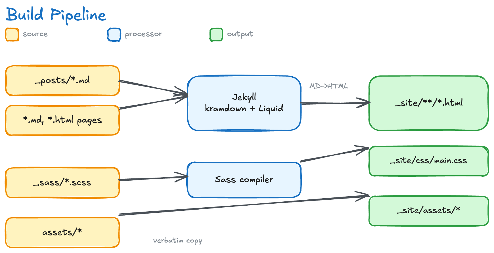
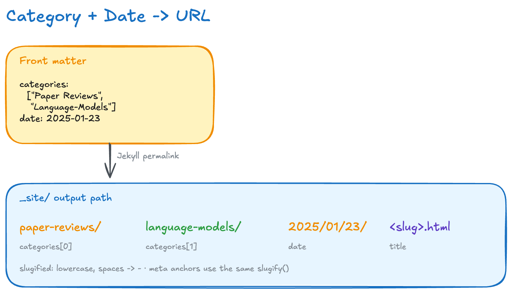
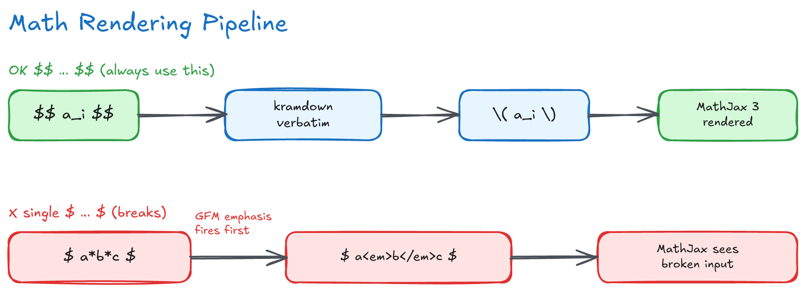

# Architecture

How the blog is built and why it is built that way, for whoever edits a template,
a plugin or a stylesheet, or debugs a build. Writing posts is in
[writing.md](writing.md); checks, deploys and Search Console in
[operations.md](operations.md).

- [In one paragraph](#in-one-paragraph)
- [Stack](#stack)
- [Repository layout](#repository-layout)
- [Build pipeline](#build-pipeline)
- [Plugins](#plugins)
- [URLs, navigation and listings](#urls-navigation-and-listings)
- [Head, feed and sitemap](#head-feed-and-sitemap)
- [Search](#search)
- [Styles](#styles)
- [Math](#math)
- [Validation](#validation)
- [Pitfalls](#pitfalls)
- [Known limits](#known-limits)

## In one paragraph

A static site: Markdown posts plus Liquid templates, built by Jekyll into plain
HTML once per deploy and served as files by GitHub Pages. There is no server and
no database. Everything dynamic (theme toggle, search, citation counts, image
zoom) runs in the reader's browser.

## Stack

| Area | Choice | Why |
|---|---|---|
| Generator | Jekyll 4.4 (`Gemfile.lock`), kramdown with GFM input | Ruby plugins in `_plugins/` are needed, and the sandboxed `github-pages` gem forbids them, so local builds and CI run Jekyll directly |
| Gems | `jekyll-paginate`, `jekyll-sitemap`, `jekyll-redirect-from` | home pagination, `sitemap.xml` and `robots.txt`, redirect stubs. The feed is the site's own `feed.xml` |
| Code highlighting | Rouge, at build time | no highlighting script in the browser; theme in `_sass/_syntax.scss` |
| Math | MathJax 3, loaded only on posts with `use_math: true` | about 1 MB the other pages never fetch |
| Styles | Sass (`_sass/`) with vendored Bourbon and Neat | pinned to `jekyll-sass-converter` 2.x (libsass); 3.x rejects Bourbon/Neat's `/` division |
| JavaScript | plain JS: `js/main.js` everywhere, `js/search.js` on `/search/`, `js/citations.js` on posts with a `paper_doi` | no framework; icons are inline SVG (`_includes/icon.html`), so no icon font |
| Third-party scripts | GLightbox and MathJax (jsDelivr), simple-jekyll-search (unpkg), Google Fonts, Google Analytics | the three libraries are version-pinned with SRI hashes; Fonts and Analytics change per request and cannot be |
| Hosting | GitHub Pages via GitHub Actions | see [operations.md](operations.md#ci-and-deploy) |

## Repository layout

```
_posts/              posts: YYYY-MM-DD-slug.md, English twins as -en.md
_layouts/            default → post / page; redirect (old-URL stubs)
_includes/           head, header, footer, nav_links, cover, category-posts,
                     language_switcher, related_posts, page_divider, icon (inline SVG)
_plugins/            build-time Ruby, one concern per file (see Plugins)
_sass/               _layout, _post, _tags, _syntax, _dark, base/;
                     bourbon/ and neat/ are vendored, not edited
_data/               post_conventions.yml (the conventions, shared with
                     scholar-lens), covers.yml (cover credits)
css/ js/             main.scss, search.css; main.js, search.js, citations.js
assets/images/       covers (+ -960/-1280 JPEG and WebP copies), figures, diagrams
feed.xml search.json the Atom feed and the search index, as Liquid pages
script/              lint-posts.rb, validate-site.sh, check-plugin-output.rb,
                     published-urls.txt, cover-variants.sh
test/                minitest for _plugins/ and the lint
docs/                these documents and their diagrams
.github/             workflows (deploy, workflow lint, external links), Dependabot
```

Top-level pages: `index.html` (home), the five section pages
(`paper-reviews.md` and so on), `categories.html`, `tags.html`, `search.md`,
`about.md` and `404.html`. `README*`, `docs/`, `script/` and `test/` are
excluded from the site.

## Build pipeline



1. **Read.** Jekyll reads `_config.yml`, `_data/`, the pages and `_posts/`.
   Front matter decides each post's URL and its template variables.
2. **`:post_read` hooks**, in file-name order: `legacy_urls.rb` adds each old
   URL to `redirect_from`; `posted_date.rb` sets `posted_at` and
   `last_modified_at` and re-sorts the posts; `translations.rb` marks the English
   twin of a pair `hidden`.
3. **Generators**: pagination, the sitemap and the redirect stubs
   (`_layouts/redirect.html`).
4. **`:pre_render` hooks**: `post_description.rb` fills in each post's
   `description`; `related_posts.rb` picks "Related reading" and the
   previous/next posts.
5. **Render.** kramdown turns Markdown into HTML (Rouge highlights code), then
   Liquid wraps it: `_layouts/default.html` (head, header, footer) around
   `post.html` or `page.html`, with fragments from `_includes/`.
6. **`:post_render` hooks** rewrite the finished HTML of every page:
   `lazy_images.rb` (`loading="lazy"`), `image_dimensions.rb` (`width` and
   `height` from the image files) and `scrollable_tables.rb` (a scroll box per
   table).
7. **Write** to `_site/<category>/<topic>/YYYY/MM/DD/<slug>.html`.

`_site/`, `.jekyll-cache/` and `.sass-cache/` are build output, ignored by git
and safe to delete.

## Plugins

| Plugin | Kind | Does |
|---|---|---|
| `posted_date.rb` | `:post_read`, and a `Document#<=>` override | `posted_at` = the file-name day when later than `date:`, else `date:`. Posts compare by it, so `site.posts`, `site.tags`, `site.categories`, pagination and everything iterating them are in posting order. Sets `last_modified_at` to a later file-name day |
| `legacy_urls.rb` | `:post_read` | adds the pre-2026-10-11 URL (`/paper%20reviews/…`) of each older post to `redirect_from` |
| `translations.rb` | `:post_read`, `listed` filter | hides a twin from every listing; `listed` drops hidden posts |
| `post_description.rb` | `:pre_render`, filter | derives `description` from the first prose paragraph |
| `related_posts.rb` | `:pre_render` | ranks related posts by shared tags (weights at the top of the file) and sets the previous/next post in posting order, same language, never the twin |
| `post_toc.rb` | filter | the post's table of contents from its `h2`s, rendered by `post.html` when there are three or more, so it is there before any script and without one |
| `reading_time.rb` | filter | reading time for mixed Korean and English |
| `search_index.rb` | filter | `plain_text` for `search.json` (see [Search](#search)) |
| `lazy_images.rb` | `:post_render` | `loading="lazy"` and `decoding="async"` on images without a `loading` |
| `image_dimensions.rb` | `:post_render` | `width`/`height` on local PNG, JPEG and SVG images |
| `scrollable_tables.rb` | `:post_render` | wraps each table in a scroll container |

Each plugin keeps its logic in plain module methods and registers its hooks or
filters behind `defined?(Jekyll::Hooks)` or `defined?(Liquid::Template)`, so
`test/` can load it without Jekyll.

## URLs, navigation and listings



- **Permalink:** `/:slugified_categories/:year/:month/:day/:title:output_ext`,
  where the date is `date:` and `:title` is the file-name slug, slugified (runs of
  hyphens collapse). `slugify` is
  also what anchors use, so `/categories/#paper-reviews` matches the URL
  segment.
- **Old URLs.** The permalink once used plain `:categories`, which kept spaces
  (`/paper%20reviews/…`). `legacy_urls.rb` adds those paths to `redirect_from`,
  and jekyll-redirect-from writes a stub at each from `_layouts/redirect.html`:
  an instant meta refresh and a script redirect, plus a canonical to the new URL. GitHub Pages cannot
  send a 301; Google reads the instant refresh as one. The layout drops the
  gem's `noindex`: beside it Google dropped the old URLs without following them.
- **Navigation is data.** `_includes/nav_links.html` lists every page with
  `main_nav: true`, by `nav_order`: About, Summaries, Reviews, Surveys, Tech
  Guides, Insights, Search. A tab is labelled `nav_title` if set, else `title`;
  the short "Summaries"/"Reviews"/"Surveys" keep the 48em bar on one line. When
  it wraps anyway, `main.js` (and an inline script in `default.html` before first
  paint) passes the real header height as `--nav-height`, so the content and
  anchor offsets move down with it. The five type pages keep their tab even
  when empty. `/categories/` and `/tags/` are not in the nav; post metadata
  links to them.
- **Listings.** Every type page starts from `site.categories['<Type>']`; the
  Paper Reviews page then groups by topic (filtering by type first: grouping by
  topic across types would pull in, say, an Insights post on the same topic).
  The other four list flat through `_includes/category-posts.html`, with an
  empty-state line. Every listing goes through `| listed`, which drops the
  hidden twin of a pair; jekyll-paginate skips `hidden` itself. Anchors on both
  sides use `slugify`.

## Head, feed and sitemap

`_includes/head.html` builds every page's head:

- `<title>`, meta description, Open Graph and Twitter cards, and a canonical
  link. A page with `sitemap: false` (search, 404) gets `robots noindex` instead
  of a canonical.
- JSON-LD: `BlogPosting` on posts (`datePublished` is `posted_at`), `WebSite` on
  the home page. Values taken from post content are written with `<` escaped,
  so a `</script>` in text cannot end the block.
- `hreflang` for translation pairs; on both posts, `x-default` points at the
  English twin.
- The saved theme, applied before first paint by an inline script.
- Google Fonts, loaded without blocking the first paint
  (`media="print" onload`), with metric-matched local fallbacks
  ([Styles](#styles)).

`feed.xml` is the site's Atom feed: jekyll-feed 0.18's template cut to what the
site uses, iterating `site.posts`, so entries are in posting order and dated by
`posted_at`. `site.feed.posts_limit` and `excerpt_only` in `_config.yml` feed
it. `site.description` (Korean) is the home page's description, the feed's
subtitle and the footer line.

`jekyll-sitemap` writes `sitemap.xml` (`<lastmod>` from `last_modified_at`) and,
since the repo has none, a `robots.txt` naming it.

## Search

There is no server, so search runs in the browser over an index built with the
site.

- **`search.json`** lists every post as `{title, url, date, category, tags,
  content}`, where `content` is the whole post as plain text. simple-jekyll-search
  matches substrings without stemming, so a word missing from the index can never
  be found; indexing whole posts is what makes Korean recall work. The cost is
  size, linear in the number of posts (several MB, about a third of that
  gzipped; `curl -so /dev/null -w '%{size_download}' <site>/search.json`).
- **`plain_text`** (`_plugins/search_index.rb`) strips tags *before* decoding
  entities (the other order turns an escaped `&lt;script&gt;` into a tag), puts a
  space at block boundaries so `<p>끝</p><p>시작</p>` stays two words, and strips
  math delimiters but keeps the TeX.
- **`js/search.js`** fetches the index the first time the visitor focuses or
  types in the box, not with the page, and runs any query typed while it
  downloads. It shows "Loading…" and a failure message. It excludes the `url`
  field from matching, cuts each excerpt around the match (choosing the window
  that holds the most distinct query words, snapping to a space within 12
  characters), escapes everything it returns, and adds only `<mark>`s.
- Results stop at 10. The library stops scanning there, so the count says
  "Showing the first 10" rather than guessing a total.
- `_config.yml` cannot configure the search: it is browser JavaScript. Change
  `search.json` or `js/search.js`.

## Styles

`css/main.scss` imports, in cascade order: Bourbon → `base/` → Neat →
`_layout` → `_post` → `_tags` → `_syntax` → `_dark` (last, so dark overrides
win).

- **Edit** `_layout`, `_post`, `_tags`, `_dark` and `base/` (tokens in
  `base/_variables.scss`). **Don't edit** `bourbon/` or `neat/` (vendored).
- **`_syntax.scss` is hand-tuned**: Monokai's comment and keyword colours were
  raised to clear 4.5:1 on the code background (values in its header). Running
  `rougify` over it undoes that.
- **Use the tokens** (`$action-color`, `$medium-gray`, `$transition-*`,
  `$shadow-*`) rather than literals.
- **No Sass in inline `<style>`**: Jekyll doesn't compile it there, so
  `$base-spacing` ships as text. Page styles go in a partial.
- **Dark mode is opt-in**, never from the OS setting: the header toggle sets
  `data-theme="dark"` on `<html>`, saved in `localStorage` and followed by other
  open tabs. `_dark.scss` overrides the surfaces that carry colour. `theme-color`
  is a meta tag, so the inline head script and `main.js` set it.
- **Fonts.** Source Sans/Serif Pro for Latin, Noto Sans/Serif KR for Hangul, at
  the weights the CSS uses (serif only 700). Until they arrive, Latin text is
  set in Arial/Georgia faces scaled to the web fonts' width and line metrics
  (`base/_typography.scss`), so the swap barely moves the page.
- **Hero covers** are a `<picture>` behind the scrim (`_includes/cover.html`):
  WebP and JPEG at 960, 1280 and 1920px, with `sizes` matching the width each
  hero draws them at, so phones download a smaller file. Print hides them.
- **Accessibility**: a visible `:focus-visible` ring on every control, a
  `prefers-reduced-motion` block that removes transitions and smooth scrolling,
  forced-colors rules for MathJax's stretched brackets and the logo, and
  `aria-expanded`/`aria-current` kept in sync by `main.js`.

## Math



kramdown's only math delimiter is `$$`. It passes the contents through untouched
as `\(…\)` (inline) or `\[…\]` (display), and MathJax, configured in `head.html`,
renders them in the browser. Single `$` is not math to kramdown, so Markdown
emphasis runs over it first (the rules are in
[writing.md](writing.md#math)). MathJax is configured to ignore `$` as a
delimiter too, so two prices on a line (`$1.2B … $250M`) do not become a
formula, and `processEscapes` lets `\$` print a dollar inside math.

`head.html` defines the extra macros (`\llbracket`, `\rrbracket`, `\textsc`);
`math.defined_macros` in the conventions must list the same names, which a test
checks.

## Validation

Four layers, each catching what the others cannot:

1. **Unit tests** (`test/`): plugin functions and the lint, without Jekyll.
2. **Source lint** (`script/lint-posts.rb`): front matter against
   `_data/post_conventions.yml`, plus Markdown defects the built HTML no longer
   shows (broken tables, unsafe math, text read as Liquid or HTML, bad fences).
3. **htmlproofer**: internal links, images, anchors, https, alt text.
4. **`script/validate-site.sh`** on the build: sitemap and feed parse, one `h1`
   and no skipped heading levels, a description and a canonical (or noindex) on
   every page, no duplicate descriptions or titles, no authoring files shipped.
   It runs `script/check-plugin-output.rb`, which reads the posts with Jekyll and
   checks each hook's mark on the built pages: redirect stubs without
   `noindex`, published times, posted order on the home pages and in the feed,
   previous/next and related links, cover credits, JSON-LD that parses, unique
   ids, and every recorded URL, and every post URL in the live sitemap, still built.

`_config.yml` sets `future: true`, so a post dated later in the day still builds
in a morning merge, and `strict_filters`, so an unknown Liquid filter fails the
build.

**Citation counts** on posts with a `paper_doi` come from Semantic Scholar in
the browser (`js/citations.js`), looked up as `arXiv:<id>` for an arXiv DOI and
`DOI:<doi>` otherwise, and cached a day in `localStorage`. A failed request
shows the last count it got, or hides the field. A zero hides it too: Semantic
Scholar returns 0 for a paper's duplicate records. OpenAlex was not used because
it counts the preprint and the published version separately, well under the
real total.

## Pitfalls

- **Dark text on the dark page**: `body { color: $base-font-color }` outranks
  the dark rules on `<html>`, so `_dark.scss` sets body and heading colours
  explicitly.
- **A category or tag anchor doesn't jump**: the link and the heading `id` must
  both use `slugify`. htmlproofer cannot catch it when nothing links to the
  anchor.
- **Search finds nothing for a word deep in a post**: the index must hold the
  full text, not an excerpt.
- **A new listing shows a translation twice**: it skipped `| listed`;
  `check-plugin-output.rb` fails it.
- **Paper posts sorted by paper date again**: `posted_date.rb`'s `Document#<=>`
  override did not load; the home and feed order checks fail.

## Known limits

- **No relevance ranking in search.** The library scans `site.posts` in order and
  stops at the limit, so results are newest first, and a title match can rank
  below a passing mention. Fixing it means owning matching and ranking, at which
  point the library should go.
- **Korean compound words** split by spaces match only as written: substring
  matching has no morphology. A real fix is a different search engine.
- **The index grows with every post.** It loads only when search is used; split
  it or move search server-side if it outgrows that.
- **Excerpts can show TeX** (`\theta`) when the match falls inside math.
- **Long posts stay slow in mobile lab tests.** Lighthouse's throttled phone
  puts LCP at 5–6 s on the longest posts (DeepSeek-V3, the Strands guide) even
  though the cover itself loads in about 0.1 s: the rest is render delay from
  laying out 8,000+ DOM nodes and running MathJax. Real-user data (Search
  Console's Core Web Vitals) has no mobile figures yet; desktop is all good.
- **Hangul has no metric-matched fallback**, since the fallback font differs
  per OS, so Korean text still shifts slightly when Noto arrives.
- **Sass is tied to libsass** through the vendored Bourbon/Neat. Replacing their
  few helpers (`media`, `modular-scale`, `span-columns`, `outer-container`)
  with plain CSS would allow dart-sass.
